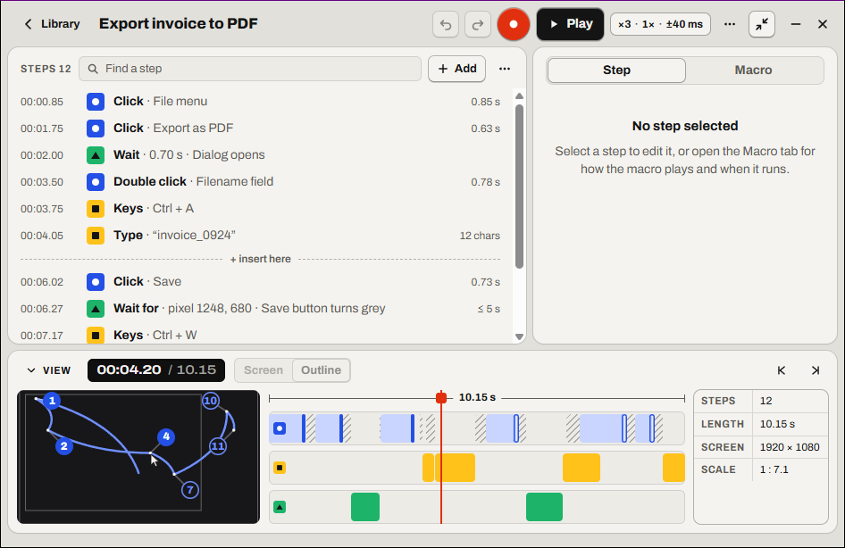

# Relay documentation

  

Relay records what you do with the mouse and keyboard, lets you edit it as a list of steps, and plays it back when you ask. You can also run it on a hotkey, on a schedule, when an app starts or when something changes on screen.

There are two guides. Pick the one you need.

<table>
<tr>
<td width="50%" valign="top">

### 📘 [User guide](user-guide/README.md)

How to install Relay and automate your work with it.

1. [Get started](user-guide/getting-started.md)
2. [Record a macro](user-guide/record.md)
3. [Stop a macro](user-guide/stop-a-macro.md)
4. [Edit the steps](user-guide/edit-steps.md)
5. [Make a macro wait](user-guide/wait.md)
6. [Click a picture wherever it is](user-guide/find-image.md)
7. [Type text that changes](user-guide/text.md)
8. [Fill in a form from a spreadsheet](user-guide/spreadsheet.md)
9. [Play, loop and change speed](user-guide/play.md)
10. [Run a macro automatically](user-guide/run-automatically.md)
11. [See what ran and what failed](user-guide/what-ran.md)
12. [Find, share and back up macros](user-guide/library.md)
13. [Run a macro without Relay](user-guide/scripts.md)
14. [Fix a problem](user-guide/troubleshooting.md)

⌨️ [Relay's keys and shortcuts](user-guide/keys.md)

</td>
<td width="50%" valign="top">

### 🛠️ [Engineering guide](engineering/README.md)

How Relay works inside, for contributors.

1. [Architecture](engineering/architecture.md)
2. [relay-core: model, steps, format](engineering/core.md)
3. [relay-platform: hooks, injection, timing](engineering/platform.md)
4. [The app: coordinator, engine, triggers](engineering/app.md)
5. [IPC: commands and the session stream](engineering/ipc.md)
6. [The frontend](engineering/frontend.md)
7. [File formats](engineering/file-formats.md)
8. [Testing and CI](engineering/testing.md)

📐 [Behavior spec](spec/README.md): every rule Relay follows, numbered

🤝 [Contributing](../CONTRIBUTING.md)

</td>
</tr>
</table>
