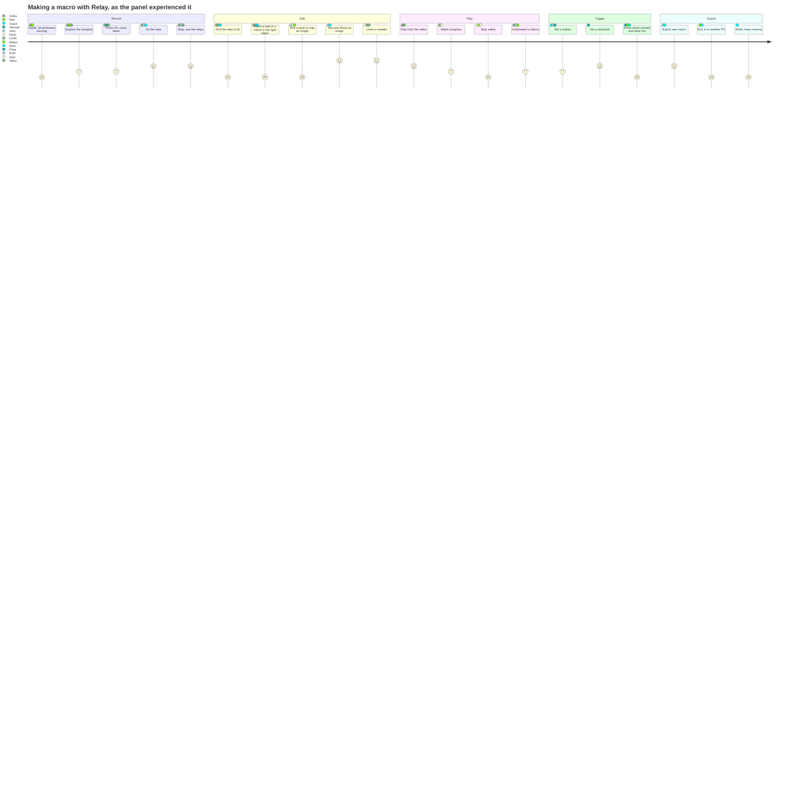
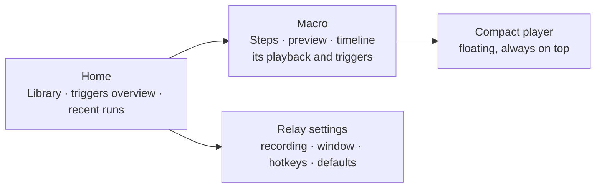

# UX research: a simulated user panel

Input for the overhaul of Relay's UI and UX. Thirteen simulated users, each with their own job, setup and needs, went through Relay's real screens and behavior. This page reports what they did, where they got stuck, what they think of the look, where they disagree, and what to change.

> [!IMPORTANT]
> **The panel is simulated, not real.** The personas, their interviews and their quotes were written by an AI model from Relay's user guide, screenshots and source code. They are a structured way to think through many kinds of users, not evidence of what real users do. Treat every finding as a hypothesis to check with real people. [Validating with real users](#validating-with-real-users) suggests how.

**Baseline:** `main` at `51090df` (v1.4.0 plus Text steps, data files and AutoHotkey export, which ship in 1.5.0), with m23's stacked toasts. Screenshots are the ones in [`docs/images`](../images/). Written 2026-10-23.

## Contents

- [Summary](#summary)
- [Method and its limits](#method-and-its-limits)
- [The panel](#the-panel)
- [Interviews](#interviews)
- [Journey map](#journey-map)
- [Findings](#findings)
- [The visual design](#the-visual-design)
- [Accessibility](#accessibility)
- [Where the panel disagrees](#where-the-panel-disagrees)
- [Recommendations](#recommendations)
- [Open questions for the maintainer](#open-questions-for-the-maintainer)
- [Validating with real users](#validating-with-real-users)
- [Appendix: measurements](#appendix-measurements)

## Summary

**What the panel likes.** Steps that read like instructions (*Click · Save*, *Ctrl + S*). Undo for every edit, and the trash. Errors that stay on screen until dismissed. The preview drawn over a screenshot. Find image's **Test** and **Show**. The run history. Exported programs with exit codes. Key names that follow the keyboard layout. And no internet connection, ever. Most of them find the Modernist look distinctive, and several call it beautiful.

**What hurts most.**

1. **The fixed global hotkeys collide with everyday keys.** <kbd>F9</kbd> recalculates in Excel and updates fields in Word, <kbd>F10</kbd> opens the menu bar in most Windows apps and steps over in debuggers. While Relay is idle, they start a recording or play the open macro instead, and play means clicks on the desktop. They can't be changed. The kill switch <kbd>Ctrl</kbd>+<kbd>Alt</kbd>+<kbd>End</kbd> is out of reach on compact keyboards, and Remote Desktop turns it into <kbd>Ctrl</kbd>+<kbd>Alt</kbd>+<kbd>Del</kbd>. 6 of 13 personas.
2. **The editor's space goes to the wrong things.** At the default size, the transport and timeline take 41% of the window's height on every tab, and neither can be made smaller. The side panel shows about four steps. Settings mixes options for this macro with options for the whole app. Triggers can only be seen one macro at a time. 9 of 13.
3. **The steps list doesn't scale.** A MOVE row before nearly every click doubles the list. There's no search, filter, multi-select, copy, paste, reorder or keyboard command, and where **+ Wait** inserts isn't shown. 7 of 13.
4. **Small, low-contrast text, and states shown only by color.** Labels go down to 9 px. Red text on the grey ground is 3.8:1 and grey sub-text 3.9:1, both under WCAG AA's 4.5:1. The CSS has no support for Windows contrast themes, a dark mode or reduced motion. 6 of 13.
5. **The screen-dependent tools assume a steady hand and good sight.** **Pick** gives you three seconds to hold the mouse over one pixel, with no magnifier. Touch can't hover at all. The timeline and the preview work only with a pointer. 4 of 13.
6. **Red means too many things.** Record, the selected tab, the selected speed, a switch that's on, the open row, links, warnings and the next scheduled run are all red. So red stops meaning "live" or "danger", against the design system's own *use the accent sparingly*. 3 of 13.

**What to do first:** see [Recommendations](#recommendations). In short: make the global hotkeys rebindable, and warn about clashes. Fix contrast and minimum text sizes. Add Stop to the compact player. Label every field. Mark the samples as samples. Then, in the overhaul, reorganize around what each user is working on (a library home, a macro, the app's settings), give the steps list real editing, keep red for record and danger, and add dark and high-contrast themes.

## Method and its limits

### How the panel was built

1. **Learning the product.** The model read the whole [user guide](../user-guide/README.md), which is Relay's spec, the [README roadmap](../../README.md#roadmap), [CHANGELOG.md](../../CHANGELOG.md), every screenshot in `docs/images`, the Svelte components (`src/components/`), the design tokens (`src/styles/tokens.css`) and the original prototype and design system in `Design/`.
2. **Choosing the panel.** Thirteen personas, picked to cover the users Relay is likely to have, and the edges where a UI tends to break: low vision, motor impairment, a screen reader, a European keyboard, a small touch screen, a first-time user, and power users with strong habits from other tools.
3. **Tasks.** Each persona was walked through the same core tasks, then their own workflow:

   | # | Task |
   | --- | --- |
   | T1 | Install, explore the samples, record and replay a first macro |
   | T2 | Fix a macro that clicks too early: add a wait or a pixel check after the right step |
   | T3 | Make a click work wherever a button is, with Find image |
   | T4 | Run a macro on a hotkey and on a schedule |
   | T5 | Export a macro, for a colleague or another PC |
   | T6 | Find a macro among many, and see what ran overnight |
   | T7 | Their own workflow, end to end |

4. **Interviews.** For each task: what they did step by step, where they hesitated or failed, what they thought, and what they'd want instead. Then questions about the look (type, color, the square corners and rules, the two sizes).
5. **Checking the claims.** Every behavior the personas run into was checked against the user guide or the code. Where a claim is a prediction (how Windows contrast themes affect the CSS, say), it's marked **to verify**. Contrast ratios were computed from the tokens; see the [appendix](#appendix-measurements).

### Limits

> [!WARNING]
> Read the findings with these limits in mind.

- **No real users took part.** The personas' frustrations are plausible, not observed. Real users surprise you; a simulation mostly confirms what its author already suspects.
- **The simulator knows the documentation.** Real users rarely read guides. If anything, the panel underestimates how often people miss things.
- **No timing or feel.** Nobody actually held a mouse still for three seconds or waited for a countdown. Effort and annoyance are estimates.
- **Counts aren't prevalence.** "5 of 13" means five personas hit it. The panel was chosen for variety, so the counts say how widely a problem spreads across kinds of users, not how many users have it.
- **Accessibility was judged from the code**, not tested with NVDA, Magnifier or Voice Access. The findings point where to test; they're not a substitute for an audit.
- **One author's voice.** The personas disagree because they were told to. Real disagreements may fall elsewhere.

## The panel

| # | Persona | Role | Skill | Setup | Accessibility needs | Automates with Relay |
| --- | --- | --- | --- | --- | --- | --- |
| P1 | **Aisha Mensah** | Claims data-entry clerk, insurance back office | Intermediate: Excel yes, scripts no | One 24" 1920×1080 at 100%, US QWERTY | None | 150–250 claims a day from a CSV into a legacy web portal: data file, Text steps, pixel checks |
| P2 | **Joris Vandamme** | QA engineer, Ghent | Advanced | Laptop 1920×1080 at 150% + 2560×1440 at 125%, **Belgian AZERTY**, Windows in Dutch | Protanomaly (weak red perception) | Smoke tests of a desktop accounting app before each release: Find image, pixel checks, run history, an exported `.exe` in a nightly script |
| P3 | **Kenji Sato** | Gamer and part-time streamer | Intermediate–advanced | 27" 2560×1440 at 100% + a 1080p monitor for chat, **60% keyboard** (no F-keys or End without Fn) | None | Crafting and fishing loops in single-player games, looped forever with Humanize; the compact player on the second screen |
| P4 | **Dolores "Dee" Ramírez** | IT admin, school district | Advanced | Works over **Remote Desktop** from a 14" 1920×1200 laptop at 125%; lab PCs are 1920×1080 at 100% | None | Resetting 40 lab PCs before exams: exported `.exe` with `--quiet`, Task Scheduler, exit codes |
| P5 | **Ruth Okafor** | Accounts manager | Intermediate | 27" 4K at 200%, **Windows Magnifier** at 2–3×, Text size 150%, a **contrast theme** in the evening | **Low vision** | Monthly statements in an accounting app, email triage in Outlook |
| P6 | **Sam Whitfield** | Paralegal | Intermediate | 15" laptop 1920×1080 at 125% docked to a 1080p monitor, trackball, **Sticky Keys**, Voice Access for some commands | **Essential tremor and RSI** | Formatting legal documents in Word and entering case data, to save movements |
| P7 | **Priya Nair** | Accessibility tester and admin support | Advanced keyboard user, new to macros | Laptop 1920×1080 at 100%, US QWERTY, **NVDA** with speech and a braille display | **Blind** | Keyboard-only sequences in a ticketing system, canned replies with `{date}` and `{clipboard}` |
| P8 | **Mateo Silva** | Freelance translator | Intermediate | **13" tablet-laptop**, 2736×1824 at 200% (1368×912 usable), touch and pen, often without the keyboard cover | None | Translation-tool chores: accept a segment, copy the source, run QA; Text steps on hotkeys |
| P9 | **Viktor Lindqvist** | Developer and sysadmin | Expert, 12 years of AutoHotkey | 3440×1440 ultrawide + two 1080p in portrait, all 100%, **Swedish** layout (`{ } [ ] @` need AltGr) | None | Records with Relay to bootstrap AutoHotkey scripts; exports to `.ahk` |
| P10 | **Noor Haddad** | Product designer, agency | Intermediate technically, expert visually | 32" 4K at 150%, calibrated | None | Batch-exporting assets from a design tool; judges the visual design |
| P11 | **Linda Brooks** | Owner of a small bakery, 62 | **First-time**, non-technical | All-in-one 1920×1080 at 125%, mouse, US QWERTY | Reading glasses | Copying the week's web-shop orders into a label-printing program |
| P12 | **Hannah Weiss** | Operations analyst, logistics, Hamburg | Excel expert, new to automation | Two 1920×1080 at 100%, **German QWERTZ**, Windows in German | None | Weekly and monthly reports from SAP GUI and Excel, on schedules, with `{date}` |
| P13 | **Grace Liu** | Customer-support team lead | Intermediate | Two 1920×1080 at 100%, US QWERTY, a 12-key macro pad sending F13–F24 | None | 40+ canned-reply macros on hotkeys, `{clipboard}` for the customer's name; shares them with 8 agents as `.rly` |

Coverage: 3 non-English layouts (AZERTY, QWERTZ, Swedish), 2 Windows display languages other than English, scaling from 100% to 200%, 1 to 3 monitors, touch and pen, a remote session, 4 personas with accessibility needs, skill from first-time to expert.

## Interviews

Each summary gives the persona's workflow step by step, where they got stuck, what they think of the look, and their wishes. Quotes are simulated.

### P1 · Aisha Mensah, claims data entry

**Workflow.**

1. Exports the day's claims from the ticket system as `claims.csv` (Excel, semicolons).
2. Records one claim by hand: clicks *New claim*, Tab through 14 fields, types values, clicks *Submit*, waits for the confirmation page.
3. Opens each recorded `TYPE` step and presses **Make editable**, then replaces the text with `{col:PolicyNo}`, `{col:Amount}` and so on.
4. Adds a **pixel check** after *Submit* on the green confirmation banner.
5. Chooses the CSV in **Settings → Playback → Data file**, and plays.

**Where they get stuck.**

- Aisha's one recorded claim is 61 steps, and 27 of them are MOVE rows. With about four rows visible in the side panel, they scroll a lot to find the `TYPE` steps. *"Half the list is the mouse travelling. I want to see what I typed."*
- Making 14 steps editable is 14 open–click–edit rounds. They'd like to select all `TYPE` steps and make them editable at once, or map them to columns in one table.
- They inserted the pixel check after the wrong step twice: **+ Pixel check** goes after "the step under the playhead", and they'd clicked the timeline, not the row. Nothing showed where it would land.
- During a 200-row run the bar says *Loop 37 / 200 · 1×*. *"Loop? That's row 37. Which policy is it on?"* When row 112 timed out, they couldn't tell which policy failed, or restart from row 112.
- Settings mixes *Playback* (this macro) with *Recording* (everything). They turned off Humanize for "everything", then found it on again in their next macro.
- Before the CSV worked, they wanted 20 repeats to test. At the default window size, Repeat is a button that steps through 1, 2, 3, 5, 10 and ∞. With a data file it says *Each row (200)*, which they like.
- When the portal added a *Region* field, they re-recorded the whole claim: there's no way to record a few steps into an existing macro.

**On the look.** Likes the clean rows and the big time. Finds the 9 px `MOVE`/`CLICK` tags and the grey sub-lines hard to read by the end of a shift.

**Wishes.** Hide MOVE rows. Bulk edit. Show the row number and a column value while playing. Resume from a row. A clear line between "this macro" and "Relay" settings.

> "When it works it's magic. Two hundred claims while I do the phones. But when it breaks I have to go back to the CSV and count rows."

### P2 · Joris Vandamme, QA engineer

**Workflow.**

1. Records a smoke test of the accounting app on the external monitor: log in, open a ledger, post an entry, export a report.
2. Replaces fixed clicks on toolbar buttons with **Find image** steps, because the toolbar reflows at 150% on the laptop.
3. Uses **Test** and **Show** on each image, and adjusts **Match %**.
4. Exports a **Standalone program** and calls it from the nightly test script: `start /wait smoke.exe --quiet --no-countdown`, then checks `%ERRORLEVEL%`.
5. Reads the **run history** the next morning.

**Where they get stuck.**

- **Humanize is on by default.** For a test, Joris wants identical runs, and turns it off in every new macro. *"A test that's random by default is a bug report waiting to happen."*
- Joris can't extend a macro by recording more from a step. When the app adds a dialog, the whole test gets re-recorded, or edited around.
- The hotkey trigger <kbd>Ctrl</kbd>+<kbd>Alt</kbd>+<kbd>1</kbd> took over <kbd>AltGr</kbd>+<kbd>1</kbd>, which types `|` on a Belgian keyboard: Windows treats <kbd>Ctrl</kbd>+<kbd>Alt</kbd> as <kbd>AltGr</kbd>. Joris lost the pipe character in the terminal until working out why. The hotkey field said *Run from anywhere*.
- With protanomaly, the timeline's red (played) and black (to play) click ticks look nearly the same. The preview is fine: played is solid, to play is dashed.
- The decimal separator changes: the step editor shows *Pause before* as `0,2` (Windows' Dutch locale), but rows say *0.63 s* and steps *Wait 0.5 s*.
- The preview over the screenshot shows where each click lands, which Joris checks before every release.
- The run history is good, but it can't be exported, and a run that timed out has no screenshot of what was on screen.

**On the look.** *"It's the first macro tool that doesn't look like 2003."* Likes the square grid and the rules. Would make the editor denser for big monitors: the step editor's fields waste a lot of width.

**Wishes.** Humanize off by default (or per-macro defaults). "Record from here". A warning when a hotkey is an AltGr character. A screenshot on failure. A deterministic "test mode".

> "Test and Show on Find image are exactly right: I see what it found and where it'd click before I trust it."

### P3 · Kenji Sato, gamer and streamer

**Workflow.**

1. Records a crafting loop in a single-player game: open the bench, click the recipe, confirm, wait for the animation.
2. Sets Repeat to ∞, turns Humanize up to ±120 ms.
3. Shrinks Relay to the **compact player** on the chat monitor.
4. Uses a hotkey trigger to start the loop from inside the game.

**Where they get stuck.**

- **The 60% keyboard has no F-row and no End key.** <kbd>F9</kbd>, <kbd>F10</kbd> and the kill switch all need an <kbd>Fn</kbd> layer. In the middle of a game, <kbd>Fn</kbd>+<kbd>Ctrl</kbd>+<kbd>Alt</kbd>+<kbd>.</kbd> (the End key) is a four-key chord that's easy to fumble. None of them can be changed.
- **The compact player has no Stop button.** Record and play/pause only. Kenji stops with <kbd>Esc</kbd>, which the game also uses to open its menu.
- **Stop on key press** stops the loop on every message typed in the stream chat. Turned off, it's forgotten on the next macro that misbehaves.
- Kenji wanted 50 repeats, not ∞. At the default window size, the Repeat button only steps through 1, 2, 3, 5, 10 and ∞. Only a wider window brings back the − and + buttons.
- Kenji wanted a "hold the hotkey to run, release to stop" mode for a fishing macro.
- Thought the red **1×** speed meant "recording" at first glance.

**On the look.** Loves the compact player: *"Tiny, sharp, doesn't look like malware."* Wants a dark theme: the light grey bar glows next to a dark game. The dark preview stage is the only part Kenji likes in the editor.

**Wishes.** Rebindable global hotkeys. Stop in the compact player. A dark theme. Hold-to-run hotkeys. Typing a repeat count. A macro picker in the compact player.

> "I don't want the big editor at all while I play. Give me the bar, the name, stop, and a way to switch macros."

### P4 · Dolores "Dee" Ramírez, IT admin

**Workflow.**

1. Connects to a lab PC over Remote Desktop.
2. Turns off **Settings → Recording → Ignore simulated input**, because RDP delivers typing as simulated input.
3. Records the reset: close the exam app, clear its cache folder, reopen it, log in to the kiosk account.
4. Exports a **Standalone program**, copies it to a share, and creates a scheduled task on 40 PCs: `reset.exe --quiet --no-countdown`, checking the exit code.

**Where they get stuck.**

- **The kill switch doesn't reach Relay in a remote session.** The Remote Desktop client sends <kbd>Ctrl</kbd>+<kbd>Alt</kbd>+<kbd>End</kbd> to the remote PC as <kbd>Ctrl</kbd>+<kbd>Alt</kbd>+<kbd>Del</kbd>, so the security screen opens instead. Dee relies on <kbd>Esc</kbd>.
- Dee learned about *Ignore simulated input* from the Troubleshooting page, after a first recording with no keys in it. The recording didn't say anything was missing.
- **Exported programs aren't signed.** SmartScreen and the district's antivirus flag them. Unsigned binaries can't be deployed without an exception, so this blocks the whole use.
- Triggers live per macro. There's no view of "what runs on this PC, and when".
- On a failed run in a scheduled task, the exit code is all there is. *"Exit 5 tells me a check timed out. Which one? What was on screen?"*

**On the look.** *"I don't care how it looks, as long as it tells me what it's doing."* Likes that the exported player is plain and stays in a corner. Thinks the editor's transport takes too much room for a tool used over RDP at a small size.

**Wishes.** Signed builds. A rebindable kill switch. A warning when a recording has no keystrokes but Ignore simulated input is on. One page listing every trigger. A log file with a screenshot on failure. A machine-wide install.

> "Relay is the first one I'd let on a lab PC, because it never phones home. Now sign it."

### P5 · Ruth Okafor, low vision

**Workflow.**

1. Uses Windows at 200% with Magnifier in lens mode at 2–3×.
2. Records the monthly statement run in the accounting app: select a customer, print to PDF, next customer.
3. Adds a pixel check for the print dialog.
4. Plays it from the compact player.

**Where they get stuck.**

- **Text size.** At 200% the editor is big, but its smallest text is still small: the step tags are 9 px, the timeline's lane labels and ruler 10 px, the step times 11 px. Ruth sets Windows' *Text size* to 150%, and Relay's text doesn't change (**to verify**: WebView2 content is not expected to follow that setting).
- **Contrast.** The grey sub-lines (*134, 70 px*) and the inactive tab names are 3.9:1 on the grey ground. The red **+ Wait**, **+ Pixel check** buttons are 3.8:1. Disabled red buttons are pale pink, and they can't be told from enabled ones without the lens.
- **Contrast themes.** In the evening Ruth uses a Windows contrast theme. Relay's CSS has no `forced-colors` rules. Chromium then replaces background colors with system colors, and much of Relay draws state with a background: the timeline's bars and ticks, the compact player's progress, the selected speed, a switch that's on, the active row (**to verify**; predicted from the CSS).
- **Pick** counts down 3 seconds while Ruth moves the Magnifier lens and the mouse to the pixel. The countdown runs out every time, so Ruth types X and Y by hand instead.
- **Toasts** appear at the bottom of the side panel, often outside the Magnifier lens. The info ones time out before Ruth finds them. Errors stay, which helps.
- The compact player's state badge is 10 px, its time 12 px.

**On the look.** The big time is the only thing Ruth reads without the lens: *"Make everything as readable as the clock."* The strong rules help: they mark the edges of each area. The light grey on grey doesn't.

**Wishes.** A text-size setting in Relay, or one that follows Windows. A high-contrast theme. A zoomed pixel picker that waits for a click. Notifications Windows reads out and shows in its own place.

> "The divider above the buttons makes them twice as big. Why can I do that for the buttons but not for the list?"

### P6 · Sam Whitfield, tremor and RSI

**Workflow.**

1. Records Word formatting: select a heading, apply a style, renumber a list, update the table of contents.
2. Gives the macro a hotkey, <kbd>Ctrl</kbd>+<kbd>Alt</kbd>+<kbd>H</kbd>.
3. Uses Voice Access for "click Play" when the trackball is too much.

**Where they get stuck.**

- **<kbd>F10</kbd> belongs to Relay.** Sam navigates Word's ribbon by keyboard with key tips (<kbd>F10</kbd> or <kbd>Alt</kbd>). While Relay is idle, <kbd>F10</kbd> plays the open macro. It happened mid-document and reformatted the wrong section. *"The shortcut I use to avoid the mouse made the mouse go wild."*
- **Stop on key press with a tremor.** A stray brush of a key stops playback. Sam turned it off, and lost the safety net with it.
- **The kill switch** is three keys at once, the third on the far right. Sticky Keys may help; whether the low-level hook sees a Sticky Keys chord as the kill switch is **to verify**.
- **Small targets.** A step's × is 24 px, a toast's close 22 px, the splitters 2 px. Sam deleted a step instead of opening it, and Undo put it back.
- **Pick** needs the cursor held still over one pixel for 3 seconds. With a tremor it lands a few pixels off. Sam would rather click than hover.
- **Hover-only** Duplicate and Delete in the Library: hard with a trackball. Focusing the row with the keyboard shows them, which works.
- There are no keyboard commands in the steps list beyond <kbd>Tab</kbd> and <kbd>Enter</kbd>: no arrows, no <kbd>Del</kbd>.

**On the look.** Likes the big transport buttons and that the button row can be made taller. Would like everything clickable to be at least that size.

**Wishes.** Change F9, F10 and the kill switch. A one-key stop that isn't any key. Arrow keys and <kbd>Del</kbd> in the steps list. Bigger targets. Click-to-pick.

> "Undo saved me a dozen times. I just wish I needed it less."

### P7 · Priya Nair, screen reader user

**Workflow.**

1. Focuses the ticketing system, presses <kbd>F9</kbd>.
2. Types the canned fields with <kbd>Tab</kbd> between them, presses <kbd>Enter</kbd>, <kbd>F9</kbd> to stop.
3. Opens the steps list with NVDA's browse mode and checks the steps.
4. Turns the reply into a **Text step** with `{date}` and `{clipboard}`.
5. Gives it a hotkey.

**Where they get stuck.**

- **Nothing says when recording starts.** The countdown is a big number drawn over the preview, and the mode badge (*● Rec*) isn't a live region. Priya waits and hopes. No sound plays.
- **NVDA's own keys get recorded.** When Priya reads back a field with <kbd>Insert</kbd>+<kbd>↑</kbd>, that's a KEYS step; on playback it makes NVDA speak in the middle of the macro. Priya would like "don't record my screen reader's keys".
- **What works.** The step rows are buttons that read *00:00.85 CLICK Click · File menu 134, 70 px*, with *expanded* or *collapsed*. Switches are switches with names. Speed and Coordinates are radio groups. Errors are alerts. *"Someone thought about this, which is rare."*
- **What doesn't.**
  - The tabs are `role="tab"` without arrow-key navigation (**to verify**; no handler in the code).
  - The schedule's days are seven buttons named *M, T, W, T, F, S, S*: two "T" and two "S".
  - The pixel trigger's X, Y and color fields have names, but no visible labels, so sighted colleagues can't say which is which.
  - The export formats are four buttons that don't say which one is selected.
  - The timeline and the preview can't be reached or read at all. The ◀ ▶ buttons are the only way to move the playhead.
  - *Pause before s* reads as "pause before s".
- Pixel checks and Find image are visual by nature. Priya doesn't need them, but a macro from a colleague may wait for something on screen that Priya can't check.

**On the look.** Doesn't see it. Asks that the next design not trade semantics for visuals: *"Every custom control you draw is one I have to hope you labeled."*

**Wishes.** An earcon or an announcement on record start and stop, and on playback end. An option to ignore screen-reader keys. Proper radio semantics in the Export dialog. Full day names. A text alternative for the timeline: the step under the playhead, which the preview bar already has.

> "Keyboard-only macros are a superpower for me. Relay is close to being usable. Close."

### P8 · Mateo Silva, small touch screen

**Workflow.**

1. Uses the tablet-laptop without its keyboard cover half the time.
2. Records copy-source-into-target sequences in the translation tool.
3. Gives each a hotkey; triggers them from the on-screen keyboard when there's no cover.

**Where they get stuck.**

- **The editor covers the work.** At 1368×912, the 944×612 editor takes 69% of the width and 67% of the height, always on top. Mateo uses the compact player most of the time and only expands to edit.
- **Touch.** The preview zooms with the mouse wheel; there's no pinch. The splitters are 2 px. Library row actions appear on hover. Tooltips (*Play / pause (F10)*) never show on touch.
- **Pick doesn't work with a finger.** A finger can't point without touching. With the pen hovering, it does.
- **Without a keyboard**, there's no <kbd>F9</kbd> or <kbd>Esc</kbd>. The on-screen keyboard is a window of its own: tapping it may be recorded as clicks, and its keys may count as simulated input (**to verify**).
- Mateo played a sample by accident (*"Export invoice to PDF"*) by tapping play to see what it does. It clicked across the desktop at the sample's 1920×1080 positions, on a screen that isn't that size.
- *End* is <kbd>Fn</kbd>+<kbd>→</kbd> on the cover; the kill switch is four keys.

**On the look.** Likes it, but the editor feels like a desktop app squeezed onto a tablet. *"On this screen, I want either the bar or the whole screen, not a big box in the middle."*

**Wishes.** A side-docked or full-screen editor. Bigger touch targets. Pinch to zoom. A stop button that's always on screen. A clear "sample" label, and samples that can't click on the desktop.

> "The compact bar is perfect on a tablet. The editor is a laptop app."

### P9 · Viktor Lindqvist, AutoHotkey expert

**Workflow.**

1. Records a sequence across three monitors to get the timing and coordinates right.
2. Trims it in Relay: deletes stray moves, shortens pauses with **Trim pauses**.
3. Exports to **AutoHotkey v2**, then edits the script by hand.

**Where they get stuck.**

- **<kbd>F9</kbd> and <kbd>F10</kbd> are the debugger's breakpoint and step over.** With Relay idle, stepping over a line in the IDE played a macro. Viktor now quits Relay while coding.
- **The step editor is slow for this kind of work.** No multi-select, no copy, paste or reorder, no keyboard. *"I want to select twelve moves and hit Delete."*
- **`IF` isn't an if.** It's a wait with a timeout; there's no else. *"Call it WAIT FOR, or give me the else."* (Branching is on the roadmap.)
- **Swedish layout.** `{` is <kbd>AltGr</kbd>+<kbd>7</kbd>, which Windows sees as <kbd>Ctrl</kbd>+<kbd>Alt</kbd>+<kbd>7</kbd>. The user guide's example hotkey message (*Ctrl + Alt + 7 already runs "Fill weekly timesheet"*) is a combination Viktor can't give up.
- The AutoHotkey export turns mouse paths into jumps and only finds images at their original size. That's in the guide; Viktor would still like the paths.
- Viktor would prefer a text view of the macro, editable, like the `.ahk` but in Relay.

**On the look.** Thinks the editor is too airy: *"A 40-pixel clock and four rows of steps. Flip it."* Wants a dense mode, and a dark theme across all three monitors. Respects the restraint of the design.

**Wishes.** Rebindable hotkeys, or at least "only while Relay has focus". A keyboard-first steps list with multi-select. A text or table view. A command palette. An honest name for `IF`.

> "It's the best recorder I've used. The editor is where I stop using it and open my text editor."

### P10 · Noor Haddad, product designer

**Workflow.**

1. Records exporting artboards from a design tool: select, export, choose a format, confirm.
2. Uses a Find image step for the export dialog's *Export* button, which opens at different places.
3. Loops it for 30 artboards.

**Where they get stuck (and what they notice).**

- **Red is everywhere.** Record, the selected tab's underline, the selected speed, switches that are on, the open row's tint, the steps bar's buttons, the Library's open-macro bar, *Next run* text, *Waiting for pixel* text, **Cancel** in the Export dialog. *"When everything's red, nothing is. Record should be the only thing that shouts."*
- **The rules of the system break in places.** The design system says button labels sit flush left; the steps bar's **+ Pixel check** and **+ Find image** wrap onto two centered lines at the default width. The Export dialog's choices have square dots that read as checkboxes, not radios. **Cancel** is red text next to a red **Save…**, so the safe choice looks like the dangerous one.
- **Hierarchy.** The 40 px time and the transport row dominate, while the steps, the thing you edit, get about 230 px of height. The header's *18 steps · 301 path samples* is engineering detail in the most valuable strip.
- **Micro-type.** 9–11 px uppercase with wide tracking for tags, lane labels and section titles. *"It's the poster style at the size of a footnote."*
- **The Library's hotkey column.** An empty hotkey is a boxed **—**, which looks like a minimize button.
- **Two worlds.** The preview stage is near-black, the chrome is light. Noor likes the contrast, but it makes the light UI look unfinished next to it.
- The exported player is a plain Windows window with none of Relay's look.

**On the look.** *"The bones are excellent: the grid, the 2 px rules, Archivo, square corners. It's an identity. The problem is the red budget and the type scale, not the style."* Wants the system kept and disciplined.

**Wishes.** A red budget (record, live, danger, the one primary action). Ink for selection. A type scale with a 12 px floor. An Insert menu instead of five wrapping buttons. Real radios. A dark theme designed, not inverted. The exported player in Relay's style.

> "Don't throw out Modernist. Enforce it."

### P11 · Linda Brooks, first-time user

**Workflow.**

1. Downloads the installer. SmartScreen says *Windows protected your PC*. Linda almost stops there.
2. Opens Relay and sees *Export invoice to PDF* with a big red record button and a black play button.
3. Presses play to see what it does.
4. Later, records copying an order from the web shop into the label program.

**Where they get stuck.**

- **The sample played on the desktop.** It clicked at positions on the screen that meant nothing, and opened a menu in the web shop. The warning is in the user guide, not on screen. *"Why does it come with something I mustn't press?"*
- **The words.** *PREVIEW* (the mode badge when idle) suggested nothing was real yet. *Humanize*, *Tolerance*, *Sketch*, *Logic*, *IF*, *path samples*: Linda skipped them all.
- **The countdown** showed the old sample's steps under *New recording*, so Linda thought it was recording into the sample.
- **Widget clicks aren't recorded.** The label program's *Print* button was behind the widget. Linda clicked the widget, the print never happened, and the macro didn't have it.
- **"Recording 1".** Linda didn't know it could be renamed by clicking the name.
- **Where did the wait go?** Linda clicked a step, pressed **+ Wait**, and couldn't see where it landed.
- **Stop on key press** rescued Linda when the label program opened a dialog the macro didn't expect: *"I pressed a key and it stopped. That's what I'd want."*
- **No Save button.** Linda looked for one before closing. *"Did it keep my changes?"*
- **× hid Relay to the tray**, under the taskbar's ^ arrow. Linda thought it was closed, then couldn't find it again.
- Times like *Thu, 22:42* and 24-hour clocks surprised Linda.

**On the look.** *"It's smart-looking, like a magazine."* But the small grey writing needs reading glasses, and the screen feels busy: *"Everything's on at once."*

**Wishes.** A short welcome that shows record and play on something safe. Plain words. A "Saved" sign. Bigger text. A clear way to close Relay for real.

> "Once my daughter showed me F9 and F10, I loved it. I'd never have found it myself."

### P12 · Hannah Weiss, scheduled reports

**Workflow.**

1. Records pulling the weekly shipment report from SAP GUI and pasting it into an Excel template.
2. Makes the file name a Text step: `Shipments {date}.xlsx`.
3. Schedules it every Monday at 07:30.
4. Wants the monthly one on the first working day.

**Where they get stuck.**

- **<kbd>F9</kbd> in Excel recalculates.** Hannah presses it all day. With Relay idle, it starts a recording instead. *"I lost a morning to that before I understood."*
- **Monthly schedules don't exist.** Only days of the week. (On the roadmap.)
- **Is it set up?** Each macro's triggers are in its own Triggers tab. The Library shows a hotkey per row, but not schedules. Hannah keeps a sticky note of what runs when.
- **Did it run?** When the report runs at 07:30 during a meeting, a failure shows only in Relay's widget, and in the run history under Library → **Runs**. There's no Windows notification.
- `{date}` types `2026-10-01`. The template wants `01.10.2026`. A format would fix it.
- **QWERTZ**: `@` is <kbd>AltGr</kbd>+<kbd>Q</kbd> and `€` <kbd>AltGr</kbd>+<kbd>E</kbd>. Hannah chose <kbd>Ctrl</kbd>+<kbd>Alt</kbd>+<kbd>E</kbd> for "Export" and lost the euro sign.
- The UI is English while Windows is German, and dates in the Library are English (*Oct 16*).
- Good: key names follow QWERTZ, and a Text step types `€` whatever the layout.

**On the look.** Finds it calm and serious, *"like a good train timetable"*. Wants more information density in the Library: next run, last result.

**Wishes.** Monthly and "first working day" schedules. A triggers overview with the next run of each. Windows notifications on failure. Date formats. German UI.

> "Automation is only useful if I can trust it ran. Right now I trust it after I check."

### P13 · Grace Liu, support team lead

**Workflow.**

1. Records each canned reply: click the reply box, type the text.
2. Turns them into Text steps with `{clipboard}` for the customer's name.
3. Assigns hotkeys: <kbd>Ctrl</kbd>+<kbd>Alt</kbd>+<kbd>1</kbd>–<kbd>9</kbd>, then F13–F24 on a macro pad.
4. Exports them as `.rly` for a team of eight, who import them.

**Where they get stuck.**

- **40 macros, one list.** No search, sort, folders or tags. The list is ordered by when each was made. *"Refund — partial (EU)" is somewhere in the middle.*
- **Sharing is one file at a time.** Grace exports one macro, then the next. The agents can at least import several files at once.
- **Imports have no triggers.** Every agent sets 40 hotkeys again. (Triggers in exports are on the roadmap.)
- **Which hotkey does what?** Grace would like a printable cheat sheet. The Library shows hotkeys, but in a muted box beside long names.
- **Replies are keyboard-only**, so the preview is an empty dark box and the timeline a strip of chips. Most of the window is useless for this.
- F13–F24 work on their own as hotkeys, which Grace found great. The hotkey messages (*Ctrl + Alt + 7 already runs …*) caught two clashes before they happened.

**On the look.** Likes it. Would like a "list mode" where the Library fills the window.

**Wishes.** Search and folders. Export and import several macros, with their hotkeys. A cheat sheet. A layout without the preview.

> "For my team, Relay is a text expander with a very fancy cockpit."

## Journey map

The five main workflows, as the panel lived them. Scores are 1 (painful) to 5 (delightful), averaged across the personas who did that step.

### Record

| | |
| --- | --- |
| **Steps** | Install → explore → press <kbd>F9</kbd> or record → countdown → do the task → <kbd>F9</kbd> or <kbd>Esc</kbd> → *Recording N* opens |
| **Touchpoints** | Installer, SmartScreen, the editor with a sample open, the countdown over the preview, the steps list filling live, the header name |
| **Works** | One key to start and stop. The countdown. Steps appear as you go. Widget clicks are left out. Typed text becomes one step. |
| **Pain points** | SmartScreen scares first-timers ([F24](#f24-first-run-and-recording-feedback)). Samples are playable ([F2](#f2-the-samples-can-play-on-the-real-desktop)). The countdown shows the previous macro's steps. No sound or announcement when recording starts ([F18](#f18-pointer-only-parts-and-screen-reader-gaps)). Screen-reader keys are recorded. *Ignore simulated input* silently drops RDP typing. The widget blocks what's under it. *Recording 1* isn't named. |
| **Feeling** | Curious, then quickly confident. Lowest point: the first sample that clicks on your desktop. |

### Edit

| | |
| --- | --- |
| **Steps** | Find the step → click it → the inline editor opens → change a field (saved on blur) → insert a wait, Text, pixel check or Find image after the step under the playhead → test |
| **Touchpoints** | Steps list, step editor, preview, timeline, steps bar (+ Wait, + Text, + Pixel check, + Find image, Trim pauses), Pick, the snipping overlay, Test/Show |
| **Works** | Plain-language steps. Undo for everything. Trim pauses. Smooth and Straighten. Make editable. Find image's Test and Show. Placeholders with a live "Types now" line. |
| **Pain points** | MOVE rows double the list; four rows visible ([F6](#f6-the-editors-space-goes-to-the-wrong-things), [F7](#f7-the-steps-list-doesnt-scale)). No multi-select, reorder, copy or keyboard commands. Insertion point invisible ([F8](#f8-where-an-insert-goes-isnt-shown)). Can't record more into a macro ([F9](#f9-no-way-to-record-into-an-existing-macro)). Pick needs a steady hand and eye ([F13](#f13-pick-assumes-a-steady-hand-good-sight-and-a-mouse)). Jargon ([F14](#f14-jargon-and-unclear-labels)). |
| **Feeling** | Pleasure at first ("it's readable!"), then friction as macros grow. |

### Play

| | |
| --- | --- |
| **Steps** | Move the playhead (or not) → <kbd>F10</kbd> or play → watch the preview and list → it finishes, stops or times out |
| **Touchpoints** | Transport, preview bar (*Playing · Loop 1 / 3 · 1×*), steps list following along, toasts, compact player |
| **Works** | Focus goes back to the target app. Keys are never left stuck. The playhead stays on a failed check. Errors stay until dismissed. |
| **Pain points** | <kbd>F10</kbd> plays when you meant your app's F10 ([F1](#f1-the-global-hotkeys-collide-with-everyday-keys)). Stopping: no Stop in the compact player, the kill switch unreachable on some keyboards and over RDP ([F3](#f3-the-kill-switch-is-out-of-reach-for-some), [F19](#f19-the-compact-player-lacks-stop-and-a-macro-picker)). Stop on key press too eager or too absent ([F12](#f12-stop-on-key-press-safety-net-or-trap)). Data runs say *Loop*, not which row ([F11](#f11-data-file-runs-dont-say-which-row)). Repeat counts fold at the default width ([F10](#f10-repeat-and-speed-fold-at-the-default-size)). |
| **Feeling** | The best moment ("it's doing my job"), with spikes of alarm when it goes wrong and stopping is awkward. |

### Trigger

| | |
| --- | --- |
| **Steps** | Open the macro → Triggers tab → set a hotkey, days and time, a program, a pixel or an image → the switch turns on → wait |
| **Touchpoints** | Triggers tab, hotkey capture with its messages, tray (*Triggers active*), Library hotkey column, run history |
| **Works** | Clear hotkey rules with specific messages. *Next run: Today 09:00*. Busy and locked skips explained. F13–F24 allowed alone. |
| **Pain points** | Per-macro only, no overview ([F5](#f5-scope-whats-this-macros-and-whats-relays)). AltGr collisions not warned about ([F4](#f4-ctrlalt-hotkeys-steal-characters-on-european-layouts)). Unlabeled fields (X, Y, color, delay). No notification of a failed unattended run ([F22](#f22-no-feedback-when-youre-away)). |
| **Feeling** | Satisfying to set up, uneasy afterwards: "is it armed? did it run?" |

### Export

| | |
| --- | --- |
| **Steps** | Export → pick a format → Save… → share or deploy |
| **Touchpoints** | Export dialog, Windows save dialog, the exported player, SmartScreen and antivirus on the other PC, Import |
| **Works** | Four clear formats with one-line explanations. Exit codes and options. Import reads programs back. |
| **Pain points** | Unsigned programs blocked ([F23](#f23-export-and-sharing)). One macro at a time; triggers not included. Radios that look like checkboxes; red Cancel. No warning about typed secrets in the dialog. |
| **Feeling** | Proud ("I made a program!") until the other PC refuses it. |

## Findings

Severity:

| Severity | Meaning |
| --- | --- |
| **Critical** | Causes unintended input on the desktop, data loss, or blocks a main task for a group of users |
| **High** | Frequent friction or a workaround in a main task; or blocks an accessibility group |
| **Medium** | Noticeable friction, confusion or extra steps |
| **Low** | Polish |

### Overview

| # | Finding | Theme | Severity | Personas |
| --- | --- | --- | --- | --- |
| [F1](#f1-the-global-hotkeys-collide-with-everyday-keys) | The global hotkeys collide with everyday keys | Safety | **Critical** | 4 · P3 P6 P9 P12 |
| [F2](#f2-the-samples-can-play-on-the-real-desktop) | The samples can play on the real desktop | Safety | **High** | 2 · P8 P11 |
| [F3](#f3-the-kill-switch-is-out-of-reach-for-some) | The kill switch is out of reach for some | Safety | **High** | 4 · P3 P4 P6 P8 |
| [F4](#f4-ctrlalt-hotkeys-steal-characters-on-european-layouts) | Ctrl+Alt hotkeys steal characters on European layouts | Triggers, i18n | **High** | 3 · P2 P9 P12 |
| [F5](#f5-scope-whats-this-macros-and-whats-relays) | Scope: what's this macro's and what's Relay's | Structure | **High** | 5 · P1 P2 P4 P12 P13 |
| [F6](#f6-the-editors-space-goes-to-the-wrong-things) | The editor's space goes to the wrong things | Layout | **High** | 6 · P1 P5 P8 P9 P10 P13 |
| [F7](#f7-the-steps-list-doesnt-scale) | The steps list doesn't scale | Editing | **High** | 5 · P1 P2 P6 P7 P9 |
| [F8](#f8-where-an-insert-goes-isnt-shown) | Where an insert goes isn't shown | Editing | Medium | 3 · P1 P10 P11 |
| [F9](#f9-no-way-to-record-into-an-existing-macro) | No way to record into an existing macro | Editing | Medium | 2 · P1 P2 |
| [F10](#f10-repeat-and-speed-fold-at-the-default-size) | Repeat and speed fold at the default size | Playback | Medium | 2 · P1 P3 |
| [F11](#f11-data-file-runs-dont-say-which-row) | Data-file runs don't say which row | Playback | **High** | 1 · P1 |
| [F12](#f12-stop-on-key-press-safety-net-or-trap) | Stop on key press: safety net or trap | Playback | Medium | 3 · P3 P6 P11 |
| [F13](#f13-pick-assumes-a-steady-hand-good-sight-and-a-mouse) | Pick assumes a steady hand, good sight and a mouse | Pixel, image | **High** | 3 · P5 P6 P8 |
| [F14](#f14-jargon-and-unclear-labels) | Jargon and unclear labels | Language | Medium | 4 · P7 P9 P10 P11 |
| [F15](#f15-red-means-too-many-things) | Red means too many things | Visual | Medium | 3 · P2 P3 P10 |
| [F16](#f16-small-text-and-low-contrast) | Small text and low contrast | Visual, a11y | **High** | 4 · P1 P5 P10 P11 |
| [F17](#f17-no-dark-high-contrast-or-reduced-motion-support) | No dark, high-contrast or reduced-motion support | Visual, a11y | **High** | 4 · P3 P5 P9 P10 |
| [F18](#f18-pointer-only-parts-and-screen-reader-gaps) | Pointer-only parts and screen-reader gaps | A11y | **High** | 2 · P6 P7 |
| [F19](#f19-the-compact-player-lacks-stop-and-a-macro-picker) | The compact player lacks Stop and a macro picker | Compact | Medium | 3 · P3 P5 P8 |
| [F20](#f20-the-window-covers-the-work-on-small-screens) | The window covers the work on small screens | Window | Medium | 2 · P8 P11 |
| [F21](#f21-the-library-doesnt-scale) | The Library doesn't scale | Library | **High** | 5 · P4 P6 P10 P12 P13 |
| [F22](#f22-no-feedback-when-youre-away) | No feedback when you're away | Feedback | **High** | 3 · P4 P5 P12 |
| [F23](#f23-export-and-sharing) | Export and sharing | Export | Medium | 5 · P4 P7 P9 P10 P13 |
| [F24](#f24-first-run-and-recording-feedback) | First run and recording feedback | Onboarding | Medium | 3 · P4 P7 P11 |
| [F25](#f25-autosave-without-a-visible-saved) | Autosave without a visible "saved" | Feedback | Low | 1 · P11 |
| [F26](#f26-locale-mix-in-numbers-dates-and-language) | Locale mix in numbers, dates and language | i18n | Medium | 3 · P2 P11 P12 |
| [F27](#f27-touch-and-pen) | Touch and pen | Input | Low | 1 · P8 |

### Safety

#### F1. The global hotkeys collide with everyday keys

**Critical · 4 personas (P3, P6, P9, P12).**

<kbd>F9</kbd> and <kbd>F10</kbd> are registered globally whenever Relay is idle, and can't be changed (Settings: *They can't be changed in v1*). Both are common keys elsewhere:

| Key | Elsewhere | What Relay does instead |
| --- | --- | --- |
| <kbd>F9</kbd> | Excel: recalculate. Word: update fields. Visual Studio, VS Code: toggle breakpoint. | Starts a recording |
| <kbd>F10</kbd> | Most Windows apps: menu bar and Office key tips. Debuggers: step over. | **Plays the open macro**, which clicks and types on the desktop |

- Hannah (P12) started recordings all morning by recalculating in Excel.
- Sam (P6) played a macro into the wrong part of a document with Word's key tips.
- Viktor (P9) played a macro while debugging, and now quits Relay to code.
- Kenji (P3) has no F-row at all.
- With a sample open, <kbd>F10</kbd> plays a sample on the user's desktop ([F2](#f2-the-samples-can-play-on-the-real-desktop)).

Playing is the dangerous one: it sends input the user didn't plan. The roadmap's *rebindable F9, F10 and kill switch* covers the fix; the panel suggests it come first, with a "no global play key" option.

#### F2. The samples can play on the real desktop

**High · 2 personas (P8, P11).**

The four samples open on first launch and look like real macros. The user guide warns *Don't play them on your real desktop*; the app doesn't. Linda (P11) and Mateo (P8) played one to see what it does. Their hotkeys are off, which helps, but Play and <kbd>F10</kbd> aren't.

#### F3. The kill switch is out of reach for some

**High · 4 personas (P3, P4, P6, P8).**

<kbd>Ctrl</kbd>+<kbd>Alt</kbd>+<kbd>End</kbd>:

- needs <kbd>Fn</kbd> on 60% keyboards and many laptops (P3, P8), so it's a four-key chord;
- is turned into <kbd>Ctrl</kbd>+<kbd>Alt</kbd>+<kbd>Del</kbd> by Remote Desktop, so it never reaches a Relay running in the remote session (P4);
- is hard one-handed and with a tremor (P6). Whether it works with Sticky Keys is **to verify**.

<kbd>Esc</kbd> still stops playback, but games and apps use it too (P3). The compact player has no Stop button ([F19](#f19-the-compact-player-lacks-stop-and-a-macro-picker)).

#### F4. Ctrl+Alt hotkeys steal characters on European layouts

**High · 3 personas (P2, P9, P12).**

Windows treats <kbd>Ctrl</kbd>+<kbd>Alt</kbd> as <kbd>AltGr</kbd>. A macro hotkey <kbd>Ctrl</kbd>+<kbd>Alt</kbd>+<kbd>1</kbd> eats `|` on Belgian AZERTY (P2), <kbd>Ctrl</kbd>+<kbd>Alt</kbd>+<kbd>7</kbd> eats `{` on Swedish (P9), <kbd>Ctrl</kbd>+<kbd>Alt</kbd>+<kbd>E</kbd> eats `€` and <kbd>Ctrl</kbd>+<kbd>Alt</kbd>+<kbd>Q</kbd> eats `@` on German (P12). The hotkey field accepts them with *Run from anywhere*, and the user guide's own examples use <kbd>Ctrl</kbd>+<kbd>Alt</kbd>+digit. The hotkey field could warn when the combination types a character on the current layout.

### Structure and layout

#### F5. Scope: what's this macro's and what's Relay's

**High · 5 personas (P1, P2, P4, P12, P13).**

- The **Settings** tab starts with *Playback* (saved in the open macro), then *Recording*, *Preview*, *Window* and *Global hotkeys* (the whole app). Aisha (P1) changed Humanize for "everything" and found it only changed one macro. Joris (P2) wants defaults for new macros (on the roadmap).
- **Triggers** are per macro. There's no view of everything that's armed (P4, P12), and the Library shows only the hotkey.
- The **Library** is a tab of the editor, so switching macros hides the steps, and the Library never gets more than the side panel's width (P13).
- The **run history** is two levels down: Library → **Runs** (P12).

The tabs mix four scopes: a macro's content (Steps), its automation (Triggers), the collection (Library, Runs) and the app (most of Settings).

#### F6. The editor's space goes to the wrong things

**High · 6 personas (P1, P5, P8, P9, P10, P13).**

At the default 944×612:

| Area | Height | Share |
| --- | --- | --- |
| Header | 44 px | 7% |
| Preview and side panel | ~312 px | 51% |
| Transport | 102 px | 17% |
| Timeline | 146 px | 24% |

- The transport and timeline (41%) stay under every tab, including Library, Triggers and Settings, where they do nothing.
- Their minimum height **is** their default: the dividers only make them taller (`MIN_TRANSPORT_H = DEFAULT_TRANSPORT_H`, `MIN_TIMELINE_H = DEFAULT_TIMELINE_H`).
- In the side panel, after the tabs (36 px) and the steps bar (~44 px), the list gets about 230 px: four or five steps. Settings shows about four rows, Triggers two and a half.
- For keyboard-only macros (P13), the preview is an empty dark box taking 64% of the width.
- The 40 px time is the biggest text on screen. Ruth (P5) loves it; Viktor (P9) and Noor (P10) would trade it for steps.

#### F7. The steps list doesn't scale

**High · 5 personas (P1, P2, P6, P7, P9).**

- **MOVE rows** sit before nearly every click: the invoice sample has 18 steps, 6 of them moves; Aisha's claim, 61 steps and 27 moves. There's no filter or "hide moves".
- **No search** for a step by text or type.
- **No multi-select**, copy, paste, reorder or bulk edit (copy, paste and reorder are on the roadmap). Aisha (P1) made 14 steps editable one at a time; Viktor (P9) deleted moves one at a time.
- **No keyboard commands** in the list besides <kbd>Tab</kbd> and <kbd>Enter</kbd>: no arrows, no <kbd>Del</kbd>, no <kbd>Ctrl</kbd>+<kbd>C</kbd> (P6, P7, P9).
- **The inline editor** opens inside the list and pushes rows down, in a column ~330 px wide. A Find image or Text editor is taller than the visible list.
- **The always-visible ×** on every row is a 24 px target next to the row's click area (P6).

#### F8. Where an insert goes isn't shown

**Medium · 3 personas (P1, P10, P11).**

**+ Wait**, **+ Text**, **+ Pixel check** and **+ Find image** go *after the step under the playhead*. The rule is consistent and documented, but invisible: nothing in the list or the timeline marks the insertion point before you press the button. Clicking the timeline moves the playhead without opening a row, so it's easy to insert after the wrong step (P1 twice, P11). The five buttons also wrap onto two lines at the default width (P10).

#### F9. No way to record into an existing macro

**Medium · 2 personas (P1, P2).**

A recording always makes a new macro. When an app adds a dialog or a field, users re-record everything or patch with waits. "Record from here" (insert a recording after the selected step) or "re-record this part" would cover it. It's not on the roadmap; *insert a click or a key press by hand* is.

### Playback

#### F10. Repeat and speed fold at the default size

**Medium · 2 personas (P1, P3).**

The control bar folds Speed into one cycling button below 1290 px and Repeat below 980 px. The default editor is 944 px, so **by default** Repeat only steps through 1, 2, 3, 5, 10 and ∞, and you can't set 4, 20 or 50 without widening the window (P1, P3). Nothing says that more is available. A click that opens a small number field would keep the compact look.

#### F11. Data-file runs don't say which row

**High · 1 persona (P1).** A main use case, so High despite one persona.

With a data file, the preview bar says *Loop 37 / 200 · 1×*: "loop" for a row, and no clue which record it is. When row 112 fails, the playhead stays on the step, but nothing says *row 112, PolicyNo 88-1042*, and there's no "resume from row 112". Exported programs have the same gap. The roadmap's *reliable batches* covers most of it; the UI part is a progress line that names the row.

#### F12. Stop on key press: safety net or trap

**Medium · 3 personas (P3, P6, P11).**

On by default, it stops playback on any key. Linda (P11) loves it as a safety net. Kenji (P3) turns it off to type in the stream chat, then forgets it's off. For Sam (P6), a tremor makes it fire by accident. It's per macro, set in Settings far from the transport, and nothing on the transport shows whether it's on. See [the disagreement](#4-stop-on-key-press-by-default).

### Screen tools

#### F13. Pick assumes a steady hand, good sight and a mouse

**High · 3 personas (P5, P6, P8).**

**Pick** (pixel check and pixel trigger) counts down 3 seconds, then takes the pixel under the cursor.

- With a tremor (P6), the cursor drifts a few pixels.
- With Magnifier (P5), moving the lens and the cursor in 3 seconds is hard, and there's no zoomed view of the target.
- With a finger (P8), you can't point without touching.

A picker that freezes the screen, magnifies around the cursor, nudges with the arrow keys and confirms with a click or <kbd>Enter</kbd> would serve everyone. Find image uses Windows' snipping overlay, which the panel found easier, except at high Magnifier zoom.

### Language

#### F14. Jargon and unclear labels

**Medium · 4 personas (P7, P9, P10, P11).**

| Label | What people thought | Suggestion |
| --- | --- | --- |
| `IF` (pixel check tag) | An "if" with an else (P9) | `WAIT FOR`, or `CHECK` |
| *Humanize* | Unclear (P11); on the roadmap's plainer-names list | *Vary timing* |
| *Tolerance* | Unclear (P11) | *Color tolerance*, with "close" … "exact" |
| *Sketch* | A drawing mode (P11) | *Outline* |
| *Logic* (lane) | Programming (P11) | *Waits and checks* |
| *PREVIEW* (idle badge) | "Not real yet" (P11) | *Ready*, or *Idle* |
| *18 steps · 301 path samples* | Engineering detail (P10, P11) | The steps and the length |
| *Pause before s* | Read aloud as "pause before s" (P7) | *Pause before (s)*, or a unit suffix |
| *Each row (200)* | Clear (P1) | Keep |

The roadmap already lists *plainer names for Humanize, Tolerance and Sketch*.

### Visual and accessibility

See also [The visual design](#the-visual-design) and [Accessibility](#accessibility).

#### F15. Red means too many things

**Medium · 3 personas (P2, P3, P10).**

Red (`#EC3013`) is used for: record, the selected tab, the selected speed, a switch that's on, Coordinates' selected option, the open row and macro, the steps bar's buttons, the Library's Runs and Import links, *Next run*, *Waiting for pixel*, the playhead, the played path and click ticks, pixel check and Find image blocks, the Export dialog's choice and its **Cancel**. Kenji (P3) took the selected speed for "recording". For Joris (P2), with protanomaly, played (red) and unplayed (black) ticks in the timeline look alike.

#### F16. Small text and low contrast

**High · 4 personas (P1, P5, P10, P11).**

- Text sizes: 9 px (step tags, timeline chips), 10 px (lane labels, ruler, compact badge, pause markers, Kbd), 11 px (step times, sub-lines, transport labels), 12 px (tabs, toasts, steps bar, most secondary text). Body text is 13–14 px.
- Contrast on the `#f3f2f2` ground: red text **3.76:1**, grey `neutral-600` text **3.85:1**, both under the 4.5:1 WCAG AA needs for small text. Disabled controls are 2.59:1 (allowed for disabled, but disabled red looks like light red, not "off").
- See the [appendix](#appendix-measurements).

#### F17. No dark, high-contrast or reduced-motion support

**High · 4 personas (P3, P5, P9, P10).**

- One light theme. There's no `prefers-color-scheme`, `forced-colors` or `prefers-reduced-motion` rule in the CSS.
- In a Windows contrast theme, Chromium forces background colors to system colors. Much of Relay's state is a background color on an empty element: the timeline's bars and ticks, the compact player's progress and ticks, the playhead, toggles, the selected speed and repeat, swatches. Those may vanish or lose their state (**to verify** with a contrast theme).
- The recording badge blinks, and the countdown is a 140 px number. Neither respects reduced motion.

#### F18. Pointer-only parts and screen-reader gaps

**High · 2 personas (P6, P7).** It blocks a whole group of users, so High.

Good: rows are buttons with `aria-expanded`, switches are `role="switch"` with names, segmented controls are radio groups, splitters are focusable separators, errors are alerts, info toasts are status messages.

Gaps, from the code:

- **The timeline and the compact progress bar** are pointer-only (`seekable` listens to pointer events); they have no role or keyboard support. The ◀ ▶ buttons are the keyboard way.
- **The preview** is an SVG with no text alternative. The bar above it has the step under the playhead in text, but it isn't a live region.
- **Mode changes** (*Get ready*, *● Rec*, *Playing*) aren't announced, and no sound plays. A blind user doesn't know when recording starts (P7).
- **Schedule days** are buttons named *M T W T F S S*.
- **Export formats** are buttons with no checked or pressed state.
- **Unlabeled fields:** the pixel trigger's X, Y and color, and the app trigger's delay, have names for screen readers but no visible label. Sighted users see bare numbers (*2* next to *EXCEL.EXE*).
- **Tabs** use `role="tab"` without arrow-key navigation (**to verify**).
- **Screen-reader keys** (NVDA's <kbd>Insert</kbd> chords) are recorded like any key.
- **Targets:** toast close 22 px, step × 24 px, splitters 2 px wide.

#### F19. The compact player lacks Stop and a macro picker

**Medium · 3 personas (P3, P5, P8).**

The 600×64 bar has record, play/pause, the state, the name, the time, a progress bar and expand. Kenji (P3) and Mateo (P8) want **Stop** there; Kenji (P3) wants to **switch macros** without expanding. Its badge is 10 px and its time 12 px (P5).

#### F20. The window covers the work on small screens

**Medium · 2 personas (P8, P11).**

The editor is always on top by default, anchored at the bottom center. On Mateo's 1368×912 it covers two thirds of each dimension. On Linda's screen it sat on the label program's *Print* button, and clicks on the widget aren't recorded (documented, but invisible at the time). The *Keep on top* setting and dragging help, but users didn't think of them.

### Library and feedback

#### F21. The Library doesn't scale

**High · 5 personas (P4, P6, P10, P12, P13).**

- No search, sort, folders or tags; newest first (P13 has 40+ macros).
- Only the hotkey is shown, not schedules or other triggers (P12, P4).
- An empty hotkey is a boxed **—** that looks like a button (P10).
- Duplicate and Delete only on hover or focus (P6).
- No multi-select for export or delete.

#### F22. No feedback when you're away

**High · 3 personas (P4, P5, P12).**

Triggered runs report in the widget only: toasts at the bottom of the side panel (or under the compact player), and the run history two levels down. When the widget is hidden in the tray or covered, a failed 07:30 report goes unnoticed (P12). There are no Windows notifications. Toasts are 12 px, often outside a Magnifier lens (P5). Exported programs return an exit code but leave no log (P4).

#### F23. Export and sharing

**Medium · 5 personas (P4, P7, P9, P10, P13).**

- **Unsigned** programs are blocked by policy and antivirus (P4). Code signing is on the roadmap.
- **One macro per export**, triggers left out (P13). Triggers in exports are on the roadmap.
- The **Export dialog**'s choices look like checkboxes, have no checked state for screen readers, and **Cancel** is red (P7, P10).
- **Secrets:** the warning about typed text is in the user guide, not in the dialog (P4). A line like *This macro types 214 characters. Check them before sharing.* would help.
- **AutoHotkey fidelity:** mouse paths become jumps; images match at one size (P9).

#### F24. First run and recording feedback

**Medium · 3 personas (P4, P7, P11).**

- No first-run guidance beyond the samples (P11).
- The countdown shows the previous macro's steps under *New recording* (P11; visible in `countdown.png`).
- No sound or announcement at record start and stop (P7).
- A recording with no keys, made with *Ignore simulated input* over RDP, doesn't say keys may be missing (P4).
- *Recording 1* isn't focused for renaming (P11).
- **×** hides to the tray, which Windows may hide under **^** (P11).
- SmartScreen's warning comes before any of it (P11, P4).

#### F25. Autosave without a visible "saved"

**Low · 1 persona (P11).**

Everything saves on blur or change, which the panel likes once they know. Linda (P11) looked for Save before closing. The undo history ends when Relay quits (one that survives a restart is on the roadmap).

#### F26. Locale mix in numbers, dates and language

**Medium · 3 personas (P2, P11, P12).**

- Number fields follow Windows' locale (`0,2` in Dutch or German), while rows, sliders and messages use a dot (*0.63 s*).
- Dates are English and 24-hour (*Thu, 22:42*, *Oct 16*); US users expected 12-hour (P11).
- The week starts on Monday; US users expected Sunday (P11).
- The UI is English only (P2, P12).
- `{date}` has one format, `2026-10-01` (P12).
- Good: key names follow the layout, AltGr characters are part of typed text, Text steps type characters whatever the layout.

#### F27. Touch and pen

**Low · 1 persona (P8).**

No pinch zoom in the preview; splitters 2 px; hover-only actions and tooltips; Pick needs hovering. Small group today, but tablet-laptops are common.

### What the panel wants kept

| Keep | Why | Who |
| --- | --- | --- |
| Steps as plain instructions | "I can read my macro" | P1, P7, P11 and most others |
| Undo for every edit, the trash, Undo in toasts | Safety to experiment | P6 |
| Errors that stay until dismissed | Nothing missed | P5 |
| Find image's Test and Show | Trust before playing | P2 |
| The run history with check timings | Picks timeouts, explains failures | P2 |
| Exported programs, options, exit codes | Deployment | P4, P2 |
| Key names by layout; Text steps typing characters | Works on QWERTZ and other layouts | P12 |
| No internet, logs without typed text | Trust | P4 |
| The compact player | Small, sharp, out of the way | P3, P8 |
| The resizable button row | The only thing that grows | P5, P6 |
| Specific hotkey messages | Says exactly why | P13 |
| The Modernist identity | Distinctive and serious | P10, P2, P12, P11 |

## The visual design

### What works

- **An identity.** Archivo, square corners, 2 px rules and one red make Relay recognizable. Nobody confused it with a generic tool. *"Doesn't look like malware"* (P3) matters for a program that moves the mouse.
- **The grid shows.** The rules separate header, preview, panel, transport and timeline clearly. Ruth (P5) uses them to find the way around under Magnifier.
- **Tabular numbers.** Times and coordinates don't jiggle while playing.
- **The dark preview stage.** The red path and squares pop on it.
- **The compact player.** The best-designed part, for those who live in it (P3, P8).
- **The red record button.** Universally understood.
- **Restraint.** No gradients, no rounded pills, no decoration. Viktor (P9) respects it; Hannah (P12) calls it calm and serious.

### What doesn't

| Problem | Evidence | Direction |
| --- | --- | --- |
| **Red budget** | 15+ uses ([F15](#f15-red-means-too-many-things)) | Red for record, live state, danger and the one primary action. Ink (`#201e1d`) for selection: tab underline, selected speed, open row bar. |
| **Type scale** | 9–12 px uppercase labels with 0.06–0.12 em tracking ([F16](#f16-small-text-and-low-contrast)) | A scale with a 12 px floor (11 px for uppercase labels at most), and fewer uppercase labels |
| **Grey on grey** | `neutral-600` text 3.85:1 | `neutral-700` (5.83:1) for secondary text; `neutral-600` only for large text |
| **Red text** | 3.76:1 for 12 px ghost buttons | `accent-700` for small red text, as the design system's own readme says |
| **Hierarchy** | 40 px time vs 230 px of steps ([F6](#f6-the-editors-space-goes-to-the-wrong-things)) | The macro's content first; the clock big but in less room |
| **Broken system rules** | Wrapping, centered **+ Pixel check**; checkbox-like radios; red Cancel; a boxed **—** that looks like a button | An Insert menu; real radio marks; Cancel as a secondary button; nothing for an empty hotkey |
| **Two worlds** | Dark stage, light chrome | A designed dark theme where the stage and chrome agree; or keep the stage dark on purpose and say so |
| **State by color only** | Played vs unplayed ticks (P2); on vs off switches in contrast themes (P5) | Add shape: filled vs outline, a check mark in switches, a pattern for played |
| **The exported player** | Plain Win32, none of Relay's look (P10) | Relay's type and rules in the player, within what Win32 allows |

### What the panel says about specific elements

- **Square corners:** liked by all who commented. Keep.
- **2 px rules:** liked. The 1 px lines inside the steps list and the transport's strips are a second, quieter system next to them.
- **Archivo:** liked. Its narrow uppercase at 9–10 px is the problem, not the font.
- **The compact 600×64 bar:** liked; wanted a little taller as an option for low vision (P5).
- **The ~944×612 editor:** too small for big monitors (P2, P9), too big for small ones (P8). Its size is right as a default only for 1080p.
- **The toggles:** square switches read as "on" by fill only; add a mark (P5).

## Accessibility

Target: WCAG 2.2 AA, plus Windows' own accessibility settings. Accessibility users are 4 of the 13 personas, and their findings also help the others (bigger targets help touch; keyboard commands help power users).

### Low vision (P5)

| Need | Today | Gap |
| --- | --- | --- |
| Follow Windows display scaling | Yes: Relay is DPI-aware | — |
| Follow Windows *Text size* | Not expected (**to verify**) | Text stays small at 200% scale |
| Contrast 4.5:1 for small text | Ink text yes (14.9:1); red and grey text no | [F16](#f16-small-text-and-low-contrast) |
| Windows contrast themes | No `forced-colors` rules | [F17](#f17-no-dark-high-contrast-or-reduced-motion-support) |
| Magnifier-friendly | Toasts far from the action; Pick timed | [F13](#f13-pick-assumes-a-steady-hand-good-sight-and-a-mouse), [F22](#f22-no-feedback-when-youre-away) |
| Bigger controls | Only the button row grows (up to 2×) | A UI zoom for the whole editor |

### Motor (P6, also P8)

| Need | Today | Gap |
| --- | --- | --- |
| Targets ≥ 24 px (WCAG 2.2 minimum), ideally 44 | Transport 48 px; step × 24; toast close 22; splitters 2 | Toast close and splitters under the minimum |
| No timed pointing | Pick: 3 s | Click-to-pick |
| Full keyboard use | Tab, Enter, Space, Ctrl+Z/Y; no list commands | Arrows, Del, copy and paste |
| No hover-only actions | Library actions show on focus too | Show them always, or in a menu |
| Forgiving stops | Stop on key press, any key | A choice of stop key |
| Rebindable global keys | No | [F1](#f1-the-global-hotkeys-collide-with-everyday-keys), [F3](#f3-the-kill-switch-is-out-of-reach-for-some) |
| Voice Access | Visible labels match names on most buttons | Icon buttons need visible text or tooltips Voice Access can use (**to verify**) |

### Screen reader (P7)

| Need | Today | Gap |
| --- | --- | --- |
| Named controls | Yes, mostly | Unlabeled trigger fields (visible), days |
| Roles and states | Switches, radio groups, expanded rows | Export formats, tabs' arrow keys |
| Announcements | Toasts | Mode changes, record start/stop, playback end |
| Non-visual cues | None | Optional sounds |
| Keyboard alternatives | ◀ ▶ for the playhead | Timeline as a slider; preview's text alternative |
| Recording with AT | Records AT keys | An option to leave them out |

### Cognitive load (P11, also P1)

- Everything is visible at once: four tabs, a preview, a transport and a timeline. A first-timer needs record, play and the list.
- Jargon ([F14](#f14-jargon-and-unclear-labels)).
- Invisible rules: where inserts go, which settings belong to the macro, that widget clicks aren't recorded.
- Good: no Save to forget, Undo everywhere, errors that stay.

## Where the panel disagrees

These are the tensions the overhaul has to resolve. Each needs a decision, not a compromise that pleases nobody.

### 1. Density

| Denser | Bigger |
| --- | --- |
| Viktor (P9), Joris (P2): more steps, less clock, smaller controls on big monitors | Ruth (P5), Linda (P11), Sam (P6): bigger text and targets, fewer things at once |

*Resolution to consider:* a density setting (Compact / Comfortable / Large) on one type scale, rather than one size for all. The 12 px floor holds in Compact.

### 2. The preview's place

| Hero | Optional |
| --- | --- |
| Joris (P2), Noor (P10): it shows what the macro will do, and where | Grace (P13): empty for keyboard macros; Viktor (P9): wants the room for steps |

*Resolution:* the preview collapses when a macro has no mouse steps, or a layout switch (Preview / Steps / Both).

### 3. Window size and on-top

| Tiny and on top | Out of the way |
| --- | --- |
| Kenji (P3), and Mateo (P8) for the compact bar: always visible | Mateo (P8) for the editor, Linda (P11): it covers the work |

*Resolution:* keep the compact player as the floating thing; let the editor be a normal, resizable window (or docked to a side) that doesn't float by default.

### 4. Stop on key press by default

| On | Off |
| --- | --- |
| Linda (P11): a safety net for when it goes wrong | Kenji (P3): stops when typing elsewhere; Sam (P6): a tremor sets it off |

*Resolution:* keep it on by default for safety, show its state on the transport, and offer a choice of stop key (any key / Esc only / a chosen key), with defaults for new macros.

### 5. Humanize by default

| On | Off |
| --- | --- |
| Kenji (P3): looks human in games | Joris (P2): tests must be identical |

*Resolution:* defaults for new macros (on the roadmap), plus a plain name. Whichever default wins, show it on the transport.

### 6. Red

| Red everywhere is the brand | Red only for record and danger |
| --- | --- |
| The original prototype; part of the design system's mono scheme | Noor (P10), Kenji (P3), Joris (P2) |

*Resolution:* keep red as the only color, but spend it on fewer things. Selection in ink. That's still Modernist, and closer to its own rule: *Use the accent sparingly*.

### 7. Dark theme

| Dark everywhere | High contrast, not dark | Light, as designed |
| --- | --- | --- |
| Kenji (P3), Viktor (P9) | Ruth (P5) | Noor (P10): but designed, not inverted; Hannah (P12) |

*Resolution:* three themes from one token set: Light, Dark, and follow Windows' contrast theme. Default: follow Windows' light/dark setting.

### 8. Simple or powerful

| Power: branching, variables, a script view | Simplicity: record, play, done |
| --- | --- |
| Viktor (P9), Joris (P2), Dee (P4) | Linda (P11), Grace (P13), Mateo (P8) |

*Resolution:* progressive disclosure. The roadmap's branching and secrets come; they live in a step's editor, not in the main view. A text view, if any, is a second view, never the first.

### 9. One window or two

| One widget does everything | A home for the collection |
| --- | --- |
| Kenji (P3), Mateo (P8): fewer windows | Grace (P13), Hannah (P12), Dee (P4): a Library, triggers overview and run history that fill a window |

*Resolution:* a decision for the maintainer ([open questions](#open-questions-for-the-maintainer)).

### 10. Jargon

| Precise terms are fine | Plain words |
| --- | --- |
| Viktor (P9): but honest ones (`IF` isn't an if) | Linda (P11) |

*Resolution:* plain words that are also accurate. *Wait for pixel* is both.

## Recommendations

### How they're grouped

- **Quick wins:** changes inside today's layout, each small and safe. They can ship before the overhaul and stay valid after it.
- **Structural:** the overhaul itself.
- **Effort** is a rough guess: S (a day or two), M (a week), L (more).
- Roadmap items from `README.md` (as updated on m23) are noted, so the overhaul makes room for them.

### Quick wins

| # | Change | Fixes | Effort |
| --- | --- | --- | --- |
| Q1 | **Warn when a hotkey types a character** on the current layout (AltGr), and change the guide's examples away from <kbd>Ctrl</kbd>+<kbd>Alt</kbd>+digit | F4 | S |
| Q2 | **Contrast:** small red text to `accent-700`, secondary grey text to `neutral-700`; disabled as outline or hatched, not pale red | F16, F15 | S |
| Q3 | **Text floor:** nothing under 11 px; step tags, lane labels, ruler, badges to 11–12 px | F16 | S |
| Q4 | **Stop in the compact player** | F19, F3 | S |
| Q5 | **Visible labels** for the pixel trigger's X, Y and color, the app trigger's delay (*Delay s*), and *Pause before (s)* | F18, F14 | S |
| Q6 | **Days with full names** for screen readers, and the first day of the week from Windows' locale | F18, F26 | S |
| Q7 | **Export dialog:** radio semantics and a round-or-dotted radio mark, Cancel as a secondary button, a line about typed text when the macro has `TYPE` or `TEXT` steps | F23, F18 | S |
| Q8 | **Samples marked as samples:** a *Sample* tag in the Library and header, and a confirmation the first time one plays | F2 | S |
| Q9 | **Countdown clears the list** and shows *Recording starts in 3…* instead of the old steps | F24 | S |
| Q10 | **Announce mode changes** (a polite live region) and offer optional sounds for record start/stop and playback end | F18, F24 | S–M |
| Q11 | **Repeat count you can type** in the folded button (a small popover) | F10 | S |
| Q12 | **An Insert menu** (*+ Add step ▾*: Wait, Text, Pixel check, Find image) instead of four wrapping buttons, with Trim pauses beside it | F8, F15 | S |
| Q13 | **Show where an insert goes:** a marker line in the list after the step under the playhead while the menu is open | F8 | S |
| Q14 | **Hide moves** switch in the steps list | F7 | S |
| Q15 | **Plain names:** `WAIT FOR` for `IF`, *Vary timing*, *Outline*, *Waits and checks*, *Ready* for the idle badge; drop *path samples* from the header (roadmap: plainer names) | F14 | S |
| Q16 | **Library:** nothing for an empty hotkey; small icons for the other triggers a macro has | F21, F5 | S |
| Q17 | **Focus the name after recording**, with *Name this macro* as a hint | F24 | S |
| Q18 | **Reduced motion:** no blinking badge; a smaller countdown | F17 | S |
| Q19 | **Data runs say *Row 37 / 200***, not *Loop* | F11 | S |
| Q20 | **Shape as well as color:** outline vs filled click ticks for played and unplayed; a mark inside switches | F15, F17 | S |
| Q21 | **Bigger small targets:** toast close and step × to at least 28 px; splitters with an 8 px hit area around the 2 px line | F18 | S |
| Q22 | **Ignore simulated input notice:** after a recording with mouse but no keys while it's on, say *No keys were recorded. Using remote desktop? Turn off Ignore simulated input.* | F24 | S |

### Structural changes

#### S1. Global hotkeys you choose (roadmap: *Hotkeys and defaults*)

**Fixes F1, F3, F4.** First, because it's the only Critical finding.

- Rebind record, play/pause, compact and the kill switch; each can also be **none**.
- Offer safe presets: *F9/F10* (today), *Ctrl+Shift+F9/F10*, *none*.
- On first run, ask once: *Use F9 and F10 for record and play? They'll stop working in other apps while Relay runs.*
- The hotkey capture warns about known clashes (F9 in Excel, F10 for menus, AltGr characters).
- Pick a default kill switch that Remote Desktop passes through and compact keyboards have (to research: Windows and the Remote Desktop client reserve several <kbd>Ctrl</kbd>+<kbd>Alt</kbd> and <kbd>Ctrl</kbd>+<kbd>Shift</kbd> combinations).

#### S2. Reorganize around scope

**Fixes F5, F6, F21, F22.**

- **Home:** the Library with search, sort and folders or tags; each macro's triggers and next run; recent runs with failures first. It can fill the window.
- **Macro:** its steps, preview and timeline, plus *this macro's* playback options and triggers, side by side with the steps rather than behind tabs.
- **Relay settings:** recording, window, hotkeys, and defaults for new macros (roadmap), in their own dialog or page.
- **Compact player:** unchanged in spirit, with Stop and a macro picker (S6).

This also answers [disagreement 9](#9-one-window-or-two) one way. The other way is to keep one widget and add a Home tab; the maintainer should choose.

#### S3. A steps list for real editing (roadmap: *Editing*)

**Fixes F7, F8, F9.**

- Multi-select (click, Shift-click, Ctrl-click, Ctrl+A), with bulk actions: delete, make editable, set pause, label.
- Keyboard: ↑ ↓ to move, Enter to open, Del to delete, Ctrl+C / Ctrl+V / Ctrl+D, Alt+↑ ↓ to reorder.
- Moves folded into the step they lead to by default (*Click · Save*, with its move in the detail), unfoldable.
- Search and filter by type.
- The editor as an **inspector** beside or under the list, not inside it, so the list doesn't jump.
- Visible insertion point; inserting by drag from the Insert menu.
- **Record from here**: a recording inserted after the selected step.
- Room for the roadmap's branching: a step can show *else: skip / go to step N / retry*.

#### S4. Layout that fits the macro and the screen

**Fixes F6, F20, F27.**

- Transport on one line (time, controls, speed, repeat) in about 56 px; the timeline collapsible; both shrinkable.
- The preview collapses for macros without mouse steps.
- Layout presets: *Steps*, *Preview*, *Both*.
- A density setting (Compact / Comfortable / Large) on one type scale ([disagreement 1](#1-density)).
- The editor as a normal window by default (not on top), and the compact player on top.
- Touch: pinch to zoom, wider hit areas, no hover-only actions.

#### S5. A disciplined visual system

**Fixes F15, F16, F17.**

- **A red budget:** record, live state, danger, the one primary action. Ink for selection.
- **A type scale** with a 12 px floor (11 px uppercase labels at most) and fewer uppercase labels.
- **Themes from one token set:** Light, Dark (designed, with the stage and chrome agreeing), and Windows contrast themes via `forced-colors` with system colors; draw state with borders and shapes, not backgrounds alone.
- **Motion:** respect reduced motion.
- **A UI zoom** (80–200%) independent of Windows scaling, or following Windows' *Text size*.
- Keep: Archivo, square corners, 2 px rules, the grid, tabular numbers.

#### S6. The compact player as a remote control

**Fixes F19, F3, F12.**

- Record, play/pause, **stop**, the name as a **macro picker**, the time and progress.
- Small state icons: repeat, Stop on key press, Vary timing.
- Sizes: today's 600×64, and a larger one for low vision.

#### S7. Accessible pickers

**Fixes F13.**

One picker for pixel checks, the pixel trigger and (optionally) images: the screen freezes, a loupe magnifies around the cursor with the pixel's color and coordinates, arrow keys nudge by one pixel, click or <kbd>Enter</kbd> picks, <kbd>Esc</kbd> cancels. No countdown.

#### S8. Feedback that reaches you

**Fixes F22, F11, F25.**

- Windows notifications for failed or skipped triggered runs, with *Open run* (opt-in per macro or global).
- A status in the compact player and the tray when the last run failed.
- Data runs: *Row 37 / 200 · PolicyNo 88-1042*, and on failure *Resume from row 112* (roadmap: *Reliable batches*).
- A quiet *Saved* indicator in the header after each change.

#### S9. A safe first run

**Fixes F2, F24, F14.**

- A short welcome: what F9 and F10 do (and the choice from S1), where Relay goes when closed, how to stop.
- **Safe samples:** samples that can't click on the desktop, such as a *practice pad* inside Relay to record and play on, or samples that only type into a Notepad Relay opens. Or no samples, and an empty state that shows how to record.
- Plain language throughout.

#### S10. Localization

**Fixes F26.**

- Strings out of the components, then Dutch, French and German first (the panel's), and others as people ask.
- Dates, times and numbers in Windows' locale, everywhere (rows and fields alike).
- `{date}` with a format (`{date:dd.MM.yyyy}`).

### Suggested order

| Phase | What | Why first |
| --- | --- | --- |
| **Now** (before the overhaul) | S1 (hotkeys), Q1–Q9, Q19, Q21, Q22 | The Critical finding and the cheapest accessibility fixes; all survive the overhaul |
| **Overhaul, part 1** | S5 (visual system), S2 (scope), S4 (layout), Q10–Q18, Q20 | The frame everything else sits in |
| **Overhaul, part 2** | S3 (steps list), S6 (compact player), S7 (pickers), S8 (feedback) | The daily work, on the new frame |
| **After** | S9 (first run), S10 (localization), and the roadmap's branching, secrets, monitor remapping | Polish and reach, once the structure is stable |

## Open questions for the maintainer

1. **Who's the primary user?** Office workers who don't script (P1, P11, P12, P13), or power users (P2, P4, P9)? The answer settles density, defaults and jargon.
2. **One widget or two windows?** Keep the single floating widget with tabs, or split a normal *Home/editor* window from the floating compact player ([disagreement 9](#9-one-window-or-two))?
3. **How fixed is Modernist?** Is a red budget, ink for selection, a 12 px floor and a dark theme within the system, or a change to it?
4. **Global hotkeys:** keep F9/F10 as defaults with a first-run choice, or move to safer defaults for everyone?
5. **The samples:** keep, replace with safe ones, or remove?
6. **Accessibility target:** WCAG 2.2 AA? Is Windows contrast-theme support in scope?
7. **Localization:** in scope for the overhaul, and which languages?
8. **Touch and pen:** a supported input, or best effort?
9. **The preview:** the hero of the editor, or one view among others?
10. **Humanize and Stop on key press defaults:** keep both on?
11. **Notifications:** is a Windows notification acceptable for a tool that otherwise stays quiet?
12. **The exported player:** should it look like Relay?

## Validating with real users

The panel generates hypotheses. These are ways to test them with real people, cheaply.

### Who to recruit

Five to eight people per segment is enough to find most usability problems in a task-based test.

| Segment | Where to find them |
| --- | --- |
| Office workers who repeat tasks (data entry, reports) | Friends and family, local small businesses, temp agencies |
| Power users (AutoHotkey, QA, IT) | The AutoHotkey forum and subreddit, GitHub issues and Discussions on this repo |
| Gamers | Game communities that allow macros in single-player games |
| Accessibility users | Local blind and low-vision associations, accessibility testing communities, paid testers through specialized services |
| Non-English users | Contributors and users in France, Belgium, Germany, Sweden |

### Studies

| Study | What it tests | Findings it checks |
| --- | --- | --- |
| **Moderated task test** (T1–T7 above), think aloud, 45 min | Where people get stuck; time on task; success | All, especially F5–F8, F13, F14 |
| **First-run test** with people who never saw Relay, no guide | Onboarding, samples, F9/F10 | F1, F2, F24 |
| **Five-second and first-click tests** on today's screenshots and on the redesign's mockups | What people notice first; where they'd click to insert a wait | F6, F8, F15 |
| **Preference test** of the red budget, ink selection and a dark theme | Visual direction | F15, F17, disagreement 6 and 7 |
| **Card sort** of every setting into "this macro" and "Relay" | Scope | F5 |
| **Accessibility sessions** with NVDA, Narrator, Magnifier at 200–300%, a contrast theme, Voice Access and Sticky Keys | The **to verify** items, and what the code review missed | F16–F18, F3 |
| **Diary study**, 2 weeks, 5 people with scheduled macros | Trust in unattended runs | F22, F11 |
| **Keyboard-layout check** on AZERTY, QWERTZ and Nordic machines | AltGr clashes, number formats | F4, F26 |

### Tools in the repo

- **`npm run dev`** runs the UI in a browser with the samples and a simulated session. It's read-only, so it's safe for remote, unmoderated navigation tests ("find where you'd change the speed"), but not for editing tasks.
- **`Design/Macro Recorder.dc.html`** is a clickable prototype: variants of the redesign can be built there and tested before any Svelte changes.
- **The E2E harness** reads `window.__relay`; the same hook could log a moderated session's clicks locally (never sent anywhere), to time tasks precisely.

### Without telemetry

Relay never connects to the internet, and that's a feature the panel values (P4). So:

- no analytics: measure in studies, not in production;
- a short survey after 1.5.0 (GitHub Discussions, if turned on, or an issue), linked from the release notes;
- an issue template for UX problems ("what I tried, what happened, what I expected").

### What success looks like

| Measure | Today (panel estimate) | Goal |
| --- | --- | --- |
| First-time users who record and replay a macro without help | Linda (P11) needed help | 9 of 10 |
| Inserting a wait after the right step on the first try | Missed by Aisha (P1) and Linda (P11) | 9 of 10 |
| Unintended plays or recordings from global keys | 3 of 13 personas | none |
| Small text meeting 4.5:1 | ink and `neutral-700` text only | all text |
| SUS score in task tests | unknown | above 80 |

## Appendix: measurements

### Contrast

WCAG 2 contrast ratios computed from `src/styles/tokens.css`. AA needs 4.5:1 for text under 18.7 px bold or 24 px regular, 3:1 for large text and UI components.

| Pair | Ratio | AA small text |
| --- | --- | --- |
| Ink `#201e1d` on ground `#f3f2f2` | 14.86 | ✅ |
| `neutral-700` `#605d5d` on ground (labels, meta) | 5.83 | ✅ |
| `neutral-600` `#7d7979` on ground (tabs, sub-lines, unplayed rows) | 3.85 | ❌ |
| `neutral-600` on `accent-100` (an unplayed row that's selected) | 3.93 | ❌ |
| Accent `#ec3013` on ground (ghost buttons, *Next run*) | 3.76 | ❌ (✅ for large text and icons) |
| Ground on accent (record button, primary button) | 3.76 | ❌ for 14 px labels (*Save…*) |
| `neutral-500` `#9b9797` on ground (disabled) | 2.59 | exempt (disabled) |
| `accent-400` on ink (toast action) | 7.91 | ✅ |
| `accent-800` on `accent-100` (error toast) | 9.80 | ✅ |
| Accent on ink (the preview's played path) | 3.95 | ✅ as a graphic (3:1) |
| `neutral-600` on ink (the preview's dashed path) | 3.86 | ✅ as a graphic |

### Text sizes in the components

| Size | Where |
| --- | --- |
| 9 px | Step type tags (`StepsTab`), timeline chips (`Timeline`) |
| 10 px | Timeline lane labels and ruler, compact badge, pause markers, `Kbd` muted |
| 11 px | Step times and sub-lines, transport labels, `Kbd`, hotkey capture, run history details |
| 12 px | Tabs, toasts, steps bar buttons, header meta, preview bar, segmented controls, Export dialog details |
| 13–14 px | Step titles, inputs, buttons, header name |
| 40 px | The transport's time |

### The editor at its default size

| | |
| --- | --- |
| Default size | 944×612 (`EXPANDED`), minimum 760×520, shrunk to fit down to 40% |
| Header | 44 px |
| Transport | 102 px, minimum 102, maximum 204 |
| Timeline | 146 px, minimum 146 |
| Preview | 600 px wide by default, minimum 360 |
| Side panel | minimum 320 px wide |
| Control bar folds | Speed below 1290 px, Repeat below 980 px |
| Compact player | 600×64 (604×68 with its border) |

---

<a href="../README.md">Documentation home</a> · <a href="../user-guide/README.md">User guide</a> · <a href="../engineering/README.md">Engineering guide</a>

