# Visual redesign: frosted, color-blocked, modernist

Relay's new look: minimalist and modernist, with subtly rounded corners, frosted glass, color blocking borrowed from industrial drawings and from teenage engineering's instruments, and controls that answer when you touch them. It dresses the structure from the [UX redesign](ux-research-panel.md#the-redesign): the Library, the Macro editor, Settings and the player.

> [!NOTE]
> **Try it:** open [`Design/redesign/prototype.html`](../../Design/redesign/prototype.html) in a browser (a double-click is enough). It's a clickable prototype of every screen, with static data and simulated sessions; it never touches the real app.
>
> - The dark bar at the top is the prototype's, not Relay's. It switches the screen and simulates the PC: Windows 10 or 11, transparency effects, reduce motion, the keyboard layout, and the window size.
> - Things to try: press **Record**, or <kbd>Ctrl</kbd>+<kbd>Shift</kbd>+<kbd>F9</kbd>, and stop it. Play *Claims from customers.csv*, and watch it fail at row 112. Press **Fire a trigger** while editing. Drag a number sideways to scrub it, use the steps list with the keyboard, **Pick from screen**, and set a key in **Settings → Keys** with a Swedish or German layout.
> - It stays in `Design/redesign/` as the reference while `m24-redesign` is built, and the last commit of that milestone removes it: from then on the app and its end-to-end tests are the reference, and this page keeps the spec and the pictures.

> [!NOTE]
> **Decided** by the maintainer, 2026-10-23:
>
> - **Signal red** is `#E0300F`, so white text on it passes AA.
> - **Exported programs** get the player's look.
> - **Sounds** are in, off by default.
> - **Frosted glass** is on by default on Windows 11 (Acrylic) and off by default on Windows 10 (solid), with a switch in Settings.
> - **Icons:** Relay draws its own set.
> - **Archivo** switches to its variable package, for the width axis.
> - **The prototype** stays in the repo until `m24-redesign` merges, then goes.
> - **A trigger firing while the window is open** shows the player in a free corner, and a notice with Stop in the window.

<p align="center">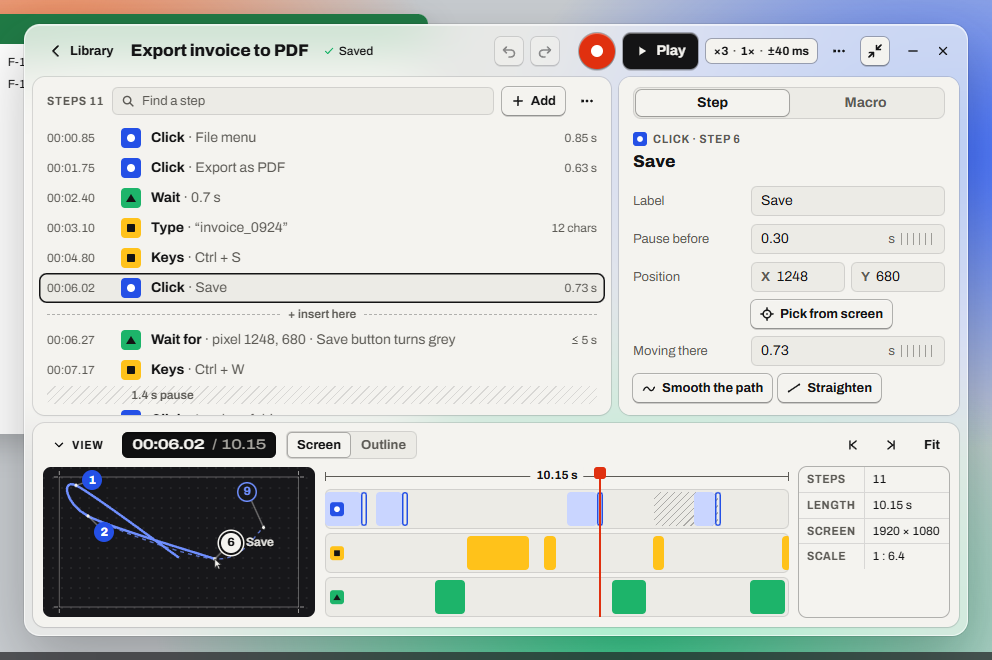</p>

## Contents

- [Where it comes from](#where-it-comes-from)
- [Principles](#principles)
- [What changes from today](#what-changes-from-today)
- [Tokens](#tokens)
- [Components](#components)
- [Icons](#icons)
- [The screens](#the-screens)
- [Motion and juice](#motion-and-juice)
- [Sound](#sound)
- [Frosted glass on Windows](#frosted-glass-on-windows)
- [Exported programs](#exported-programs)
- [Accessibility guardrails](#accessibility-guardrails)
- [The prototype, tested](#the-prototype-tested)
- [Decided after the prototype](#decided-after-the-prototype)

## Where it comes from

| Source | What Relay takes | What it leaves |
| --- | --- | --- |
| **Modernism** (Swiss grid, Braun) | The grid, alignment, flush-left text, restraint, one typeface family, nothing decorative | The heavy 2 px rules everywhere, and the hard square corners |
| **teenage engineering** | Keys that look pressable and travel when pressed; a dark "screen" for what's happening (time, state, progress); each function with its own color; small, precise legends; numbers set wide, like a device's display | Novelty for its own sake: every control still says what it does in words |
| **Industrial drawings** | Numbered callouts with leader lines for clicks, dimension lines on the timeline, a title block, drafting hatch for pauses, registration marks on the screen outline, thin even linework | Clutter: one dimension, one title block, no grid of annotations |
| **Color blocking** | Flat planes of strong color, each meaning one category of step | Gradients, and color as decoration |
| **Frosted glass** (Windows 11's Acrylic and Mica) | The window's ground: the desktop shows through, softly, so Relay feels light and part of Windows | Text on glass beyond the essentials: content sits on solid plates |

## Principles

1. **Glass is the ground, plates hold the content.** The window and the player are frosted. The steps, the inspector, the view and the Library's table sit on solid **plates** with rounded corners, like panels screwed onto a device. Reading never happens through blur.
2. **A color is a category, never decoration.**
   - **Blue** is the pointer: clicks, drags, scrolls, moves.
   - **Yellow** is the keyboard: keys, typing, Text steps.
   - **Green** is logic: waits, pixel checks, Find image.
   - **Red** is live and danger only: record, recording and playing, the playhead, errors, delete.
   - Everything else is paper, aluminium and graphite.
3. **Every color has a shape.** A circle for the pointer, a square for keys, a triangle for logic: the glyph says it even without color.
4. **What you press looks pressable, and answers.** Keys have depth and travel; switches spring; numbers roll; a finished run flashes. Never slow: the answer is faster than the action.
5. **Precision you can see.** Times in device numerals, callouts on the clicks, a dimension on the timeline, a title block with the scale: the macro reads like a drawing of what it will do.
6. **Relay steps aside.** While it records, plays from the player, or picks a pixel, its window gets out of the way of the app being automated.
7. **Calm on request.** Reduced motion, reduced transparency and Windows contrast themes each get a version that loses nothing but the effect.

## What changes from today

| Today | Proposed |
| --- | --- |
| Square corners everywhere | Radii from 4 px (chips) to 16 px (the window, the player); the record key is round |
| 2 px rules between every region | Plates with a hairline edge on a frosted ground; rules only inside drawings |
| One red for nearly everything ([F15](ux-research-panel.md#f15-red-means-too-many-things)) | Red for live and danger only, plus three category colors |
| Flat grey ground | Frosted glass with paper plates; solid on Windows 10 by default, and whenever Windows says so |
| Archivo at one width | Archivo's variable width: condensed for labels, wide for device numerals |
| Numbered squares on the preview | Numbered callouts with leader lines, as on an engineering drawing |
| Striped pauses | Kept, as drafting hatch: they already were |
| Light only | Light, dark, and Windows contrast themes |
| The transport's 40 px clock | A small LCD in the view's bar and in the player |
| Icons from a mix of sources | Relay's own set, drawn on one grid |
| Silent | Optional short sounds |
| A plain Windows window for exported programs | The player's look: keys and a screen |

## Tokens

### Color

| Token | Hex | Role | Text on it | Contrast |
| --- | --- | --- | --- | --- |
| Paper | `#F4F3EF` | Light plates, light text on dark | Ink | 16.6:1 |
| Aluminium 100–300 | `#ECEBE6` `#E1E0DA` `#CFCDC6` | Fields, tracks, light keys | Ink | 11.6:1 or more |
| Aluminium 700 | `#5C5A55` | Secondary text on paper | — | 6.2:1 on paper |
| Graphite 900 | `#1C1C1E` | Dark plates, ink keys in dark | Paper | 15.3:1 |
| Secondary text, dark | `#B3B1AB` | Secondary text on graphite | — | 7.9:1 |
| Ink | `#141415` | Text, the Play key, selection | Paper | 16.6:1 |
| LCD | `#101011` | The screens (time, the player) | Paper | 17.1:1 |
| **Signal red** | `#E0300F` | Record, live, the playhead, errors, delete | White | 4.6:1 |
| Red text | `#B3210A` (light), `#FF6A4D` (dark) | Red as small text | — | 6.0:1 on paper, 6.0:1 on graphite |
| **Pointer blue** | `#2450E6` | Clicks, drags, scrolls, moves | White | 6.2:1 |
| **Keys yellow** | `#FFC21A` | Keys, typing, Text steps | Ink | 11.4:1 |
| **Logic green** | `#1DB46A` | Waits, pixel checks, Find image | Ink | 6.8:1 |
| Green text | `#0E6B3D` (light), `#3DD68C` (dark) | *Completed*, the ✓ | — | 5.0:1 or more on light fills, 9.1:1 on graphite |

<p align="center">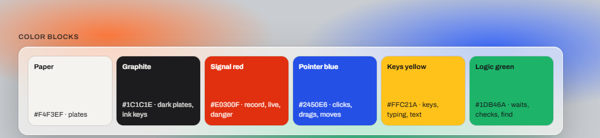</p>

### Type

Archivo stays, as the **variable** font, for its width axis. Relay bundles `@fontsource/archivo` today, which has fixed weights only; it switches to the variable package (`@fontsource-variable/archivo`), and checks the width axis is in it when it's installed:

| Role | Setting | Use |
| --- | --- | --- |
| Title | 17 px, 800 | The macro's name, the inspector's title |
| Body | 14 px, 400–700 | Rows, fields, keys |
| Small | 12–13 px | Details, times, hints |
| Label | 12 px, 700, uppercase, 0.06 em, width 88% | Section labels: *STEPS 12*, *PLAY OPTIONS* |
| Device numerals | 14 px, 650, width 125%, tabular | Times and counts on the LCDs |

Nothing under 12 px, anywhere, including the player's state and the preview's callouts.

### Shape

| Radius | Where |
| --- | --- |
| 4 px | Chips, glyphs, timeline blocks |
| 6 px | Fields, small keys, segmented controls, checkboxes |
| 8 px | Keys, list rows, cards |
| 12 px | Plates |
| 16 px | The window, the player |
| Round | The record key, callouts |

### Spacing

Three spacings on one scale (*Settings → Appearance → Spacing*):

| | Rows | Keys | Small keys | Fields |
| --- | --- | --- | --- | --- |
| Compact | 26 px | 30 px | 24 px | 26 px |
| Comfortable (default) | 30 px | 36 px | 28 px | 30 px |
| Large | 40 px | 44 px | 36 px | 38 px |

*Text size* (100–200%) scales everything, and the window with it, as far as the screen allows.

### Lines and depth

- **Hairlines** (1 px, ink at 12%) edge the plates and separate rows.
- **Keys** have travel: a 2 px shadow under them that collapses when pressed.
- **Drawings** (the preview, the timeline's dimension) use thin, even lines that keep their width when the drawing scales.
- **Glass:** the ground tinted at **72%** (paper in light, graphite in dark), blurred 28 px with saturation 1.5, a 1 px light inner edge and a soft shadow. Menus and dialogs float on a **94%** tint, so their text never depends on what's behind.

## Components

| Component | Look | Behavior |
| --- | --- | --- |
| **Key** | Rounded 8 px, aluminium, ink or red, 2 px of travel | Lifts 1 px on hover, sinks 2 px and shrinks 3% when pressed (90 ms), springs back (220 ms) |
| **Record key** | Round, red, a white dot | Breathes (a soft red ring) while recording. The dot stays: pressing it again stops, and ■ is the one stop button |
| **Chip** | Rounded 6 px, a hairline | The play summary (*×3 · 1× · ±40 ms*), named in full for screen readers and as a tooltip; it says *keys don't stop it* when that's off |
| **Keycap** | A chip with a bottom edge | Hotkeys: <kbd>Ctrl</kbd> <kbd>Alt</kbd> <kbd>1</kbd>, in the Library, the triggers, the first run and Settings |
| **Glyph** | A 20 px color block with a white or ink shape | The category of a step, everywhere a step appears |
| **Step row** | Time, glyph, *what* in bold and its detail | Selected: an ink outline. Playing: the category color washes in from the left, and the current step gets a red outline. Failed in the last run: red tint and *Timed out* |
| **Insert line** | A dashed line with *+ insert here* | Where + Add puts the next step. Hovering a row shows a 24 px **+** at its lower edge to insert right there |
| **Pause** | Drafting hatch with its length | — |
| **Tabs** | A track with a sliding thumb | The thumb springs to the chosen tab; arrow keys move between tabs |
| **Section** | A header with a one-line summary and a chevron | The Macro tab's *Play options* and *Runs automatically*, one open at a time |
| **Field** | Rounded 6 px, aluminium, a visible label, the unit after the value, X and Y inside the field | Numbers **scrub**: drag sideways to change them, like turning an encoder; or click and type |
| **Switch** | 44 × 24, rounded, a check mark inside when on | The knob springs |
| **Checkbox** | 24 px, rounded 6 px, a check when on | For selecting several macros |
| **Segmented** | A track of choices, at least 24 px tall | Radio group, arrow keys |
| **Menu** | A floating plate at 94%, keyboard-operable, shortcuts shown | Opens on its first item; Esc returns to the button that opened it |
| **LCD** | A dark inset screen, device numerals | The time in the view; the player's state, name, time and progress |
| **LED bar** | 48 small segments, a red one per click | The player's progress |
| **Callout** | A 20 px numbered circle with a leader line, in HTML over the drawing | Clicks on the preview: filled when played, outlined when not, white for the selected one, which also shows its label. Nudged apart so they never overlap |
| **Dimension** | A line with end ticks and the length | The macro's length over the timeline |
| **Title block** | A small ruled table | Steps, length, screen size and the preview's scale |
| **Toast** | Ink (or red for errors), rounded 8 px | Rises in; errors stay until dismissed |
| **Badge** | A red count | *Problems* in the Library |

## Icons

Relay draws its own icons: 59 of them, on one 16 px grid, with 1.6 px strokes and round ends. Only the transport (record, play, pause, stop) is filled. The set is in [`Design/redesign/icons.js`](../../Design/redesign/icons.js).

<p align="center">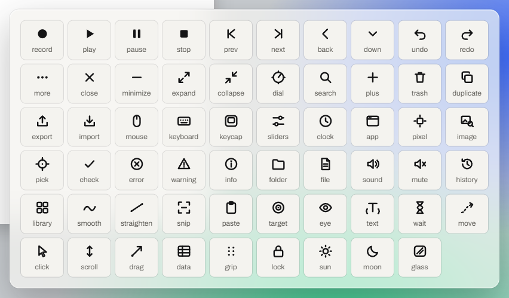</p>

- **Every icon button has a name** (for screen readers and Voice Access) **and a tooltip**, and the ones a first-timer needs carry a word too: *Settings*, *Add*, *Pick from screen*, *Smooth the path*.
- **Shapes over pictures:** sliders for Settings, a keycap for hotkeys, a clock for schedules, a window for an app starting, a crosshair square for a pixel, a framed picture with a magnifier for an image.
- **The panel's corrections:** a dial drawn for Settings read as a stopwatch to Linda (P11), so it became sliders. The first keycap read as a monitor, so it got its inner key.

## The screens

**The editor**, in dark, with the inspector on its **Macro** tab and *Runs automatically* open:

<p align="center">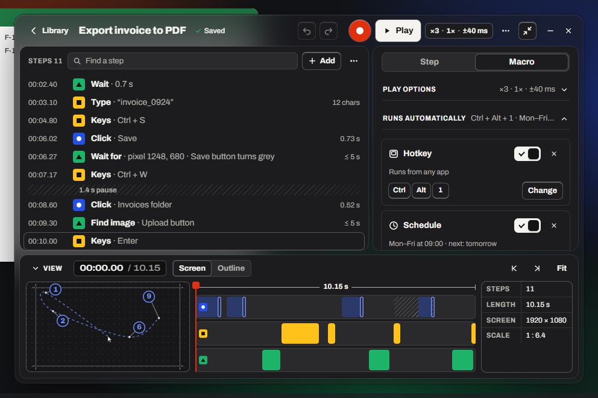</p>

**After a failed run**, with the window open: the failed step is marked, its Step tab explains, and an error message stays until dismissed:

<p align="center">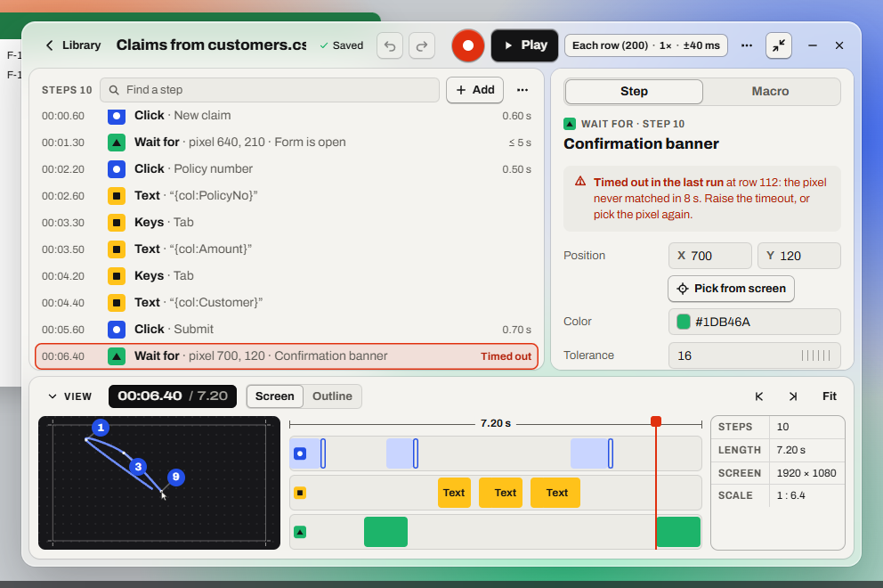</p>

**Solid**, on Windows 10 by default, or when Windows turns transparency off (here on a pixel check, with *Pick from screen* under the position):

<p align="center">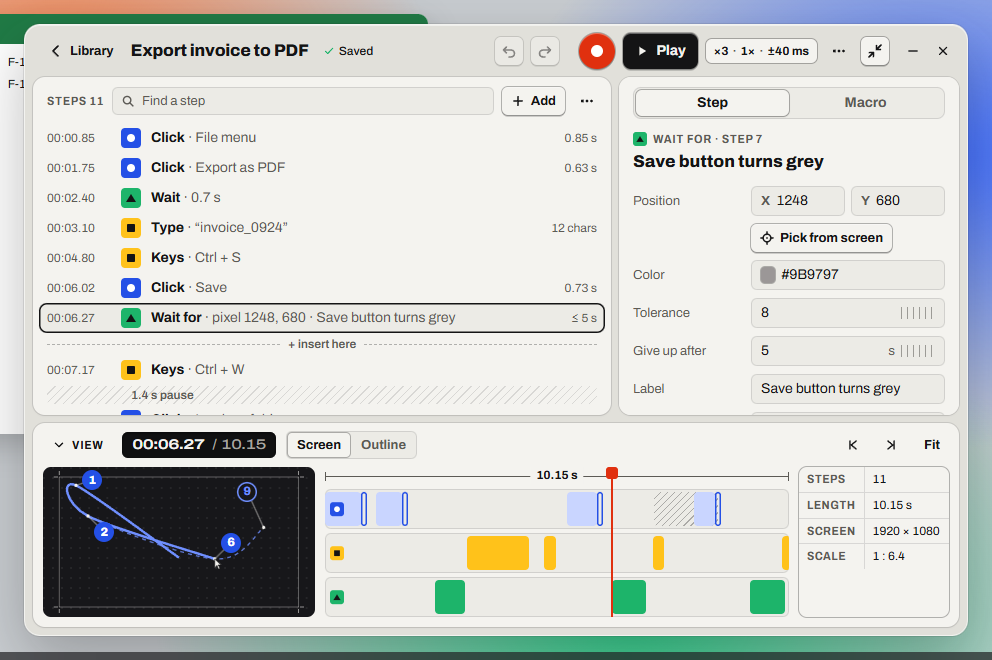</p>

**The minimum window** (760 × 520): the inspector slides over the list, and <kbd>Esc</kbd> closes it:

<p align="center">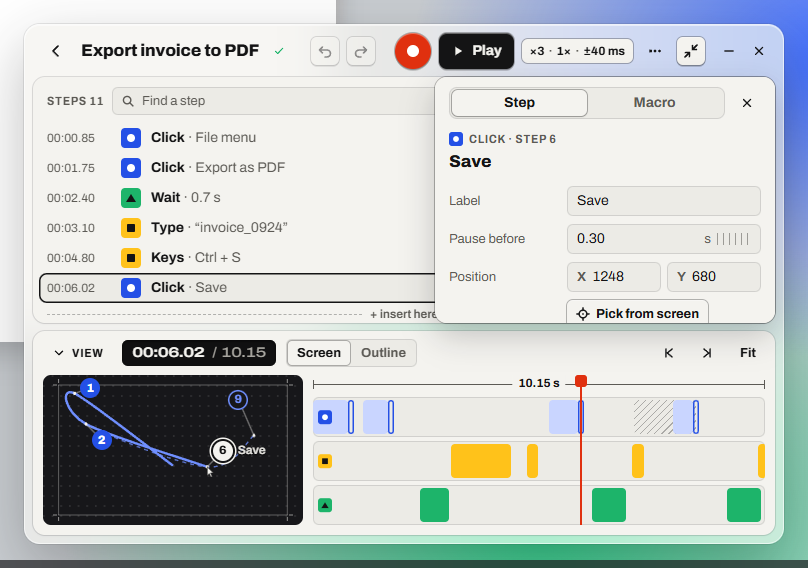</p>

**150% text:** the window grows with the text, and the view starts closed when there isn't room for it:

<p align="center">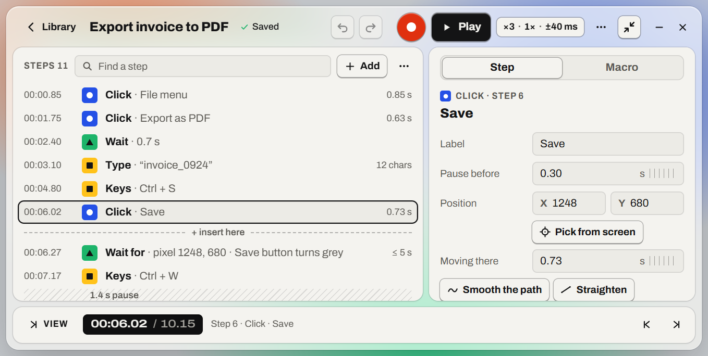</p>

**The Library**, with hotkeys as keycaps, what else runs each macro (a link to its triggers) and the last run in words; and **Problems**, with a failed run opened:

<p align="center">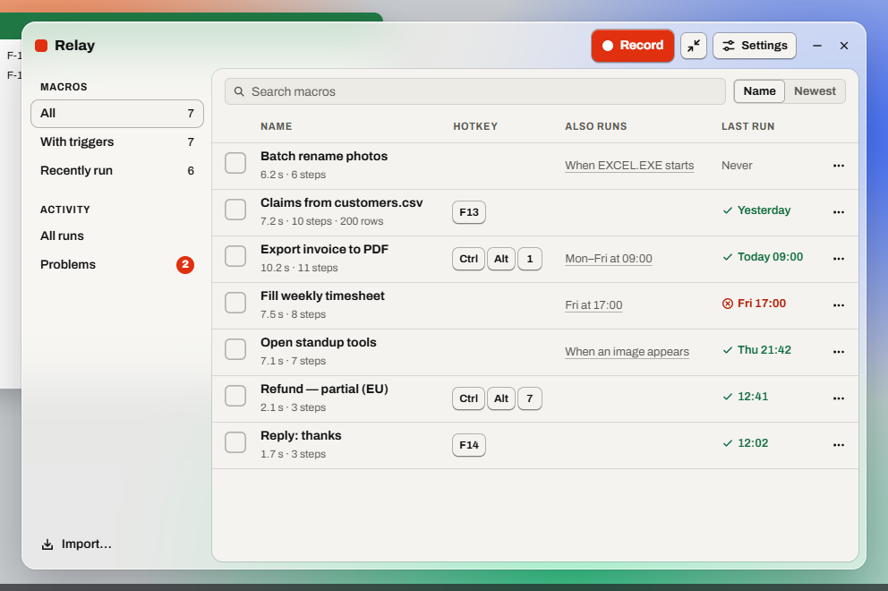<br>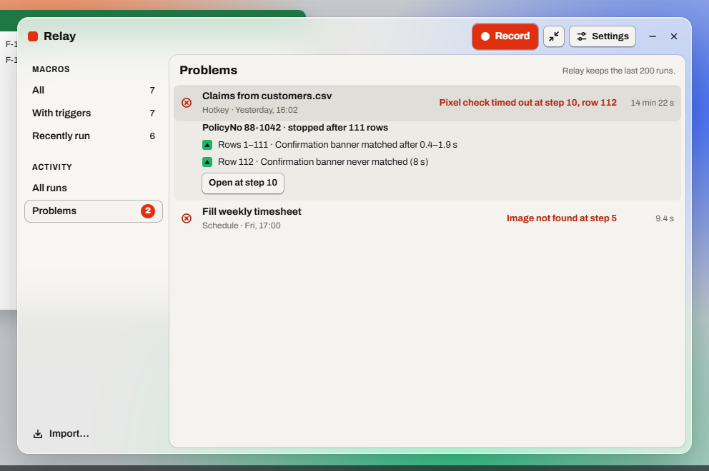</p>

**The first run**, on its keys screen, with <kbd>Ctrl</kbd>+<kbd>Shift</kbd>+<kbd>F9</kbd>/<kbd>F10</kbd> preselected:

<p align="center">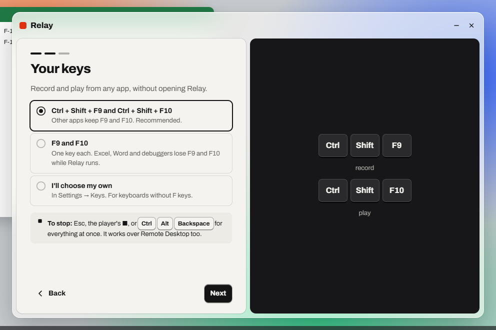</p>

**Settings → Keys**, warning about an AltGr character on a Swedish keyboard; and **Appearance**:

<p align="center">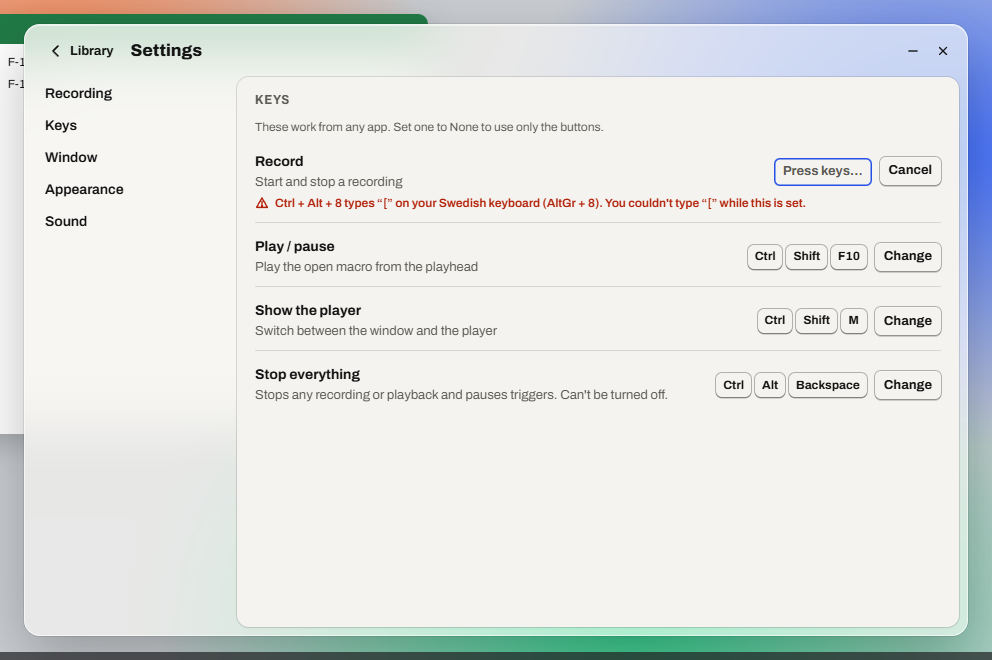<br>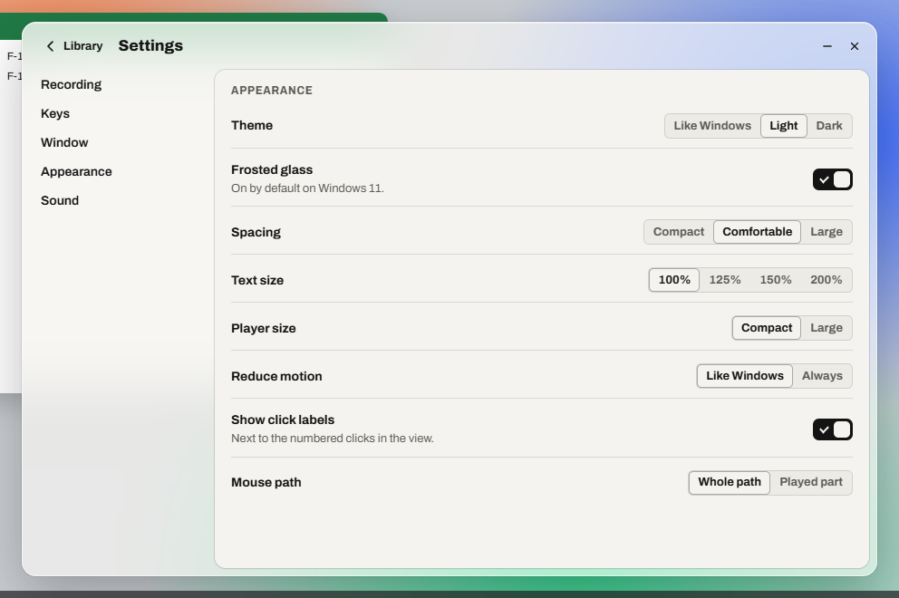</p>

**The player** at 600 × 64: playing a data file, recording, stopped after an error, and large in dark:

<p align="center">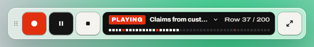<br>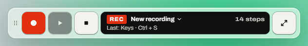<br>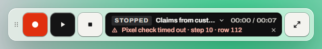<br>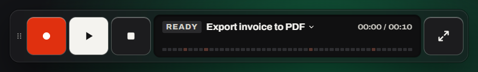</p>

**A trigger fires while you're editing another macro:** the player shows in a corner that's clear of the window and of the macro's clicks (top right on most screens, since the window sits at the bottom), and the window says what's running, with **Stop**. The open macro's **Play** is off and its steps are locked until the run ends; it isn't drawn as playing. If Relay was already busy, the trigger is skipped and says so (*Skipped "Fill weekly timesheet": Relay was busy*), in the run history too:

<p align="center">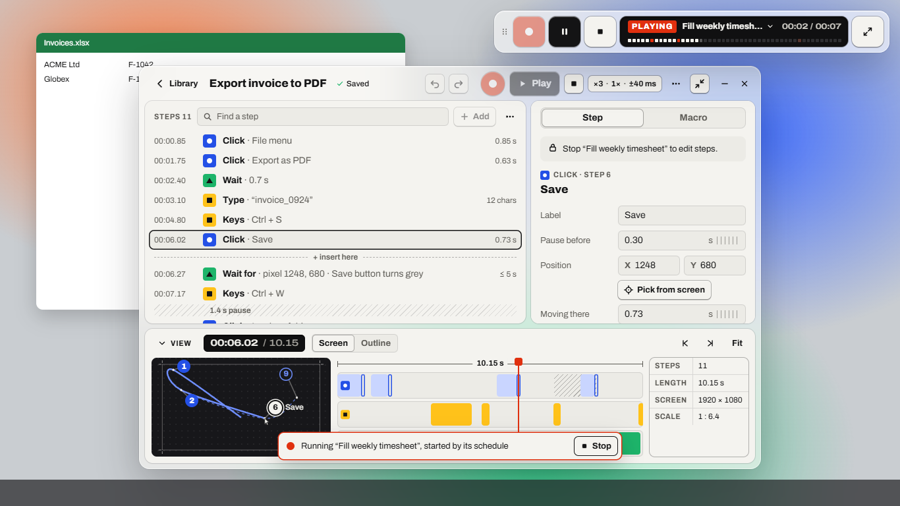</p>

**Picking from the screen:** Relay steps aside, the loupe shows the pixel and its color, and the arrow keys nudge it:

<p align="center">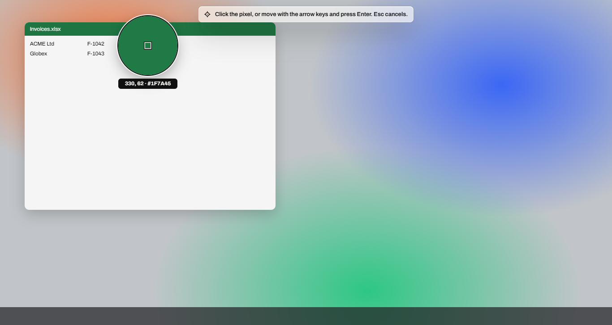</p>

## Motion and juice

Fast, physical, never in the way. Every effect has a calm version, and with reduce motion on, nothing animates at all (the tests check that no animation is running).

| Moment | What happens | Timing | With reduced motion |
| --- | --- | --- | --- |
| Pressing a key | Sinks 2 px, shrinks 3%, shadow collapses | 90 ms in, 220 ms spring out | Color change only |
| Hovering a key | Lifts 1 px | 220 ms | None |
| Recording | The record key breathes; the player's step count rolls up with each new step | 1.6 s loop; 220 ms roll | A steady red key; the count changes in place |
| Countdown | *3, 2, 1* in the player's screen, each digit dropping in | 1 s each | Digits change in place |
| Playing | The playhead glides; rows wash in their category color as they're reached; the current step is outlined red; LED segments light | Continuous; 300 ms wash | Rows simply change |
| A run completes | The player's screen flashes green, *DONE ✓* | 600 ms | *DONE ✓* without the flash |
| A run fails | The failed step's row and the player shake twice, 2 px, and turn red | 300 ms | No shake |
| Switching tabs, opening a section | The thumb springs across; the chevron turns | 220 ms | Instant |
| Switches | The knob springs | 220 ms | Instant |
| Scrubbing a number | Ticks slide under the cursor; the value changes live | Live | The value changes |
| Menus and messages | Pop in from 4 px above; messages rise from 8 px below | 140–200 ms | Instant |
| Relay stepping aside (recording, picking) | The window fades and drops toward the player | 180 ms | Instant |

## Sound

Off by default (*Settings → Sound*), with a **Try** button for each. Short and dry, like an instrument's clicks, at a low volume that follows Windows' own:

| When | Sound |
| --- | --- |
| Recording starts | Two quick rising clicks |
| Recording or playback stops | Two quick falling clicks |
| A macro finishes | Three rising notes |
| A macro fails | Two low notes |
| A step is recorded | One very short tick |

Sounds never replace words: every one of these moments is also announced to screen readers and shown in the player.

## Frosted glass on Windows

| | Windows 11 | Windows 10 |
| --- | --- | --- |
| Default | **On**: Acrylic (a true blur of what's behind) | **Off**: solid, since Acrylic windows can lag when dragged there |
| Setting | *Settings → Appearance → Frosted glass*, to turn it off | The same switch, to turn it on |

Relay is solid, whatever the setting, when Windows' *Transparency effects* are off, in a Windows contrast theme, and in Remote Desktop sessions, which usually run without transparency (**to verify**). The setting then says why it's off.

- The glass comes from Windows through Tauri 2's window effects. Inside the window, menus, messages and dialogs use CSS `backdrop-filter`, kept off anything that animates continuously.
- The layout never depends on the glass: the solid version is the same screens on an aluminium ground (see [the screens](#the-screens)).
- **Rounded corners:** Windows 11 rounds window corners itself; on Windows 10 the page draws them on a transparent window (**to verify**).

## Exported programs

An exported program plays a macro without Relay. It now looks like the player, without the record key: pause, stop, and a screen with the state, the macro's name, the progress and the time. It stays in a corner the macro doesn't click in, as today.

<p align="center">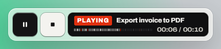</p>

It's a plain Win32 window, so the glass and the springs are out of reach. The colors, the type, the corners and the keys aren't.

## Accessibility guardrails

These rules hold everywhere, and the [tests](#the-prototype-tested) check each of them on every screen:

- **Text on glass:** only primary text (ink, or paper in dark), and only in the top bar and the Library's sidebar. Glass is tinted at least 72%, which keeps ink at **8.4:1 or more over a black wallpaper** and paper at **6.0:1 over a white one**. Menus and dialogs are 94% opaque.
- **Every text** meets WCAG AA against its real background, glass included (checked over a black and a white wallpaper).
- **Nothing under 12 px**, at any spacing and text size.
- **Targets:** at least 24 × 24 px at every spacing (keys 36 px in the window and 46 px in the player at the default spacing).
- **Color is never alone:** each category has its shape, played callouts are filled and unplayed ones outlined, switches have a check mark, failures have a word and an icon.
- **Focus:** a 2 px ring in the text color, never a category color, on every control reached by <kbd>Tab</kbd>.
- **Names:** every control has an accessible name; the steps are a list of options, the timeline a slider that names the step, the tabs and choices radio groups and tabs with arrow keys.
- **Announcements:** recording starting and stopping, playback ending or failing, and picking are announced; the window comes back with the focus on the new macro's name.
- **Windows contrast themes:** glass, plates and blocks give way to system colors; categories keep their shapes; state is drawn with borders.
- **Reduced motion and reduced transparency:** see [Motion and juice](#motion-and-juice) and [Frosted glass on Windows](#frosted-glass-on-windows).

## The prototype, tested

The prototype was put through the panel again, this time by doing their tasks in it for real, and by tests of every screen and state. Each round's findings changed the design, and the next round checked the changes.

> [!WARNING]
> The panel is still simulated, and the same model built the prototype and played the panel. What the tests measured (contrast, sizes, names, whether a task can be done) is real. What the personas *felt* is not. A test with real users remains the next step.

### What was tested

- **Every screen and state:** 64 in all, across the first run, the Library, Problems, the editor, the Macro tab, every step type, menus, the export dialog, every Settings section, key capture with its warnings, and the player in each state, and a triggered run while the window is open. They were also run in dark, solid, Windows 10, no transparency, every spacing, 150% and 200% text, the minimum and a large window, the picker, the exported program and the icon sheet.
- **On each one, an audit in the page:**
  - the contrast of every text against its real background, glass composited over a black and a white wallpaper;
  - text under 12 px;
  - controls without a name;
  - targets under 24 px;
  - clipped text;
  - anything spilling out of the window or player.
- **Emulations:** Windows contrast themes (`forced-colors`); protanopia, deuteranopia and achromatopsia; blurred vision at 150% text; reduce motion, with a check that nothing animates.
- **The accessibility tree** of every state: roles and names.
- **Keyboard:** a Tab walk through the editor (every stop must show a focus ring), and the steps list's keys: arrows, <kbd>Shift</kbd>-select, <kbd>Del</kbd>, <kbd>Ctrl</kbd>+<kbd>Z</kbd>, <kbd>Insert</kbd>, <kbd>Enter</kbd>, <kbd>Esc</kbd>, <kbd>Ctrl</kbd>+<kbd>M</kbd>.
- **16 panel tasks,** done in the prototype with clicks and keys, each step checked:

| Persona | Task | Actions |
| --- | --- | --- |
| Linda (P11) | First run to a first macro: choose the keys, record, stop, name it, play it | 6 |
| Aisha (P1) | Find the typed text, make it editable | 4 |
| Aisha (P1) | A data run fails at row 112: see it in the editor, the inspector and Problems | 4 |
| Joris (P2) | Watch a run in the window, then turn off varied timing | 4 |
| Kenji (P3) | The player as a remote: switch macros, play, stop, back to the window | 6 |
| Kenji (P3) | Set the play key to None | 2 |
| Dee (P4) | Solid on Windows 10; glass disabled without transparency; the kill switch's Remote Desktop warning | 3 |
| Ruth (P5) | 150% text (two columns, nothing under 18 px), the large player | 0 |
| Sam (P6) | Pick a pixel by keyboard only | 6 |
| Sam (P6) | Delete, undo and insert by keyboard | 3 |
| Priya (P7) | Names and roles, menu focus, record and cancel announced | 4 |
| Mateo (P8) | Edit in the minimum window | 2 |
| Viktor (P9) | Select all, show moves, back to the Library, all by keyboard | 4 |
| Hannah (P12) | See what runs when, from the Library and the Macro tab; change the days | 4 |
| Hannah (P12) | A schedule fires while editing another macro: the player in a free corner, the notice, Stop; then a skip because Relay is busy | 3 |
| Grace (P13) | Find a macro among many, select two for export | 3 |

### The rounds

| Round | States clean | Contrast | Under 12 px | Targets | Clipped | Overflow | Tasks |
| --- | --- | --- | --- | --- | --- | --- | --- |
| 1, first build | 9 / 57 | 44 | 69 | 127 | 185 | 89 | not run (the list's keys failed) |
| 2 | 50 / 60 | 24 | 0 | 2 | 0 | 103 | 11 / 15 |
| 3 | 54 / 62 | 0 | 0 | 17 | 0 | 19 | 14 / 15 |
| 4 | 62 / 62 | 0 | 0 | 0 | 0 | 0 | 15 / 15 |
| Final, with triggered runs | **64 / 64** | **0** | **0** | **0** | **0** | **0** | **16 / 16** |

Counts are issues across all states (one bad control on 10 screens counts 10). The final round added the two triggered-run states and Hannah's second task after the maintainer's decision on triggered runs. Rounds 2 and 3 also included false alarms from the audit itself, which then learned to read `color-mix()` backgrounds and to skip rows scrolled out of view; the final round uses the corrected audit throughout.

### What the rounds found, and what changed

| # | Found | How | Who it affected | Change |
| --- | --- | --- | --- | --- |
| 1 | The **+** between rows had an invisible hit area over the rows, so clicking a row near its edge opened the Add menu | The keyboard test, which clicked a row first | Sam (P6), everyone | The **+** only shows on hover, as a 24 px button at the row's lower edge |
| 2 | The hidden player's frame still caught clicks at the bottom centre of the window: the first run's **Next** did nothing | Linda's task | Linda (P11), everyone | The player's frame lets clicks through when the player is hidden |
| 3 | During playback and after errors, the player covered the window's view and timeline | Screenshots | Joris (P2), Ruth (P5) | The player shows only when the window doesn't (recording, player mode, triggered runs with the window closed); with the window open, its top bar has Pause and Stop, and errors show in the window |
| 4 | Two stop buttons while recording: the red key turned into a stop, next to ■ | Screenshots | Linda (P11), Kenji (P3) | The red key keeps its dot and breathes; ■ is the one stop |
| 5 | In the Macro tab, a macro's triggers were below the play options, out of sight | Hannah's task | Hannah (P12) | Two sections with summaries, one open at a time; the Library's *Also runs* opens *Runs automatically* |
| 6 | Switches (22 px), checkboxes (18 px), the inputs inside fields (20 px), the player's dismiss (12 px) and macro name (18 px) under 24 px | The audit | Sam (P6), Mateo (P8) | Switches 44 × 24, checkboxes 24, inputs fill their field, 24 px minimums |
| 7 | *Saved* faded to 3.2:1; menu shortcuts 3.1:1 on glass | The audit | Ruth (P5) | Full-contrast *Saved*; menus and dialogs at 94% |
| 8 | The player's state badge at 11 px | The audit | Ruth (P5) | 12 px |
| 9 | Timeline labels cut to "C" or "Wait f" | The audit | Noor (P10) | A label only where it fits whole; the full text as a tooltip |
| 10 | The preview's callouts were SVG text at about 7 px, and overlapped | Screenshots, the audit | Ruth (P5), Noor (P10) | Callouts in HTML at 12 px, nudged apart, the label only on the selected click |
| 11 | The schedule's days and time spilled out of the inspector | The audit | Hannah (P12) | Days on a row, the time below |
| 12 | At 150% and 200% text the window kept its size, and the layout broke | The audit, screenshots | Ruth (P5) | The window grows with the text, up to the screen; the view starts closed when short; the inspector slides over below about 860 px |
| 13 | The top bar overflowed in narrow windows | The audit | Mateo (P8) | *Library*, *Saved*, *Play* and *Settings* fold to their icons when space runs out |
| 14 | *Pick from screen*, *Test* and *Straighten* were below the inspector's fold | Sam's task, screenshots | Sam (P6), Joris (P2) | *Pick from screen* under Position, *Test* with *Snip*, Smooth and Straighten on a full row |
| 15 | The X and Y fields had no visible labels | Screenshots | Priya's sighted colleagues (P7) | *X* and *Y* inside the fields |
| 16 | The Settings icon read as a stopwatch | Screenshots | Linda (P11) | Sliders, and the word *Settings* |
| 17 | A keycap icon in the play summary meant nothing to most | Screenshots | Kenji (P3), Linda (P11) | Removed; the summary says *keys don't stop it* when that's off |
| 18 | *On the screen / In the window* wrapped onto two lines | Screenshots | Noor (P10) | *Screen / Window*, with a line saying what each does |
| 19 | In dark, the preview and the LCD merged into the plates | Screenshots | Noor (P10), Ruth (P5) | An inset edge |
| 20 | In a contrast theme, the record key lost its dot | The `forced-colors` emulation | Ruth (P5) | The dot in a system color |
| 21 | During playback the inspector said *No step selected* | Screenshots | Priya (P7), Aisha (P1) | It shows the step playing now, and the data row |
| 22 | Undo brought steps back but not the selection | The keyboard test | Viktor (P9), Sam (P6) | Undo restores the selection too |
| 23 | The picker sampled Relay's own window | Screenshots | Everyone | Relay steps aside while picking |
| 24 | The exported program's name was cut to "E…" | Screenshots | Dee (P4) | Name on the top line, progress and time below |
| 25 | Secondary text in dark fell to 4.4:1 on yellow rows | The audit | Ruth (P5) | Dark secondary text `#B3B1AB` |
| 26 | Green *✓ Yesterday* fell to 4.3:1 on a hovered row | The audit | Ruth (P5) | Green text `#0E6B3D` |
| 27 | A triggered run's announcement (*started by its schedule*) was replaced at once by a plain *Playing…* | Hannah's second task | Priya (P7) | The trigger's announcement is the one heard |
| 28 | During another macro's run, the open macro's Play showed a disabled *Pause* | Screenshots | Hannah (P12), Linda (P11) | It shows *Play*, off, with a tooltip saying what's running; the lock note names it too |
| 29 | The record key stayed clickable during playback, though Relay can't record then | Screenshots | Everyone | Off during playback, in the window and the player |

**Checked and working from the first round:** key capture's warnings (F9, AltGr, Remote Desktop) and refusals, the first run's preselected keys, reduce motion (no animation running), the Tab order and focus rings, the accessibility tree's names and roles, and the protanopia, deuteranopia and achromatopsia views, where the shapes carry the categories.

<p align="center">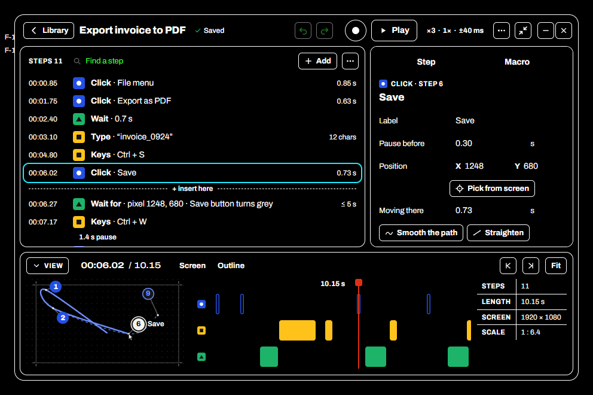 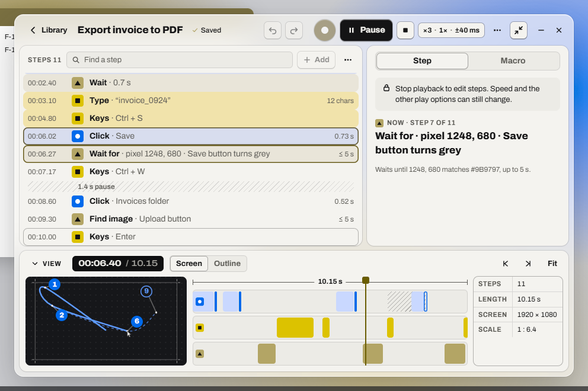</p>

### The panel on the prototype

| Persona | Says | Rating (plan → prototype) |
| --- | --- | --- |
| Aisha (P1) | *"I find the yellow rows, select them, make them editable. Done."* Still wants to resume from row 112. | 4 → 5 |
| Joris (P2) | Watching the rows fill while the window stays put is what testing needs. | 4 → 4 |
| Kenji (P3) | The player is the instrument: name menu, ■, no second stop. | 4 → 5 |
| Dee (P4) | The kill switch and the solid Windows 10 default are right; signing still blocks. | 3 → 3 |
| Ruth (P5) | Text that grows with the window, callouts at a readable size, errors right where Ruth is looking. | 4 → 5 |
| Sam (P6) | Everything by keyboard, pick included, and no fiddly targets. | 4 → 5 |
| Priya (P7) | The live step in the inspector and the announcements make playback followable. | 4 → 4 |
| Mateo (P8) | The minimum window works; the slide-over is the right call. | 4 → 4 |
| Viktor (P9) | Fast to drive by keyboard. Still wants a text view. | 3 → 3 |
| Noor (P10) | *"Disciplined: the red budget held, the system shows."* | 4 → 5 |
| Linda (P11) | The first run took Linda to a working macro with no help. | 4 → 5 |
| Hannah (P12) | *Runs automatically* one click from the Library. Still no notifications. | 4 → 4 |
| Grace (P13) | Search and keycaps make 40 macros manageable. | 4 → 4 |

### What the prototype can't tell

- **Real windows:** Acrylic, Mica, the window's corners and its shadow are drawn by Windows, not by a page. The prototype's frosted window is CSS over a wallpaper.
- **Real assistive technology:** the accessibility tree was checked; NVDA, Narrator, Magnifier and Voice Access weren't run.
- **Real timing:** the prototype speeds sessions up (a 200-row run takes seconds).
- **Real users.**

### Running the tests

The harness is in [`Design/redesign/tests/`](../../Design/redesign/tests/). It drives Microsoft Edge headless over the DevTools protocol:

```bash
python -m http.server 4310 --bind 127.0.0.1 --directory Design/redesign
```

```bash
node Design/redesign/tests/run.mjs final
```

```bash
node Design/redesign/tests/tasks.mjs final
```

`run.mjs` writes a screenshot and an audit of every state to `tests/out/<round>/`, and `tasks.mjs` the panel's tasks with each step's result.

## Decided after the prototype

The three questions the prototype round left, decided by the maintainer on 2026-10-23:

| Question | Decision |
| --- | --- |
| Archivo's width axis | Switch to the variable package, `@fontsource-variable/archivo`, and check its width axis when it's installed |
| Where the prototype lives | In `Design/redesign/` until `m24-redesign` merges; the milestone's last commit removes it |
| A trigger firing while the window is open | The player in a free corner (clear of the window and the macro's clicks), and a notice with **Stop** in the window; tested in the final round |

Nothing is left open from the panel's rounds. What's left to learn needs Windows itself and real people (see [What the prototype can't tell](#what-the-prototype-cant-tell)).

---

<p align="center"><a href="ux-research-panel.md">← UX research and redesign</a> · <a href="../README.md">Documentation home</a></p>
