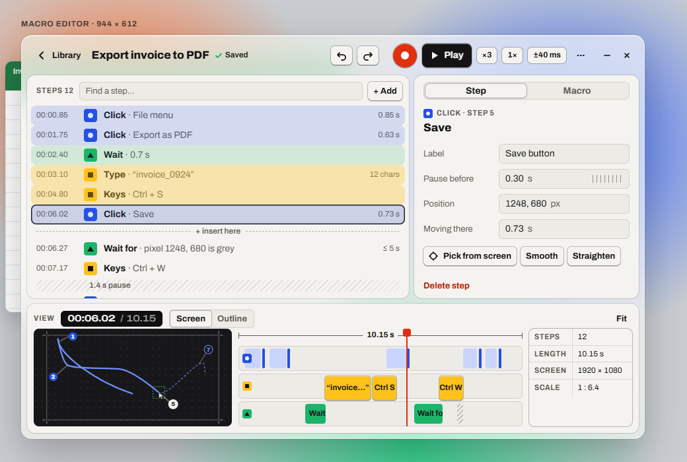
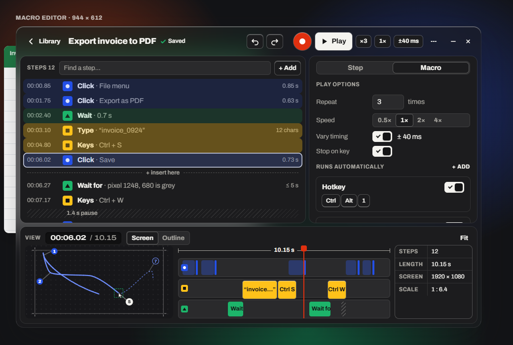
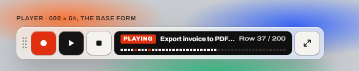
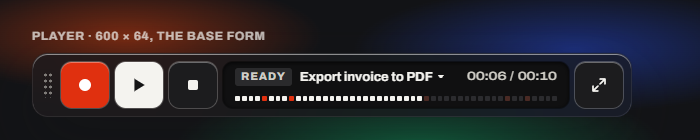
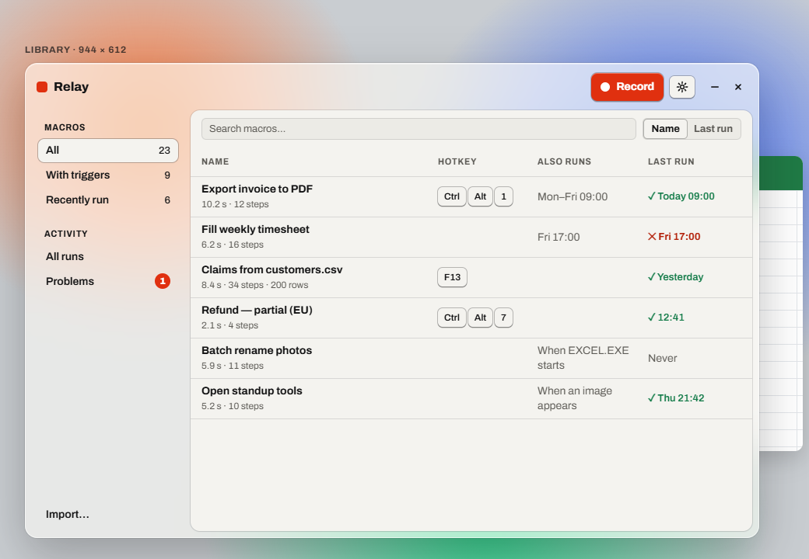
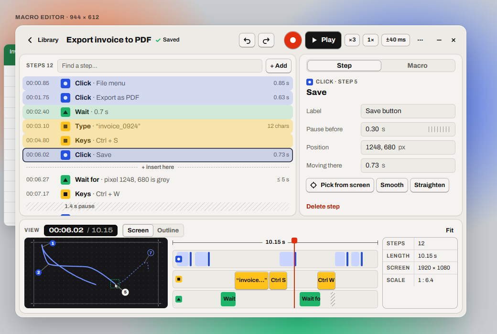

# Visual redesign: frosted, color-blocked, modernist

A proposal for Relay's new look: minimalist and modernist, with subtly rounded corners, frosted glass, color blocking borrowed from industrial drawings and from teenage engineering's instruments, and controls that answer when you touch them. It dresses the structure from the [UX redesign](ux-research-panel.md#the-redesign): the Library, the Macro editor, Settings and the player.

> [!NOTE]
> **See it move:** open [`Design/redesign/relay-visual.html`](../../Design/redesign/relay-visual.html) in a browser. Press **Record** or **Play** (in the editor or the player), drag *Pause before* sideways, switch the inspector's tabs, and try the **Dark**, **Solid** and **Reduce motion** toggles at the top. Add `?frame=editor`, `player`, `library` or `palette` to the address to see one at a time. It's a mockup: static data, a few behaviors, not the app.

## Contents

- [Where it comes from](#where-it-comes-from)
- [Principles](#principles)
- [What changes from today](#what-changes-from-today)
- [Tokens](#tokens)
- [Components](#components)
- [The screens](#the-screens)
- [Motion and juice](#motion-and-juice)
- [On Windows](#on-windows)
- [Accessibility guardrails](#accessibility-guardrails)
- [The panel on the look](#the-panel-on-the-look)
- [Open questions](#open-questions)

## Where it comes from

| Source | What Relay takes | What it leaves |
| --- | --- | --- |
| **Modernism** (Swiss grid, Braun) | The grid, alignment, flush-left text, restraint, one typeface family, nothing decorative | The heavy 2 px rules everywhere, and the hard square corners |
| **teenage engineering** | Keys that look pressable and travel when pressed; a dark "screen" for what's happening (time, state, progress); each function with its own color; small, precise legends; numbers set wide, like a device's display | Novelty for its own sake: every control still says what it does in words |
| **Industrial drawings** | Balloons (numbered callouts with leader lines) for clicks, dimension lines on the timeline, a title block, drafting hatch for pauses, registration marks on the screen outline, thin even linework | Clutter: one dimension, one title block, no grid of annotations |
| **Color blocking** | Flat planes of strong color, each meaning one category of step | Gradients, and color as decoration |
| **Frosted glass** (Windows 11's Mica and Acrylic) | The window's ground: the desktop shows through, softly, so Relay feels light and part of Windows | Text on glass beyond the essentials: content sits on solid plates |

## Principles

1. **Glass is the ground, plates hold the content.** The window and the player are frosted. The steps, the inspector, the view and the Library's table sit on solid **plates** with rounded corners, like panels screwed onto a device. Reading never happens through blur.
2. **A color is a category, never decoration.** **Blue** is the pointer (clicks, drags, scrolls, moves). **Yellow** is the keyboard (keys, typing, Text steps). **Green** is logic (waits, pixel checks, Find image). **Red** is live and danger only: record, recording and playing, the playhead, errors, delete. Everything else is paper, aluminium and graphite.
3. **Every color has a shape.** A circle for the pointer, a square for keys, a triangle for logic: the glyph says it even without color.
4. **What you press looks pressable, and answers.** Keys have depth and travel; switches spring; numbers roll; a finished run flashes. Never slow: the answer is faster than the action.
5. **Precision you can see.** Times in device numerals, balloons on the clicks, a dimension on the timeline, a title block with the scale: the macro reads like a drawing of what it will do.
6. **Calm on request.** Reduced motion, reduced transparency and Windows contrast themes each get a version that loses nothing but the effect.

## What changes from today

| Today | Proposed |
| --- | --- |
| Square corners everywhere | Radii from 4 px (chips) to 16 px (the window, the player); the record key is round |
| 2 px rules between every region | Plates with a hairline edge on a frosted ground; rules only inside drawings |
| One red for nearly everything ([F15](ux-research-panel.md#f15-red-means-too-many-things)) | Red for live and danger only, plus three category colors |
| Flat grey ground | Frosted glass (Mica or Acrylic) with paper plates; solid when Windows says so |
| Archivo at one width | Archivo's variable width: condensed for labels, wide for device numerals |
| Numbered squares on the preview | Balloons with leader lines, as on an engineering drawing |
| Striped pauses | Kept, as drafting hatch: they already were |
| Light only | Light, dark, and Windows contrast themes |
| The transport's 40 px clock | A small LCD in the view's bar and in the player |
| A plain Windows window for exported programs | The player's look: keys and a screen (an [open question](#open-questions)) |

## Tokens

### Color

| Token | Hex | Role | Text on it | Contrast |
| --- | --- | --- | --- | --- |
| Paper | `#F4F3EF` | Light plates, light text on dark | Ink | 16.6:1 |
| Aluminium 100–300 | `#ECEBE6` `#E1E0DA` `#CFCDC6` | Fields, tracks, light keys | Ink | 11.6:1 or more |
| Aluminium 700 | `#5C5A55` | Secondary text on paper | — | 6.2:1 on paper |
| Graphite 900 | `#1C1C1E` | Dark plates, ink keys in dark | Paper | 15.3:1 |
| Ink | `#141415` | Text, the Play key, selection | Paper | 16.6:1 |
| LCD | `#101011` | The screens (time, the player) | Paper | 17:1 |
| **Signal red** | `#E0300F` | Record, live, the playhead, errors, delete | White | 4.6:1 |
| Red text | `#B3210A` (light), `#FF6A4D` (dark) | Red as small text | — | 6.0:1 on paper, 6.0:1 on graphite |
| **Pointer blue** | `#2450E6` | Clicks, drags, scrolls, moves | White | 6.2:1 |
| **Keys yellow** | `#FFC21A` | Keys, typing, Text steps | Ink | 11.4:1 |
| **Logic green** | `#1DB46A` | Waits, pixel checks, Find image | Ink | 6.8:1 |
| Green text | `#117A47` (light), `#3DD68C` (dark) | *Completed*, the ✓ | — | 4.9:1 on paper, 9.1:1 on graphite |

Signal red is today's `#EC3013` taken a step darker, so white text on it passes AA (4.6:1 instead of 4.2:1).

### Type

Archivo stays, as the **variable** font, for its width axis:

| Role | Setting | Use |
| --- | --- | --- |
| Title | 17 px, 800 | The macro's name, the inspector's title |
| Body | 14 px, 400–700 | Rows, fields, keys |
| Small | 12–13 px | Details, times, hints |
| Label | 12 px, 700, uppercase, 0.06 em, width 88% | Section labels: *STEPS 12*, *PLAY OPTIONS* |
| Device numerals | 14 px, 650, width 125%, tabular | Times and counts on the LCDs |

Nothing under 12 px, as the UX plan says.

### Shape

| Radius | Where |
| --- | --- |
| 4 px | Chips, glyphs, timeline blocks |
| 6 px | Fields, small keys, segmented controls |
| 8 px | Keys, list rows, cards |
| 12 px | Plates |
| 16 px | The window, the player |
| Round | The record key |

### Lines and depth

- **Hairlines** (1 px, ink at 12%) edge the plates and separate rows.
- **Keys** have travel: a 2 px shadow under them that collapses when pressed.
- **Drawings** (the preview, the timeline's dimension) use thin, even lines: 0.8–1.6 px.
- **Glass:** the ground tinted at **72%** (paper in light, graphite in dark), blurred 28 px with saturation 1.5, a 1 px light inner edge and a soft shadow.

## Components

| Component | Look | Behavior |
| --- | --- | --- |
| **Key** | Rounded 8 px, aluminium, ink or red, 2 px of travel | Lifts 1 px on hover, sinks 2 px and shrinks 3% when pressed (90 ms), springs back (220 ms) |
| **Record key** | Round, red, a white dot | Breathes (a soft red ring) while recording |
| **Chip** | Rounded 6 px, a hairline | The play summary (*×3*, *1×*, *±40 ms*), with full names for screen readers |
| **Keycap** | A chip with a bottom edge | Hotkeys: <kbd>Ctrl</kbd> <kbd>Alt</kbd> <kbd>1</kbd>, in the Library and the triggers |
| **Glyph** | A 20 px color block with a white or ink shape | The category of a step, everywhere a step appears |
| **Step row** | 30 px, time, glyph, *what* in bold and its detail | Selected: an ink outline. Playing: the category color washes in from the left; the current step gets a red outline |
| **Insert line** | A dashed line with *+ insert here* | Where + Add puts the next step |
| **Pause** | Drafting hatch with its length | — |
| **Tabs** | A track with a sliding thumb | The thumb springs to the chosen tab |
| **Field** | Rounded 6 px, aluminium, unit after the value | Numbers **scrub**: drag sideways to change them, like turning an encoder; or type |
| **Switch** | Rounded 6 px, a check mark inside when on | The knob springs |
| **LCD** | A dark inset screen, device numerals | The time in the view; the player's state, name, time and progress |
| **LED bar** | 48 small segments, a red one per click | The player's progress |
| **Balloon** | A numbered circle with a leader line | Clicks on the preview: filled when played, outlined when not, white for the selected one |
| **Dimension** | A line with end ticks and the length | The macro's length over the timeline |
| **Title block** | A small ruled table | Steps, length, screen size and the preview's scale |
| **Badge** | A red count | *Problems* in the Library |

## The screens

**The editor**, in dark, with the inspector on its **Macro** tab:

**The player**, the base form, at today's 600 × 64. Playing a data file (light) and ready (dark):

 

**The Library**, with hotkeys as keycaps and the last run in words:

**Solid**, when Windows turns transparency off (or over Remote Desktop):

## Motion and juice

Fast, physical, never in the way. Every effect has a calm version.

| Moment | What happens | Timing | With reduced motion |
| --- | --- | --- | --- |
| Pressing a key | Sinks 2 px, shrinks 3%, shadow collapses | 90 ms in, 220 ms spring out | Color change only |
| Hovering a key | Lifts 1 px | 220 ms | None |
| Recording | The record key breathes; the player's step count rolls up with each new step | 1.6 s loop; 220 ms roll | A steady red ring; the count changes in place |
| Countdown | *3, 2, 1* in the player's screen, each digit dropping in | 1 s each | Digits change in place |
| Playing | The playhead glides; rows wash in their category color as they're reached; the current step is outlined red; LED segments light | Continuous; 300 ms wash | No wash animation: rows simply change |
| A run completes | The player's screen flashes green, *DONE ✓* | 600 ms | *DONE ✓* without the flash |
| A run fails | The failed step's row and the player shake twice, 2 px, and turn red | 300 ms | No shake |
| Switching tabs | The thumb springs across | 220 ms | Instant |
| Switches | The knob springs | 220 ms | Instant |
| Scrubbing a number | Ticks slide under the cursor; the value rolls | Live | The value changes |
| The player taking over | The window fades and shrinks toward the player | 180 ms | Instant |
| Sounds (optional, off by default) | Short, dry clicks for record, stop and done, like an instrument's | — | — |

## On Windows

**Frosted glass** comes from Windows itself, through Tauri 2's window effects:

- **Windows 11:** *Mica* for the window (a tint of the wallpaper, cheap to draw) and *Acrylic* for the player and menus (a true blur of what's behind).
- **Windows 10:** Acrylic only. The library Tauri uses for it warns that resizing or dragging an Acrylic window can lag, so the window may need to go solid while it's moved (**to verify** on real hardware).
- **Solid**, automatically, when Windows' *Transparency effects* are off, in battery saver, in a Windows contrast theme, and in Remote Desktop sessions, which usually run without transparency (**to verify**). The page follows with `prefers-reduced-transparency` where WebView2 supports it (**to verify**).
- Inside the window, menus, toasts and popovers use CSS `backdrop-filter`. Blur stays off anything that animates continuously (the list while playing, the timeline), which keeps it cheap.

**Rounded corners:** Windows 11 rounds window corners itself; on Windows 10, whose windows are square, the page draws the radius on a transparent window. The window's shadow comes from Windows, as today (`shadow: true`).

**Fonts:** the app bundles Archivo, as today, but as the variable font with its width axis (**to verify** that the package Relay uses carries it). The mockup loads it from Google Fonts; Relay never does.

## Accessibility guardrails

- **Text on glass:** only primary text (ink, or paper in dark) and only in the top bar and the Library's sidebar. Glass is tinted at least 72%, which keeps ink at **8.4:1 or more over a black wallpaper** and paper at **6.0:1 over a white one**. Secondary grey never sits on glass (it would drop to 2.7:1).
- **Every color pair** in [the table](#color) meets WCAG AA for its use.
- **Color is never alone:** each category has its shape, played balloons are filled and unplayed ones outlined, switches have a check mark, failures have a word and an icon.
- **Focus** is a 2 px ring in the text color (ink or paper), never a category color.
- **Windows contrast themes:** glass, plates and blocks give way to system colors; categories keep their shapes; state is drawn with borders.
- **Reduced motion and reduced transparency:** see [Motion and juice](#motion-and-juice) and [On Windows](#on-windows).
- **Targets:** keys 36 px in the window and 46 px in the player; small keys 28 px; nothing under 24 px.

## The panel on the look

The [simulated panel](ux-research-panel.md#the-panel) looked at the mockup. (Same caveat as before: simulated, and the same model designed it. The concerns are the useful part.)

| Persona | Reaction | Guardrail it led to |
| --- | --- | --- |
| **Noor** (P10), designer | *"teenage engineering without the cosplay."* Worried about losing Modernist rigor to glass and color. | Glass only as the ground; color only as category; the grid and flush-left text kept |
| **Ruth** (P5), low vision | Glass over a busy wallpaper made the top bar hard to read in an early version. | Glass tinted at least 72%; only primary text on glass |
| **Joris** (P2), protanomaly | Red and green could blur together on the timeline. | Shapes in every glyph; filled and outlined balloons; red never shares a meaning with green |
| **Dee** (P4), Remote Desktop | Blur over Remote Desktop is slow, or absent. | Solid automatically in remote sessions; the layout doesn't depend on glass |
| **Kenji** (P3), gamer | Loves the player as an instrument and the dark theme. Wants more juice. | Kept fast: nothing over 300 ms but the loops |
| **Viktor** (P9), power user | Motion in a tool used all day gets old. | Reduce motion in Settings, not only from Windows; effects at 90–220 ms |
| **Sam** (P6), tremor | Scrubbing needs a steady drag. | Every scrubbable number is also a field you type into, and takes the arrow keys |
| **Aisha** (P1), data entry | The category colors make the list scannable: *"I find the yellow rows."* | Category washes kept subtle (16–32%), so text stays readable on them |
| **Linda** (P11), first-timer | Friendly, *"like a nice radio."* | — |
| **Priya** (P7), screen reader | Doesn't see it; asks that the keys, chips and LCDs stay real buttons and text, not pictures. | Every component is a native control or text |
| **Hannah** (P12), reports | Calm enough for work, if the sounds stay off. | Sounds off by default |
| **Mateo** (P8), touch | The bigger, rounder keys are easier to tap. | Player keys 46 px |
| **Grace** (P13), support | Hotkeys as keycaps read at a glance. | Keycaps in the Library and the triggers |

## Open questions

1. **The red:** take today's `#EC3013` a step darker to `#E0300F`, so white text on it passes AA?
2. **The exported player:** give it the same look (keys and a screen), within what a plain Win32 window allows?
3. **Sounds:** worth making, off by default?
4. **Windows 10:** glass there (Acrylic, with its dragging caveat), or solid on Windows 10 and glass on 11 only?
5. **Icons:** draw Relay's own small set in this style, as the mockup does, or use Lucide as the original design system says?

Next: the hi-fi spec and a clickable prototype in Claude Design, once its access works here, then the [user tests](ux-research-panel.md#validating-with-real-users) on the prototype.

---

<a href="ux-research-panel.md">← UX research and redesign</a> · <a href="../README.md">Documentation home</a>

