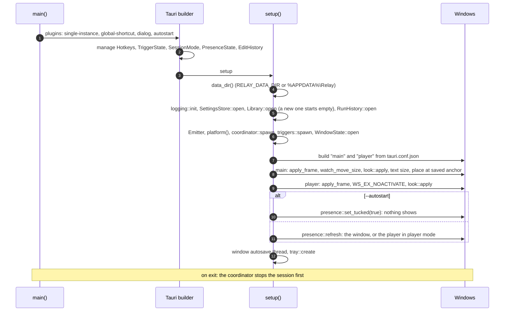
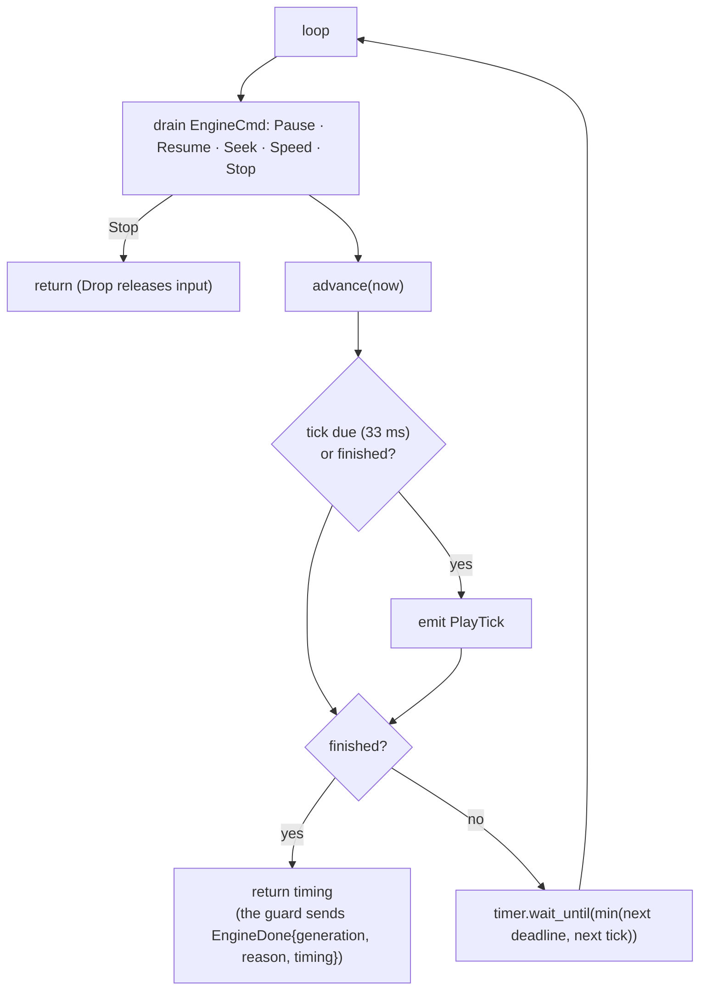

# The app (src-tauri)

`src-tauri` is the binary crate `relay`. It wires `relay-core` and `relay-platform` into a running app: threads, state, persistence, Relay's two windows, the tray and the commands the UI calls.

- [Startup](#startup)
- [Managed state](#managed-state)
- [The coordinator](#the-coordinator)
- [The playback engine](#the-playback-engine)
- [The recorder thread and the hook watchdog](#the-recorder-thread-and-the-hook-watchdog)
- [Global hotkeys](#global-hotkeys)
- [Triggers](#triggers)
- [The library and storage](#the-library-and-storage)
- [Undo history](#undo-history)
- [Settings](#settings)
- [Which window shows](#which-window-shows)
- [The window](#the-window)
- [The look](#the-look)
- [The tray](#the-tray)
- [The embedded player](#the-embedded-player)
- [Logging and panics](#logging-and-panics)

| File | Lines | Role |
| --- | ---: | --- |
| [`lib.rs`](../../src-tauri/src/lib.rs) | 267 | Plugins, managed state, setup (the two windows), window events |
| [`coordinator.rs`](../../src-tauri/src/coordinator.rs) | 1074 | The session thread, and the current macro |
| [`engine.rs`](../../src-tauri/src/engine.rs) | 52 | The app's side of playback: the engine (in `relay-playback`) reports to the UI and the coordinator |
| [`rec_thread.rs`](../../src-tauri/src/rec_thread.rs) | 206 | The recorder thread and the hook watchdog |
| [`hotkeys.rs`](../../src-tauri/src/hotkeys.rs) | 557 | Relay's keys and macro hotkeys: the rules, registration, the handler |
| [`triggers.rs`](../../src-tauri/src/triggers.rs) | 737 | Schedule, app-launch, pixel and image threads |
| [`commands.rs`](../../src-tauri/src/commands.rs) | 917 | Tauri commands (file-writing ones run off the main thread) |
| [`history.rs`](../../src-tauri/src/history.rs) | 235 | Undo and redo of macro edits |
| [`ipc.rs`](../../src-tauri/src/ipc.rs) | 281 | `EngineMsg` and the `Emitter` (both windows) |
| [`library.rs`](../../src-tauri/src/library.rs) | 1069 | Macros on disk, trash, import |
| [`data_file.rs`](../../src-tauri/src/data_file.rs) | 98 | A macro's data file, read when it's needed |
| [`run_history.rs`](../../src-tauri/src/run_history.rs) | 153 | `runs.json`, the run history |
| [`screens.rs`](../../src-tauri/src/screens.rs) | 86 | The screenshot taken as a recording starts |
| [`settings.rs`](../../src-tauri/src/settings.rs) | 517 | `settings.json`, Relay's keys, the first run's state |
| [`storage.rs`](../../src-tauri/src/storage.rs) | 77 | Data directory, atomic writes |
| [`presence.rs`](../../src-tauri/src/presence.rs) | 372 | Which window shows, and where the player goes |
| [`window_ctl.rs`](../../src-tauri/src/window_ctl.rs) | 997 | Placement, zoom, frame, focus; `window.json` |
| [`look.rs`](../../src-tauri/src/look.rs) | 115 | Frosted glass and the frame's theme |
| [`tray.rs`](../../src-tauri/src/tray.rs) | 143 | Tray icon and menu |
| [`logging.rs`](../../src-tauri/src/logging.rs) | 49 | Rolling logs, panic hook |

Line counts include each file's tests.

## Startup



- **Single instance**: a second launch calls `tray::show` on the first instance and exits.
- **Settings before the library**: `SettingsStore::open` tells a new install from a folder an older Relay used (see [Settings](#settings)), and the library is given Relay's keys (`set_relay_keys`), which no macro hotkey may take.
- **The windows are created in `setup`**, not by Tauri (`"create": false` for both in `tauri.conf.json`), once everything their first commands read is managed: the main window's `subscribe_engine` and `window_prefs` could otherwise arrive before the `Emitter` or the `WindowState` exist.
- **They start hidden** (`"visible": false`) and are shown by `presence` only after they've been sized and placed, so they never jump. Launched with `--autostart` (by the Windows *Run* key), Relay stays in the tray.
- **Closing**: `CloseRequested` on the main window is intercepted to put Relay in the tray when *Close to the tray* is on (`window_ctl::close_or_hide`, shared with the × button); the player's is always refused. Each window's events go to its own handler (`on_player_event` for the player: a drag, a scale change).
- **Quitting**: on `RunEvent::Exit` (the tray's Quit, the × with *Close to tray* off, Windows shutting down), the coordinator gets `Cmd::Shutdown` and stops what's running, releasing held keys and saving a recording in progress, before the process ends (up to 3 s).

## Managed state

Tauri's `app.manage` holds everything shared. Commands get it with `State<'_, T>` (or `AppHandle::state` in the `async` ones), threads through `AppHandle::state`. Locks are `parking_lot`'s, which don't poison: a panic on one thread can't make every other thread's `lock()` panic too.

| State | Type | Used by |
| --- | --- | --- |
| Library | `Mutex<Library>` | Commands, coordinator, triggers, hotkeys |
| Settings | `Mutex<SettingsStore>` | Commands, coordinator |
| Emitter | `Arc<Emitter>` | Everything that talks to the UI |
| Platform | `Arc<Platform>` | Commands (pixels, processes), coordinator, triggers |
| Coordinator | `CoordinatorHandle` (a `Sender<Cmd>`) | Commands, hotkeys, tray, triggers |
| Session mode | `SessionMode` (`RwLock<Mode>`, updated as soon as a transition is decided, and the current macro) | Commands that must refuse while busy, `current_macro`, `show_window` |
| Hotkeys | `Hotkeys` (the wanted set, whether a key field holds them, registered macro hotkeys, their errors) | Hotkey handler, coordinator, `set_triggers`, `hold_hotkeys` |
| Trigger pause | `TriggerState` (`AtomicBool`) | Triggers, coordinator, tray |
| Edit history | `EditHistory` | `edit_macro`, `undo_edit`, and every command that returns a `MacroView` |
| Run history | `Mutex<RunHistory>` | Coordinator, `list_runs` |
| Window | `WindowState` (`window.json`, the main window's size and zoom, the player's anchor) | Window commands and events, `presence` |
| Presence | `PresenceState` (tucked, aside, the last session, where the player is) | `presence`, the coordinator, the tray |
| System look | `Mutex<SystemLook>` (what Windows offers for the glass) | `system_look`, `update_settings`, focus events |

Locks are held briefly. The rule that matters: **nothing holds a lock while it calls into the main thread** (window, tray and hotkey calls block until the main thread runs them), because the main thread may need that lock.

## The coordinator

[`coordinator.rs`](../../src-tauri/src/coordinator.rs) is a thread that loops over `Receiver<Cmd>`:

```rust
pub enum Cmd {
    Input(Input),                 // ToggleRecord, TogglePlay{from}, Stop(reason), Kill, …
    HotkeyPlay,                   // the play key: play from the last idle playhead
    Escape, StopKey,              // from the hook during a session
    EngineDone { generation, reason, timed_out_at },  // playback `generation` ended on its own
    Select { id, by },            // a window (`by` its label) opened a macro
    Seek(f64),
    Speed { id, speed },          // applies if `id` is the macro playing
    RunMacro { id, source },      // a trigger or macro hotkey
    LogSkip { id, source, reason },  // a trigger that won't run (a missed schedule), for the run history
    SetTriggersPaused(bool),
    HookLost,                     // from the watchdog
    Shutdown(Sender<()>),         // Relay is quitting
}
```

Every `Input` goes through `session::step`, and the coordinator performs the returned effects in order (see [the state machine](core.md#the-session-state-machine)).

**The current macro** is the one Relay's play key and the player play. It's the coordinator's (`current`, mirrored in `SessionMode` for `current_macro`), set by `Cmd::Select` while idle (a window opened a macro) and by a new recording. `set_current` emits `Current { macro_id, by }` to both windows, so the other window follows: the main window and the player always show the same macro. A triggered run plays its macro without announcing it (`before_trigger` keeps the macro that was current, put back when the session is idle again), so a trigger never switches what the user has open.

The loop waits on the channel; while a recording countdown runs, it waits with a 50 ms timeout instead, and each wake reports the time left or, at zero, feeds `CountdownDone`. Each command runs under `catch_unwind`: a bug in one ends the session cleanly (with an error for the user) instead of killing the thread every later session needs. The coordinator is generic over Tauri's `Runtime` (and so are the few helpers it calls on the app), so a unit test runs the real thread on Tauri's mock runtime: a command that panics mid-countdown (`Cmd::Panic`, test-only) leaves it idle, tells the UI, doesn't go on to record, and later commands still work. Hotkey registration skips itself when the global-shortcut plugin isn't there, as in that test.

A few effects in detail:

**StartRecording**
1. Start the hook in `HookMode::Record { own, skip_vks, esc_stops }`, with the kill switch as set (`KeyChord::parse(keys.kill)`) and a bounded channel of 8,192 events. `own` is both of Relay's windows (`own_windows`); `skip_vks` is the record key's virtual key, since the record key stops a recording through its hotkey; `esc_stops` comes from the *Esc stops recording* setting.
2. Read the double-click settings, create a `Recorder` (with the same kill switch), and spawn the recorder thread. With *Screenshot* on, a thread captures the desktop, leaving out both windows.
3. If the hook fails, report the error and queue `Input::Stop` so the transition in progress completes first.

**StopRecording**
1. Drop the hook, `finish()` the recorder thread, and get the events (a recorder that panicked reports an error instead).
2. If meaningful, build `RecordingMeta` (OS, virtual desktop, monitors, double-click settings, and the **anchor window** under the first click), name it *Recording N*, `insert_front` into the library (which keeps it in memory even if writing the file fails, and says so: `Unsaved`), make it the current macro, take Relay out of the tray (`presence::untuck`), ask for the window in front at the next `EmitMode`, and emit `Saved` and `LibraryChanged`.

**StartPlayback { from }**, in small steps (`start_playback` calls one helper per step):
1. Load the current macro. None? Report *Select a macro to play* and finish with `Error`.
2. **The data file** (`data_file::for_playing`): its rows, or the message that refuses the run (see [The library and storage](#the-library-and-storage)).
3. **Hand the focus back** (`hand_focus_back`): if one of Relay's windows is the foreground window (Play was clicked), `restore_previous` activates the app the user was in. If Windows will block input to it (`input_blocked`), emit a `Notice`.
4. **Window coordinates** (`window_offset`): find the anchor window by exe and class, and use how far it moved as the offset. Missing? Emit a `Notice` and use screen coordinates.
5. **The player comes up now** (`presence::update` with the session and the macro's clicks), so its rect is known before the first click: in a free corner clear of the macro's clicks for a triggered run beside the window.
6. **Click-through** (`click_through_if_needed`): if any click (after the offset) lands inside the player, make the player ignore the cursor for this playback (undone in `end_playback`).
7. **Stop keys** (`watch_for_stop_keys`): a hook in `HookMode::Watch { stop_on_key, pass_vks: [the play key's vk], report_kill_switch: false }` with the kill switch as set; a small thread forwards `Escape` and `StopKey` to the coordinator.
8. Build a `PlayPlan` (with both windows as `own`, for Find image) and spawn the engine with the next **generation** number.

**Playback generations.** Every playback gets a number, and the engine's `EngineDone` carries it. A message from a playback that was already stopped (it can be queued behind a Stop and a new Play) is ignored, so it can't end the next one. `Finished` is sent once, by the coordinator, with the timing the engine returns, whether playback completed or was stopped.

**EmitMode(mode)** updates the tray tooltip, sets `WS_EX_NOACTIVATE` on the main window during sessions (so clicking it doesn't take the keyboard from the app being recorded or played into), shows the windows the mode calls for (`presence::update`, bringing the window to the front after a recording), and emits `Session { mode, macro_id, source }`. Back to idle after a triggered run, it puts the current macro back.

Runs are counted (`runs += 1`, `last_run = now`) only when the engine reports `Completed` (`counts_as_run`).

**The play key's playhead.** The play key is handled in Rust (`Cmd::HotkeyPlay`), so the coordinator keeps its own `idle_playhead`, set the way the UI moves its playhead (`playhead_after(reason, duration, timed_out_at)`): back to 0 after a stop, the kill switch, a key press or an error; the end after a complete run (so the key starts over); the check's time after a pixel timeout (`EngineDone.timed_out_at`). Seeks during playback move it too, and opening a macro puts it at 0.

**Triggers** go through `admit(paused, name, mode, desktop_available)`: ignored while paused or for a deleted macro, skipped with a notice while busy, skipped silently when the screen is locked. A skip goes into the run history.

**Every mode change** goes through `set_mode`, which also updates the shared `SessionMode` the commands read, including when a command panicked, so `delete_macro` and edits never stay refused as "busy".

## The playback engine

The engine lives in [`relay-playback`](../../crates/relay-playback/src/engine.rs), shared with the [exported player](architecture.md#the-exported-player). It separates the **decision** from the **thread**:

- `Engine` is plain logic. `advance(now)` injects everything due at `now` and returns `Some(reason)` when done. It takes wall times as arguments and gets its injector, pixel reader and image finder as boxed traits, so tests drive it with a fake clock, a recording injector and a fake screen.
- `spawn` runs it on the `relay-engine` thread with the platform timer, reporting ticks, notices and its end to a `PlaybackSink`. The thread returns the run report when it ends; when it ends on its own (or panics) a guard calls `done`, with `Error` for a panic. Dropping the `EngineHandle` stops the thread.
- The app's sink, in [`src-tauri/src/engine.rs`](../../src-tauri/src/engine.rs), turns ticks and notices into `EngineMsg`s and the end into `EngineDone` for the coordinator, with the playback's generation, so the session never stays stuck in *Playing*.



What `advance` does:

- Converts `now` to macro time with the `PlayClock` and dispatches every event whose planned time (from `plan_times`, with humanize) has passed. Each dispatch records its **lateness** (now − deadline) for the timing stats.
- **Move / Button / Wheel**: move to the position (+ the window offset) first, then press, release or scroll.
- **Key**: inject by scan code, virtual key, code or text (see [Injection](platform.md#injection)).
- **Tracks held input**: `keys_down` and `buttons_down`. `release_all` releases them newest first, and is called on stop, seek, loop end, pixel timeout and in `Drop`.
- **PixelWait**: seeks the clock to the check and **pauses** it, then polls the pixel every 30 ms. On a match, it seeks to the end of the `IF` block and resumes. After `timeout_ms`, it finishes with `PixelTimeout` and remembers the step number for the notice. Time paused by the user doesn't count toward the timeout.
- **FindImage**: the same, looking for the image every 250 ms with [`finder::find_on_screen`](../../crates/relay-playback/src/finder.rs) (a 1:1 capture of its area, moved by the window offset, or of the whole desktop, with what shows of Relay's window at that moment painted over: not the windows in front of it). When found, it moves to the match plus the click point times the match's scale, presses and releases the button, and resumes at the end of the `FIND` block. The last poll is at the timeout, so it ends on time. A timeout finishes with `PixelTimeout` too (the playhead rule is the same); `timeout_notice` says *Image not found at step N* instead.
- **Text**: fills in the template with the `TextFiller` (the loop number, `chrono::Local::now()` and the clipboard, read on the engine thread), seeks the clock to the step and **pauses** it, then types a character every `CHAR_MS` / speed with `Injector::text`. Once it's typed, it resumes from where typing got to in the step (`t + characters × 10 ms`), so what follows keeps its time, or from the step's end if the text ran over it, which pushes what follows back. A pause stops the typing; a seek leaves it. Each character is a press and a release, so nothing stays held.
- **End of the macro**: release everything, then either finish (`Completed`) or start the next loop with a fresh humanize seed, carrying the overshoot into it.

`TimingStats { events, p50_ms, p99_ms, max_ms }` is logged and sent with `Finished`. Lateness goes into a fixed histogram (10 µs buckets up to 20 ms, plus the exact maximum), so an endless loop measures in constant memory.

The first injection error (usually UIPI) is reported once as a `Notice`. Playback continues, since later events may go to another window.

## The recorder thread and the hook watchdog

[`rec_thread.rs`](../../src-tauri/src/rec_thread.rs) drains the hook channel into the `Recorder` and, every 100 ms:

- sends `RecProgress { elapsed_ms, desktop, moves, steps }` (to both windows: the player says how many steps, and the last one). `moves` holds only the cursor samples since the last message. `steps` is re-grouped and included only when something other than the cursor path changed, which keeps long recordings cheap.
- runs the **hook watchdog**.

Windows removes a low-level hook it considers too slow **without any notification**. The tell is a cursor that moves while no mouse events arrive:

```rust
// HookWatchdog::check(now, cursor): true when the hook looks dead
moved && now - last_event > 1000 ms && now - last_alarm > 5000 ms
```

Mouse events the hook filters out (injected input, with *Ignore simulated input* on) would look like silence, so the hook beats a `MousePulse` (an atomic timestamp in `HookConfig`) on every mouse event it sees, filtered or not, and the watchdog counts that as a sign of life.

On an alarm, the coordinator stops the old hook and starts a new one with the **same config and the same sender**, so the recorder keeps going with a small gap, and the user gets a notice.

`Esc` arrives on the same channel as `RawKind::Escape` and is forwarded to the coordinator as `Cmd::Escape`.

## Global hotkeys

[`hotkeys.rs`](../../src-tauri/src/hotkeys.rs) uses `tauri-plugin-global-shortcut`, which is `RegisterHotKey` on Windows. Unlike a low-level hook, it fires even when an elevated window is focused, and it never sees keys it isn't registered for.

**Relay's keys are settings** (`Settings.keys`, a `RelayKeys`: `record`, `play`, `player`, each `Option<String>`, and `kill`, a `String`), as the UI shows them (*Ctrl + Shift + F9*). A key set to `None` isn't registered: the buttons do its job. The handler compares what was pressed with the keys as they are now (`action_for`), so a change applies at the next refresh without restarting anything:

| Key | Default (new install) | After an upgrade | Does |
| --- | --- | --- | --- |
| `record` | Ctrl + Shift + F9 | F9 | `ToggleRecord` |
| `play` | Ctrl + Shift + F10 | F10 | `HotkeyPlay` |
| `player` | Ctrl + Shift + M | Ctrl + Shift + M | Player mode on or off (`presence::set_player_mode`) |
| `kill` | Ctrl + Alt + Backspace | Ctrl + Alt + End | `Kill`; never `None` |

**Which hotkeys are registered depends on the session**, so Relay only takes keys it needs right now:

| Set | Registered |
| --- | --- |
| `Idle` | All four of Relay's keys that are set, and every enabled macro hotkey |
| `Recording` | The record key and the kill switch |
| `Playing` | The play key and the kill switch |

**The rules** (`check_key`, and `check_keys` for all four at once): each must parse as a hotkey (`parse_combo`), none twice, and none a macro's enabled hotkey; the kill switch can't be `None`. `set_relay_key` and `update_settings` refuse a key that breaks one with `code: "hotkey"` and the reason (*Ctrl + Shift + M is already Relay's “Show the player” key*, *… already runs “Daily report”*), and save nothing. The other way, `conflict()` refuses a macro hotkey that's one of Relay's keys as set now (`Library::relay_keys`) or another enabled macro's, **before** saving.

**While a key field listens** (Settings → Keys, a macro's hotkey), the UI calls `hold_hotkeys(true)`: `hold` sets `held` and refreshes, and a refresh while held unregisters everything, so a combination Relay or a macro has reaches the field. `hold_hotkeys(false)` registers them again.

**A key another program has**: registering one of Relay's keys fails when another program registered it first. The failure is reported once per run and combination (`Reported`), as an error: *Another program uses Ctrl + Alt + Backspace, so Relay's “Stop everything” key doesn't work. Choose another in Settings → Keys.*

**Registration runs on the main thread, one refresh at a time.** The plugin hands every (un)register call to the main thread anyway, and a thread that waited for that while holding a lock the main thread needed would deadlock. So:

- The coordinator only records the wanted set (`set_active`) and posts a refresh (`run_on_main_thread`), without waiting.
- `refresh` re-registers after macro hotkeys change (delete, restore, import); `refresh_and_wait` does the same and waits, from `set_triggers`, so the hotkey errors it returns are current.
- `refresh` also runs when Relay's keys change (`update_settings`).
- A refresh reads the *latest* wanted set, Relay's keys and the macros' hotkeys when it runs, so refreshes from anywhere, in any order, end in the right state. It snapshots the triggers first, registers without holding any lock, and only then stores what it registered and why others failed: a duplicate combo (*used by another macro*) or a registration failure, which means another app owns it (*taken by another app*). `TriggerStatus.hotkey_error` shows the reason in the UI.

`parse_combo("Ctrl + Alt + 1")` turns the UI's labels into a `Shortcut`: a modifier is required unless the key is F1–F24, Shift alone isn't enough for a key that types, and the last key can't be a modifier.

**Warnings** don't refuse anything: `key_warning(combo)` says what setting a key costs, for Relay's keys and macro hotkeys alike. It asks the keyboard layout in use what Ctrl + Alt (+ Shift) and the key type, as Windows treats that as AltGr (`CharTranslator::translate` with left Ctrl and left Alt held), and passes it to `relay_core::keys::key_warning` (see [relay-core → Keys](core.md#keys)).

## Triggers

[`triggers.rs`](../../src-tauri/src/triggers.rs) runs four threads. Each polls every macro's triggers through `Library::all_triggers`, an `Arc` the library rebuilds when triggers change, so polling doesn't copy anything and changes apply without restarting anything.

| Thread | Period | Logic |
| --- | --- | --- |
| `relay-schedule` | 5 s | For each enabled schedule, compute `next_run` from the **previous tick's time**. If it's ≤ now, fire it, unless it's more than 2 minutes late (the PC slept), in which case log and skip. Comparing wall-clock times each tick survives sleep and clock changes. |
| `relay-app-launch` | 2 s | One `ProcessWatcher`. A `ProcessLaunchEdge` per (macro, exe). On a launch edge, a short-lived thread sleeps `delay_ms`, then fires. |
| `relay-pixel-trigger` | 250 ms | A `PixelEdge` per macro, reset when the watched position changes. Samples `Screen::pixel` and fires on the edge. A read that fails (locked screen, UAC) is no sample at all, so it can't re-arm the edge. |
| `relay-image-trigger` | 500 ms | Only while an image trigger is on. An `ImageWatch` keeps a `PixelEdge` and the decoded picture per macro, reset when the image (by hash), match or area changes. A [`finder::Looker`](../../crates/relay-playback/src/finder.rs) captures each area once per round, however many triggers look there, and remembers each search's answer with the frame's fingerprint, so an unchanged screen isn't searched again. What shows of both of Relay's windows is painted over first. A capture that fails is no sample. |

`fire()` sends `Cmd::RunMacro`; the coordinator decides. It:

1. ignores it if triggers are paused,
2. emits *Skipped "…": Relay was busy* if not idle,
3. logs and skips if `input_desktop_available()` is false (lock screen, UAC),
4. otherwise plays the macro (without announcing it as current, see [The coordinator](#the-coordinator)) by feeding `Input::Trigger(source)`, which plays from 0. The player comes up in a free corner (see [Which window shows](#which-window-shows)), and the main window says what runs, with Stop.

The kill switch's `PauseTriggers` effect sets `TriggerState`, unchecks the tray's *Triggers active* item and emits `TriggersPaused`.

## The library and storage

[`library.rs`](../../src-tauri/src/library.rs) keeps every macro in memory (`Vec<Entry>`, in Library order) and mirrors changes to disk immediately:

| Operation | Disk effect |
| --- | --- |
| `insert_front`, `save` | Write `macros/<id>.rly`, then `library.json`. The entry's cached step count and length are refreshed. |
| `save_stats` | `library.json` only (a run was counted) |
| `duplicate` | New id, unique name "… (copy)", no triggers, the same data file, inserted after the original |
| `trash` | Move the file to `macros/.trash/` (or write it there from memory if its file was never saved; if that fails too, it's kept in memory and written with the next `save`, or at quit), remember the macro that came after it, its name and stats in `library.json` |
| `restore` | Move it back before the macro that came after it (following the chain through other trashed macros), with its stats and triggers. If its enabled hotkey now belongs to another macro, it comes back with the hotkey off and the user is told. |
| `import` | Many at once: new id if the id is already in the library or the trash, unique name (a trailing number counts on: "Report 2" → "Report 3"), inserted at the top in order, one index write. If writing one fails, the ones before it are kept. |
| `set_triggers`, `set_data_file` | `library.json` |

`Library::open` loads every `.rly` in `macros/` (skipping broken files), orders them by `library.json` (files it doesn't list go last, newest first), and attaches stats and triggers. A `library.json` that isn't valid JSON is renamed `library.json.bad`. One that exists but can't be *read* (locked by another program, say) is left alone: the index isn't written for the rest of the run, so it's never overwritten with an empty one; saves report that instead. Every problem found at startup is shown to the user, not just logged. With no index and no files, **a new library starts empty**: nothing is written until there's something to keep (the first run's guided recording replaces the samples). The unit tests seed the four samples themselves with `Library::open_with_samples` (test-only), which adds them, their design hotkeys present but disabled, to a new library; the end-to-end tests copy them into the data folder (see [Testing](testing.md#end-to-end-testing)).

The library also keeps Relay's keys (`set_relay_keys`, at startup and when they change), so a macro's hotkey can't take one. Its rows (`MacroListItem`) carry what else runs each macro (`also`: `MacroTriggers::also_on`) and when it was made (`created_at`), for the Library's *Also runs* column and its sort by newest.

A macro's data file is a path in its `Entry` (`data_file`), never a copy. [`data_file.rs`](../../src-tauri/src/data_file.rs) reads it when it's needed: `for_playing` (the coordinator's `start_playback`, for manual and triggered runs alike, and `export_macro` for a program) returns its rows or the message to show, and `info` is what the inspector's Macro tab shows (`get_data_file`). A playback it refuses goes the way of *Select a macro to play*: an `error` message, then `PlaybackFinished(Error)`, so nothing is counted, and no `Finished` is sent. A triggered run it refuses is added to the run history as skipped (`data_file`), with the message as its `note` (`data_file_skip`), since no one may have been watching.

[`storage.rs`](../../src-tauri/src/storage.rs): the data directory is `%APPDATA%\Relay`, or `RELAY_DATA_DIR` if set. `write_atomic` writes a uniquely named temporary file in the same folder and renames it over the target, so a crash never leaves a half-written file and two writers never share a temporary one.

**When a save fails**, the change is kept in memory and the user gets an error saying it wasn't saved; the command still returns the new state, so the UI shows what Relay actually holds. That holds for edits, triggers, duplicating, deleting and restoring.

## Undo history

[`history.rs`](../../src-tauri/src/history.rs): `EditHistory` keeps, per macro id, an undo and a redo stack of changes, up to 100 deep, in memory only. A change is the name it replaced and, for all but renames, a [`Splice`](../../crates/relay-core/src/splice.rs) of the events: the run of events the edit replaced, and the one time shift it gave the events after them. Inserting a wait, deleting a step or changing a pause shifts everything after it, so this keeps a few events where a copy of the macro would keep thousands.

- `edit_macro` (refused while a session runs) takes a `Snapshot` of what the edit may change, applies the `EditOp`, and on success records the change from the snapshot (`Splice::between`) and clears the redo stack, unless the edit changed nothing. Renames less than 2 s apart are one entry, since the UI saves the name as it's typed. A batch (`EditOp::Batch`, edits on several selected steps) is one change, so one undo reverts it all.
- `undo_edit(id, redo)` reverts the top change of one stack (`Splice::revert`, which returns the change that re-applies it), pushes that on the other, and saves the `.rly`.
- `view_of(macro, history)` fills `MacroView.can_undo` and `can_redo`, so every view the UI gets knows whether its buttons are enabled.

Playback options and triggers aren't edits and bypass the history.

## Settings

[`settings.rs`](../../src-tauri/src/settings.rs): `settings.json` is read field by field, so missing, unknown or invalid fields fall back to defaults without losing the others, and older files keep loading. A file with an invalid value is set aside as `settings.json.bad` and the user is told. `update_settings` checks Relay's keys (`check_keys`), replaces the whole struct, saves atomically, and then applies what changed: the hotkeys and the tray's Record item if the keys did, the look on both windows, the main window's text size (`window_ctl::set_text_size`), the player's size and on-top state (`presence`). It sends `Settings` to both windows, so a change made in one shows in the other. Recording settings are read when a recording starts, so changes apply to the next one. See [File formats → settings.json](file-formats.md#settingsjson) for every field.

**A new install or an upgrade.** `SettingsStore::open` decides what a missing value means from the folder: one an older Relay used (`settings.json`, `library.json` or `macros\` exists) starts from `Settings::upgraded()`, a new one from `Settings::default()`. They differ in two fields:

- `keys`: `RelayKeys::new_default()` (Ctrl + Shift + F9, Ctrl + Shift + F10, Ctrl + Shift + M, Ctrl + Alt + Backspace) or `RelayKeys::legacy()` (F9, F10, Ctrl + Shift + M, Ctrl + Alt + End), so an upgrade keeps the keys its user knows;
- `intro`: `welcome` (the first run's three screens) or `keys` (the keys screen, once). The UI sets it to `done` when the first run ends or is skipped.

The same base fills in missing fields while parsing, so an older Relay's `settings.json`, without `keys`, keeps F9 and F10. `set_relay_key(key, combo)` changes one key (`RelayKeys::with`; the kill switch stays if `combo` is `None`) through `update_settings`.

## Which window shows

Relay has two windows, both declared in `tauri.conf.json` and both loading the same page: **`main`** (a normal, resizable window, never on top, in the taskbar) and **`player`** (600 × 64, not resizable, not in the taskbar, `focus: false`, on top by default). [`presence.rs`](../../src-tauri/src/presence.rs) decides which of them shows, with one pure rule:

```rust
pub fn shown(p: Presence, session: Session, settings: &Settings) -> Shown
// Presence { player_mode, tucked, aside }   what the user chose
// Session: Idle | Recording (the countdown included) | Playing { triggered } (paused included)
// Shown { main, player }
```

| | Main window | Player |
| --- | --- | --- |
| `aside` (the picker is on the screen) | hidden | hidden |
| Player mode | hidden | shown |
| `tucked` (in the tray) | hidden | shown only during a session |
| Idle | shown | hidden |
| Recording | hidden if *Hide the window while recording* (on by default) | shown when the window isn't |
| Playing | hidden if *Hide the window while playing* (off by default) | shown when the window isn't, and for every triggered run |

`update(app, session, clicks, focus_main)` applies it: it shows or hides the main window (focusing it when asked, after a recording), shows the player with `ShowWindow(SW_SHOWNOACTIVATE)` so it never takes the keyboard, hides it the same way, and sets the player's always-on-top from *Keep the player on top* (`always`, `sessions`, `never`). The coordinator calls it on every mode change and when a playback starts; `refresh` calls it again with the last session when a choice changes. Window calls go to the main thread, so the state's lock is never held around them.

- **Player mode** (`set_player_mode`, from the player key, the editor's player button or the player's expand key) is saved in `window.json` at once and sent to both windows as `PlayerMode`. Relay starts in it if it was on.
- **The tray** (`set_tucked`) hides both; a session in the tray still shows the player, so Stop is always on screen. A recording takes Relay out of the tray (`untuck`), so the window comes back on the new macro.
- **Stepping aside** (`step_aside`) hides both while the picker is on the screen (see `pick_pixel`), and brings them back after.
- **Where the player goes.** When it shows beside the main window (a triggered run, or with the window kept while playing), it goes in a corner of the window's monitor: `free_corner(work, size, margin, window, clicks)` tries the top right, top left, bottom right and bottom left, and takes the first clear of the window (with a 16 px margin) and of the macro's clicks (`relay_playback::plan::clicks_inside`), else the top right. Otherwise it goes at its own anchor (`window.json`'s `player_anchor`, its bottom-center, laid out like the main window with `window_ctl::layout`). A drag of the player moves the anchor (`on_player_moved`: anywhere but where it was placed is a drag).
- **Its size**: `player_css` (600 × 64 compact, 760 × 88 large, the *Player size* setting), zoomed by the text size up to 150% (`player_zoom`), and less where the work area is too narrow. `resize_player` places it again when either setting changes, or after it was dragged onto a monitor with another scale.
- **Its focus**: besides showing without activating, the player gets `WS_EX_NOACTIVATE` at startup, so a click on it never takes the keyboard. During a playback whose clicks land under it, it ignores the cursor (`set_ignore_cursor_events`), so the clicks reach the app beneath.

## The window

[`window_ctl.rs`](../../src-tauri/src/window_ctl.rs) positions the main window from Rust, since only Rust knows the monitors' physical geometry.

- **The anchor** is the window's **bottom-center** in physical pixels, saved in `window.json`. Placing it means: find the monitor whose bounds contain the anchor (or the nearest one, if its monitor is gone), compute the zoom, size the window, center it horizontally on the anchor with its bottom on the anchor, and clamp it inside that monitor's work area with a 16 px margin on every side. Clamping never changes the saved anchor: only the user dragging the window does. The default anchor is centered, 24 px above the bottom of the primary work area.
- **Zoom**: the window is 944 × 612 CSS px by default. On a work area too small for that (at the monitor's scale), `webview.set_zoom` scales it down to fit, clamped to 40–100%, then multiplies it by the *Text size* (100, 125, 150 or 200%), so everything grows with the text, the window too, as far as the work area allows. `set_text_size` places the window again when the setting changes.
- **The size** is Rust's: the user's (`window.json`'s `size`, never below `MIN_EXPANDED` = 760 × 520, and made to fit the work area by `fit_work`) or the default, at most 80% of the work area.
- **Resizing**: the window is `resizable`, and tao hit-tests the edges of an undecorated window (with `shadow: true`, the invisible borders and a top strip). `place` and `rescale` set `set_min_size(MIN_EXPANDED × zoom × scale)`, or what the work area holds. `WindowEvent::Resized` goes to `on_resized`, which records a size only while the user resizes: the window's subclass sets `RESIZING` on `WM_SIZING` and clears it on `WM_EXITSIZEMOVE`, so Relay's own `SetWindowPos` and the move loop's resize after a scale change don't count. The CSS size is `resized_css` (the client size over zoom × scale, rounded), and the anchor moves to the new bottom-center; both are saved half a second after the resize stops. A resize that crosses onto a monitor with another scale never holds a size (`WM_SIZING` clears `HELD_SIZE`, and `rescale` doesn't hold one while `RESIZING`).
- **The divider**: the inspector's width (`panes.inspector_w`, `null` for the default) is the UI's; `save_panes` writes it to `window.json` (sanitized: what isn't a size is dropped, a huge one capped), and `window_prefs` returns it at startup with player mode.
- **Moves** are tracked in `WindowEvent::Moved` and saved half a second after dragging stops. `ScaleFactorChanged` (dragged onto a monitor with another scale, or the scaling changed) re-sizes it with `rescale`, **after** the event: tao applies Windows' suggested rect once the handlers return, which would overwrite a size set inside them (and `run_on_main_thread` runs a task inline on the main thread, so the task is posted from another thread). `rescale` sizes the window for the monitor it's actually on, the one Windows took the new scale from, which isn't always the one holding the anchor (monitors of different heights). During a drag (`GUI_INMOVESIZE`) it keeps the top-left corner, so the window stays under the cursor; otherwise it lays the window out at the anchor as usual. Windows' move loop keeps re-applying the size it suggested (often a pixel or two off) on every mouse move, so after a scale change mid-drag the window **holds** `rescale`'s size: a subclass of the window (`watch_move_size`) substitutes it in `WM_WINDOWPOSCHANGING` until the drop, or until the next `WM_DPICHANGED` lets the window system's rect for that scale through. A watcher thread waits for the drop, releases the size and runs `rescale` once more, which also keeps the window inside the work area.
- **Frame** (`apply_frame`, both windows): on Windows 11, `DWMWA_WINDOW_CORNER_PREFERENCE = ROUND` (Windows' 8 px corners, which also clip the frosted glass) and `DWMWA_BORDER_COLOR = NONE`, so Windows draws no accent-colored border. On Windows 10 the calls fail harmlessly and the corners stay square. Relay can't round a frosted window itself: Windows paints Acrylic over the whole rectangle, whatever its shape.
- **Focus**: `WS_EX_NOACTIVATE` on the main window during sessions (see the coordinator). The window is never on top; only the player is.

## The look

[`look.rs`](../../src-tauri/src/look.rs): `SystemLook { glass_default, transparency }` is what this Windows offers: glass is on by default on Windows 11 (build 22000 and later, read from the registry), where Acrylic moves smoothly, and off on Windows 10; and Windows' *Transparency effects* setting (`EnableTransparency`), off meaning solid whatever Relay's setting. `glass(settings)` is `transparency && settings.glass.unwrap_or(glass_default)`.

`apply(window, settings, look)` frosts the window with Tauri's window effects (`Effect::Acrylic`, or none) and gives the frame the settings' theme (`system` follows Windows). It runs on both windows at startup, after `update_settings`, and when the main window gets the focus and `SystemLook::read()` finds that Windows changed (then `SystemLook` goes to both windows, whose pages draw a solid ground). Both windows are `transparent`, so the page draws its own ground over the glass (see [The frontend → The look](frontend.md#styling)).

## The tray

[`tray.rs`](../../src-tauri/src/tray.rs): left-click puts Relay in the tray or brings it back (`toggle`: `presence::set_tucked`; a minimized window is brought back). The menu has *Show / hide Relay*, *Record* (with the record key, `Record\tCtrl + Shift + F9`, renamed by `set_keys` when it changes), *Stop*, the *Triggers active* check item, *Open macros folder* and *Quit Relay*. The tooltip follows the session mode and names the record key (*Relay — recording (Ctrl + Shift + F9 to stop)*, or Esc when it's `None`). A second launch of Relay calls `tray::show`: the window, or the player in player mode.

## The embedded player

[`build.rs`](../../src-tauri/build.rs) builds the [player](architecture.md#the-exported-player) (`cargo build -p relay-player --release`) into `target/player` and copies it to `OUT_DIR`; `commands.rs` embeds it with `include_bytes!` as `PLAYER`, and `export_macro` with `format: "exe"` writes `format::bundle(PLAYER, macro)`. The first build takes a minute or two longer; later ones rebuild the player only when a crate it uses changes. Set `RELAY_PLAYER_EXE` to a prebuilt player to skip the nested build.

## Logging and panics

[`logging.rs`](../../src-tauri/src/logging.rs) sets up `tracing` with a daily rolling file in `logs/` (`relay.YYYY-MM-DD.log`, 7 kept), non-blocking, at INFO level. A panic hook logs the thread name and message before the default hook runs.

Log lines record **what happened** (session transitions, recordings saved with their event counts, triggers fired or skipped, playback timing, errors), **never what was typed**. Keep it that way when adding logs.

The release profile uses `panic = "unwind"` (the default, deliberately not `abort`): a panic on the engine thread unwinds through `Engine`'s `Drop`, which releases every held key and button.

---

<p align="center"><a href="platform.md">← relay-platform</a> · <a href="README.md">Contents</a> · <a href="ipc.md">IPC →</a></p>
