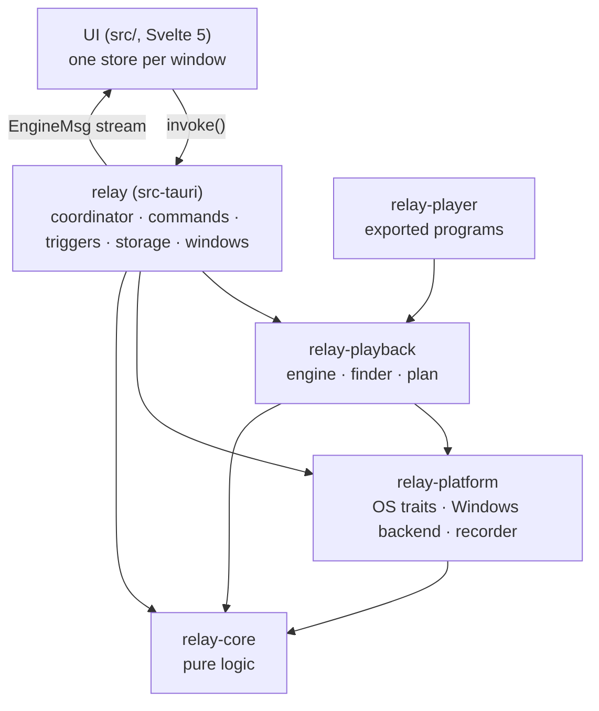
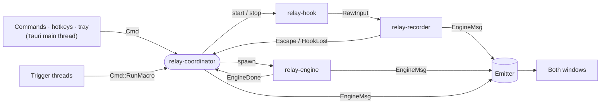
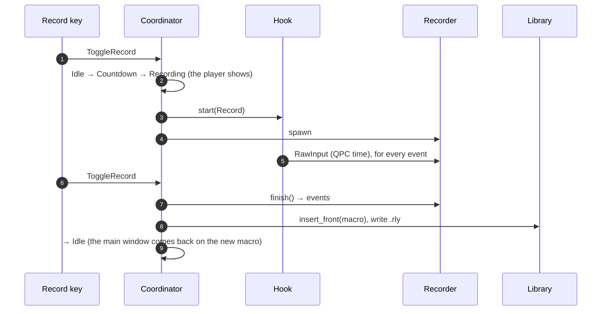
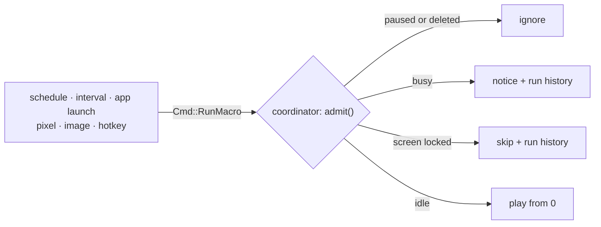
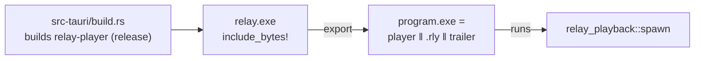

# Architecture

Relay is a Rust process that owns all state and everything OS-related, and a Svelte UI that shows it in two WebView2 windows: the **main window** (Library, editor, Settings) and the **player** (a small bar on top, shown while the main window isn't). This page is the map: the crates, the threads, how a recording, a playback and a trigger travel through them, and the rules that keep it reliable.

- [The crates](#the-crates)
- [Threads](#threads)
- [How a recording flows](#how-a-recording-flows)
- [How a playback flows](#how-a-playback-flows)
- [How a trigger flows](#how-a-trigger-flows)
- [The exported player](#the-exported-player)
- [Rules the code follows](#rules-the-code-follows)

## The crates



| Crate | Owns | Builds on Linux |
| --- | --- | :---: |
| [relay-core](core.md) | The model, steps, edits, the file format, timing, the session state machine, schedules and trigger edges. No I/O. | yes |
| [relay-platform](platform.md) | The OS traits (hooks, injection, timer, screen, windows), the Windows backend, a stub, and the OS-independent recorder, key map and picker logic | yes (stub) |
| relay-playback | The playback engine and its thread, finding an image on the real screen, planning a playback. Shared by the app and the player. | yes |
| relay-player | The exported program: a small Win32 player for the macro appended to it | logic only |
| [relay](app.md) (`src-tauri`) | Threads, state, files, commands, Relay's keys, the tray, both windows, triggers | no |

The UI never touches the OS or the disk: it calls commands and listens to one message stream, which Rust sends to both windows ([IPC](ipc.md)).

## Threads

A handful of long-lived threads talk over [crossbeam](https://crates.io/crates/crossbeam-channel) channels. One thread, the coordinator, owns the session; everything else sends it a `Cmd`.



| Thread | Lives | Does |
| --- | --- | --- |
| `relay-coordinator` | Always | Owns the session and the current macro. Runs `session::step`, then performs its effects: hook, recorder, engine, hotkeys, which windows show. |
| `relay-hook` | During a session | The low-level keyboard and mouse hooks. Callbacks filter, timestamp and `try_send`, nothing more. |
| `relay-recorder` | While recording | Raw input → events; progress 10 times a second; the hook watchdog |
| `relay-engine` | While playing | Injects events on time, waits on pixel checks and images, ticks 30 times a second. High priority. |
| `relay-stop-keys` | While playing | Forwards Esc and stop keys from the hook to the coordinator |
| `relay-schedule`, `relay-interval`, `relay-app-launch`, `relay-pixel-trigger`, `relay-image-trigger` | Always | Poll their triggers and send `Cmd::RunMacro` when one fires |
| Tauri main thread | Always | Both windows, the tray, global hotkeys, commands that don't write files |

## How a recording flows



On the way, the **hook** drops Relay's own injected input (tagged `RELAY_MAGIC`) and input to Relay's windows; the **recorder** throttles cursor samples, maps scan codes to key codes and translates keys into the characters they type; **on stop**, presses are balanced (`normalize`) and a recording with no real content is discarded. What gets recorded is specified in [Recording](../spec/recording.md).

## How a playback flows

```mermaid
sequenceDiagram
    autonumber
    participant C as Coordinator
    participant H as Hook
    participant P as Engine
    participant OS as SendInput
    C->>C: Idle → Playing, generation += 1
    C->>H: start(Watch): Esc and stop keys
    C->>P: spawn(PlayPlan)
    loop each event
        P->>P: timer.wait_until(deadline)
        P->>OS: inject (tagged RELAY_MAGIC)
    end
    alt stopped
        H->>C: Escape → stop(); Drop releases held input
    else finished
        P->>C: EngineDone{generation}
    end
    C->>C: add a RunEntry to the run history, → Idle
```

Each deadline comes from a `PlayClock` (macro time = anchor + elapsed wall time × speed). Speed changes, pauses and seeks re-anchor it, so timing never drifts. The engine sleeps on a high-resolution waitable timer, then spins the last millisecond: in a 10-minute soak, p99 lateness was 0.008 ms.

Every playback, however it ends, goes through the coordinator's `finish_playback`, which records the run.

## How a trigger flows



Trigger threads only detect events; the coordinator, which knows the session, decides. A triggered run doesn't change the windows' current macro: the player comes up in a free corner, and the current macro is put back when the run ends. The rules are [Triggers](../spec/triggers.md).

## The exported player

**Export → Standalone program** writes relay-player's exe with the macro's `.rly` and a 20-byte trailer appended ([File formats](file-formats.md#exported-programs)). The player reads its own file and plays the macro with the same engine as the app.



The player builds in its own target folder (`target/player`), because a nested cargo in the same folder deadlocks on its lock; `RELAY_PLAYER_EXE` skips the build with a prebuilt one. Its options, window and exit codes are in [Export and import](../spec/export-import.md).

## Rules the code follows

Each of these has caused a real bug when broken.

| Rule | Why |
| --- | --- |
| **Pure logic lives in relay-core and takes time as an argument** (`now`) | It's tested exhaustively, with property tests, on Linux CI. Threads that read the clock can't be. |
| **Threads only sleep and feed pure types** (`Engine::advance`, the trigger watches, `presence::shown`, `admit`) | The decision gets a unit test; the thread is too thin to break. |
| **Every mode change goes through `coordinator::set_mode`** | It also updates the shared `SessionMode` that commands read, even after a panic, so nothing stays "busy". |
| **Playbacks carry a generation** | A late `EngineDone` from a stopped playback can't end the next one. |
| **Never hold a lock while calling into the Tauri main thread** | Window, tray and hotkey calls wait for the main thread, which may be waiting for that lock: deadlock. Hotkeys register only on the main thread. |
| **Hook callbacks don't allocate, lock, log or block** | Windows silently removes a slow hook. A watchdog reinstalls one that's lost. |
| **Anything that presses a key releases it on every path** (stop, loop end, seek, drop, panic) | A stuck Ctrl breaks the user's PC. Release builds unwind on panic so the engine's `Drop` still runs. |
| **A failed save never loses data; an unreadable file is never overwritten; writes are atomic** | The change stays in memory and the user is told. A file locked by another program isn't replaced by an empty one. |
| **Which window shows is decided only by `presence::shown`** | One pure, tested function decides for every state, so the two windows never disagree. |
| **Relay's keys are settings** (`RelayKeys`), never hard-coded | Users change them; old data folders keep F9 and F10. |
| **The UI never edits steps itself:** it sends an `EditOp` and shows the `MacroView` it gets back | One implementation of every edit, in relay-core, with its invariants checked. |
| **Logs say what happened, never what the user typed** | Macros type passwords. |

---

<p align="center"><a href="README.md">← Engineering guide</a> · <a href="core.md">relay-core →</a></p>
