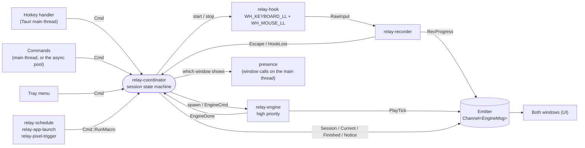
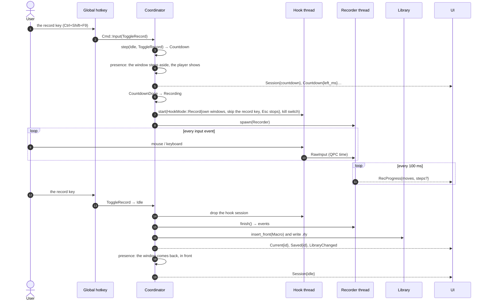
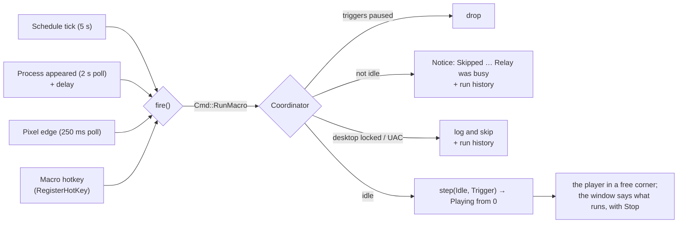
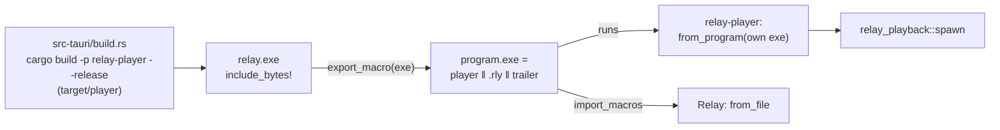

# Architecture

Relay is a Tauri 2 app: a Rust process that owns everything OS-related and all state, and a Svelte UI that shows it in two WebView2 windows: the **main window** (the Library, the editor and Settings) and the **player** (a small window on top, shown while the main window isn't). The Rust side is split into five crates so the logic that matters most can be tested without Windows, and so a macro can play without the app, as an [exported program](#the-exported-player).

- [The crates](#the-crates)
- [Threads](#threads)
- [How a recording flows](#how-a-recording-flows)
- [How a playback flows](#how-a-playback-flows)
- [How a trigger flows](#how-a-trigger-flows)
- [The exported player](#the-exported-player)
- [Design principles](#design-principles)
- [Repository layout](#repository-layout)

## The crates

```mermaid
flowchart TB
    subgraph ui["UI (src/, Svelte 5): the main window and the player"]
        store["RelayStore<br/>(one per window)"]
        comps["Components"]
    end
    subgraph app["relay (src-tauri/)"]
        cmds["Tauri commands"]
        coord["Coordinator"]
        rec["Recorder thread"]
        trig["Triggers"]
        lib["Library / storage"]
        pres["Presence<br/>(which window shows)"]
    end
    subgraph playback["relay-playback"]
        engine["Engine · spawn"]
        finder["finder · plan"]
    end
    player["relay-player<br/>(exported programs)"]
    subgraph platform["relay-platform"]
        traits["InputHook · Injector · Timer<br/>Screen (and the picker) · WindowQuery"]
        win["windows/ backend"]
        stub["stub backend"]
        recorder["Recorder · keymap"]
    end
    subgraph core["relay-core (pure)"]
        model["model · steps · edit"]
        fmt["format · playback · session"]
        sched["schedule · triggers · view"]
    end
    comps --> store
    store -- "invoke()" --> cmds
    coord -- "Channel&lt;EngineMsg&gt;" --> store
    cmds --> coord & lib
    coord --> pres
    coord --> engine
    coord --> rec
    trig --> coord
    app --> playback & platform & core
    player --> playback
    playback --> platform & core
    platform --> core
    traits -.implemented by.-> win & stub
```



| Crate | Path | Depends on | Role |
| --- | --- | --- | --- |
| **relay-core** | `crates/relay-core` | serde, chrono, uuid, ts-rs | **Pure logic, no I/O.** The macro model, step grouping, edit operations, the `.rly` format and migrations, the playback clock and humanize, the session state machine, schedules and trigger edge detectors. Builds and tests on any OS. |
| **relay-platform** | `crates/relay-platform` | relay-core, `windows` | **The OS boundary.** Traits for input hooks, injection, timers, screen and window queries (picking a pixel included), a Windows backend, and a stub for other systems. The recorder (raw input → events), the key map, the kill switch's `KeyChord` and the picker's layout and keys are OS-independent and live here too. |
| **relay-playback** | `crates/relay-playback` | relay-core, relay-platform | **Playing a macro.** The engine and its thread (reporting through a `PlaybackSink`), finding an image on the real screen, and planning a playback (`PlayPlan::for_macro`, `window_offset`). Shared by the app and the player. |
| **relay-player** | `crates/relay-player` | the three above, `windows` | **The exported program.** A small Win32 player (about 1 MB) that plays the macro appended to it. Its logic (options, exit codes, status text, placement) is a library tested on any OS. |
| **relay** | `src-tauri` | all but the player, Tauri 2 and plugins | **The app.** Threads, state, persistence, commands for the UI, Relay's keys, the tray, the two windows (which one shows, where the player goes, the frosted look) and triggers. It embeds the player's release build, for exporting. |

The UI never touches the OS or the files. Both windows load the same page, each with its own store: it calls commands and listens to the message stream, which Rust sends to both (see [IPC](ipc.md)). Which window shows is Rust's decision (see [The app → Which window shows](app.md#which-window-shows)).

## Threads

Relay is a handful of long-lived threads that talk over [crossbeam](https://crates.io/crates/crossbeam-channel) channels. Nothing shares mutable state except behind a `Mutex` held briefly (the library and settings).



| Thread | Lives | Does |
| --- | --- | --- |
| **relay-coordinator** | Whole run | Owns the session mode and the current macro. Applies `session::step`, then performs the effects: start or stop the hook, recorder and engine, ask for the global hotkeys of the new state, show the windows the new state calls for (`presence::update`), emit mode changes. Runs the recording countdown in its own loop. The single place where sessions change. |
| **relay-hook** | During a session | Installs the low-level hooks and pumps their messages. Callbacks only filter, timestamp and `try_send`. |
| **relay-recorder** | While recording | Turns raw input into events, sends live progress 10 times a second, runs the hook watchdog. |
| **relay-engine** | While playing | Injects events on time with the precision timer, polls pixel checks, reports ticks 30 times a second. Runs at `THREAD_PRIORITY_HIGHEST`. |
| **relay-schedule**, **relay-app-launch**, **relay-pixel-trigger** | Whole run | Poll every 5 s, 2 s and 250 ms, and ask the coordinator to run a macro when a trigger fires. |
| **Tauri main thread** | Whole run | Both windows, the tray, the global hotkey handler (`RegisterHotKey` messages arrive here), hotkey registration, and the commands that don't write files. |
| **relay-stop-keys** | While playing | Forwards Esc and stop keys from the watching hook to the coordinator. |
| **The picker** | While picking a pixel | A thread of Tauri's blocking pool (`pick_pixel`): creates the picker's windows and its keyboard hook, and pumps their messages until a pick or a cancel (see [relay-platform → The picker](platform.md#the-picker)). |

## How a recording flows



What happens to an event on the way:

1. **Hook callback** ([`windows/hook.rs`](../../crates/relay-platform/src/windows/hook.rs)): drops Relay's own injected input (tagged with `RELAY_MAGIC` in `dwExtraInfo`) and, by default, anyone else's injected input. It lets the kill switch through to its hotkey, leaves out clicks on Relay's windows (the main window or the player under the cursor), keys typed while one of them is in front, and the record key, and a release always goes the way its press went. Esc is swallowed and reported as `RawKind::Escape`. Everything else is timestamped with `QueryPerformanceCounter` and sent without blocking.
2. **Recorder** ([`recorder.rs`](../../crates/relay-platform/src/recorder.rs)): converts to macro time, throttles cursor samples to one per 16 ms, translates key presses into the characters they type (with the current layout, without disturbing dead keys), maps scan codes to W3C key codes, and drops the kill switch (the one set, as a `KeyChord`).
3. **On stop**: trailing modifiers (those of a kill switch) are trimmed, presses are balanced by `normalize`, and a recording without real content is discarded. The window under the first click becomes the macro's *anchor window*. The new macro becomes the current one, and the window comes back on it with its name ready to type.

## How a playback flows

```mermaid
sequenceDiagram
    autonumber
    actor U as User
    participant C as Coordinator
    participant W as WindowQuery
    participant H as Hook thread
    participant P as Engine thread
    participant OS as SendInput
    participant UI

    U->>C: the play key / Play (from = playhead)
    C->>C: step(Idle, TogglePlay) → Playing, hotkeys = {play key, kill switch}, generation += 1
    C->>W: foreground is one of Relay's windows? restore_previous()
    C->>W: input blocked (integrity)? → Notice
    C->>C: Window mode? offset = anchor moved by (dx, dy)
    C->>C: presence: which windows show; the player click-through if the macro clicks under it
    C->>H: start(HookMode::Watch{stop_on_key, pass the play key}, kill switch)
    C->>P: spawn(PlayPlan{events, steps, speed, repeat, jitter, offset, from})
    loop until done
        P->>P: timer.wait_until(next deadline)
        P->>OS: move / button / wheel / key (tagged RELAY_MAGIC)
        P-->>UI: PlayTick{t, speed, loop} every 33 ms
    end
    alt Esc or any key
        H->>C: Escape / StopKey → StopPlayback
        C->>P: stop() → timing (Drop releases held input)
        C-->>UI: Finished{stopped, timing}
    else finished
        P->>C: EngineDone{generation, completed, timing}
        C-->>UI: Finished{completed, timing}, count the run
    end
    C->>C: run history += RunEntry{source, outcome, checks}
    C-->>UI: RunsChanged, Session{idle}
```

The engine computes each event's deadline from a `PlayClock` (macro time = anchor + (wall time − anchor wall) × speed), sleeps until it with a high-resolution waitable timer plus a 1 ms spin, and injects. Speed changes, pauses and seeks re-anchor the clock, so timing never drifts. In a 10-minute soak test, 12,000 events were injected with a p99 lateness of 0.008 ms and a maximum of about 1 ms.

Every playback ends in the coordinator's `finish_playback`, however it ends. It takes the engine's `RunReport` (loops played, each pixel check's and Find image step's result and wait, the timing) and the `RunStart` it kept when the playback began (the source, the options, the wall clock), and adds a `RunEntry` to the [run history](file-formats.md#runsjson). A run still going when Relay quits isn't recorded.

## How a trigger flows



The trigger threads don't decide whether a macro can run. They only detect the event and send `Cmd::RunMacro`. The coordinator, which knows the session mode and whether triggers are paused, decides, and adds a skipped run to the history. A schedule tick that finds a run more than 2 minutes late sends `Cmd::LogSkip` instead (`ScheduleWatch::take_missed`). See [The app → Triggers](app.md#triggers).

A triggered run doesn't take the windows away from what the user has open. The coordinator plays the trigger's macro without announcing it as the current macro (the windows keep theirs), and puts the current one back when the run ends. The player comes up, beside the main window if that's open, in a corner clear of the window and of the macro's clicks (`presence::free_corner`), and the main window says what runs, with **Stop**.

## The exported player

Exporting a macro as a **Standalone program** writes the player's exe with the macro's `.rly` appended (with its data file's rows, if it has one), then a 20-byte trailer (see [File formats](file-formats.md#exported-programs)). The player reads its own file, finds the macro, and plays it with the same engine as the app.



- **Build.** `src-tauri/build.rs` builds the player in release, in a target folder of its own (`target/player`: cargo locks the folder of the build that runs the script), without the outer build's wrappers and flags (clippy, coverage). relay.exe embeds it, so the portable exe exports too. `RELAY_PLAYER_EXE` uses a prebuilt player instead.
- **Flow.** Parse the options over the saved playback options, place a small window (400 × 64 at 100%, `WS_EX_TOPMOST | WS_EX_NOACTIVATE | WS_EX_TOOLWINDOW`, never focused, rounded on Windows 11) in the first corner of the primary work area where the macro doesn't click (bottom right first), count down, check the input desktop (a locked screen exits with 6), warn about an elevated app in front, apply the window offset, then `relay_playback::spawn` with a sink that posts `WM_APP` messages to the window. Ticks are coalesced, so the window redraws at most once per message.
- **The window** looks like Relay's player without the record key: **Pause** (which pauses the engine, then plays on) and **Stop**, then a dark screen with the state, the macro's name and the time or the data file's row, and LED segments for the progress, red where the macro clicks (or a notice in their place).
- **Stopping.** The Stop button, a Watch hook (Esc, stop on key press, and the kill switch via `report_kill_switch`, since Relay may own the hotkey), and `RegisterHotKey` for Ctrl + Alt + End (exported programs keep it, whatever Relay's kill switch is), which also works when an elevated window is in front. Stopping drops the `EngineHandle`, which releases held input.
- **Its window** is passed as its own window (`OwnWindows`), so Find image paints it over and never finds it. When every corner is busy, it's click-through (`WS_EX_TRANSPARENT`), as Relay's player is when a macro clicks under it.
- **Exit codes** say how it ended: 0 completed, 1 error, 2 bad options, 3 stopped, 4 kill switch, 5 a check timed out, 6 screen locked. `--quiet` uses a message-only window, so the hotkey and the timers still work with nothing shown.
- **Resources.** Its manifest makes it per-monitor DPI aware (v2) like Relay, and `asInvoker`; it carries Relay's icon and a version resource.

## Design principles

- **A pure core.** Everything that can be a pure function is one, in `relay-core`: grouping, edits, the clock, the session state machine, schedules. They take time as a parameter (`now: f64`) instead of reading a clock, so they're tested exhaustively, including with property tests, and run on Linux CI.
- **One owner per piece of state.** The coordinator owns the session. The engine owns what it pressed. The hook thread owns the hooks. Other threads send messages.
- **Never wait on the main thread while holding a lock.** Window, tray and hotkey calls from other threads block until the main thread runs them; hotkey registration only ever runs there.
- **Effects, not calls.** `session::step(mode, input) → (mode, effects)` returns what should happen, and the coordinator performs it. The table of transitions is readable in one screen, and tests assert it.
- **Never leave input stuck.** The engine tracks every key and button it pressed and releases them on stop, seek, loop end, `Drop` and panic (the release profile unwinds instead of aborting for this reason). Edits keep presses balanced.
- **Don't fight Windows.** Hook callbacks do the minimum, since Windows silently removes slow hooks (and Relay detects and reinstalls one when it happens). Hotkeys go through `RegisterHotKey`, which works even when an elevated window is in front. Elevated targets, the lock screen and UAC are detected and explained instead of failing silently.
- **Local and private.** No network. Files are plain JSON, written atomically. Logs record what happened, never what was typed.
- **Portable later.** OS access is behind traits, so a macOS or Linux backend is a new module in `relay-platform`, not a rewrite.

## Repository layout

```text
Relay/
├── crates/
│   ├── relay-core/          pure logic (model, steps, edit, format, playback, session, schedule, triggers, view)
│   │   └── src/snapshots/   insta snapshots of the file format
│   ├── relay-platform/      OS traits, recorder, key map, the kill switch's KeyChord, the picker's logic
│   │   └── src/windows/     hook, inject, timer, screen, picker, marker, clipboard, window, text
│   ├── relay-playback/      the engine, finding images on screen, planning a playback
│   └── relay-player/        the exported program: its logic, and the Win32 shell (win.rs)
├── src-tauri/               the app
│   ├── build.rs             Tauri's build, and the release player that relay.exe embeds
│   ├── src/                 coordinator, presence, window_ctl, look, engine (the app's sink), rec_thread, hotkeys, triggers, commands, ipc, library, …
│   ├── tauri.conf.json      the two windows, bundle and installer config
│   └── app.manifest         PerMonitorV2 DPI awareness
├── src/                     the Svelte UI
│   ├── components/          window, library, editor, player, settings, kit, shared, ui
│   ├── lib/state/           the RelayStore
│   ├── lib/editor/          the steps list's rows, the play summary, trigger texts
│   ├── lib/ipc/             backend abstraction and generated bindings
│   └── styles/              theme.css (tokens and themes), base and app styles
├── Design/                  the Claude Design source files
├── docs/                    this documentation
└── .github/workflows/       CI and releases
```

---

<p align="center"><a href="README.md">← Engineering guide</a> · <a href="README.md">Contents</a> · <a href="core.md">relay-core →</a></p>
