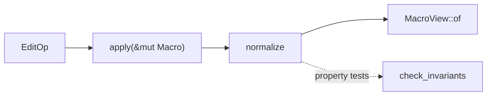
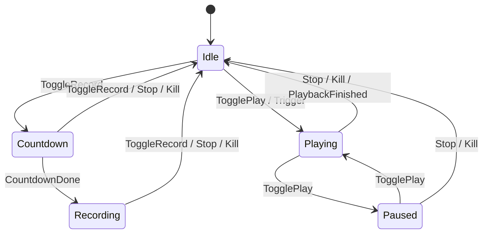

# relay-core

`crates/relay-core` is everything about macros that doesn't need an OS: the model, steps, edits, the file format, timing, the session state machine, schedules and trigger edges. It has no I/O, and anything time-dependent takes `now` as an argument, so it's deterministic, fast to test and tested on Linux. If a decision can be a pure function, it goes here.

- [The model: events, not steps](#the-model-events-not-steps)
- [Step grouping](#step-grouping)
- [Edits](#edits)
- [The session state machine](#the-session-state-machine)
- [Playback timing](#playback-timing)
- [The rest of the crate](#the-rest-of-the-crate)

## The model: events, not steps

A [`Macro`](../../crates/relay-core/src/model.rs) is metadata plus **a flat, time-sorted list of low-level events**: `Move`, `Button`, `Wheel`, `Key`, and the inserted ones, `Wait`, `PixelWait`, `FindImage` and `Text`.

Steps are never stored. They're derived from the events every time, so there's one source of truth and grouping can improve without migrating files.

- **Time** is `u32` milliseconds from the start. Arithmetic saturates; edits cap durations at a day (`MAX_DUR`).
- **Positions** are physical pixels on the virtual desktop (negative left of or above the primary monitor).
- **Keys** are W3C `code`s ("KeyA", "ControlLeft"): the physical key, the same on every layout. The virtual key and scan code are kept for faithful replay. Labels for letters follow the layout ([`keys.rs`](../../crates/relay-core/src/keys.rs)).

## Step grouping

[`group_steps`](../../crates/relay-core/src/steps.rs) makes one pass over the events and returns the editor's steps. Each `Step` has a `kind`, a `t`, an `end`, a `pause` and its `items`: the indices of the events it owns.

The design choices that matter:

- **Every event belongs to at most one step, and every move to exactly one.** Deleting a step is then just deleting its `items`.
- **Moves become steps last.** A move during a press belongs to that click or drag; every other run of moves is a `Move` step, added after the rest of the grouping, so it never breaks a double click or a Ctrl-click.
- **Modifiers attach to the one step they wrap**, and widen it, so retiming around a shortcut never separates it from its Ctrl.
- **`pause`** is idle time only: from the latest end of the earlier steps to this step's start.
- **Step numbers skip moves** (`step_number`, mirrored in `src/lib/editor/rows.ts`), so they don't change with *Show moves*.

The grouping rules (click slop, double clicks, typing gaps) are [Steps](../spec/steps.md).

## Edits

The UI changes a macro only by sending an [`EditOp`](../../crates/relay-core/src/edit.rs). The app runs `edit::apply` and sends back a fresh `MacroView`, so the UI's step indices can never go stale.



- **Ops address steps by index** into `group_steps` of the current events. `Batch` applies several to a copy, in order, all or nothing, and undoes as one.
- **Inserts never split a step:** the insert point snaps past any step it falls in, and everything after it shifts later.
- **Retiming is monotone** (`SetPause`, `CapPauses`, `SetMoveDuration`): events inside the changed span are scaled, those after it shift. Order and press/release balance survive.
- **`normalize`** is the safety net, run after deletes, after loading any file and after every recording: sort, move events out of waits, drop orphan releases and doubled button-downs, release anything still held at the end.
- **`check_invariants`** states what always holds (sorted, balanced, nothing inside a wait). The [property tests](../../crates/relay-core/src/proptests.rs) run it after random recordings and random edit sequences.

What each op does for the user is [Editing](../spec/editing.md).

## The session state machine

[`session::step(mode, input, config) → (mode, effects)`](../../crates/relay-core/src/session.rs) is the whole session logic. The coordinator performs the effects; it decides nothing itself.



Effects come out in order (`StartRecording`, `StartPlayback`, `SetHotkeys`, `PauseTriggers`…), with `EmitMode` always last. An input with no transition is ignored, so a stray `PlaybackFinished` after a stop does nothing. The countdown is skipped when it's off.

## Playback timing

[`PlayClock`](../../crates/relay-core/src/playback.rs) maps wall time to macro time:

```text
macro_t(now) = anchor_t + (now − anchor_wall) × speed     (paused: anchor_t)
deadline(t)  = anchor_wall + (t − anchor_t) / speed
```

Every speed change, pause, resume or seek **re-anchors** on the current times, so errors never accumulate. The engine handles loops by seeking back a loop's length, carrying the overshoot.

**Humanize** (`plan_times`) draws one seeded offset per step, so a click's press and release move together. Offsets are clamped so steps never swap or start before 0, and `Move` steps take the offset of the step before them, so the path stays on its clicks. Each loop gets a new seed.

## The rest of the crate

Each module is small and has its tests beside it. The non-obvious decisions:

| Module | What to know |
| --- | --- |
| [`path`](../../crates/relay-core/src/path.rs) | Smooth and Straighten move samples, never drop them: playback doesn't interpolate. Uses `sqrt`, not `hypot`, because the UI test copy (`src/test/fake-path.ts`) must land on the same pixels; `path-cases.json` checks it. |
| [`text`](../../crates/relay-core/src/text.rs) | Templates (`{date}`, `{col:Name}`…). `fill` takes the time, the clipboard and the column as arguments. Edits validate a template; playback types a broken one as written. |
| [`data`](../../crates/relay-core/src/data.rs) | CSV parsing (UTF-8 or Windows-1252, the separator guessed from the header). `check` is the one rule for whether a macro can play or export with its file. |
| [`image`](../../crates/relay-core/src/image.rs) | Gray normalized cross-correlation, coarse to fine on a pyramid, scales 0.5–2. About 22 ms on a 1440p screen, which is why relay-core builds at `opt-level = 3` in dev too. |
| [`format`](../../crates/relay-core/src/format.rs) | `.rly` read and write; migrations work on `serde_json::Value`, so old shapes need no Rust types. Bundling a macro into a player exe. See [File formats](file-formats.md). |
| [`ahk`](../../crates/relay-core/src/ahk.rs) | The AutoHotkey v2 export, one block per step, timed start to start. Pinned by a snapshot; CI only checks the syntax. |
| [`splice`](../../crates/relay-core/src/splice.rs) | What an edit changed (a run of events and one time shift), so undo stores a diff, not the macro |
| [`schedule`](../../crates/relay-core/src/schedule.rs) | `next_run` is generic over `TimeZone`, so tests use fixed zones; daylight-saving gaps and repeats are handled explicitly |
| [`triggers`](../../crates/relay-core/src/triggers.rs) | Edge detectors: `ProcessLaunchEdge` (the first sample is only a baseline), `PixelEdge` (two matches after two non-matches, also used for images) |
| [`runlog`](../../crates/relay-core/src/runlog.rs) | The run history's types; the newest 200 runs |
| [`view`](../../crates/relay-core/src/view.rs) | `MacroView` (steps, cursor path, duration) and `MacroListItem`: all the UI ever gets. It never sees raw events. |
| [`samples`](../../crates/relay-core/src/samples.rs) | The four design samples, which also generate the browser fixtures and `e2e/samples.json` |

Every type the UI sees derives `ts_rs::TS`, which generates its TypeScript ([IPC](ipc.md#generated-bindings)).

---

<p align="center"><a href="architecture.md">← Architecture</a> · <a href="platform.md">relay-platform →</a></p>
