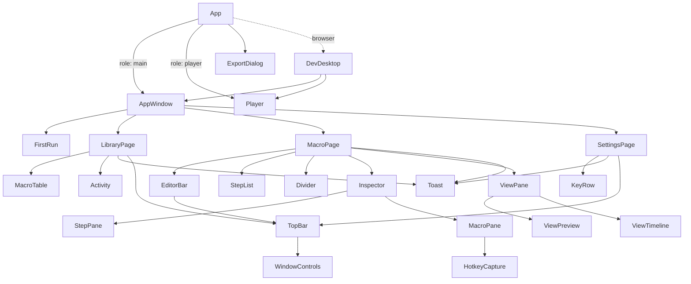

# The frontend

The UI in [`src/`](../../src) is Svelte 5 with runes, TypeScript and Vite 8, with no component library. It renders state and sends intentions. It doesn't own any session logic: the Rust coordinator does. The same page runs in both of Relay's windows, the **main window** and the **player**, each with a store of its own.

- [Structure](#structure)
- [The store](#the-store)
- [The backend abstraction](#the-backend-abstraction)
- [The browser preview](#the-browser-preview)
- [Components](#components)
- [The preview and the timeline](#the-preview-and-the-timeline)
- [Styling](#styling)
- [The window from the UI's side](#the-window-from-the-uis-side)
- [Conventions](#conventions)

## Structure

```text
src/
├── main.ts                     loads Archivo and the styles, and mounts App
├── App.svelte                  sets the store's role from the window's label; AppWindow, the Player,
│                               or (in a browser) the DevDesktop; the export dialog; the look on <html>
├── components/
│   ├── window/                 AppWindow (the three places), TopBar, WindowControls, FirstRun
│   ├── library/                LibraryPage (the sidebar and the page), MacroTable, Activity
│   ├── editor/                 MacroPage, EditorBar, StepList, Inspector, StepPane, MacroPane, ViewPane
│   │   └── view/               ViewPreview, ViewTimeline
│   ├── player/                 Player, the main window's stand-in
│   ├── settings/               SettingsPage, KeyRow
│   ├── kit/                    the component kit: Key, Chip, Keycaps, Glyph, UnitField, Switch, Checkbox,
│   │                           Choice, Tabs, Section, Menu, Lcd, Leds, Divider
│   ├── shared/                 Toast, Grip
│   ├── ui/                     Icon (Relay's own icons), HotkeyCapture
│   ├── ExportDialog.svelte
│   └── dev/DevDesktop.svelte   the demo desktop for the browser preview
├── lib/
│   ├── state/relay.svelte.ts   the RelayStore
│   ├── state/selection.ts      which steps the inspector follows across edits
│   ├── editor/rows.ts          the steps list's rows: moves folded, what each row says, deleting rows
│   ├── editor/summary.ts       the play summary next to Play
│   ├── editor/triggers.ts      what the Macro tab and the Library say about triggers
│   ├── categories.ts           a step's category (pointer, keys, logic, move): its color and shape
│   ├── look.svelte.ts          the look as attributes on <html>; Windows' dark mode and reduced motion
│   ├── sound.ts                the sounds (Web Audio)
│   ├── keycapture.ts           listening for a key combination
│   ├── hotkeys.ts              KeyboardEvent → "Ctrl + Alt + 1"; how the UI names a key
│   ├── fields.ts               number fields: parse, round, clamp, show the committed value
│   ├── defaults.ts             default settings and playback options (shared with the browser preview)
│   ├── ipc/backend.ts          Tauri and browser backends
│   ├── ipc/bindings/           generated from Rust (don't edit)
│   ├── types.ts                re-exports of the bindings, UI-only types
│   ├── format.ts  runs.ts      time, names, "Next run", "Last run"; what Activity says about a run
│   ├── image.ts                images for Find image: sizes, areas, Test's result
│   ├── timeline/lanes.ts       lane geometry, current step, previous and next
│   ├── preview/geometry.ts     SVG path, cursor lookup, fitting, zooming and panning the view
│   ├── preview/callouts.ts     the numbered callouts beside the clicks, kept apart
│   ├── actions/seekable.ts     click-and-drag to seek
│   ├── platform/window.ts      isTauri, which window this is, window prefs, player mode, dragging, the tray
│   ├── layout.ts               the inspector's width kept inside the window
│   ├── transport.ts            the speeds, and stepping the speed and the repeat
│   └── dev/                    the browser fixture and demo desktop state
└── styles/                     theme.css, base.css, app.css
```

## The store

[`lib/state/relay.svelte.ts`](../../src/lib/state/relay.svelte.ts) exports one `RelayStore` instance, `relay`. Components import it and read its fields directly. Svelte 5's fine-grained reactivity re-renders only what changed.

**One store per window.** `App.svelte` sets `relay.role` to the window's label (`"main"` or `"player"`, from `windowLabel()`) before `init()`. Both stores subscribe to the stream and get every message; the role decides the few things that differ:

- **The macro.** Both windows show the current macro, the one the play key and the player play. Opening one (`load_macro`) tells Rust, which sends `current` with the window it came from; the other window opens it too. The player starts on `current_macro()` (or the first macro); the main window on the first macro, in the Library unless there's only one macro.
- **A run of another macro** (a trigger started it): the player shows the macro that plays (`showMacro` on `session`); the main window keeps its own, ignores that run's ticks (`playingElsewhere`), and its toasts say what runs, with Stop.
- **Only the main window** opens a recording once it's saved (with its name ready to type), plays sounds, loads the run history and autostart, and handles `open` (the player's expand key).

| Kind | Fields |
| --- | --- |
| **Session** (from the stream) | `mode` (the engine's `Mode`: `idle`, `countdown`, `recording`, `playing`, `paused`), `cur` (the playhead, ms), `countLeft`, `loopIdx`, `playInfo`, `playingId` and `runSource` (what plays, and what started it), `triggersPaused`, `finishes` (counts the open macro's runs that ended, for the player's flash or shake) |
| **Data** (from commands) | `library`, `view` (the open `MacroView`), `screenUrl`, `settings`, `systemLook`, `triggerStatus`, `dataFile`, `runs`, `autostart`, `processes` |
| **Window** | `role`, `ready`, `playerMode`, `place` (`library`, `macro` or `settings`), `settingsSection`, `libraryShows` (macros, all runs or problems), `libFilter`, `libSelection`, `runsFilter`, `panes` (the inspector's width) |
| **Editor** | `selected` (the step the inspector shows), `selection` (the steps selected, ascending), `inspector` (`step` or `macro`), `macroSection` (`play` or `triggers`), `inspectorOpen` (in a narrow window), `viewOpen`, `failedStep`, `saves` (for *Saved*), `naming` (a new recording to name) |
| **UI** | `exportOpen`, `exportFmt`, `toasts` (oldest first; `shownToasts`, the newest three, and `toast`, the newest), `picking`, `imaging` (an image on its way: where from, and for which step, one being inserted or the trigger), `imageTest` (what *Test* last said, and about what) |
| **Derived** | `recording`, `playing`, `playingHere`, `playingElsewhere`, `name`, `playback`, `loops`, `steps`, `moves`, `duration`, `desktop`, `frames`, `curStepIdx`, `triggers`, `showsIntro`, `canEdit`, `canUndo`, `canRedo`, `longPauses`, `unsaved`, `error`, `shownRuns`, `problems`, `lastRuns`, `exportName` |

- `view`, `library`, `settings`, `toasts` and the other data fields use `$state.raw`: they're replaced wholesale, never mutated, so deep proxies would be wasted work.
- While recording, `steps`, `moves` and `desktop` switch to the live recording, fed by `rec_progress`. Cursor samples are appended in place and a version counter tells the derived values, rather than copying a growing array ten times a second. `duration` grows a second at a time, so the timeline is rebuilt once a second, not every frame.
- `curStepIdx`, the step under the playhead, is one binary search per frame, shared by every component that highlights "the current step".
- **Actions** are arrow-function fields (`toggleRec`, `togglePlay`, `stop`, `seek`, `jump`, `select`, `go`, `back`, `openMacro`, `openSettings`, `openTriggers`, `openAt`, `playMacro`, `showLibrary`, `showRunsOf`, `edit`, `rename`, `deleteRows`, `setPauses`, `setLabels`, `makeAllEditable`, `insertWait`, `insertText`, `insertPixelCheck`, `pickPixel`, `insertFindImage`, `setPause`, `trimPauses`, `setMoveDuration`, `smoothMove`, `straightenMove`, `undo`, `redo`, `setPlayback`, `cycleSpeed`, `cycleRepeat`, `chooseDataFile`, `setTriggers`, `pickTriggerPixel`, `setPlayerMode`, `openWindow`, `duplicateMacro`, `deleteMacros`, `exportMacros`, `importMacros`, `updateSettings`, `setRelayKey`, `keyWarning`, `holdHotkeys`, `finishIntro`, `trySound`, `doExport`…), so they can be passed as event handlers without binding.
- **Errors**: every action goes through one helper, `run(promise)`, which shows a failure as an error toast and resolves to `undefined`. Toasts stack: each is shown under the others with its own id and timer, the newest three at once (`MAX_TOASTS`), and older ones come back as those are dismissed. Error toasts stay until dismissed. `notify()` shows information for 5 s, or 8 s when it has an action such as **Undo**. The same message again moves to the bottom rather than showing twice. An `unsaved` message is an error toast marked `unsaved`: while it shows, the editor's top bar says *Couldn't save*. The player shows the newest error on its screen, with Dismiss.
- **Editing only while idle**: `canEdit` (in the app, a macro open, and nothing recording, counting down or playing) gates every edit, undo, redo, rename and pick, and the controls that start them. Rust refuses edits during a session too (`busy`).
- **Seeking** moves the playhead at once, but tells the engine at most once per animation frame, however fast the pointer drags.
- **Sounds** play only with *Sounds* on, and only in the main window, so they never play twice: a recording starts and stops, each step recorded, a run done, a run failed. Settings → Sound's Try keys call `trySound`. Tests replace `soundPlayer` to listen in.
- **The first run** shows while `showsIntro` (in the app, the settings known, `settings.intro` not `done`); `finishIntro` saves `intro: "done"`.

Lifecycle: `App.svelte` calls `relay.start()` (the animation-frame loop and the key listener) and `relay.init()` (read the saved window state, subscribe to the stream, load the settings, the system look and the library, then the macro to show; in the main window also the run history and autostart). The window renders once `ready` is set.

The store is exposed as `window.__relay` for DevTools and the end-to-end tests, in each window's page.

### Handling the stream

`onEngine(msg)` is a `switch` over `EngineMsg`. The non-obvious cases:

- **`session`** to `playing` with another `macro_id`: a trigger started a different macro. The player opens it (`showMacro`, which works mid-playback); the main window keeps its own and stops extrapolating.
- **`current`** from the other window (or from Rust), while idle: open that macro, so Play plays what the window shows.
- **`saved`** arrives just before the session goes back to idle, when the store still refuses to load a macro. It's kept in `pendingLoad` and opened on the `idle` message (`openRecording`: the editor, the name field focused, *Recording stopped, N steps. Name this macro.*).
- **`finished`**: stop extrapolating, then rewind to 0 unless `completed` or `pixel_timeout`; a pixel timeout marks its step (`failedStep`). (Rust moves its own play-key playhead the same way.)
- **`play_tick`** and **`rec_progress`** update `tick` for [extrapolation](ipc.md#why-the-ui-extrapolates). When not advancing (paused, frozen on a pixel check), `cur` is set exactly. `playInfo` keeps the loop count and speed of the run, which the editor shows: what's playing, not the saved options.
- **`settings`**: saved from either window, so this one shows them, unless a change made here is still being saved.
- **`player_mode`**, **`system_look`**, **`open`** (main window only) and **`unsaved`** set what they say.

### Edits

**Every async result is tied to the macro it was for.** `edit(op)` → `apply(id, backend.editMacro(id, op), op)`. `apply` tags each request with an increasing sequence number and drops the response if a newer request replaced the view since, or if the open macro isn't `id` any more. So a slow response can neither overwrite a newer state nor land on a macro opened in the meantime. The same goes for the rest:

- `rename` updates the view at once and saves after 250 ms through `apply`, for the macro being renamed (not whichever is open when the timer fires). Opening, duplicating or deleting a macro, or undoing, saves a pending rename first. A blank name isn't saved (leaving the field puts the saved name back). A rename pending when a session starts is saved when it ends; one pending when the store is disposed is dropped.
- Opening a macro clears the previous one's `triggerStatus` and `dataFile`, so the Macro tab can't write one macro's triggers into another; trigger results are only applied if their macro is still open.
- **Several steps at once.** The steps list selects several (`selection`); the inspector edits what they share. A change to all of them goes as one `batch` op (`setPauses`, `setLabels`, `makeAllEditable`, and `deleteRows`, which deletes from the last step so the others keep their index): one request, one undo.
- The pixel pickers (`pickPixel`, `pickTriggerPixel`) wait for the picker, then check that the same macro is open and that the check is still the same one (its row and first event) before editing it, and say what was picked (*Picked 640, 360 · #00FF00*, and *from the frozen screen* when it was). **Wait for pixel** inserts nothing when the screen can't be read.
- An **Undo** offered in a toast (deleting a step, shortening pauses, smoothing or straightening a move when its path changed) belongs to its macro (`undoes`): it's withdrawn when another edit or rename starts, or another macro opens, so it never undoes something else. The trash toast's Undo isn't withdrawn by edits: restoring doesn't touch the edit history. It's marked with the macro it brings back (`restores`), so a restore dismisses only its own toast. Deleting several macros from the Library is one toast and one Undo.
- Settings, trigger and trigger-pause saves carry sequence numbers too: an older response or failure never overwrites a newer change, and a failure goes back to the last state Rust confirmed. `setRelayKey` resolves to why Rust refused a key (shown in its row), or `null` once it's saved.
- The inspector's steps live in the store (`selected`, `selection`, `select`). After an edit, undo or redo, `followStep` ([`selection.ts`](../../src/lib/state/selection.ts)) keeps each selected step on its edited row, or finds the same step (same kind and content) nearest to where it was, or drops it.

**Keys the store handles** (a window key listener, in the capture phase): <kbd>Ctrl</kbd>+<kbd>Z</kbd>, <kbd>Ctrl</kbd>+<kbd>Y</kbd> and <kbd>Ctrl</kbd>+<kbd>Shift</kbd>+<kbd>Z</kbd> undo and redo, except when the event comes from a text-like field (text, search and number inputs, a `textarea`), where those keys mean something else; <kbd>Ctrl</kbd>+<kbd>M</kbd> opens the inspector's Macro tab in the editor; <kbd>Alt</kbd>+<kbd>←</kbd> goes back to the Library. An element marked `data-captures-keys` (a key field) and the export dialog keep their keys. In the app, Relay's own keys are global hotkeys handled in Rust; the browser preview, which has none, handles the keys set in its settings itself.

### The editor's rows

[`lib/editor/rows.ts`](../../src/lib/editor/rows.ts) is the steps list's logic, kept out of the component so it's tested on its own:

- `stepRows(steps, showMoves)`: one row per step, each MOVE folded into the step it leads to (the step after it), unless *Show moves* is on. A move with nothing after it (the trip to the stop button) stays a row of its own, so it can still be deleted.
- `rowOf`, `rowSteps`: a row from a step index, and the steps a row stands for (its folded move first).
- `rowText(step, move, frame)`: what a row says (*Double click*, *Keys*, *Wait for*…, what it does, and an aside: a length, a count), with positions on the screen or relative to the anchor window in *Window* coordinates. The player's last step and the view's bar use it too.
- `rowMatches`: the list's find, on a row's kind and text.
- `deleteRows`: deleting rows and their folded moves as one op.

## The backend abstraction

[`lib/ipc/backend.ts`](../../src/lib/ipc/backend.ts) defines a `Backend` interface covering every command and the stream. It has two implementations, chosen once by `isTauri()` (the presence of `window.__TAURI_INTERNALS__`):

- **`tauriBackend`**: `invoke` for commands, a `Channel<EngineMsg>` for the stream, and `@tauri-apps/plugin-dialog` for file and folder pickers (`exportMacros` asks for a folder and writes one `.rly` per macro, with unique names). `editable: true`.
- **`browserBackend()`**: a simulation for `npm run dev`. `editable: false`.

The store and components only see `Backend`. Features that need the app check `relay.editable` and hide or disable their controls.

## The browser preview

`npm run dev` serves the UI at `http://localhost:1420` in any browser, with no Rust build. It's how the design is iterated on quickly.

- `App.svelte` renders `DevDesktop`, the design's demo desktop (wallpaper, taskbar, clock), with the main window (944 × 612) on it, or the player in player mode, scaled to fit the browser window. The player's grip drags it on the demo desktop.
- The browser backend loads [`lib/dev/sample-views.json`](../../src/lib/dev/sample-views.json), the four sample macros as real `MacroView`s generated by relay-core's tests, and their run history. So the steps, paths and timings are exactly what the app would show.
- It simulates the session like the app: the countdown (or none), a recording that advances without capturing anything, playback with a moving playhead (speed changes, loops and seeking included), and triggers and their pause kept in memory. Edits are refused with *Editing needs the Relay app*; other commands that need the app with *This needs the Relay app (npm run tauri dev)*.
- With no global hotkeys, the store listens for Relay's keys as set (record, play and the player) and Esc on the page itself.
- The first run doesn't show, and undo, redo and every other edit are unavailable.
- Export is unavailable: the fixture has views, not the events a `.rly` holds.

> [!NOTE]
> Port 1420 is also what `npm run tauri dev` uses for its dev server. Stop one before starting the other.

## Components



`AppWindow` shows the first run while `showsIntro`, else the place in `relay.place`, and marks it on `.app-window` as `data-place` (the end-to-end tests wait on it). Every page starts with a `TopBar`, which moves the window (`data-tauri-drag-region`) and ends with the window's controls.

Components are small and mostly presentational, built from the **kit** in `components/kit/`: `Key` (a device key with travel, with variants for Record and Play), `Chip`, `Keycaps` (a combination as keycaps), `Glyph` (a step's category as a color block with a shape, so it reads without color), `UnitField` (a number with its unit, which scrubs by dragging), `Switch` (with a check mark), `Checkbox`, `Choice` (a radio group), `Tabs`, `Section` (opens and closes, with what's in it on one line), `Menu`, `Lcd`, `Leds` and `Divider`. Each is keyboard-operable on its own. Logic that deserves a test (formatting, rows, timeline geometry, hotkey parsing, preview fitting, callouts) lives in plain `.ts` modules next to their `.test.ts`.

A few that do more:

| Component | Notes |
| --- | --- |
| `MacroPage` | The editor: the top bar, the list and the inspector (with a `Divider` between them that sets `panes.inspector_w`, saved with `save_panes` when a drag or key press ends, reset by double-click; `inspectorWidth` in `layout.ts` keeps the list at least 320 px wide without changing what's saved), the view, and the toasts. Narrower than 860 px, the inspector slides over the list (`inspectorOpen`; Esc closes it); shorter than 470 px, a macro opens with the view closed. |
| `EditorBar` | Back, the name (focused and selected for a new recording), *Saved* or *Couldn't save*, undo and redo, record, Play with its summary (`playSummary`: chips such as ×3, 2× and ±40 ms, and the whole sentence for screen readers; it opens the play options), the ⋯ menu, the player, the window controls. Tooltips and `aria-keyshortcuts` name Relay's keys as set (`keyHint`, `ariaKeys`). |
| `StepList` | A `listbox`: arrows (and Home, End) move the selection and the playhead, Shift and Ctrl select several, Ctrl + A all, Del deletes, Insert or + opens **Add** at the insertion line (just after the step under the playhead), Enter focuses the inspector, Esc keeps one selected. Find (Ctrl + F) filters the rows. The edge between two rows offers a **+** that inserts right there. Keeps the current row in view while playing. |
| `StepPane` | The selected step's fields (*Pause before* for every step, plus its kind's), what several selected steps share, the live step while playing, and what happened to a step that timed out. Fields commit on change and show what Rust saved. |
| `MacroPane` | The Macro tab: two `Section`s, the play options (repeat, speed, the data file, varied timing, stopping on a key, where clicks land) and the triggers (a card each, **+ Add** for the others). |
| `MacroTable` | The Library's table: search (Ctrl + F), sort (name, newest, last run), a hotkey column, *Also runs* (opens the triggers), the last run, multi-select for export and delete, a row menu (*More for {name}*) and row keys (arrows, Del, Ctrl + D, Enter). |
| `Player` | The player window: record, play or pause, stop, a screen (the state, the macro as a menu to switch macros, the time, the countdown, the step count or the data file's row, LEDs with the clicks in red, the newest error with Dismiss), and the expand key. A live region speaks state changes, not every tick. |
| `KeyRow` | One of Relay's keys in Settings → Keys: its keycaps, **Change** to listen (`listenForCombo`, with `holdHotkeys(true)` meanwhile; Backspace: None, Esc: cancel), and what Rust says about it: why it's refused (`setRelayKey`) or what setting it costs (`keyWarning`). |
| `HotkeyCapture` | A macro's hotkey field, on the same `keycapture.ts` and hold. Marked `data-captures-keys` so the undo shortcut leaves it alone. |
| `FirstRun` | Three screens (what Relay does; the keys, with three choices; a first recording, with *Record now*), or only the keys screen after an upgrade (`intro: "keys"`), with one click to switch a Ctrl + Alt + End kill switch to Ctrl + Alt + Backspace. Finishing or skipping calls `finishIntro`. |
| `Toast` | Errors and notices at the bottom of each page, stacked, the newest at the bottom, each with its own **Dismiss**; first, while a trigger's run plays, *Running “X”, started by …* with **Stop**. |
| `ExportDialog` | A native modal `<dialog>` (`showModal`): the formats as radios; focus stays inside, Esc and a click on the backdrop close it. |

## The preview and the timeline

**Preview** ([`ViewPreview.svelte`](../../src/components/editor/view/ViewPreview.svelte), [`geometry.ts`](../../src/lib/preview/geometry.ts)): an SVG whose `viewBox` is a region of the virtual desktop, in the macro's physical pixels. By default it's the **whole desktop**, fitted to the stage's aspect ratio, so resizing never hides any of it. The wheel or + and − zoom in around the pointer or the middle (`zoomAround`, 1.25× a notch, up to 16×), a drag or the arrows pan (`pan`), and a double-click, 0 or the bar's *Fit* go back to the whole desktop; a zoomed-in view never shows past the desktop's edges (`zoomedView`), and opening another macro or recording starts fitted. Everything is in desktop coordinates, and strokes and markers keep their size on screen at any zoom.

- The **path** is one polyline. The played part is the same path with `stroke-dasharray = "<done length> <total>"`, where the done length comes from precomputed cumulative lengths and a binary search for the current time. So animating the trail costs nothing per frame.
- The **selected step's move** (folded into it, or the move itself) is drawn again, thicker, from its start position through its samples, so Smooth and Straighten show what they changed. A selected pixel check is marked.
- **Callouts**: a numbered circle beside each click (its row's number), placed by `placeCallouts` ([`callouts.ts`](../../src/lib/preview/callouts.ts)) so none covers another and all stay inside the stage; filled once played, white when selected, with the click's label when it's selected and *Show click labels* is on.
- The **screenshot**: opening a macro fetches it (`screenshot`, raw bytes) into an object URL, `relay.screenUrl`, revoked when another macro opens; an answer for a macro the user has left is dropped, and one that fails just leaves the outlines. With *Screen* chosen in the view's bar (`preview_background`), an SVG `<image>` draws it at the recording's `virtual_desktop`, dimmed to 55%, in place of the monitor outlines. It isn't drawn while recording. The CSP's `img-src` allows `blob:` for it.

**The view's bar** ([`ViewPane.svelte`](../../src/components/editor/ViewPane.svelte)) holds the open and close key, the playhead on an `Lcd`, *Screen | Outline*, previous and next step, and the zoom. Closed, it says what's under the playhead (*Step 3 · Click · Save*). Beside the timeline, a title block gives the step count, the length, the screen's size and the scale.

**Timeline** ([`ViewTimeline.svelte`](../../src/components/editor/view/ViewTimeline.svelte), [`lanes.ts`](../../src/lib/timeline/lanes.ts)): a lane per category (the pointer, the keyboard, logic) under a dimension line with the macro's length. Pure functions turn steps and moves into percentages: a bar per move and drag (`moveBars`), each step's `pause` as a striped span (`pauseSpans`), key chips (`keyChips`), and while recording, when the steps don't have the latest moves yet, the live path (`moveSegments`). It's a `slider` for assistive technology, whose value text says the time, the step and what it does: a click or a drag seeks (the `seekable` action, with pointer capture), the arrows go to the previous or next step (a tenth of a second with Shift), Home and End to the ends, and Space plays or pauses. `currentStepIndex` and `jumpTarget` drive the highlighted row and the previous and next keys.

## Styling

The look is the redesign's: frosted glass, color-blocked steps, Archivo, keys with travel. All of it comes from tokens in one file.

| File | Contents |
| --- | --- |
| [`theme.css`](../../src/styles/theme.css) | The tokens: the palette (paper, aluminium, graphite, ink, the LCD, signal red, pointer blue, keys yellow, logic green), text and plate colors, the glass, the category washes, shadows, radii (4 to 16 px), the spacing scale (row, key and field heights, gaps), the font, and the motion curves and timings. Then the variants, as attributes on `<html>`, a few shared classes (`.glass`, `.plate`, `.caps`, `.num`, `.field`, `.sr-only`), and Windows' contrast themes (`forced-colors`) |
| [`base.css`](../../src/styles/base.css) | Element defaults, the focus ring |
| [`app.css`](../../src/styles/app.css) | App rules: no page scroll, no text selection outside inputs, a transparent page (the window frosts what's behind it) |

**The look's attributes** ([`look.svelte.ts`](../../src/lib/look.svelte.ts)): `lookAttrs(settings, systemLook, media)` turns the settings into attributes that `theme.css` reads, and `applyLook` sets them on `<html>` in each window:

| Attribute | Values | From |
| --- | --- | --- |
| `data-theme` | `light`, `dark` | *Theme*; `system` follows Windows' app mode (`prefers-color-scheme`, watched by `SystemMedia`) |
| `data-spacing` | `compact`, `large` (none: comfortable) | *Spacing* |
| `data-glass` | `off` (none: frosted) | *Frosted glass* and what Windows offers (`glassOn`, the same rule as Rust's `SystemLook::glass`) |
| `data-motion` | `calm` (none: animated) | *Reduce motion* set to always, or Windows' animation setting (`prefers-reduced-motion`); calm turns every animation and transition off |

The text size isn't an attribute: Rust zooms the window (see [The app → The window](app.md#the-window)). The frost itself is Windows' (Acrylic, set by Rust); the page draws a tinted ground over it (`--glass`, at least 72%), solid when the glass is off. Components use scoped `<style>` blocks and only `var(--…)` tokens for colors and sizes. Archivo is bundled with `@fontsource-variable/archivo`, the variable font with its width axis (62–125%) and weights (100–900), with no network at runtime. Icons are Relay's own SVGs, behind `Icon`.

**Sounds** ([`sound.ts`](../../src/lib/sound.ts)): short square-wave notes made with Web Audio at a low volume (Windows' own applies): `record` (two rising clicks), `stop` (two falling), `done` (three rising notes), `error` (two low notes) and `step` (a tick). No sound files. WebView2 runs the audio without a click first, so they also play when a global key started what they announce.

## The window from the UI's side

[`lib/platform/window.ts`](../../src/lib/platform/window.ts) holds the only window calls: `windowLabel` (which window this page is in), `savedWindow` (player mode and the divider, before the first render), `savePanes`, `setPlayerMode` and `showWindow` (the player's expand key), `minimize`, `startDragging` (the player's grip, via Tauri; the main window drags by its top bar's `data-tauri-drag-region`) and `hideToTray` (the × button). They're no-ops in a browser. Which window shows, placement, zoom, the saved anchors and focus behavior are all in Rust (see [The app → Which window shows](app.md#which-window-shows)).

## Conventions

- Components read `relay` and call its actions. They never call `backend` or `invoke` directly.
- New IPC types come from Rust bindings, not hand-written interfaces.
- Pure logic goes in `lib/` with a Vitest test. Components stay thin.
- Labels, tooltips and messages name Relay's keys as set, never a fixed key.
- `npm run check` (svelte-check) must pass with no warnings, including accessibility warnings.

---

<p align="center"><a href="ipc.md">← IPC</a> · <a href="README.md">Contents</a> · <a href="file-formats.md">File formats →</a></p>
