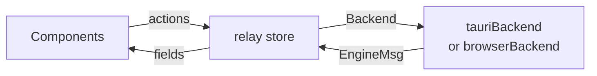

# The frontend

The UI in [`src/`](../../src) is Svelte 5 (runes), TypeScript and Vite, with no component library. It shows state and sends intentions; it owns no session logic. The same page runs in both windows, the main window and the player, each with its own store.

- [The store](#the-store)
- [Async results are guarded](#async-results-are-guarded)
- [Two backends](#two-backends)
- [Components](#components)
- [The preview and the timeline](#the-preview-and-the-timeline)
- [Styling](#styling)
- [Conventions](#conventions)

## The store

[`lib/state/relay.svelte.ts`](../../src/lib/state/relay.svelte.ts) exports one `RelayStore`, `relay`. Components read its fields and call its actions; Svelte's fine-grained reactivity re-renders only what changed. It's on `window.__relay` for DevTools and the end-to-end tests.



**One store per window.** `App.svelte` sets `relay.role` from the window's label (`main` or `player`). Both stores get every message; the role decides what differs:

- **The macro.** Both show the current macro. Opening one tells Rust, which sends `current`, and the other window follows.
- **A triggered run of another macro:** the player shows the macro that plays; the main window keeps its own and says what runs, with Stop.
- **Only the main window** opens a new recording to name it, plays sounds, and loads the run history at startup.

What to know when changing it:

- **Data fields are `$state.raw`** (`view`, `library`, `settings`…): they're replaced whole, never mutated, so deep proxies would be wasted work.
- **While recording**, the steps and path come from `rec_progress`. Samples are appended in place with a version counter, rather than copying a growing array ten times a second.
- **The playhead** (`cur`) is [extrapolated](ipc.md#the-session-stream) each animation frame. `curStepIdx` is one binary search per frame, shared by every component that highlights the current step.
- **Actions are arrow-function fields**, so they pass as event handlers without binding. Each goes through `run(promise)`, which turns a failure into an error toast.
- **`canEdit`** (in the app, a macro open, idle) gates every edit and the controls that start one. Rust refuses them too (`busy`).
- **Toasts stack** (the newest three show). Error toasts stay until dismissed. An Undo toast belongs to its macro (`undoes`) and is withdrawn by another edit, a rename or opening another macro.
- **The selection follows its step across edits** ([`selection.ts`](../../src/lib/state/selection.ts)): same row, or the same step nearest to where it was.

## Async results are guarded

Every answer is tied to what it was for, so a slow response can't land on another macro or overwrite a newer state.

- **Edits** go through `apply(id, promise)`, which tags each request with `++viewSeq` and drops the answer if a newer request replaced the view or the open macro isn't `id` any more.
- **Renames** show at once and save after 250 ms, for the macro being renamed. A pending name survives any view that arrives meanwhile.
- **Settings, trigger and trigger-pause saves** carry sequence numbers too. A failure goes back to the last state Rust confirmed.
- **Opening a macro** clears the previous one's triggers and data file, so the Macro tab can't write one macro's triggers into another.
- **The pickers** check, after the picker returns, that the same macro and the same check are still there before editing.

## Two backends

[`lib/ipc/backend.ts`](../../src/lib/ipc/backend.ts) defines `Backend`: every command but the window's own (in `platform/window.ts`), plus the stream. `isTauri()` picks one implementation at startup:

- **`tauriBackend`**: `invoke`, a `Channel<EngineMsg>`, and the dialog plugin. `editable: true`.
- **`browserBackend()`**: a read-only simulation for `npm run dev`. It loads the four samples as real `MacroView`s (generated by relay-core's tests), and simulates recording and playback. It's `editable: false`: the store refuses edits with *Editing needs the Relay app*, and the backend answers other app-only commands with *This needs the Relay app (npm run tauri dev)*.

`npm run dev` shows the UI on a demo desktop at `http://localhost:1420` with no Rust build: the quick way to work on the look. It shares port 1420 with `npm run tauri dev`.

The tests use the real `tauriBackend`, with every `invoke` answered by the fake core ([Testing](testing.md#the-frontend)).

## Components

```text
components/
  window/     AppWindow (the three places), TopBar, FirstRun
  library/    LibraryPage, MacroTable, Activity
  editor/     MacroPage, EditorBar, StepList, Inspector, StepPane, MacroPane, ViewPane, view/
  player/     Player
  settings/   SettingsPage, KeyRow
  kit/        the component kit
  shared/ ui/ Toast, Grip, Icon, HotkeyCapture
```

- **Build from the kit** ([`components/kit/`](../../src/components/kit)) before adding a control: `Key`, `Chip`, `Keycaps`, `Glyph`, `UnitField`, `Switch`, `Checkbox`, `Choice`, `Tabs`, `Section`, `Menu`, `Lcd`, `Leds`, `Divider`. Each control among them is keyboard-operable on its own.
- **Logic that deserves a test lives in plain `.ts` modules** in `lib/`, beside their `.test.ts`: the steps list's rows ([`editor/rows.ts`](../../src/lib/editor/rows.ts): moves folded into the step they lead to, what each row says), the play summary, trigger texts, formatting, hotkey parsing, timeline lanes, preview geometry.
- **Key fields** (Settings → Keys, a macro's hotkey) use [`keycapture.ts`](../../src/lib/keycapture.ts) and call `holdHotkeys(true)` while listening. They're marked `data-captures-keys`, so the store's Ctrl + Z leaves them alone.
- **Window calls** are only in [`platform/window.ts`](../../src/lib/platform/window.ts), and are no-ops in a browser. Which window shows, placement and zoom are Rust's.

## The preview and the timeline

**The preview** ([`ViewPreview.svelte`](../../src/components/editor/view/ViewPreview.svelte), [`preview/geometry.ts`](../../src/lib/preview/geometry.ts)) is an SVG whose `viewBox` is a region of the virtual desktop, in the macro's physical pixels. Zoom and pan only change the `viewBox`. The played part of the path is the same polyline with a `stroke-dasharray` from precomputed cumulative lengths, so animating the trail costs nothing per frame. Callouts are placed by [`callouts.ts`](../../src/lib/preview/callouts.ts) so none covers another.

**The timeline** ([`ViewTimeline.svelte`](../../src/components/editor/view/ViewTimeline.svelte), [`timeline/lanes.ts`](../../src/lib/timeline/lanes.ts)) is a lane per category. Pure functions turn steps into percentages: move bars, pause spans, key chips. It's a `slider` for assistive technology.

## Styling

- **Tokens:** every color, radius, spacing, font and motion value is a `var(--…)` in [`theme.css`](../../src/styles/theme.css). Components use scoped styles and tokens only.
- **Red** is for recording, playing and danger, nothing else.
- **The look is attributes on `<html>`** ([`look.svelte.ts`](../../src/lib/look.svelte.ts)): `data-theme`, `data-spacing`, `data-glass`, `data-motion`. `theme.css` reads them. The text size isn't one: Rust zooms the window.
- **The frost is Windows'** (Acrylic, set by Rust); the page draws a tinted ground over it, solid when the glass is off.
- **Archivo** is bundled as a variable font; there's no network at runtime. Icons are Relay's own SVGs, behind `Icon`. Sounds are Web Audio notes ([`sound.ts`](../../src/lib/sound.ts)), no files.

## Conventions

- Components talk to `relay` only, never to `backend` or `invoke`.
- IPC types come from the generated bindings (only `IpcError` and `ExportFormat` are hand-written).
- Svelte 5 runes only.
- Labels and tooltips name Relay's keys as set, never a fixed key.
- `npm run check` passes with 0 errors **and 0 warnings**, accessibility warnings included.

---

<p align="center"><a href="ipc.md">← IPC</a> · <a href="file-formats.md">File formats →</a></p>
