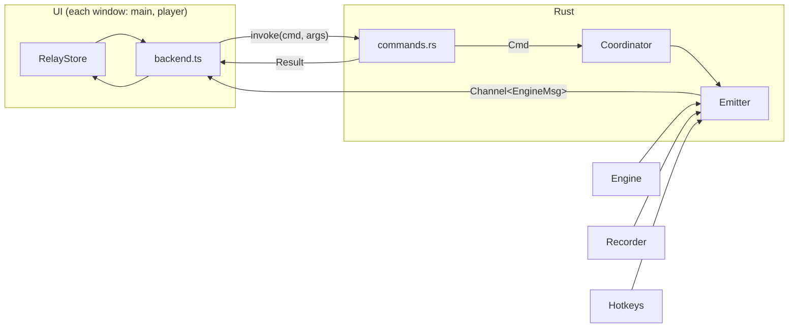
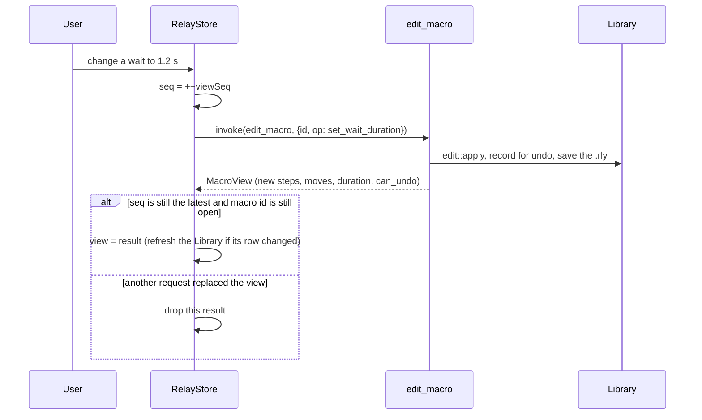
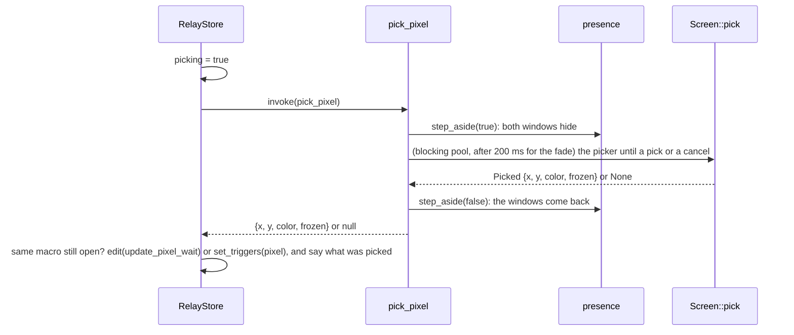
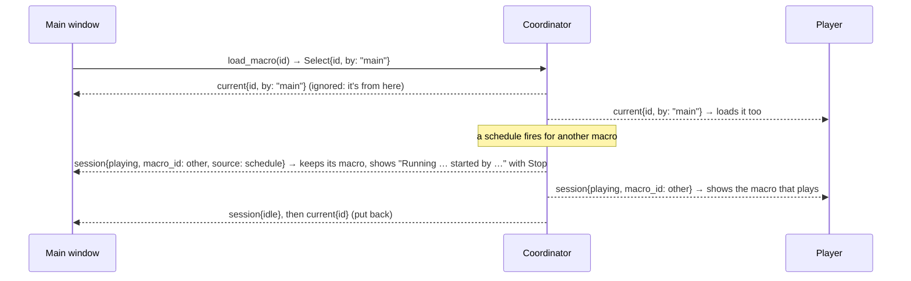

# IPC

The UI and Rust talk in two directions:

- **UI → Rust:** Tauri commands (`invoke`), request and response. They ask for data or an action.
- **Rust → UI:** one ordered stream, `Channel<EngineMsg>`, for everything the session does on its own schedule. Each of Relay's two windows (the main one and the player) subscribes, and gets every message.



- [Commands](#commands)
- [The session stream](#the-session-stream)
- [Errors](#errors)
- [Sequences](#sequences)
- [Generated bindings](#generated-bindings)
- [Adding a command](#adding-a-command)

## Commands

All commands are in [`src-tauri/src/commands.rs`](../../src-tauri/src/commands.rs). They're wrapped by [`src/lib/ipc/backend.ts`](../../src/lib/ipc/backend.ts), except the window's own (player mode, the divider, the close button), which [`src/lib/platform/window.ts`](../../src/lib/platform/window.ts) calls; those two are the only places the UI calls `invoke`. Commands that write files are `#[tauri::command(async)]`, off the main thread; the others are quick and run on it. Both windows call the same commands: a command that needs to know which window called takes Tauri's `WebviewWindow` and reads its label.

### Session

Session commands only send a `Cmd` to the coordinator and return right away. The result comes back on the stream.

| Command | Args | Does |
| --- | --- | --- |
| `subscribe_engine` | `channel: Channel<EngineMsg>` | Sets the calling window's receiver (by its label). Called once by each window at startup, and again if its UI reloads (the new one replaces that window's old one). |
| `current_macro` | | The current macro's id (the one Relay's play key and the player play), or `null`. The player opens it at startup. |
| `toggle_record` | | Like the record key |
| `toggle_play` | `from: f64` | Play or pause from the UI's playhead |
| `stop_session` | | Stop, like Esc |
| `seek` | `t: f64` | Moves the engine while playing, or remembers the idle playhead for the play key |

### Macros

| Command | Args | Returns |
| --- | --- | --- |
| `list_macros` | | `MacroListItem[]` |
| `load_macro` | `id` | `MacroView`, and tells the coordinator it's selected (`Cmd::Select { id, by }`, `by` the calling window's label): while idle it becomes the current macro, and the other window hears `current` and follows |
| `screenshot` | `id` | The screenshot taken when it was recorded, as raw JPEG bytes (a Tauri `Response`: an `ArrayBuffer` in the UI, no base64), empty if it has none. Never an error, not even for an unknown id. |
| `edit_macro` | `id, op: EditOp` | The new `MacroView`. Records the edit for undo (an edit that changes nothing isn't recorded). Refused with `busy` while a session runs. |
| `undo_edit` | `id, redo: bool` | The `MacroView` after undoing (or redoing) the last edit. Refused with `busy` while a session runs. |
| `set_playback_options` | `id, options: PlaybackOptions` | The new `MacroView`. A speed change also goes to a running engine. |
| `duplicate_macro` | `id` | The copy's id |
| `delete_macro` | `id` | Refused with `busy` while a session runs |
| `restore_macro` | `id` | Sends a `notice` if its hotkey now belongs to another macro (it comes back with the hotkey off) |
| `export_macro` | `id, format, path` | Writes the file. `format` is `rly`, `json`, `ahk` or `exe` (a [program](architecture.md#the-exported-player) that plays the macro). The Library's export of several macros calls it once per macro, as `.rly` files in the folder chosen. |
| `list_runs` | | `RunEntry[]`, the [run history](file-formats.md#runsjson), newest first |
| `import_macros` | `paths: string[]` | Reads `.rly`, `.json` and exported programs. `ImportResult { imported: id[], problems: string[] }`. If writing one fails, the ones before it are kept and the rest are listed in `problems`. |

Save and open dialogs are shown by the UI with `@tauri-apps/plugin-dialog`, and the chosen paths are passed to `export_macro` and `import_macros`.

### Screen

| Command | Args | Returns |
| --- | --- | --- |
| `sample_pixel` | `x, y` | `"#RRGGBB"` or `null` |
| `pick_pixel` | | Relay's windows step aside and [the picker](platform.md#the-picker) shows on the screen; returns `PickedPixel { x, y, color, frozen }` (`frozen`: picked from the frozen screen), or `null` when the user cancelled. Async, on a blocking-pool thread. Refused with `busy` while a session runs. |
| `paste_image` | | The clipboard's picture as a base64 PNG, ready for a Find image step or the image trigger (shrunk to 512 px). `code: "image"` when there's none, or it's too small or plain. |
| `load_image` | `path` | The same from a PNG or JPEG file; `code: "io"` when it can't be read |
| `snip_image` | | Opens Windows' snipping overlay and waits (up to a minute) for the snip on the clipboard: the image, or `null` when cancelled |
| `cancel_snip` | | Stops a `snip_image` waiting, which then returns `null` |
| `show_match` | `area, dot_x, dot_y` | Marks a match on the screen for 3 s: a red outline around `area` and a dot, over every window, click-through and out of every capture |
| `preview_text` | `id, text` | What a Text step's text in macro `id` would type now, as the first repeat (the local time, the clipboard and the data file's first row filled in), or `code: "invalid_text"` with what's wrong, or `code: "data_file"` when it types a column the macro's data file can't give |
| `get_data_file` | `id` | `DataFileInfo { path, columns, rows, error }`, the file read now (`error`: why the macro can't play with it), or `null` without one |
| `set_data_file` | `id, path` | Links the CSV at `path` (or unlinks, with `null`) and returns `get_data_file`'s answer. A file that can't be read or parsed is refused with `code: "data_file"`. |
| `test_find_image` | `image, threshold, area` | `FoundImage { x, y, w, h, score }`: the best match in screen pixels, its score in percent (even below `threshold`), or `null` when nothing came close. Never inside Relay's window. |

### Triggers

| Command | Args | Returns |
| --- | --- | --- |
| `get_triggers` | `id` | `TriggerStatus { triggers, next_run, hotkey_error, paused }` |
| `set_triggers` | `id, triggers: MacroTriggers` | `TriggerStatus`. Refuses a hotkey that's one of Relay's keys as set now, or another macro's (`code: "hotkey"`). Re-registers hotkeys synchronously when idle, so `hotkey_error` in the response is already current. |
| `set_triggers_paused` | `paused` | |
| `list_processes` | | Running executable names, for suggestions |

### Settings and window

| Command | Args | Returns |
| --- | --- | --- |
| `get_settings` | | `Settings` |
| `update_settings` | `settings` | `Settings` as saved. Refuses Relay's keys if one can't be used (`code: "hotkey"`, with why; nothing is saved). Applies the look, the text size and the player's size and on-top state, and sends `settings` to both windows. |
| `set_relay_key` | `key: RelayKey, combo: string \| null` | `Settings`. Sets one of Relay's keys (`record`, `play`, `player`, `kill`); `null` turns it off, except `kill`. Refused with `code: "hotkey"` and why: not a usable hotkey, another of Relay's keys, a macro's hotkey. |
| `key_warning` | `combo` | What setting it as a global key costs, or `null`: the character it types on the layout in use (AltGr), or an app that uses it (see [relay-core → Keys](core.md#keys)) |
| `hold_hotkeys` | `on` | While a key field listens: every hotkey lets go (`true`), then they're taken back (`false`) |
| `system_look` | | `SystemLook { glass_default, transparency }`: what Windows offers for the frosted glass |
| `get_autostart`, `set_autostart` | `enabled` | `bool` |
| `window_prefs` | | `{ player_mode, panes }`, read before the first render |
| `save_panes` | `panes: Panes` | Saves the editor's divider (`inspector_w`) to `window.json` |
| `set_player_mode` | `on` | The player takes the main window's place, or gives it back; saved, and sent to both windows as `player_mode` |
| `show_window` | | The player's expand key: player mode off, and the main window asked to open the current macro (`open`) |
| `hide_to_tray` | | Puts Relay in the tray, or quits if *Close to the tray* is off |
| `quit` | | |

## The session stream

[`ipc.rs`](../../src-tauri/src/ipc.rs): `EngineMsg` is a tagged enum (`{"type": "play_tick", …}`), sent through the `Emitter`, which holds one `Channel` per window, by label. A Tauri `Channel` preserves order and is much faster than events for high-frequency messages. **Every message goes to every window**, so both stores follow the session, the current macro, the settings and the library; each decides what applies to it (the player shows the macro that plays, the main window keeps its own).

`error`, `unsaved` and `notice` messages sent before the **main window** first subscribes (problems found at startup, a key another program has) are kept, the latest 20, and delivered to it in order when it does; the player gets nothing from before it subscribed, and session and tick messages aren't kept for anyone.

| Message | Sent by | When | Payload |
| --- | --- | --- | --- |
| `session` | Coordinator | Every mode change | `mode`, `macro_id` (the macro the session is about), `source` (what started a playback: `manual`, `hotkey`, `schedule`…) |
| `current` | Coordinator | The current macro changed: a window opened one, a recording was saved, a triggered run ended | `macro_id`, `by` (the window that opened it; `null` when Relay did). The other window opens it too. |
| `open` | `show_window` | The player asked the main window to show the current macro | `macro_id` |
| `countdown` | Coordinator | Every 50 ms | `left_ms` |
| `rec_progress` | Recorder thread | Every 100 ms | `elapsed_ms`, `desktop`, new `moves`, `steps` when they changed |
| `play_tick` | Engine | Every 33 ms, and right after any command | `t`, `advancing`, `speed`, `loop_idx`, `loops` |
| `finished` | Coordinator | Playback ended, once per playback | `reason`, `timing` (p50, p99, max lateness) |
| `saved` | Coordinator | A recording was saved | `id` |
| `library_changed` | Coordinator | A run was counted, a recording saved | |
| `runs_changed` | Coordinator | A run or a skipped trigger was added to the history | |
| `player_mode` | `presence` | Player mode turned on or off (the player key, a button) | `on` |
| `triggers_paused` | Coordinator | Paused or resumed | `paused` |
| `settings` | `update_settings` | The settings were saved, from either window | `settings` |
| `system_look` | Focus handler | Windows' transparency effects changed | `look` |
| `notice` | Anyone | Information: elevated target, busy skip, hook restarted, pixel timeout | `message` |
| `error` | Anyone | Something failed | `message` |
| `unsaved` | Anyone | A change couldn't be written to disk; it's kept until Relay quits | `message` |

`FinishReason` is one of `completed`, `stopped`, `key_pressed`, `killed`, `pixel_timeout`, `error`. The UI rewinds the playhead for every reason except `completed` and `pixel_timeout`.

### Why the UI extrapolates

30 ticks a second is enough to be exact, but not enough to look smooth at 60 or 120 Hz. The store keeps the last tick `{ t, at, speed, advancing }` and, on every animation frame:

```ts
cur = tick.t + Math.min(now - tick.at, 100) * tick.speed;
```

The cap of 100 ms means that if ticks stop arriving (a pixel check froze the engine, the engine is busy), the playhead stops too instead of running ahead. Ticks are the truth: each one snaps `cur` back to the engine's time.

## Errors

Commands return `Result<T, IpcError>`, and `IpcError` serializes as `{ code, message }`. A save that fails after an edit is not an error of the command: the edit is kept, the command returns the new state, and an `unsaved` message tells the user it wasn't saved (the editor's top bar says *Couldn't save* while it shows).

| Code | From |
| --- | --- |
| `not_found` | Unknown macro id |
| `io` | A file couldn't be written |
| `edit_rejected` | `EditError`: no such step, wrong kind of step |
| `busy` | Deleting, editing, undoing or picking a pixel while a session runs |
| `hotkey` | `set_triggers` with a clashing hotkey; `set_relay_key` or `update_settings` with a key Relay can't use |
| `image` | A picture that can't be used (none on the clipboard, too small, too plain) |
| `invalid_text` | `preview_text` with a template that doesn't parse |
| `data_file` | A data file that can't be read, or can't give a column a Text step types |
| `unavailable` | The screen couldn't be read |
| `autostart` | The Run key couldn't be changed |
| `format` | A macro file couldn't be read: *not a Relay macro*, *saved by a newer Relay*, … |

The store shows every error as a toast. Messages are written for users, since that's where they end up.

## Sequences

### Editing a step



Every `MacroView` carries `can_undo` and `can_redo`, which enable the editor's undo and redo keys in its top bar.

Edits on several selected steps go as one `batch` op (`{"op": "batch", "ops": [...]}`), one request and one undo.

The sequence number makes out-of-order responses harmless. Renames are debounced by 250 ms, and a pending name is kept over any `MacroView` that arrives in the meantime, so typing is never overwritten.

### Picking a pixel



### Two windows, one macro



## Generated bindings

Every Rust type that crosses the boundary derives `ts_rs::TS` with `#[ts(export)]`. Running `cargo test` writes one `.ts` file per type into [`src/lib/ipc/bindings/`](../../src/lib/ipc/bindings), set by `TS_RS_EXPORT_DIR` in [`.cargo/config.toml`](../../.cargo/config.toml). `src/lib/types.ts` re-exports them with a few UI-side helpers.

The same `cargo test` run also regenerates four fixtures: `src/lib/dev/sample-views.json` and `sample-runs.json` (the sample macros as `MacroView`s, and their run history, for the browser preview and the fake core), `e2e/samples.json` (the samples as `.rly` documents, which the end-to-end tests copy into their data folder, since a new library starts empty), and `src/test/path-cases.json` (Rust's path reshaping answers, which the fake core is checked against).

All of them are committed. CI runs `cargo test` and then fails if any of them changed or a new one appeared, so **a Rust type change without regenerated bindings fails the build**.

## Adding a command

1. Write the function in `commands.rs` with `#[tauri::command]`, returning `Result<T>` (the module's alias for `Result<T, IpcError>`) if it can fail.
2. Add it to `generate_handler![…]` in `lib.rs`.
3. Derive `Serialize` and `TS` (with `#[ts(export)]`) on any new argument or return type, and run `cargo test` to generate its binding.
4. Add it to the `Backend` interface in `backend.ts`, with a Tauri implementation and a browser implementation (a simulation, or a rejection with `code: "unavailable"`).
5. Answer it in the fake core (`src/test/fake-core.ts`) exactly as Rust does, and pin that in `fake-core.test.ts`.
6. Call it from the store, never from a component.

---

<p align="center"><a href="app.md">← The app</a> · <a href="README.md">Contents</a> · <a href="frontend.md">The frontend →</a></p>
