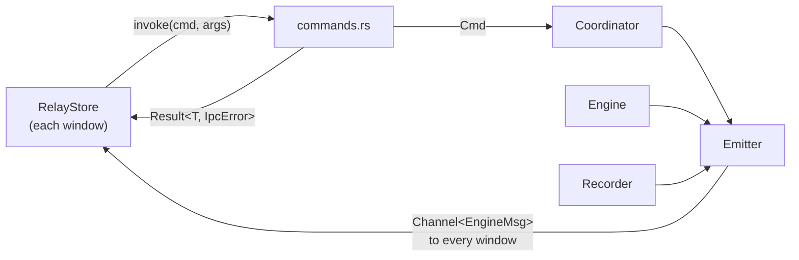
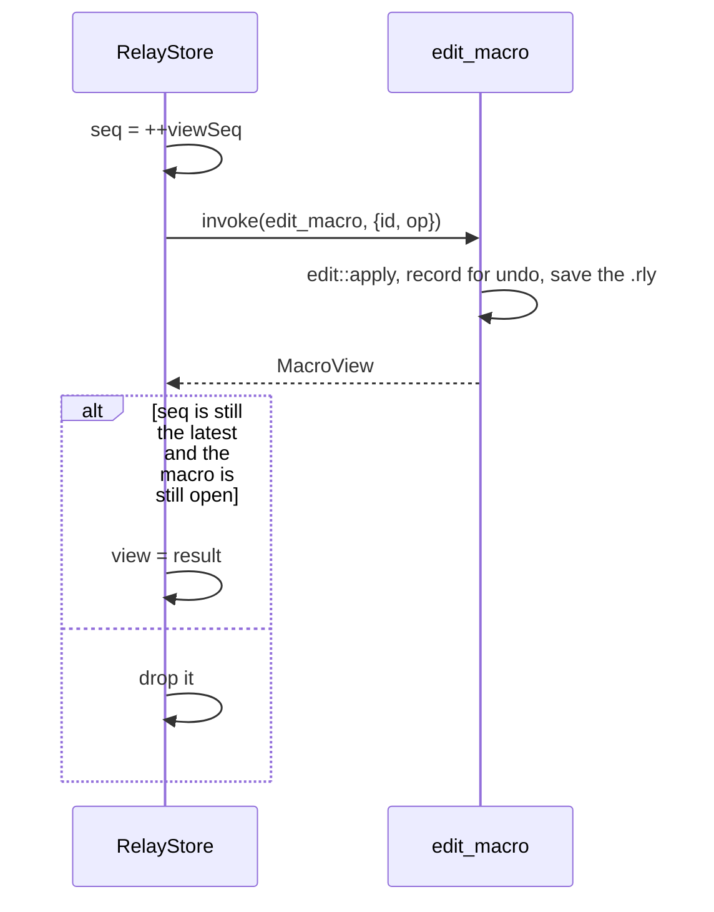
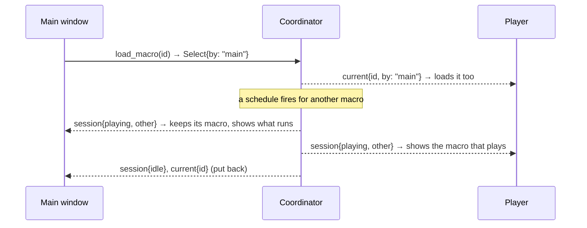

# IPC

The UI and Rust talk in two directions: the UI **calls commands** (request, response), and Rust **streams messages** to both windows for everything that happens on its own schedule. This page is that contract.

- [Commands](#commands)
- [The session stream](#the-session-stream)
- [Errors](#errors)
- [Sequences](#sequences)
- [Generated bindings](#generated-bindings)

## Commands

Every command is in [`commands.rs`](../../src-tauri/src/commands.rs) and registered in `generate_handler!` in `lib.rs`. On the UI side, the [`Backend`](../../src/lib/ipc/backend.ts) interface lists them all but the window's own (player mode, the divider, the tray), which are in [`platform/window.ts`](../../src/lib/platform/window.ts). Those two are the only places that call `invoke`.

- **Commands that write macros, settings or exports are `async`**, off the main thread. The quick ones run on it, `window.json`'s small writes included.
- **Session commands** (`toggle_record`, `toggle_play`, `stop_session`, `seek`) only send a `Cmd` to the coordinator and return. The result arrives on the stream.
- **Commands that return a macro return a whole `MacroView`**, never a patch, and the store replaces its view with it.
- **Edits are refused with `busy` while a session runs**: `edit_macro`, `undo_edit`, `delete_macro`, `pick_pixel`.
- **Both windows call the same commands.** One that needs to know who called takes Tauri's `WebviewWindow` and reads its label.
- **Native dialogs are the UI's** (`@tauri-apps/plugin-dialog`); commands get the chosen paths.

## The session stream

`EngineMsg` ([`ipc.rs`](../../src-tauri/src/ipc.rs)) is a tagged enum (`{"type": "play_tick", …}`) sent through a Tauri `Channel`, which keeps order and is much faster than events. Each window subscribes once (`subscribe_engine`) and gets **every** message; each store decides what applies to it.

| Kind | Messages |
| --- | --- |
| Session | `session` (mode, macro, source), `countdown`, `rec_progress`, `play_tick` (30 a second), `finished` (once per playback, with its reason and timing) |
| The current macro | `current` (with `by`, the window that chose it), `open` |
| Data changed | `saved`, `library_changed`, `runs_changed`, `settings`, `triggers_paused`, `player_mode`, `system_look` |
| For the user | `notice`, `error`, `unsaved` |

The user-facing messages sent before the main window subscribes (problems found at startup) are queued, the latest 20, and delivered when it does.

**The UI extrapolates the playhead.** 30 ticks a second is exact but not smooth at 120 Hz, so each animation frame computes `tick.t + min(now − tick.at, 100) × speed`. The 100 ms cap stops the playhead when ticks stop (a pixel check froze the engine), and every tick snaps it back to the engine's time.

## Errors

Commands return `Result<T, IpcError>`, serialized as `{ code, message }`. The store shows the message as a toast, so most are written for users; `not_found` and `edit_rejected` carry internal text, since the UI shouldn't cause them.

| Code | Means |
| --- | --- |
| `not_found` | Unknown macro id |
| `busy` | Refused while a session runs |
| `edit_rejected` | No such step, the wrong kind of step, or a Text template that doesn't parse |
| `hotkey` | A key Relay can't use, or one already taken |
| `io`, `format` | A file couldn't be written, or isn't a macro Relay can read |
| `image`, `data_file` | A picture or a data file that can't be used |
| `invalid_text` | A Text template that doesn't parse, in `preview_text` |
| `unavailable`, `autostart` | The screen couldn't be read; the Run key couldn't be changed |

**A failed save isn't a command error.** The change is kept, the command returns the new state, and an `unsaved` message tells the user.

## Sequences

### Editing a step

The sequence number makes out-of-order answers harmless. Several selected steps go as one `batch` op: one request, one undo.

### Two windows, one macro

## Generated bindings

Every type that crosses IPC derives `ts_rs::TS` with `#[ts(export)]`, except two small hand-written ones: `IpcError` (in `backend.ts`) and `ExportFormat` (in `types.ts`). `cargo test` writes one `.ts` per type into [`src/lib/ipc/bindings/`](../../src/lib/ipc/bindings), which `src/lib/types.ts` re-exports. Never edit them by hand.

The same run regenerates the fixtures: `src/lib/dev/sample-*.json` (the browser preview's data), `e2e/samples.json` and `src/test/path-cases.json`. All are committed, and CI fails if `cargo test` changes any of them. So **a Rust type change without regenerated bindings fails the build**.

Adding a command: see [Recipes](recipes.md#add-a-command).

---

<a href="app.md">← The app</a> · <a href="frontend.md">The frontend →</a>

