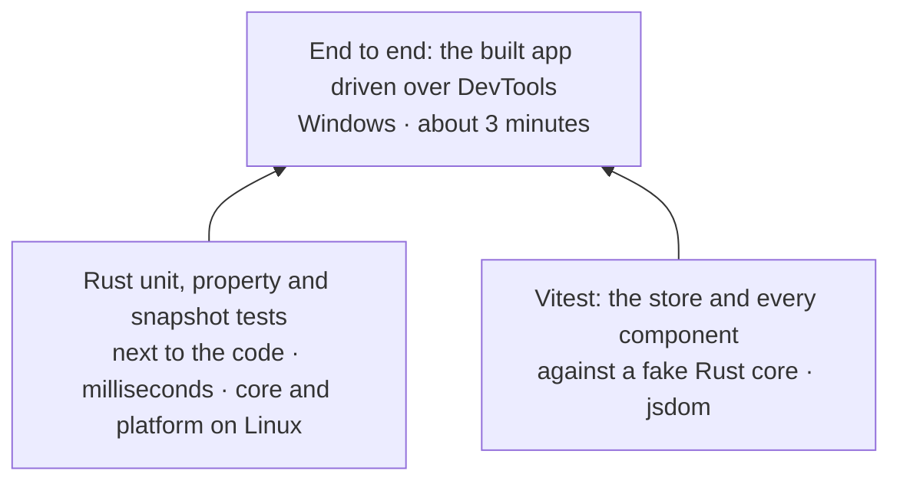

# Testing, CI and releases

Relay is tested in three layers, and each test goes in the lowest one that can express it. The pure logic is tested hardest, because that's where most behavior is and where tests are cheapest. This page says how to write a test at each layer, what CI runs, and how to release.

- [Running the tests](#running-the-tests)
- [Rust tests](#rust-tests)
- [The frontend](#the-frontend)
- [End-to-end testing](#end-to-end-testing)
- [Manual checks](#manual-checks)
- [CI](#ci)
- [Releases](#releases)



> [!IMPORTANT]
> **Never write code that synthesizes OS keyboard or mouse input for testing.** No `SendInput` helpers, no input-generating companion apps. What needs real input goes on the [manual checklist](#manual-checks).

## Running the tests

| Command | Runs |
| --- | --- |
| `npm run verify:quick` | fmt, clippy, `cargo test`, `npm run check`, `npm test`: before every push |
| `npm run verify` | The same, then the debug build and E2E (quit Relay first). About 10 minutes: before marking a PR ready. |
| `cargo test -p relay-core` | The core alone, in seconds |
| `npm run test:coverage` | Vitest with coverage in `coverage/` |
| `cargo llvm-cov --workspace --summary-only` | Rust coverage |

`cargo test` also regenerates the bindings and fixtures; commit them when they change ([IPC](ipc.md#generated-bindings)).

## Rust tests

Tests live next to the code, in `#[cfg(test)]` modules.

- **Test the pure type, not the thread.** The engine is the model: `Engine::advance(now)` takes time as an argument and gets a fake injector and screen, so a test says "at t = 1000 the button is down" with no threads or sleeps. The trigger watches, `presence::shown`, `window_ctl::layout` and the coordinator's `admit` work the same way.
- **Property tests** ([`proptests.rs`](../../crates/relay-core/src/proptests.rs)) generate random recordings and edit sequences and check [`check_invariants`](core.md#edits), that steps own disjoint events, and that each edit's splice undoes and redoes it. A failure is shrunk and saved in `crates/relay-core/proptest-regressions/`: commit that file. `PROPTEST_CASES=2000` runs longer.
- **Snapshots** ([insta](https://insta.rs)) pin the exact `.rly` output, the v0 migration and the AutoHotkey export. Accept intended changes with `cargo insta review`.
- **The coordinator runs on Tauri's mock runtime**, so its real thread is tested, panics included.
- **The recorder** is fed synthetic `RawInput` with a fake US translator. That's not OS input, so it's allowed.
- **AutoHotkey scripts** are never run (they'd click on the desktop). With `RELAY_AHK_DIR` set, the tests write them there, and CI has AutoHotkey check their syntax with `/Validate`.

## The frontend

[Vitest](https://vitest.dev) in jsdom, with [Testing Library](https://testing-library.com/docs/svelte-testing-library/intro). Pure modules in `src/lib/` have their own `.test.ts`. Everything else runs the **real `tauriBackend`** against a fake Rust core.

**The fake core** ([`src/test/fake-core.ts`](../../src/test/fake-core.ts), with [`fake-edit.ts`](../../src/test/fake-edit.ts) and [`fake-path.ts`](../../src/test/fake-path.ts)) sits behind Tauri's `mockIPC` and answers every `invoke` **exactly as Rust does**: library rules, edit semantics with event renumbering, undo, hotkey refusals with Rust's messages, `busy`. [`fake-core.test.ts`](../../src/test/fake-core.test.ts) pins those answers.

> [!WARNING]
> A fake that drifts from Rust makes tests pass on behavior the app doesn't have. When a command, edit, library rule, hotkey rule or setting changes in Rust, change the fake and its test in the same branch.

Writing a component test:

- `freshStore({ settings })` ([`src/test/app.ts`](../../src/test/app.ts)) gives a new store on a new fake core; `settle()` lets responses and Svelte run.
- **New controls get a test that checks the exact command sent** (`core.argsOf("edit_macro")`).
- **Compare with literal expected values**, never with the fake's own state after the call.
- To shape answers: `core.fail` (a command that can fail in Rust), `core.saveError` (a save that fails), `core.on` (answer differently), `core.hold` / `core.held` (hold a response), `core.emit` / `core.emitLater` (deliver a stream message now or after a frame), `core.mode` (a session running).
- jsdom has no layout: tests that seek by pointer stub `getBoundingClientRect`. [`setup.ts`](../../src/test/setup.ts) adds `<dialog>`, `ResizeObserver` and animation frames.

## End-to-end testing

[`e2e/`](../../e2e) starts the **real built app** on a scratch data folder and drives both windows over the Chrome DevTools Protocol. It covers what only the real app shows: the coordinator's threads, timing, files on disk, the native windows, triggers firing.

```bash
npx tauri build --debug --no-bundle
npm run test:e2e
```

Quit your own Relay first: only one copy runs, and the harness refuses to start otherwise. `RELAY_EXE` tests another build.

How [`harness.mjs`](../../e2e/harness.mjs) works:

- **Seeding.** A new folder starts empty, so before its first start an `App` writes the four samples (`e2e/samples.json`) and a `settings.json` with the first run done and the new install's keys. `settings: null` shows the first run.
- **Two pages.** `app.page` is the main window, `app.player` the player. Each has its store on `window.__relay`.
- **Clicks by accessible name.** `page.click("Play")` needs exactly one visible control with that name; `{ nth, role, within }` disambiguate. Helpers like `page.go`, `page.open`, `page.addStep` and `page.setField` wait for what they did; [`harness.mjs`](../../e2e/harness.mjs) documents each.
- **Commands for native dialogs.** Where the UI opens a file dialog, the test calls the command (`page.invoke("import_macros", …)`).
- **Files.** Tests check what Relay writes, and `app.restart()` checks what survives.
- **`page.reset()`** runs after every test: stops any session, leaves player mode, clears the selection and toasts.

What the tests play and fire, without OS input:

- Played macros hold only waits and pixel checks (`waitingMacro()`), plus a Find image step whose image is absent (a found one would click).
- Triggers fire on real events: `ping.exe` launching, a scheduled minute, a patch drawn in Relay's player changing color, an image shown in a separate PowerShell window ([`image-window.ps1`](../../e2e/image-window.ps1)), since Relay never searches its own windows.

Lessons that keep tests stable:

- **After a file changes, wait for the UI too**: Rust writes the file slightly before the UI gets its answer.
- **Wait until the UI allows an action** (`canUndo` before Ctrl+Z).
- **Watch "nothing happened" for the whole window** (`staysIdle`), and read run counts from `library.json`.
- **App launches need a baseline**: the watcher polls every 2 s, so the `ping()` helper waits a poll first.

**By hand:** start Relay with `RELAY_DATA_DIR` and `RELAY_DEVTOOLS_PORT=9333`, then run JavaScript in a page with [`scripts/cdp.mjs`](../../scripts/cdp.mjs) (`node scripts/cdp.mjs 9333 check.js [player]`). `window.__TAURI_INTERNALS__.invoke` calls any command. [`docs-screenshots.ps1`](../../scripts/docs-screenshots.ps1) uses the same technique to regenerate `docs/images`.

## Manual checks

What needs real input, real apps or real hardware. Go through it before a release.

<details>
<summary>The release checklist</summary>

- [ ] Record with *Screenshot* on: the preview shows your screen (without Relay's windows) under the path; Screen | Outline switches; with it off, no picture is saved
- [ ] Drag the window and the player between monitors with different scaling: each keeps its size and layout; the player's spot survives a restart
- [ ] Resize the window from each edge and corner, at 100% and 150%, and across monitors: the layout follows, it stops at 760 × 520, and the size survives a restart; the player can't be resized
- [ ] Relay's keys from another app: the record and play keys, and the player key (player mode on and off); each set to None reaches the other app; a key field takes a combination Relay or a macro holds; on a European layout, a Ctrl + Alt combination that types a character gets the AltGr warning
- [ ] The player never takes the keyboard: click it while recording into Notepad, and keep typing there; a triggered run with the window open puts it in a free corner, and the window's Stop stops the run
- [ ] The picker with real input: the arrows and Shift + arrows, Space to freeze and unfreeze over a menu that's open in another app (the menu stays open), a click and Enter pick, Esc and a right click cancel, on two monitors with different scaling; none of its keys reach the app beneath
- [ ] Sounds: each moment (recording starts and stops, a step, done, failed) and each Try key, at a sensible loudness, and silent with Sounds off
- [ ] The look: frosted glass on Windows 11 (and off on Windows 10 by default), solid with Windows' *Transparency effects* off, the dark theme, a contrast theme, reduce motion
- [ ] The first run on a new data folder: the keys' three choices, and the guided first recording into Notepad
- [ ] Record and replay in Notepad, a browser and an Office app, at 100% and 150% scaling, and across two monitors
- [ ] Double clicks, drags (including window drags), scrolls, AltGr characters, dead keys
- [ ] Esc, stop on key press and the kill switch during a long loop, with nothing left pressed afterwards: Ctrl + Alt + Backspace, an upgrade's Ctrl + Alt + End, and one changed in Settings → Keys; on a PC where another program holds Ctrl + Alt + Backspace, Relay says so
- [ ] Play from the Play button: input goes to the previous app, not Relay
- [ ] An elevated target shows the warning
- [ ] Each trigger type fires once, and is skipped while busy or locked
- [ ] An exported program: the window never takes the focus, avoids the corners the macro clicks in, and follows a move to a 150% monitor; the countdown, Pause and play on, Stop, Esc, stop on key press and Ctrl+Alt+End (with Relay closed, with Relay running, and with an elevated window in front) all stop it with nothing left pressed; Find image never finds its window; exit codes through `start /wait` and `Start-Process -Wait -PassThru`; a scheduled run on a locked screen exits with 6; SmartScreen on a downloaded copy, and a Windows Defender scan
- [ ] Find image: **+ Find image** snips (Esc, then Cancel, inserts nothing); Paste a screenshot copied from another app and one from a browser; a Find image step clicks a real button at 100% and 150% scaling, and on a second monitor; *Test* agrees; the image trigger fires when a dialog opens; CPU in Task Manager stays low while a step or trigger waits
- [ ] Text steps: one with `{date}`, `{time}`, `{n}` and a new line types into Notepad, a browser and an Office app, on an AZERTY layout too; `{clipboard}` types what was copied (several lines, accents, emoji); a long clipboard pushes the next click back; an exported program types them too
- [ ] AutoHotkey export: a sample macro's script runs with AutoHotkey v2 (clicks, a shortcut, typed text, a Text step with `{date}`, a pixel check, a Find image step), Esc and Ctrl+Alt+End stop it, `Speed`/`Repeat` at the top change it
- [ ] Data files: each row's `{col:…}` typed into Notepad, once per row, from a file saved by Excel (its formats are unit-tested); choosing and removing it in the play options; the file changed in Excel between two runs; an exported program types the rows it was exported with
- [ ] Close to the tray, the tray's menu (its Record item names the record key), Start with Windows (sign out and in: Relay stays in the tray), single instance (a second launch shows the window, or the player in player mode)
- [ ] A 10-minute soak: memory stays flat, timing stats in the log stay under 2 ms p99
- [ ] The installer installs, upgrades and uninstalls cleanly on a fresh Windows 10 and 11

</details>

## CI

`main` changes only through pull requests, and a ruleset requires the `quick`, `windows` and `msrv` checks. CI minutes are limited (Windows minutes count double), so everyday checking is local and the expensive job runs once per PR, when it's marked ready.

| Job ([`ci.yml`](../../.github/workflows/ci.yml)) | Runs on | Does |
| --- | --- | --- |
| `quick` | Every push to a PR, drafts too (Linux) | fmt, tests and clippy for the four portable crates, `npm run check`, `npm test`; decides whether the PR changes more than docs |
| `windows` | Ready PRs that change code | `cargo test`, the AutoHotkey syntax check, generated files up to date, clippy, `npx tauri build`, then E2E against the release build |
| `msrv` | Same | `cargo check` with Rust 1.95 |

A skipped job counts as passed, so a docs-only PR merges after `quick`. A newer push cancels the run in progress.

- **Reading a failure:** `gh pr checks <n>`, then `gh run view <id> --log-failed`. Each E2E failure is also an annotation ([`github-reporter.mjs`](../../e2e/github-reporter.mjs)).
- **Checking an E2E fix quickly:** [`e2e.yml`](../../.github/workflows/e2e.yml) builds the release app and runs only the tests asked for, in about ten minutes. Push the fix to a draft PR first, then `gh workflow run e2e.yml --ref <branch> -f suites="triggers" -f tests="<name regex>"`.

## Releases

1. On a `release-X.Y.Z` branch, bump the version in `Cargo.toml` (workspace), `package.json` and `src-tauri/tauri.conf.json`; run `npm install --package-lock-only` and `cargo check` to refresh the lockfiles; rename *Unreleased* in `CHANGELOG.md` to `## vX.Y.Z: <title>`; tick the roadmap line in `README.md` if relevant.
2. Run `npm run verify`, commit `chore(release): X.Y.Z`, open a ready PR (`gh pr create --base main`), and merge it once green (`--subject "Release X.Y.Z"`).
3. `git checkout main && git pull`, tag `git tag -a vX.Y.Z -m "Relay X.Y.Z"` and push the tag. [`release.yml`](../../.github/workflows/release.yml) runs the tests, builds, and creates a **draft** release with `Relay_X.Y.Z_x64-setup.exe` and `Relay_X.Y.Z_x64-portable.exe`.
4. Publish it: `gh release edit vX.Y.Z --draft=false --latest --title "Relay vX.Y.Z" --notes-file notes.md`. Write the notes like the previous release's (`gh release view v1.5.0`): *What's new* bullets, links to the changelog and user guide, *Downloads* (both files), and the SmartScreen note, since the builds aren't signed.
5. Check that `gh release view vX.Y.Z` lists both files, that `gh release list` marks it Latest, and that both download URLs respond.

> [!CAUTION]
> In the web UI, open the draft from the Releases list. `/releases/edit/vX.Y.Z` is a *new release* form for a tag without a published release, and publishing it creates a second, empty release.

`release.yml` can also be run by hand with a `tag`, to rebuild that tag and reattach its portable exe.

---

<p align="center"><a href="file-formats.md">← File formats</a> · <a href="recipes.md">Recipes →</a></p>
