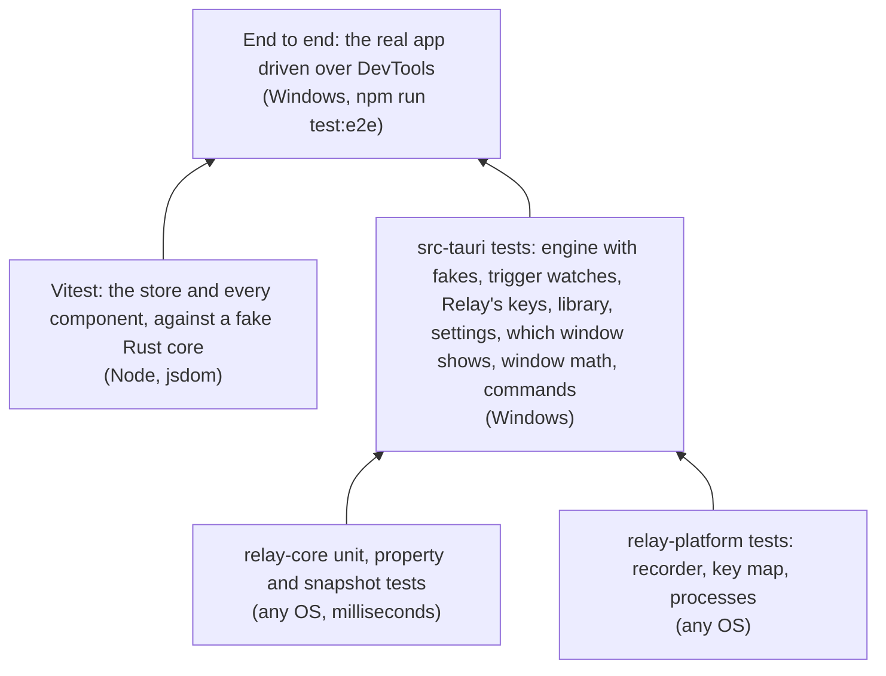

# Testing and CI

Relay is tested in layers. The pure logic is tested hardest, because it's where most of the behavior is and where tests are cheapest. The OS layer is kept thin and checked end to end against the real app.



| Layer | Tests | Where |
| --- | --- | --- |
| Rust unit, property and snapshot tests | about 445 | Next to the code, in `#[cfg(test)]` modules |
| Frontend: the store, the backend contract, the fake core and the components | about 787 | `src/**/*.test.ts` |
| End to end, against the built app (both windows) | 131 | [`e2e/`](../../e2e) |

- [Running the tests](#running-the-tests)
- [relay-core](#relay-core)
- [relay-platform](#relay-platform)
- [The app](#the-app)
- [The frontend](#the-frontend)
- [End-to-end testing](#end-to-end-testing)
- [Manual checks before a release](#manual-checks-before-a-release)
- [CI](#ci)
  - [A few E2E tests](#a-few-e2e-tests)
- [Releases](#releases)

## Running the tests

```bash
cargo test --workspace     # all Rust tests; also regenerates the TS bindings and the browser fixture
cargo test -p relay-core   # just the core (fast)
cargo fmt --all            # 120 columns, see rustfmt.toml; CI checks it
cargo clippy --workspace --all-targets -- -D warnings
npm test                   # Vitest
npm run test:coverage      # Vitest with coverage (coverage/index.html)
npm run check              # svelte-check (types and accessibility)
cargo test -p relay-player # the player's logic: options, exit codes, status text, placement
npm run test:e2e           # the real app, end to end (build it first, see below)
npm run verify             # what CI checks: fmt, clippy, the tests, the debug build and E2E
npm run verify:quick       # the same without the build and E2E
cargo llvm-cov --workspace --summary-only   # Rust coverage, with cargo-llvm-cov
```

Set `PROPTEST_CASES=2000` for a longer property-test run than the default.

## relay-core

About 200 tests, all pure, so they also run on Linux.

| Area | What's tested |
| --- | --- |
| `steps` | Click vs. drag at the slop boundary, double and triple clicks by time and distance, scroll merging and direction changes, typing gaps, Ctrl combos vs. AltGr text, modifier ownership, auto-repeat |
| `edit` | Each `EditOp`, inserting after the step under the playhead and never inside one, deleting a wait closes the gap, retiming a pause and trimming pauses, a batch applied in order or not at all, `normalize` on orphan releases and unreleased presses |
| `keys` | Labels and combos, `normalize_combo`, and `key_warning`: keys apps use, remote-desktop clients' keys, an AltGr character on the layout |
| `format` | Round trips, `NotRelay` and `TooNew`, the v0 migration |
| `playback` | The clock under speed changes, pause, seek and loops. Humanize stays within bounds, keeps whole steps together and keeps order. |
| `session` | Every transition and its effects, including the ignored inputs |
| `schedule` | Next run across days and weeks, and both DST transitions |
| `triggers` | `PixelEdge` and `ProcessLaunchEdge` sequences, defaults for partial JSON, `also_on` (only the triggers that would fire) |
| `samples` | The fixtures written for the browser preview, the fake core and the end-to-end tests (`e2e/samples.json`) |

### Property tests

[`proptests.rs`](../../crates/relay-core/src/proptests.rs) uses [proptest](https://crates.io/crates/proptest) to generate random recordings (clicks, drags, double clicks, scrolls, typing, combos, held modifiers, random gaps) and random sequences of edits, and checks:

| Property | Meaning |
| --- | --- |
| `recordings_satisfy_the_invariants` | Any generated recording, normalized, is sorted, balanced and has nothing inside waits |
| `steps_own_disjoint_valid_events` | Every step's items are valid indices, and no event belongs to two steps |
| `edits_do_what_they_say_and_preserve_the_invariants` | Any sequence of inserts, deletes, duration, pause, label and move changes and pause trimming does what each edit says (or is refused as expected) and keeps the invariants |
| `every_edit_undoes_and_redoes_from_its_splice` | The `Splice` each edit records undoes and redoes it exactly |
| `a_batch_is_its_edits_in_order_and_undoes_in_one` | A batch equals its edits applied one by one (or changes nothing when one fails), and one splice undoes it |
| `deleting_every_step_leaves_nothing` | Deleting steps until none are left leaves no events |

When proptest finds a failure, it shrinks it to a minimal case and saves it in `proptest-regressions/`. Commit that file, so the case is retried forever.

### Snapshots

[insta](https://insta.rs) snapshots in [`src/snapshots/`](../../crates/relay-core/src/snapshots) pin the exact `.rly` output of a fixed macro and the result of migrating an M0 export. A format change shows up as a snapshot diff in review. Accept intended changes with `cargo insta review`, or by replacing the `.snap` file.

## relay-platform

- **Recorder**: synthetic `RawInput` sequences with a fake US translator. Covers a click, typing and Ctrl+S grouped into the right steps, physical key codes, *Capture keystrokes* off, the kill switch (and its modifiers) left out, the kill switch as set (Ctrl + Alt + End is then a key like any other), live moves reported once, and `is_meaningful`.
- **Key map**: scan code ↔ W3C code round trips, `vk_for_code`, and `KeyChord`: parsing combos, at least its modifiers held.
- **The picker's logic**: its keys (arrows, ten with Shift, Space, Enter, Esc), where the loupe and the help bar go on a monitor's edges, colors as hex. (The Windows picker itself is checked by hand.)
- **Snapshots**: `snapshot_size` scales down evenly and never up; a `Snapshot` never prints its pixels. (The Windows capture itself is checked by hand: see the checklist.)
- **Processes**: sees the test's own process (by prefix, since Linux truncates names to 15 characters).

## The app

`src-tauri` tests run on Windows:

| Module | What's tested |
| --- | --- |
| `engine` | With a fake clock, a recording injector and a fake screen: injection on schedule and lateness stats, speed, pause/seek/speed changes, loops releasing between loops, releasing a button when dropped mid-drag, pixel checks waiting, timing out with their step number, and pausing during a check, and the window offset |
| `history` | Undo and redo, a new edit clearing redo, typed renames as one step, a batch as one undo, an edit that changes nothing not recorded |
| `hotkeys` | Parsing UI combos (spacing, order, F1–F24 alone, Shift with a key that types, ending with a modifier), which of Relay's keys each session state registers, recognizing Relay's keys as set, the rules for setting one (usable, not twice, not a macro's, Stop everything never off), a key another program has reported once per run, conflicts with other macros' hotkeys (written either way; disabled ones don't count) |
| `screens` | Screenshots saved as JPEG and read back, too big to encode, a copy for a duplicate |
| `library` | A new library starts empty (the other tests seed the samples with `open_with_samples`), persistence, duplicate (with its screenshot)/trash/restore/import, triggers and the pre-trigger hotkey migration, broken and unreadable files reported without failing |
| `settings` | Persistence and partial files, a bad value reset alone, an unreadable file never overwritten, a new install's keys and first run, an upgrade's keys and keys screen, changing one key at a time, the text sizes, when the player is on top |
| `presence` | `shown` for every choice and session (the window stepping aside, player mode, the tray, a triggered run, picking), the player's zoom with the text size, `free_corner` (clear of the window, with a margin, and of the clicks; on the window's monitor) |
| `look` | Glass from the setting, then Windows' default, and never with transparency effects off |
| `rec_thread` | The watchdog: fires on silent movement, respects the cooldown, never fires on a still cursor |
| `triggers` | `ScheduleWatch` (on time, a few seconds late, skipped after sleep, days, shared times), `LaunchWatch` (lower-case names, the baseline, once per start, triggers switched off) and `PixelWatch` (two samples, tolerance, unreadable screens, a moved pixel) |
| `window_ctl` | Zoom on small screens and high scaling; the layout (default spot, bottom-center anchor, kept inside the work area, negative coordinates, centering); which monitor owns an anchor; the size after a scale change (dragging or not); the window's size from `window.json` (never below the minimum, made to fit the work area, the default at most 80% of it), a user resize in CSS px at 100% and 150%, the divider sanitized; player mode saved at once, a drag of the player moving only its anchor; `window.json` round trips and bad files |
| `commands` | Error codes for the UI, `busy` refusals, exports that import again (programs with their data, AutoHotkey scripts), an import with broken and missing files, views reporting undo and redo |
| `coordinator` | Trigger admission, only the current playback ending it, only a completed run counting, the play key's playhead after each ending, the run history's entries (finished, skipped, refused by the data file), a screenshot kept only for its desktop, and a command that panics leaving Relay idle and working (on Tauri's mock runtime) |
| `ipc`, `storage` | The message stream's JSON shape, every window getting every message, early errors kept for the main window only, resubscribing; atomic writes |

Each trigger thread only sleeps and feeds a `*Watch` type the time, the running programs or a pixel reader, so what fires when is tested without threads.

The engine is the best example of the approach: `Engine::advance(now)` takes time as an argument and gets its injector and pixel reader injected, so a test can say "at t = 1000, the button must be down" without threads or sleeps.

## The frontend

[Vitest](https://vitest.dev) runs in jsdom with [Testing Library](https://testing-library.com/docs/svelte-testing-library/intro). The pure modules in `src/lib/` have their own tests: formatting, lanes, the preview's view (the whole desktop fitted, zoom around the pointer, pan, never past an edge) and its callouts, the inspector's width (`layout.ts`), the editor's rows (`rows.ts`: moves folded, what each row says, deleting rows as one batch), the play summary, trigger texts, Activity's wording (`runs.ts`), images, the sounds, the window calls, which step the inspector follows (`selection.ts`), and hotkey capture. Everything else runs against a **fake Rust core**:

- [`src/test/fake-core.ts`](../../src/test/fake-core.ts) sits behind Tauri's own IPC mock (`@tauri-apps/api/mocks`). The UI runs its real `tauriBackend`, and every `invoke` lands in the fake, which records every call (`core.calls`, `core.argsOf("edit_macro")`). **It answers the way the Rust side does**, so a test can't pass on behavior the real app doesn't have, and [`fake-core.test.ts`](../../src/test/fake-core.test.ts) pins that:
  - the library like `library.rs` with `open_with_samples`: the four samples with their hotkeys off, only enabled hotkeys in the list, "X (copy)" then "X (copy) 2", restore back in place, imports at the top with unique names (from `core.files`);
  - edits and undo like `edit.rs` and `history.rs` ([`fake-edit.ts`](../../src/test/fake-edit.ts)): batches applied in order or not at all, one undo; inserts snap after the step under the playhead and push the rest later, deleting a wait closes its gap, deleting a click joins the moves either side, pauses and moves retime what follows, smoothing and straightening move a move's samples (with [`fake-path.ts`](../../src/test/fake-path.ts), a port of `path.rs` checked against the `path-cases.json` Rust writes), event indices renumber, an edit that changes nothing isn't one to undo, wrong-kind edits are refused with Rust's messages, undo restores the name and steps but not the playback options, quick renames merge;
  - refusals: `busy` for deletes, edits and picks during a session (`core.mode`), hotkeys like `hotkeys.rs` (Relay's keys as set, another macro's, Shift + a character, modifier-only, malformed), Relay's keys like `check_key` (with Rust's messages), arguments of the wrong type;
  - Relay's keys: `set_relay_key`, `hold_hotkeys` (`core.hotkeysHeld`), `key_warning` like `relay_core::keys::key_warning`, with what the layout types set by the test (`core.altgr`);
  - the two windows: `core.install("player")` routes a page's IPC as the player's, `current_macro` and `current` follow `load_macro`, `set_player_mode` and `show_window` answer like `presence.rs`, and `update_settings` tells both windows (`settings`);
  - screenshots as raw bytes (empty when there's none, never an error), copied with a duplicate;
  - the window like `window_ctl.rs`: player mode, `save_panes` sanitized as `Panes::sanitized` does (NaN arrives as null);
  - `pick_pixel` answers `core.picked` (frozen or not, or `null` for a cancel);
  - `update_settings` fills in defaults and refuses Relay's keys as Rust does; `set_triggers_paused` emits `triggers_paused`; errors sent before the UI subscribes are queued.

  A test can make a command fail (`core.fail`, which refuses commands that can't fail in Rust: for those, `core.saveError` makes the save fail and an `error` message follow, as Rust does), answer it differently (`core.on`), or hold its response until the test releases it (`core.hold`, `core.held`). `core.emit(msg)` delivers an engine message the way the coordinator does, and `core.emitLater(msg)` after a frame, for ordering bugs. `core.view(id)` returns a copy.
- [`src/test/app.ts`](../../src/test/app.ts) gives each test a fresh store with `freshStore({ settings })`, which uses `resetRelay()` (components read the `relay` binding live) on a fake core with these settings in Rust (the first run is a setting: `intro`). `settle()` lets responses and Svelte updates run. [`src/test/media.ts`](../../src/test/media.ts) fakes Windows' dark mode and reduced motion (`matchMedia`).

| Tests | What's covered |
| --- | --- |
| [`backend.test.ts`](../../src/lib/ipc/backend.test.ts) | Every `Backend` method sends one command with the argument names Rust expects; the export and import dialogs, including cancelling; the browser preview's simulation (countdown, loops, pause, seek, speed, forever) |
| [`relay.test.ts`](../../src/lib/state/relay.test.ts) | The store: startup in each window, every engine message (the two windows following one macro, a triggered run of another macro, settings saved from the other window), each action and its guards (busy sessions, nothing open), dropping responses for a macro the user left (a slow screenshot too; the screenshot's object URL is revoked when another macro opens or the last one is deleted), rename debouncing, undo and redo, several steps edited as one batch, the picker, toasts, sounds (only in the main window, only when on), keyboard shortcuts in the app and the browser |
| `src/components/**/*.test.ts` | Every button, switch, radio and field in every component, checked by the command it sends: the kit; the window and its places, the top bar and window controls, the first run (new install and upgrade); the Library (table, sort, search, filters, row menus, multi-select, Activity and Problems); the editor's top bar, steps list (keys, selection, find, insertion), inspector (Step and Macro tabs), divider, narrow window and view (the preview's callouts, screenshot and Screen / Outline, zooming, panning and Fit; the timeline as a slider, including seeking by pointer); Settings (every section, Relay's keys with refusals and warnings); the player (each state, the macro menu, errors); toasts, the export dialog and the demo desktop |

jsdom has no layout, so tests that seek by pointer stub `getBoundingClientRect`. [`src/test/setup.ts`](../../src/test/setup.ts) fills in what jsdom lacks: `<dialog>`, `ResizeObserver`, pointer capture, object URLs, `matchMedia` and animation frames. With no layout, nothing is measured: the divider shows the saved value unclamped and the preview uses the default drawing's shape, so what depends on real sizes (a narrow or short window, the preview's aspect following its pane) is checked by setting the sizes a component binds, or end to end.

## End-to-end testing

Some things only show up in the real app: the coordinator and its threads, the engine's timing, files on disk, the native window, triggers firing. [`e2e/`](../../e2e) drives the built app through the Chrome DevTools Protocol, which WebView2 exposes with a command-line flag:

```bash
npx tauri build --debug --no-bundle
npm run test:e2e
```

The build puts the app, with the UI built in, at `target/debug/relay.exe`. Quit Relay before running the tests: only one copy runs at a time, so the tests would reach yours instead (the harness checks for this). Set `RELAY_EXE` to test another build, such as `target/release/relay.exe`.

[`e2e/harness.mjs`](../../e2e/harness.mjs) starts Relay on a scratch data folder (`RELAY_DATA_DIR`), with remote debugging on a random port (`RELAY_DEVTOOLS_PORT`: Relay passes it to WebView2 itself, since `WEBVIEW2_ADDITIONAL_BROWSER_ARGUMENTS` isn't honored on CI runners). It connects to **both windows' pages**, told apart by their Tauri label: `app.page` is the main window, `app.player` the player, each with its own store. It clicks a page's own controls by their accessible names (`page.click("Play")`) and reads its store (`page.store("mode")`). Where the UI would open a native dialog, it calls the command instead (`page.invoke("import_macros", …)`), and `app.visible("player")` asks Tauri whether a window shows. Then it checks the files Relay writes. `app.restart()` quits and relaunches on the same folder, to check what survives.

**What a folder starts with.** A new library starts empty, so `new App()` seeds the folder before the first start: the design's four samples (`SAMPLES`, read from [`e2e/samples.json`](../../e2e/samples.json), which relay-core's tests write) as `.rly` files, and a `settings.json` with the first run done and a new install's keys (`KEYS`: Ctrl + Shift + F9, Ctrl + Shift + F10, Ctrl + Shift + M, Ctrl + Alt + Backspace). `new App({ samples: false, settings: null })` starts like a new install, and `settings: { … }` like any other (an upgrade's, without keys).

**The helpers** on a page:

| Helper | Does |
| --- | --- |
| `click(name, { role, within, nth })` | Clicks the one visible control with exactly that accessible name (`nth` for repeated names, `within` to scope) |
| `menu(opener, item)` | Opens a menu by its button and chooses an item |
| `rowAction(item, name)` | Chooses `item` in a Library row's menu (*More for {name}*) |
| `addStep(kind)` | **Add** → *Wait*, *Text*, *Wait for pixel* or *Find image*, at the insertion line |
| `setField(name, value)` | Sets an inspector field by its label and commits it, as leaving the field does |
| `go(place)`, `open(id)` | Goes to the Library, Settings or a macro, and waits until it shows |
| `inspector(tab, section)`, `selectStep(i)` | Shows the inspector's Step or Macro tab (and the Play or Triggers section); selects a step |
| `playTimed()` | Clicks Play and times the run inside the page |
| `reset({ keepPlayer })` | After every test: stops any session, leaves player mode (unless `keepPlayer`), closes the export dialog, selects nothing, dismisses the toasts |

The tests never send input to the desktop. Macros that get played contain only waits and pixel checks (`waitingMacro()`), and one Find image step whose image is never on screen (the suite checks first: found, it would click). The triggers fire on real events: `ping.exe` launching, a scheduled minute arriving, for the pixel trigger a patch of Relay's own window changing color, and for the image trigger a small window appearing. Relay never finds images inside its own window, so [`e2e/image-window.ps1`](../../e2e/image-window.ps1) (PowerShell and WinForms, DPI-aware) draws a fixed pattern, saves it as the PNG to look for, and shows it in a borderless window of its own.

| Suite | What's covered |
| --- | --- |
| Suite | Tests | What's covered |
| --- | ---: | --- |
| `library` | 15 | Macros in a folder without `library.json`, in the Library's table; renaming in the editor's top bar; Duplicate; Delete to the trash folder, and Undo; deleting the open macro opens its neighbour; import (`.rly`, `.json`, broken, too new, missing); export in both formats and back; an AutoHotkey export with a block per step; export to a folder that can't be written; a screenshot shown in the preview (the CSP allows it), copied with a duplicate and left out of exports; `not_found` for every per-macro command; a restart; damaged macro files and a damaged `library.json` |
| `editing` | 23 | Delete step, Undo and Redo (buttons, and Ctrl + Z / Ctrl + Y); Add → Wait, Wait for pixel and Text (a v3 file); a text with a mistake; Make editable; the Step tab's label, pause, wait duration and every pixel field, and staying on its step; Shorten pauses with an Undo; a rejected edit; the play options (speed, repeat, varied timing, where clicks land, stop on key); moves as steps (deleting the trip to Stop, Smooth and Straighten, a move's duration); nothing editable while playing; undo history kept per macro, and not across restarts |
| `playback` | 19 | Playing to the end, with the run counted; starting over from the end; loops; speed; pause and resume; stop; playing from the playhead; seeking and changing speed mid-playback; a pixel check timing out; a data file playing once per row, and refusing to play when it's gone; the busy guard; recording: the window stepping aside for the player, which counts down, then records, and Stop bringing the window back; no countdown, and cancelling it; Play ignored while recording; *Hide the window while playing*; player mode (the player's keys drive the session, its expand key brings the window back); the player's menu switching macros, with the window following |
| `triggers` | 23 | Hotkeys registered and shown in the Library, and refused for Relay's keys as set, another macro's or an unusable combo; the schedule saved from the Macro tab with its next run, then firing at the minute; the app-launch trigger firing with the player beside the window and the window saying what runs, a run its data file refuses logged as skipped, the baseline (started right after, already running), switched off during its delay, skipped while busy, not firing while paused; the pixel trigger firing once per change; the log and the run history recording each run and skip; everything after a restart, and triggers paused by the kill switch running again after one |
| `run-history` | 8 | No `runs.json` until a run; completed, matched, timed-out and stopped runs recorded with what they did; All runs listing them newest first, a run opening to its checks; a restart; a damaged `runs.json` set aside |
| `images` | 5 | An image file read, and a plain one refused; *Test* finding the pattern in another window at its exact position, and not in Relay's own windows, nor the trigger's thumbnail with Relay on each monitor; the image trigger firing when the window appears, and once; a Find image step whose image never shows stopping playback on its step |
| `settings` | 27 | Each setting's switch saved to `settings.json`, and the ones that change the page (theme, spacing, mouse path, reduce motion); a bigger text size zooming the window and the player (up to 150%); the player's size; *Keep the player on top* on the native window; Relay's keys (Change and a combination saved, a key apps use warned about, one Relay has refused, Backspace for None but not for Stop everything, a macro's hotkey that's one of them refused); settings after a restart; only the user resizing the window; the window resizable and the player not; the divider saved and reset; player mode remembered; × with and without *Close to the tray*; the first run of a new install (an empty Library, its keys, the three screens, Later) and of an upgrade (F9, F10 and Ctrl + Alt + End kept, the keys screen once) |
| `player` | 11 | Exported programs: macros that only wait, exported and run: exit code 0 and the time taken, with and without the window; the countdown; the saved options, and `--repeat` and `--speed` over them; a pixel check timing out (5); bad options (2, with the message); `--help`; Import reading the macro back, and refusing another program; a program playing once per row of the data file it was exported with; a macro typing a column without a file refused for export |

Anything that needs real input isn't covered end to end: recording actual clicks and keys, Esc, stop on key press, pressing Relay's keys or a macro's hotkey, the kill switch, the tray menu, the picker (its loupe, keys and Freeze), dragging the player, and the sounds. Nor is anything that clicks what it finds (a Find image step that finds its image), or that changes the user's clipboard or opens the snipping overlay (Paste and Snip). The engine's injection, including a Find image step's click, is covered by its unit tests with a recording injector, and clipboard bitmaps by relay-core's. The rest is in the manual checks below.

### By hand

The same technique works interactively. Start Relay with a throwaway data folder and remote debugging:

```powershell
$env:RELAY_DATA_DIR = "$env:TEMP\relay-e2e"
$env:RELAY_DEVTOOLS_PORT = "9333"
.\target\release\relay.exe
```

Then run JavaScript in a window's page with [`scripts/cdp.mjs`](../../scripts/cdp.mjs), in the main window or, with a third argument, in the player:

```powershell
'return window.__relay.library.map(m => m.name)' | Out-File -Encoding utf8 check.js
node scripts/cdp.mjs 9333 check.js
node scripts/cdp.mjs 9333 check.js player
```

In each page, `window.__relay` is that window's store (state and actions), and `window.__TAURI_INTERNALS__.invoke(cmd, args)` calls any command directly. A new data folder starts with an empty Library and the first run: copy the samples from `e2e/samples.json` and write a `settings.json` with `"intro": "done"` first, as the harness does.

Real input for recordings can come from PowerShell (`SendKeys`, `SetCursorPos`, `mouse_event`), but it's *injected*, so set `"ignore_injected": false` in the scratch `settings.json` first. Otherwise Relay ignores it, as designed.

Things learned the hard way:

- Find the main window with `FindWindow("Tauri Window", "Relay")` and the player with `"Relay player"`. The tray icon also owns a window titled "Relay".
- Screenshot the visible frame with `DWMWA_EXTENDED_FRAME_BOUNDS`, not `GetWindowRect`, which includes invisible borders.
- Synthetic DOM events need `{ bubbles: true }` to reach Svelte's delegated handlers.
- Windows PowerShell 5 mangles non-ASCII in scripts. In JavaScript strings, use Unicode escapes (a backslash, `u` and four hex digits) instead of the characters themselves.
- `SendKeys` types characters through the current layout. On AZERTY, digits need Shift, so prefer letters in tests.

[`scripts/docs-screenshots.ps1`](../../scripts/docs-screenshots.ps1) uses the same technique to regenerate every image in `docs/images`.

## Manual checks before a release

What automated tests can't cover well:

- [ ] Record with *Screenshot* on: the preview shows your screen (without Relay's windows) under the path; Screen | Outline switches; with it off, no picture is saved
- [ ] Drag the window and the player between monitors with different scaling: each keeps its size and layout; the player's spot survives a restart
- [ ] Resize the window from each edge and corner, at 100% and 150%, and across monitors: the layout follows, it stops at 760 × 520, and the size survives a restart; the player can't be resized
- [ ] Relay's keys from another app: the record and play keys, and the player key (player mode on and off); each set to None reaches the other app; a key field takes a combination Relay or a macro holds; on a European layout, a Ctrl + Alt combination that types a character gets the AltGr warning
- [ ] The player never takes the keyboard: click it while recording into Notepad, and keep typing there; a triggered run with the window open puts it in a free corner, and the window's Stop stops the run
- [ ] The picker with real input: the arrows and Shift + arrows, Space to freeze and unfreeze over a menu that's open in another app (the menu stays open), a click and Enter pick, Esc and a right click cancel, on two monitors with different scaling; none of its keys reach the app beneath
- [ ] Sounds: each moment (recording starts and stops, a step, done, failed) and each Try key, at a sensible loudness, and silent with Sounds off
- [ ] The look: frosted glass on Windows 11 (and off on Windows 10 by default), solid with Windows' *Transparency effects* off, the dark theme, a contrast theme, reduce motion
- [ ] The first run on a new data folder: the keys' three choices, and the guided first recording into Notepad
- [ ] Record and replay in Notepad, a browser and an Office app, at 100% and 150% scaling, and across two monitors
- [ ] Double clicks, drags (including window drags), scrolls, AltGr characters, dead keys
- [ ] Esc, stop on key press and the kill switch during a long loop, with nothing left pressed afterwards: Ctrl + Alt + Backspace, an upgrade's Ctrl + Alt + End, and one changed in Settings → Keys; on a PC where another program holds Ctrl + Alt + Backspace, Relay says so
- [ ] Play from the Play button: input goes to the previous app, not Relay
- [ ] An elevated target shows the warning
- [ ] Each trigger type fires once, and is skipped while busy or locked
- [ ] An exported program: the window never takes the focus, avoids the corners the macro clicks in, and follows a move to a 150% monitor; the countdown, Pause and play on, Stop, Esc, stop on key press and Ctrl+Alt+End (with Relay closed, with Relay running, and with an elevated window in front) all stop it with nothing left pressed; Find image never finds its window; exit codes through `start /wait` and `Start-Process -Wait -PassThru`; a scheduled run on a locked screen exits with 6; SmartScreen on a downloaded copy, and a Windows Defender scan
- [ ] Find image: **+ Find image** snips (Esc, then Cancel, inserts nothing); Paste a screenshot copied from another app and one from a browser; a Find image step clicks a real button at 100% and 150% scaling, and on a second monitor; *Test* agrees; the image trigger fires when a dialog opens; CPU in Task Manager stays low while a step or trigger waits
- [ ] Text steps: one with `{date}`, `{time}`, `{n}` and a new line types into Notepad, a browser and an Office app, on an AZERTY layout too; `{clipboard}` types what was copied (several lines, accents, emoji); a long clipboard pushes the next click back; an exported program types them too
- [ ] AutoHotkey export: a sample macro's script runs with AutoHotkey v2 (clicks, a shortcut, typed text, a Text step with `{date}`, a pixel check, a Find image step), Esc and Ctrl+Alt+End stop it, `Speed`/`Repeat` at the top change it
- [ ] Data files: each row's `{col:…}` typed into Notepad, once per row, from a file saved by Excel (its formats are unit-tested); choosing and removing it in the play options; the file changed in Excel between two runs; an exported program types the rows it was exported with
- [ ] Close to the tray, the tray's menu (its Record item names the record key), Start with Windows (sign out and in: Relay stays in the tray), single instance (a second launch shows the window, or the player in player mode)
- [ ] A 10-minute soak: memory stays flat, timing stats in the log stay under 2 ms p99
- [ ] The installer installs, upgrades and uninstalls cleanly on a fresh Windows 10 and 11

## CI

[`.github/workflows/ci.yml`](../../.github/workflows/ci.yml) runs on pull requests to `main`, the only way changes reach it (a repository ruleset requires the three checks below). CI minutes are limited, so the expensive jobs run once a PR is ready, and everyday checks run locally with `npm run verify`. It can also be started by hand on any branch (**Actions → CI → Run workflow**). A newer push to a PR cancels its run in progress.

| Job | Steps |
| --- | --- |
| **quick** | Every push to a PR, drafts included, on Linux: `cargo fmt --check`, `cargo test` and `clippy -D warnings` for `relay-core`, `relay-platform`, `relay-playback` and `relay-player` (which keeps them portable), `npm run check`, `npm test`. Also decides whether the PR changes more than docs (`docs/**`, `*.md`). |
| **windows** | Ready PRs that change code, after `quick`: `npm ci` → `cargo test --workspace` → **the AutoHotkey exports load** (the scripts the `ahk` tests write to `RELAY_AHK_DIR`, checked by AutoHotkey v2.0.28's `/Validate`, downloaded and verified by its SHA-256; never run) → **generated files are up to date** (nothing `cargo test` regenerates changed or appeared) → `cargo clippy -D warnings` → `npx tauri build` → upload the installer as an artifact → the E2E suites against the release build |
| **msrv** | Same condition: `cargo check --workspace` with Rust 1.95, the `rust-version` in `Cargo.toml` (the highest any dependency needs, from `sysinfo`) |

A skipped job counts as a passed check, so a docs-only PR merges after `quick`.

### A few E2E tests

[`.github/workflows/e2e.yml`](../../.github/workflows/e2e.yml) builds the release app on any branch and runs only the E2E suites and tests asked for, so a fix for a failed test is checked in about ten minutes rather than twenty-five. It only runs by hand, and it isn't a required check: a PR still needs the full CI to merge.

```bash
gh workflow run e2e.yml --ref <branch> -f suites="triggers editing" -f tests="pixel"
```

`suites` are file names without `.e2e.test.mjs` (empty: all of them); `tests` is a regular expression on test names (`node --test-name-pattern`; empty: every test in those suites). From the web: **Actions → E2E → Run workflow**. `gh run watch` follows the run, and failures show as annotations, as in CI.

## Releases

[`.github/workflows/release.yml`](../../.github/workflows/release.yml) runs on version tags `vX.Y.Z` (milestone tags like `v0.8.0-m7` don't match). It runs the tests, builds with [tauri-action](https://github.com/tauri-apps/tauri-action), and attaches the installer and the portable .exe (`target/release/relay.exe`, renamed `Relay_X.Y.Z_x64-portable.exe`) to a **draft** GitHub release, to be reviewed and published by hand.

It can also be run by hand (**Actions → Release → Run workflow**) with an existing tag: it builds that tag and adds (or replaces) its portable .exe on the release. That's how releases made before the portable .exe existed got theirs.

To release:

1. Bump the version in `Cargo.toml` (workspace), `package.json` and `src-tauri/tauri.conf.json`.
2. Add the release to `CHANGELOG.md`.
3. Merge to `main`, tag `vX.Y.Z` and push the tag.
4. Check the draft release, then publish it.

---

<p align="center"><a href="file-formats.md">← File formats</a> · <a href="README.md">Contents</a> · <a href="../../CONTRIBUTING.md">Contributing →</a></p>
