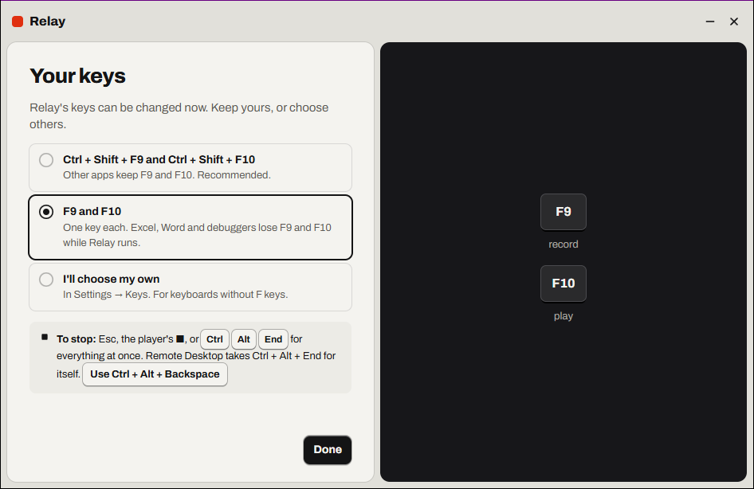

# Getting started

This page takes you from downloading Relay to replaying your first macro.

- [Install](#install)
- [First launch](#first-launch)
- [Your first macro](#your-first-macro)
- [What to read next](#what-to-read-next)

## Install

1. Download **`Relay_<version>_x64-setup.exe`** from the [releases page](https://github.com/HappyRave/Relay/releases).
2. Run it. Relay installs for your Windows user only, so it doesn't ask for administrator rights.
3. Start **Relay** from the Start menu.

### Or use the portable .exe

**`Relay_<version>_x64-portable.exe`**, on the same page, is Relay on its own: no installer, no Start menu entry. Put it anywhere and double-click it.

- It needs the Microsoft WebView2 runtime. Windows 11 includes it, and most Windows 10 PCs get it with Microsoft Edge. The installer adds it if it's missing, the portable .exe can't.
- Your macros and settings are still kept in `%APPDATA%\Relay`, so the portable and the installed Relay share the same Library.
- To update, replace the file with a newer one. **Start with Windows** remembers where the file is, so turn it off and on again if you move it.

> [!NOTE]
> Relay isn't code-signed yet, so Windows SmartScreen may show *"Windows protected your PC"*. Click **More info → Run anyway**. The source and the build scripts are all in this repository if you'd like to check what you're running.

**Requirements:** Windows 10 or 11 (64-bit), with the WebView2 runtime. Windows 11 includes it, and the installer adds it on Windows 10 if it's missing.

## First launch

Relay's window opens near the bottom of your main screen, 944 × 612 by default (smaller on a small screen), and starts with three short screens. **Skip** on the first one, or **Later** on the last, goes straight to Relay.

1. **What Relay does:** record once, play back whenever you like. Relay never connects to the internet, and your macros stay on this PC.
2. **Your keys:** the keys that record and play from any app, without opening Relay. Pick one of:

   | Choice | Record | Play / pause | Good for |
   | --- | --- | --- | --- |
   | **Ctrl + Shift + F9 and Ctrl + Shift + F10** (recommended, chosen at first) | <kbd>Ctrl</kbd>+<kbd>Shift</kbd>+<kbd>F9</kbd> | <kbd>Ctrl</kbd>+<kbd>Shift</kbd>+<kbd>F10</kbd> | Other apps keep <kbd>F9</kbd> and <kbd>F10</kbd> |
   | **F9 and F10** | <kbd>F9</kbd> | <kbd>F10</kbd> | One key each. Excel, Word and debuggers lose <kbd>F9</kbd> and <kbd>F10</kbd> while Relay runs. |
   | **I'll choose my own** | | | Keyboards without F keys. Relay opens **Settings → Keys** when you finish. |

   The screen also says how to stop: <kbd>Esc</kbd>, the player's **■**, or <kbd>Ctrl</kbd>+<kbd>Alt</kbd>+<kbd>Backspace</kbd> to stop everything at once (the [kill switch](04-playback.md#the-kill-switch)).
3. **Your first macro:** the steps below. **Record now** starts the recording right away.

You can change every key later in **Settings → Keys**. See [Keyboard shortcuts](keyboard-shortcuts.md#relays-keys).

> [!NOTE]
> **Upgrading from an older Relay?** You keep the keys you know (<kbd>F9</kbd>, <kbd>F10</kbd>, <kbd>Ctrl</kbd>+<kbd>Shift</kbd>+<kbd>M</kbd> and <kbd>Ctrl</kbd>+<kbd>Alt</kbd>+<kbd>End</kbd>), and Relay shows the keys screen once, with **Done**. Remote Desktop takes <kbd>Ctrl</kbd>+<kbd>Alt</kbd>+<kbd>End</kbd> for itself, so the screen offers **Use Ctrl + Alt + Backspace** for the kill switch.

A new Library is empty. It offers **Record** until you have a macro, and Relay opens on the Library from then on (or straight on your macro while it's the only one).

## Your first macro

We'll record something harmless: typing a line into Notepad. The keys below are the defaults; if you chose others, use yours.

1. **Open Notepad** and click inside it.
2. **Press <kbd>Ctrl</kbd>+<kbd>Shift</kbd>+<kbd>F9</kbd>**, or **Record** in Relay. Relay's window steps aside, and the player counts down *3, 2, 1*. Use that time to put your hands back on the mouse and keyboard.

   

3. **Do the task.** Click in Notepad and type `Hello from Relay`, then press <kbd>Enter</kbd>. The player shows *REC*, the number of steps and the last one.
4. **Press <kbd>Ctrl</kbd>+<kbd>Shift</kbd>+<kbd>F9</kbd> again**, or **■** on the player, to stop. Relay's window comes back on your new macro, *Recording 1*, with its name selected: type a name, such as *Say hello*. Its steps look like this:

   | Time | Step |
   | --- | --- |
   | 00:00.40 | **Click** · 812, 402 |
   | 00:01.10 | **Type** · “Hello from Relay” |
   | 00:03.02 | **Keys** · Enter |

   If you stopped with **■**, a last **Move** is the cursor going to the player: select it and press <kbd>Del</kbd>.
5. **Press <kbd>Ctrl</kbd>+<kbd>Shift</kbd>+<kbd>F10</kbd>**, or **Play**, to replay it. Relay clicks where you clicked and types what you typed, with the same timing.

That's it: recording, then playback. Everything else builds on these two keys.

## What to read next

- Want the macro to wait for something to load? See [Pixel checks](05-pixel-checks.md) and [waits](03-editing.md#waits).
- Want it to run on its own every morning? See [Triggers](07-triggers.md).
- Something didn't replay as expected? See [Troubleshooting](10-troubleshooting.md).

---

<a href="README.md">← User guide</a> · <a href="README.md">Contents</a> · <a href="02-recording.md">Recording →</a>

