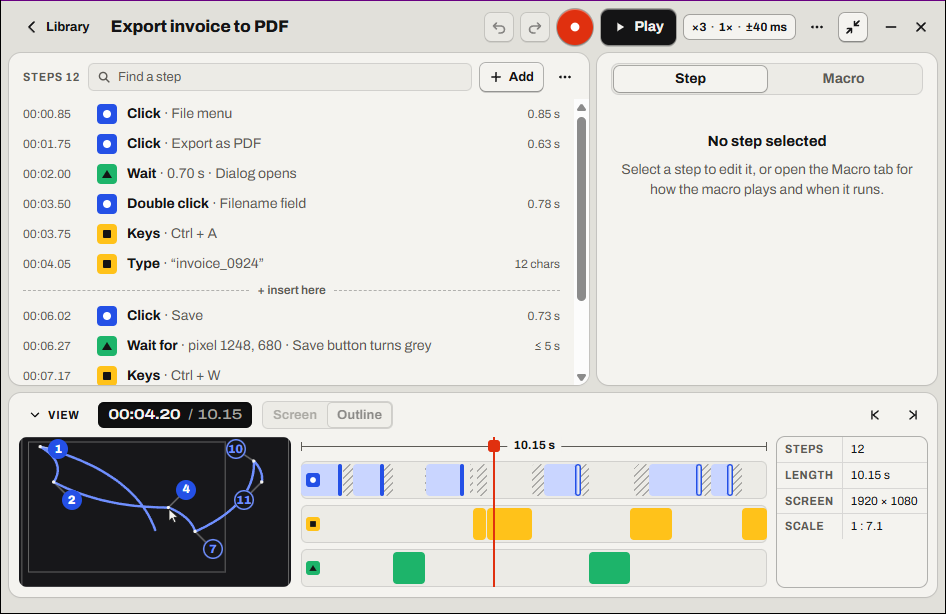
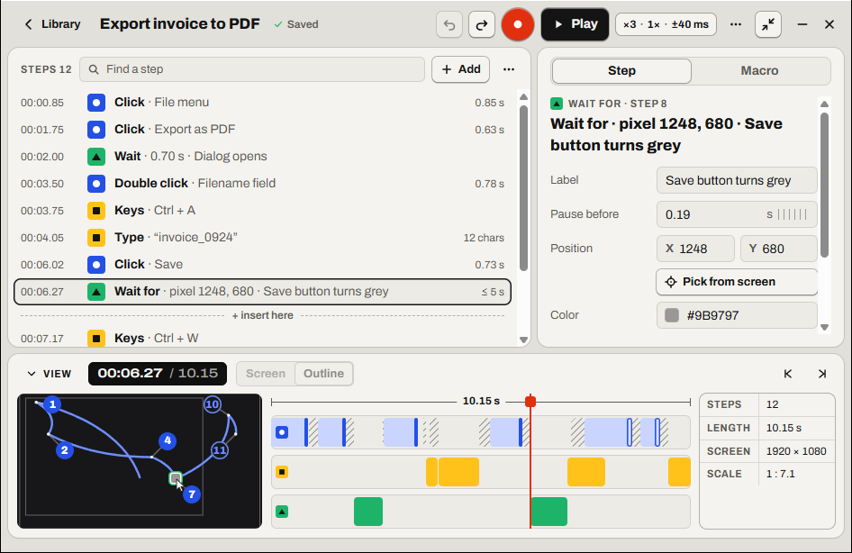

# Editing steps

Relay doesn't show you a thousand raw mouse events. It groups them into **steps** that read like instructions: *Click · Save button*, *Keys · Ctrl + S*, *Type · “invoice_2026”*. You edit a macro by editing its steps, in the editor: open the macro from the Library.

- [The step types](#the-step-types)
- [The steps list](#the-steps-list)
- [Selecting steps](#selecting-steps)
- [Adding steps](#adding-steps)
- [The Step tab](#the-step-tab)
- [Editing several steps](#editing-several-steps)
- [Moves](#moves)
- [Waits](#waits)
- [Text that changes each run](#text-that-changes-each-run)
- [Pauses](#pauses)
- [Deleting steps](#deleting-steps)
- [Undo and redo](#undo-and-redo)
- [The view](#the-view)
  - [The preview](#the-preview)
  - [The timeline](#the-timeline)
- [Renaming a macro](#renaming-a-macro)

## The step types

| Step | For example | Made from |
| --- | --- | --- |
| **Click**, **Double click**, **Triple click**, **Right click**… | *Click · Save button* | A button pressed and released without moving more than 4 px. Clicks that follow each other quickly enough, and close enough, by your Windows double-click settings, merge into a double or triple click. |
| **Drag** | *Drag · 640, 300 → 980, 300* | A button pressed, moved more than 4 px while held (even if it came back), then released. |
| **Scroll** | *Scroll · down 3 notches* | Wheel notches in the same direction, less than 300 ms apart. |
| **Keys** | *Keys · Ctrl + S*, *Keys · Enter* | A key pressed with <kbd>Ctrl</kbd>, <kbd>Alt</kbd> or <kbd>Win</kbd>, or a key that doesn't type a character (arrows, <kbd>Enter</kbd>, <kbd>Tab</kbd>, function keys…). |
| **Type** | *Type · “invoice_2026”* | Characters typed less than 500 ms apart. Shifted characters and <kbd>AltGr</kbd> characters (like `@` or `€` on many European layouts) are part of the text. |
| **Text** | *Text · “Invoice {date}”* | A [Text step](#text-that-changes-each-run) you added, or typed text you made editable: it's filled in when it plays. |
| **Wait** | *Wait · 0.50 s* | A pause you added. |
| **Wait for** | *Wait for · pixel 1248, 680* | A [pixel check](05-pixel-checks.md) you added. |
| **Find** | *Find · OK button* | A [Find image](06-find-image.md) step you added: it waits for a picture, then clicks it. |
| **Move** | *Move · 134, 70 → 230, 324* | The cursor moving between two other steps, including before the first and after the last. See [Moves](#moves). |

The cursor moving while a button is held is part of that click or drag, not a move of its own.

> [!NOTE]
> Key names follow **your keyboard layout**. On an AZERTY keyboard, the key to the right of <kbd>Tab</kbd> shows as **Ctrl + A**, not *Ctrl + Q*.

## The steps list

The list fills the left of the editor. Its header counts the steps, and has **Find a step**, **Add** and **Steps options** (⋯).

Each row shows the **time** the step starts, a mark for its kind (a circle for the mouse, a square for the keyboard, a triangle for waits, pixel checks and Find image, a ring for a move), the step, and a short note on the right: how long the move to it takes, how many characters were typed, or how long a pixel check or Find image step waits at most (*≤ 5 s*).

- **Moves are folded** into the step they lead to: a click's row stands for the cursor going there too. **Steps options → Show moves** gives each move a row of its own; Relay remembers your choice. A move with no step after it (often the cursor going to the player when you stopped) always has its own row.
- A dashed line, **+ insert here**, sits just after the step under the playhead: that's where [Add](#adding-steps) puts a step.
- A striped line such as **1.4 s pause** above a row marks a [pause](#pauses) longer than a second before that step.
- **Find a step** (<kbd>Ctrl</kbd>+<kbd>F</kbd>) shows only the rows whose kind or text contains what you type: *click*, *save*, *Ctrl*.
- While the macro plays, each row fills with its color once it has played, the step playing is outlined in red, and the list scrolls to follow along.
- A step the last run stopped on (a pixel check that timed out) is marked in red, with **Timed out**.

With **Window** coordinates (see [Screen or Window coordinates](04-playback.md#screen-or-window-coordinates)), positions are shown relative to the window, like *+120, +48*.

You can only edit while nothing is recording or playing. During a session the Step tab says *Stop playback to edit steps. Speed and the other play options can still change.*

## Selecting steps

**Click a row** to select it: the playhead moves to that step, and the [Step tab](#the-step-tab) shows it. The keyboard works too, once the list has the focus:

| To… | Do |
| --- | --- |
| Select the next or previous step | <kbd>↓</kbd> or <kbd>→</kbd>, <kbd>↑</kbd> or <kbd>←</kbd> |
| Select the first or last step | <kbd>Home</kbd>, <kbd>End</kbd> |
| Select a range | <kbd>Shift</kbd>+click, or <kbd>Shift</kbd> with the arrows, <kbd>Home</kbd> or <kbd>End</kbd> |
| Add or remove one step | <kbd>Ctrl</kbd>+click |
| Select every step shown | <kbd>Ctrl</kbd>+<kbd>A</kbd> |
| Go back to one step | <kbd>Esc</kbd> |
| Edit the selected step | <kbd>Enter</kbd>: the focus goes to its first field |
| Delete the selected steps | <kbd>Del</kbd> |
| Add a step | <kbd>Insert</kbd> or <kbd>+</kbd> |

The selected step stays selected when you add or delete other steps, or undo.

## Adding steps

**Add** (or <kbd>Insert</kbd> or <kbd>+</kbd> in the list) opens a menu:

| Item | Adds |
| --- | --- |
| **Wait** | A 0.5-second [wait](#waits) |
| **Text** | An empty [Text step](#text-that-changes-each-run), selected, so you can type its text |
| **Wait for pixel** | A [pixel check](05-pixel-checks.md) on the pixel under the cursor at that moment of the macro, with its color now |
| **Find image** | A [Find image](06-find-image.md) step: snip the image, or **Paste** or **File…** |

The new step goes at the **+ insert here** line, **just after the step under the playhead**, and everything after it moves later by the time it takes. A step is never split: if the playhead is in the middle of one, such as between the press and the release of a drag, the new step goes right after it.

So to add a step in the right place, **select the step it should come after**, then **Add**. Or hover the edge between two rows: a **+** appears there, and adds right after the row above.

## The Step tab

The inspector's **Step** tab shows the selected step: its kind and number (*Click · step 5*), what it does, and its fields.

| Step | What you can change |
| --- | --- |
| Every step | **Pause before**: the idle time before the step, in seconds. See [Pauses](#pauses). |
| Click, drag, wait, pixel check, Find image | **Label**, for example *Save button*. Labels show in the list and, for a selected click, in the [preview](#the-preview). |
| A step with a move folded in | **Moving there**: how long the cursor takes to get there, with **Smooth the path** and **Straighten**. See [Moves](#moves). |
| Move (with **Show moves**) | **Takes**, with **Smooth the path** and **Straighten**. |
| Click, scroll, drag, keys | Its **Position** (or **From** and **To**), what it **Scrolls**, or its keys, shown for reference. |
| Typed text | What it **Types**, and **Make editable**, which turns it into a Text step. |
| Text | The **Text**, a button for each placeholder, what it types now, and how long it **Lasts**. See [Text that changes each run](#text-that-changes-each-run). |
| Wait | How long it **Waits**. |
| Pixel check | **Position** (**X**, **Y**), **Pick from screen**, **Color**, **Tolerance** and **Gives up after**. See [Pixel checks](05-pixel-checks.md). |
| Find image | The image (click it where it should be clicked), **Snip**, **Paste** or **File…** to replace it, **Match**, **Gives up after**, **Test** and **Show**, the button it **Clicks**, and where it **Looks on** with several monitors. See [Find image](06-find-image.md). |

**Delete step** at the bottom deletes it.

Changes save as soon as you leave a field or press <kbd>Enter</kbd>. There's no Save button. In a number field, you can also drag sideways to change the value, or press <kbd>↑</kbd> and <kbd>↓</kbd> (with <kbd>Shift</kbd>, ten steps at a time). The field then shows what was saved: rounded to the millisecond, or kept within its limits.

With no step selected, the tab says so: select a step, or open the **Macro** tab (<kbd>Ctrl</kbd>+<kbd>M</kbd>) for how the macro [plays](04-playback.md) and [when it runs](07-triggers.md).

While the macro plays, the Step tab follows the step playing (*Now · step 5 of 12*) and, with a data file, the row (*Row 3 of 20*). When a pixel check timed out in the last run, its Step tab says what happened: *Timed out in the last run: the pixel at 1248, 680 px wasn't #2E7D32 within 5 s, so the macro stopped.*

## Editing several steps

Select several steps (<kbd>Shift</kbd> or <kbd>Ctrl</kbd>, see [Selecting steps](#selecting-steps)), and the Step tab shows what they share:

- **Pause before**: sets the same pause before each of them.
- **Label**: labels each one that takes a label.
- **Make editable**, when some are typed text: turns each into a Text step.
- **Delete *N* steps**.

Each of these is **one change**: a single Undo puts all the steps back as they were.

## Moves

A **move** is the cursor going from where it was to where it goes next: to the next click, usually. It's folded into the row of that step, whose note says how long it takes; with **Show moves**, it's a row of its own: *Move · 134, 70 → 230, 324*, *0.63 s*. When you select it (or the step it's folded into), the preview draws its path thicker.

- **Moving there** (or **Takes**, on a move's own row): how long the move takes, from its first recorded position to its last. Shorter is faster. The path keeps its shape, and everything after the move comes earlier or later by the difference.
- **Smooth the path** takes the wobble out of a shaky path and keeps its big turns. Press it again to smooth more.
- **Straighten** makes the path a straight line.

Smooth and Straighten only change where the cursor goes, not when: the move still starts and ends at the same times and places, and keeps the way it sped up and slowed down. Each offers **Undo**.

> [!TIP]
> The last row of a recording is often a move you didn't mean to keep: the cursor going to the player's **■**. Select it and press <kbd>Del</kbd>, and the macro ends at your last real step.

A cursor stopping for a moment halfway doesn't split the move: the stop is part of it. A move with a single recorded position is a jump, so it has no duration to set or path to reshape.

## Waits

**Add → Wait** adds a 0.5-second wait **after the step under the playhead** (see [Adding steps](#adding-steps)). Everything after it moves later by the same amount.

Then set how long it **Waits** in the Step tab. Making a wait longer or shorter moves everything after it too.

> [!TIP]
> A wait is fine when an app always takes about the same time. When the delay varies (a page loading, a file exporting), use a [pixel check](05-pixel-checks.md) instead: it waits exactly as long as needed.

## Text that changes each run

A **Text** step types text that's filled in when the macro plays: an invoice number, today's date, what you copied. Make one in either of two ways:

- **Add → Text** adds an empty Text step after the step under the playhead, selects it and opens it in the inspector.
- **Make editable**, in the Step tab of a typed text, turns it into a Text step that types the same text, over the same time.

Type the text in the **Text** field. These placeholders are filled in each time it plays:

| Placeholder | Types | For example |
| --- | --- | --- |
| `{date}` | Today's date | `2026-10-01` |
| `{time}` | The time, to the second | `14:05:09` |
| `{clipboard}` | The text on the clipboard, or nothing if there's none | `ACME Ltd` |
| `{n}` | Which repeat this is, from 1 | `3` |
| `{col:Customer}` | The *Customer* column of the [data file](04-playback.md#a-data-file-one-run-per-row), in this run's row | `Globex` |

The buttons under the field put a placeholder where the cursor is, with one for each column of the macro's data file. To type a brace itself, double it: `{{` types `{` and `}}` types `}`.

The line under the buttons shows what the text would type right now, as the first repeat (with the data file's first row): *Types now: “Invoice 2026-10-01”*. A mistake, like `{name}` or a `{` that isn't closed, shows there instead, and the text isn't saved until you fix it. So does a column the macro has no data file for, or that its file doesn't have, though that text is saved: Relay just won't play it until the file has the column.

When it plays, the text is typed as characters, one about every 10 ms, rather than as key presses, so it comes out the same whatever the keyboard layout. A new line presses <kbd>Enter</kbd> and a tab presses <kbd>Tab</kbd>.

A Text step lasts at least as long as typing it takes: about 10 ms a character, counting `{date}` as 10 characters, `{time}` as 8 and the clipboard and columns as none. Make it longer with **Lasts**, and everything after it moves later, as with a wait. If the text turns out longer when it plays (a long clipboard), what follows waits until it's typed.

> [!NOTE]
> A macro with a Text step needs Relay 1.5 or later to open. Macros without one still open in older versions.

## Pauses

A **pause** is the time between two steps when nothing happened while you recorded: you were reading the screen or waiting for a window, with the mouse still. Moving the mouse isn't a pause: that's a [move](#moves). Pauses longer than a second are marked in the steps list, like **1.4 s pause**.

- **Change one pause**: select the step after it and set **Pause before**. Everything after the step moves earlier or later. On a row with a move folded in, it's the pause before the move.
- **Change several**: select them and set **Pause before** once (see [Editing several steps](#editing-several-steps)).
- **Shorten them all**: **Steps options → Shorten pauses** shortens every pause longer than 1 second to 1 second, and says how many it changed (*Shortened 4 pauses to 1 s*), with **Undo**.
- **Speed up the mouse**: set **Moving there**. See [Moves](#moves).

A pause is different from a [wait](#waits): a wait is a step you added on purpose, a pause is the recorded time between steps.

> [!NOTE]
> Two clicks on the same spot less than your double-click time apart (usually half a second) are a double click, to Windows as much as to Relay. If you shorten the pause between two such clicks that far, they merge into one **Double click** step.

## Deleting steps

Select the steps and press <kbd>Del</kbd>, or **Delete step** (**Delete *N* steps**) in the Step tab. The whole step goes: a click's press and release, all the characters of a typed text, the keys of a combination with their modifiers, and the move folded into its row.

- Deleting a **wait**, a **Text** step, a **pixel check** or a **Find image** step also removes its time, so the rest of the macro moves earlier.
- Deleting any other step leaves the timing of the rest alone. Without its move, the cursor jumps to the next step's position when it plays instead of travelling there.
- Relay makes sure nothing stays pressed. If you delete a press, its release goes too.

After you delete, a message at the bottom of the window (*Deleted the step*, *Deleted 3 steps*) has an **Undo** button. It belongs to that macro: it goes away when you open another one, or make another change.

## Undo and redo

Every change you make to a macro (deleting, adding, pauses, waits, moves, Text steps, pixel checks, Find image steps, labels, the name) can be undone:

| To… | Press |
| --- | --- |
| Undo | **Undo** in the top bar, or <kbd>Ctrl</kbd>+<kbd>Z</kbd> |
| Redo | **Redo** in the top bar, or <kbd>Ctrl</kbd>+<kbd>Y</kbd> (or <kbd>Ctrl</kbd>+<kbd>Shift</kbd>+<kbd>Z</kbd>) |

- Each macro has its own history of up to 100 changes. It lasts until you quit Relay.
- A change to several steps at once is one change. So is typing a new name, not one per letter.
- In a text or number field, <kbd>Ctrl</kbd>+<kbd>Z</kbd> undoes your typing in that field instead. A focused switch or choice doesn't get in the way.
- Play options (speed, repeat, Vary timing…) and triggers are settings, not edits, and aren't part of the history.

## The view

Under the steps and the inspector, the **view** shows where and when the macro acts. Its bar has, from left to right:

- **View**, which folds it away or opens it again. Folded, the bar says what's under the playhead (*Step 4 · Double click · Filename field*). A macro without mouse steps (only keys, text and waits) opens with the view folded, since there's nothing to draw; so does every macro when the window is short.
- The **time** of the playhead, and the macro's length: *00:06.02 / 10.15*.
- **Screen | Outline**: what the preview draws the macro over (see below).
- **Previous step** and **Next step**, which move the playhead.
- While zoomed in, the zoom and **Fit** (*250% · Fit*), which shows the whole screen again.

Open, it has the [preview](#the-preview), the [timeline](#the-timeline), and a small table with the number of **Steps**, the macro's **Length**, the **Screen** it was recorded on (all your monitors, in pixels) and the preview's **Scale**.

### The preview

The preview draws the macro over your whole screen: all your monitors, whatever the size of the pane. **Scroll** over it (or press <kbd>+</kbd> and <kbd>−</kbd>) to zoom in on a part, **drag** (or the arrow keys) to move around, and **double-click** (or <kbd>0</kbd>) to see it all again.

**Screen** draws the macro over the [screenshot](02-recording.md#what-gets-recorded) taken when you recorded it, dimmed so the path stays readable. **Outline** draws it over the outlines of your monitors and of the window you first clicked in. Your choice is remembered. A macro recorded without a screenshot (before Relay 1.3, imported from a file, or with **Settings → Recording → Screenshot** off) always shows the outline, and the choice is off.

The drawing has:

- The **mouse path**: a dashed line for the whole recording, and a solid line for the part already played. With **Settings → Appearance → Mouse path: Played part**, only the solid part is drawn, which is easier to read on long macros. The path of the selected step's [move](#moves) is drawn thicker.
- A **numbered circle** beside each click, numbered like its row: filled once played, white when selected. A selected click shows its label next to its number if **Settings → Appearance → Show click labels** is on.
- The **cursor**, at its position for the current time.
- For a selected pixel check, a small square at its pixel, in the color it waits for.

### The timeline

The timeline shows the whole macro, its length above it, in three lanes:

| Lane | Shows |
| --- | --- |
| **Mouse** (a circle) | A bar for each [move](#moves) and drag, a tick for each click, scroll and drag (hollow until played), and [pauses](#pauses), striped |
| **Keyboard** (a square) | Key combinations, typed text and Text steps, with their text |
| **Logic** (a triangle) | Waits, pixel checks (*Wait for*) and Find image steps (*Find*) |

**Click or drag anywhere** on it to move the playhead. The preview, the steps list and the time all follow. With the timeline focused, <kbd>←</kbd> and <kbd>→</kbd> go to the previous and next step (with <kbd>Shift</kbd>, a tenth of a second), <kbd>Home</kbd> and <kbd>End</kbd> to the start and the end, and <kbd>Space</kbd> plays or pauses. While you record, the Mouse lane follows the live cursor path.

Playback starts from the playhead, so this is also how you replay just the end of a macro.

## Renaming a macro

Click the name in the top bar and type. It's saved as you type. A macro needs a name: if you clear the field, the name you had comes back when you leave it. Names don't have to be unique, but distinct names make the Library and notifications easier to follow. A new recording opens with its name selected, ready to type over; while recording, the name reads *New recording*.

---

<a href="02-recording.md">← Recording</a> · <a href="README.md">Contents</a> · <a href="04-playback.md">Playing back →</a>

