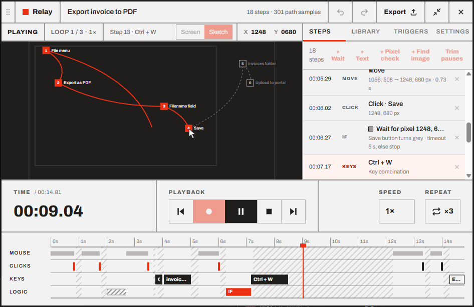

# Playing back

Playback replays a macro's clicks, keys and mouse path with the timing you recorded, or faster, slower, looped or slightly varied.

- [Play, pause and stop](#play-pause-and-stop)
- [The play options](#the-play-options)
  - [Speed and repeat](#speed-and-repeat)
- [A data file: one run per row](#a-data-file-one-run-per-row)
- [Vary timing](#vary-timing)
- [Stop on key press](#stop-on-key-press)
- [Screen or Window coordinates](#screen-or-window-coordinates)
- [Where the input goes](#where-the-input-goes)
- [The kill switch](#the-kill-switch)
- [The player](#the-player)
- [Player mode](#player-mode)
- [Hide the window while playing](#hide-the-window-while-playing)

<p align="center"></p>

## Play, pause and stop

Your **play key** is <kbd>Ctrl</kbd>+<kbd>Shift</kbd>+<kbd>F10</kbd> unless you chose another (<kbd>F10</kbd> if you upgraded from an older Relay). It plays the macro open in the window, or shown on the player. Change it, or set it to *None*, in **Settings → Keys**.

| To… | Do |
| --- | --- |
| Play from the playhead | Your play key, **Play** in the editor's top bar, the player's **▶**, or <kbd>Space</kbd> on the timeline |
| Pause and resume | The same |
| Stop | <kbd>Esc</kbd>, **Stop** in the top bar, the player's **■**, or **Stop** in the tray menu |
| Play a macro from the Library | Its row's **More** menu → **Play**: it plays from the start, and you stay in the Library |
| Replay part of a macro | Move the playhead (select a step, or click the timeline), then play |
| Jump while playing | Click the timeline or a step. Playback continues from there. |

Playback starts **wherever the playhead is**. If it's at the end, playback starts from the beginning. Your play key uses the same playhead the editor shows: after **Stop** it's back at the start, after a complete run at the end (so the key plays again from the beginning), and after a [pixel check](05-pixel-checks.md) or a [Find image](06-find-image.md) step timed out, on that step.

While a macro plays in the editor, **Play** becomes **Pause** with **Stop** beside it, the steps list fills in as the steps play and outlines the one playing, and the Step tab follows it (*Now · step 5 of 12*). Record is off while a macro plays, and Play is off while recording, or while a trigger plays another macro.

When playback ends:

- **It finished:** the playhead stays at the end, the player says *DONE ✓*, and the run counts in the Library's *Last run* and in Activity.
- **You stopped it** (<kbd>Esc</kbd>, **Stop**, a key press, the kill switch): the playhead goes back to the start, ready for the next run.
- **A pixel check timed out, or a Find image step didn't find its image:** the playhead stays on that step, so you can see where it got stuck, and the player says *STOPPED* with the message until you dismiss it. See [Pixel checks](05-pixel-checks.md#when-the-pixel-never-matches) and [Find image](06-find-image.md#when-the-image-isnt-found).

Relay never leaves a key or mouse button stuck. Anything the macro is holding down is released when playback stops, at the end of each loop and when you jump to another point.

## The play options

Each macro has its own play options, **saved with it**, in its file. They're in the inspector's **Macro** tab, under **Play options**: click the summary next to **Play** in the top bar (*×3 · 1× · ±40 ms*), or press <kbd>Ctrl</kbd>+<kbd>M</kbd>.

| Option | Default | What it does |
| --- | --- | --- |
| **Repeat** | 1 time | How many times the macro runs in a row. See [Speed and repeat](#speed-and-repeat). |
| **Speed** | 1× | How fast it plays |
| **Data file** | None | A CSV file: the macro plays once per row. See [A data file](#a-data-file-one-run-per-row). |
| **Vary timing** | On, ±40 ms | Shifts each step by a small random amount. See [Vary timing](#vary-timing). |
| **Stop on key** | On | Any key you press stops playback. See [Stop on key press](#stop-on-key-press). |
| **Clicks land** | Screen | At the recorded screen pixels, or relative to the window. See [Screen or Window coordinates](#screen-or-window-coordinates). |

The summary next to **Play** shows the repeat (*×3*, *∞* or *Each row (20)*), the speed, the timing variation when it's on, and *keys don't stop it* when **Stop on key** is off. Speed and the other options can change while the macro plays; a macro's [data file](#a-data-file-one-run-per-row) is remembered on this PC only.

### Speed and repeat

| Option | Choices |
| --- | --- |
| **Speed** | **0.5×**, **1×**, **2×**, **4×**. You can change it while the macro is playing. |
| **Repeat** | Type how many times the macro runs in a row (1 to 9999), drag the field sideways, or use <kbd>↑</kbd> and <kbd>↓</kbd>. **Forever** loops until you stop it; press it again to go back to the count you had. |

> [!CAUTION]
> Faster isn't always better. At 2× or 4× the apps you're automating get half or a quarter of the time they had when you recorded. If they can't keep up, clicks land before a window is ready. Use [pixel checks](05-pixel-checks.md) to make fast playback reliable.

## A data file: one run per row

To do the same thing for each line of a list (enter each customer's invoice, rename each file), give the macro a **data file**: a CSV whose first row names the columns.

```text
Customer;Invoice;Total
ACME Ltd;F-1042;1250,00
Globex;F-1043;87,50
```

1. In the **Macro** tab, under **Play options → Data file**, press **Choose…** and pick the file. It shows the file's name and how many rows it has: *customers.csv · 2 rows*.
2. In a [Text step](03-editing.md#text-that-changes-each-run), type a column with `{col:Customer}`. The Step tab has a button for each column.
3. Press **Play**. The macro plays **once per row**, and each run types that row's values. `{n}` is the row number.

While a macro has a data file, **Repeat** says *Once per row of the data file (2 rows)*, the summary next to Play says *Each row (2)*, and the player shows the row while it plays (*Row 1 / 2*). **Change…** picks another file, and **Remove** goes back to the repeat the macro had.

- Save it from Excel as **CSV**, with commas or semicolons, or as **CSV UTF-8**: both work, and so do tab-separated files. Values in quotes can hold the separator, quotes (doubled: `""`) and new lines.
- Column names are matched whatever their case. Empty lines are skipped, and a row with fewer values than columns types nothing for the missing ones.
- Relay reads the file **each time the macro plays**, so edit it in Excel between runs as you like. It keeps where the file is, not a copy: if you move it, choose it again.
- Relay won't play the macro, and says why (under **Data file**, and when you press Play), if the file isn't there, a row has more values than there are columns, a Text step types a column the file doesn't have, or there are no rows. Triggered runs, too.
- The data file belongs to the macro on this PC. A copy (Duplicate) uses the same file, but a `.rly` export doesn't carry it. A [Standalone program](08-library.md#exported-programs) carries the rows the file had when it was exported.

## Vary timing

**Vary timing** shifts each step by a small random amount, so a long-running loop doesn't click with robot-perfect regularity.

- **By up to** sets the range, from **±0** to **±200 ms** (default **±40 ms**). Drag the field sideways to try values.
- A step moves as a whole: a click's press and release move together (the time between them stays exactly as recorded), and steps never swap order.
- Playing from a step always plays that whole step, even if the variation moves it slightly earlier.
- Each loop gets a new random pattern.
- It's **on by default**. Turn it off to replay your recording exactly.

## Stop on key press

**Stop on key** (on by default) stops playback **the moment you press any key**: *Any key stops playback*. It's a safety net: if the macro goes wrong, just hit a key.

- The key is swallowed, so it doesn't reach the app the macro is typing into.
- <kbd>Shift</kbd>, <kbd>Ctrl</kbd>, <kbd>Alt</kbd> and <kbd>Win</kbd> alone don't stop playback, so you can still use shortcuts such as the kill switch.
- Your play key still pauses rather than stops. The same key without its modifiers stops, like any other: with <kbd>Ctrl</kbd>+<kbd>Shift</kbd>+<kbd>F10</kbd> set, <kbd>F10</kbd> alone does.
- Moving the mouse doesn't stop playback. It does get in the way of the macro, so keep your hands off while it runs.

Turn it off when a macro should keep running while you type in another window: *Keys don't stop it: Esc and Stop still do*. The summary next to Play then says *keys don't stop it*.

## Screen or Window coordinates

**Clicks land** decides where clicks go.

| Choice | Clicks land… | Use it when |
| --- | --- | --- |
| **Screen** (default) | At the exact screen pixels you recorded | The app window is always in the same place, such as maximized |
| **Window** | At the same place **relative to the window you first clicked in** while recording | The window moves around between runs |

With **Window**, Relay finds the recorded app's window (the same program and window type) when playback starts, and shifts every click and movement by how far that window has moved. The steps list shows positions relative to the window, like *+120, +48*.

> [!NOTE]
> Window mode follows a window that **moved**, not one that was **resized**: a button that moves when the window gets bigger will be missed. If Relay can't find the window, it tells you and plays at screen coordinates instead.

## Where the input goes

Relay injects input the same way your mouse and keyboard would: it goes to whatever is under the cursor and whichever window has the focus.

- **Started from Relay's own Play button:** clicking it gave Relay the keyboard, so Relay first hands the focus back to the app you were using before. The macro types into that app, not into Relay.
- **Relay's windows don't take the focus** while a macro plays, even if you click them.
- **Clicks under the player:** the player stays on top, so a click where it is would hit Relay. If the macro clicks there, the player lets clicks pass through it for the whole playback.
- **Relay's window** stays where it is, behind the app you were using, unless you [hide it while playing](#hide-the-window-while-playing). If the macro clicks where the window shows, turn that on.

> [!WARNING]
> **Apps running as administrator.** Windows doesn't let a normal app send input to an elevated one. If the app in front runs as administrator, Relay warns you and the input is blocked. To automate it, run Relay as administrator too (right-click → **Run as administrator**).

Nothing can be sent while the screen is locked or a UAC prompt is up. Games with anti-cheat software may ignore simulated input or flag it.

## The kill switch

The kill switch, **Stop everything**, is the emergency stop: <kbd>Ctrl</kbd>+<kbd>Alt</kbd>+<kbd>Backspace</kbd> unless you chose another (<kbd>Ctrl</kbd>+<kbd>Alt</kbd>+<kbd>End</kbd> if you upgraded from an older Relay). It works from anywhere, at any time, even when a macro is typing:

1. It stops whatever Relay is doing: countdown, recording (which is kept) or playback.
2. It **pauses all triggers**, so a scheduled or looping macro can't restart right away.

Resume triggers with **Resume** on the Library's *Triggers are paused (the kill switch).* notice (also in a macro's **Runs automatically**), or with **Triggers active** in the tray menu. See [Triggers](07-triggers.md#pausing-triggers).

Change it in **Settings → Keys**. It can't be set to *None*. If another program already uses it, Relay says so: *Another program uses Ctrl + Alt + Backspace, so Relay's “Stop everything” key doesn't work. Choose another in Settings → Keys.*

> [!NOTE]
> Remote Desktop takes <kbd>Ctrl</kbd>+<kbd>Alt</kbd>+<kbd>End</kbd> for itself, so it doesn't reach Relay in a remote session; <kbd>Ctrl</kbd>+<kbd>Alt</kbd>+<kbd>Backspace</kbd> does. [Exported programs](08-library.md#exported-programs) always stop on <kbd>Ctrl</kbd>+<kbd>Alt</kbd>+<kbd>End</kbd>.

## The player

<p align="center"></p>

The player is Relay's small window on top. It shows whenever Relay records or plays without the main window, and in [player mode](#player-mode). From left to right:

- The **dots**: drag them to move the player. Relay remembers where.
- **Record** (or stop recording), **play/pause**, and **stop** (■).
- A screen with the **state**, the **macro's name** and the **time**:

  | State | When |
  | --- | --- |
  | *READY* | Nothing runs |
  | *GET READY* | Counting down before a recording, with the count (3, 2, 1) on the right |
  | *REC* | Recording, with the number of steps on the right, and the last step under it (*Last: Click · 812, 402*) |
  | *PLAYING*, *PAUSED* | Playing, with the time (*00:04 / 00:10*) or, with a data file, the row (*Row 37 / 200*) |
  | *DONE ✓* | For a moment after a macro played to the end |
  | *STOPPED* | The last run ended on an error, shown under it until you dismiss it (×) |

  Under the name, a bar of lights shows the progress, with a red light for each click.
- Click the **name** to switch to another macro (each with its hotkey, if it has one). It's off while something runs.
- **Open the window** (the last button), on the player's macro.

It never takes the keyboard from the app you're working in. **Settings → Window → Keep the player on top** keeps it above other windows **Always** (the default), only **While working** (recording or playing), or **Never**. **Settings → Appearance → Player size** makes it **Large** (760 × 88 instead of 600 × 64), and it grows with the text size, up to 150%.

When a trigger starts a macro while the window is open, the player comes up in a free corner of the screen, clear of the window and of where the macro clicks, and the window says what runs (*Running “Daily report”, started by its schedule*) with **Stop**.

## Player mode

**Player mode** shows only the player, in the window's place: for when you only need to record and play. Turn it on with **Switch to the player** in the window's top bar, or with your **show the player** key (<kbd>Ctrl</kbd>+<kbd>Shift</kbd>+<kbd>M</kbd> by default); turn it off with the same key or the player's **Open the window**. Relay remembers it after a restart.

## Hide the window while playing

**Settings → Window → Hide the window while playing** (off by default) puts the window away while a macro plays, and the player shows instead; the window comes back when it ends. Off, the window stays where it is, behind your apps, so you can watch the steps.

---

<p align="center"><a href="03-editing.md">← Editing steps</a> · <a href="README.md">Contents</a> · <a href="05-pixel-checks.md">Pixel checks →</a></p>
