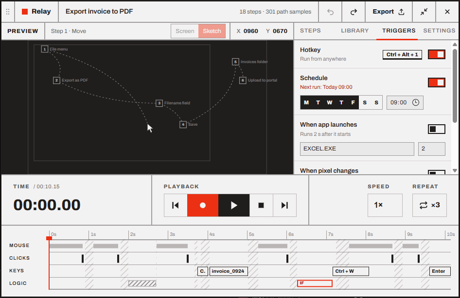

# Triggers

Triggers run a macro without you pressing play: on a hotkey, on a schedule, when an app starts, or when something changes or appears on screen. Each macro has its own triggers, in the inspector's **Macro** tab, under **Runs automatically**.

- [Adding a trigger](#adding-a-trigger)
- [The five triggers](#the-five-triggers)
- [Hotkey](#hotkey)
- [Schedule](#schedule)
- [When an app starts](#when-an-app-starts)
- [When a pixel changes](#when-a-pixel-changes)
- [When an image appears](#when-an-image-appears)
- [When a trigger fires](#when-a-trigger-fires)
- [Pausing triggers](#pausing-triggers)
- [Keep Relay running](#keep-relay-running)

## Adding a trigger

1. Open the macro, and the inspector's **Macro** tab (<kbd>Ctrl</kbd>+<kbd>M</kbd>).
2. Open **Runs automatically**. Closed, it sums up the triggers that are on, such as *Ctrl + Alt + 1 · Mon–Fri at 09:00*, or *Only when you play it*.
3. Press **Add** and choose a trigger. Only those the macro doesn't have yet are offered.

Each trigger is a card: its name, a line under it saying whether it's on or when it runs next, a switch, a sentence saying what it does, and its fields. **Remove** takes it off the macro. A macro with no trigger says *It runs only when you play it. Add a hotkey, a schedule, or something to watch for.*

In the Library, a macro's hotkey shows in the **Hotkey** column, and its other triggers that are on under **Also runs**, in words (*Mon–Fri at 09:00 · When EXCEL.EXE starts*). Click them to open the macro on its triggers. See [The Library](08-library.md#the-library).

If the triggers couldn't be loaded, the section says *Couldn't load the triggers.* with a **Retry** button.

## The five triggers

| Trigger | Runs the macro… | Example |
| --- | --- | --- |
| **Hotkey** | When you press a key combination, from any app | <kbd>Ctrl</kbd>+<kbd>Alt</kbd>+<kbd>1</kbd> fills in a form |
| **Schedule** | On chosen days at a set time | Weekdays at 09:00, export yesterday's report |
| **When an app starts** | A few seconds after a program starts | When `EXCEL.EXE` starts, open the usual workbook |
| **When a pixel changes** | When a pixel on screen turns a given color | When a build light turns red, take a screenshot |
| **When an image appears** | When a picture shows up anywhere on screen | When an *Update available* dialog appears, click *Later* |

You can use several on the same macro. Triggers are saved on this PC only: they're not included when you [export](08-library.md#export) a macro.

## Hotkey

1. Click the key field (it shows **Set…** when empty). It changes to *Press keys…*.
2. Press the combination, for example <kbd>Ctrl</kbd>+<kbd>Alt</kbd>+<kbd>1</kbd>. The switch turns on by itself. (Until a hotkey is set, the switch is off and can't be turned on.)

While the field is waiting for keys, <kbd>Backspace</kbd> clears the hotkey and <kbd>Esc</kbd> cancels. Relay's keys and the other macros' hotkeys let go of the keyboard meanwhile, so a combination they use reaches the field (and is then refused, below).

**Rules for a hotkey:**

- It needs <kbd>Ctrl</kbd>, <kbd>Alt</kbd>, <kbd>Shift</kbd> or <kbd>Win</kbd>, so the key still types normally. Function keys <kbd>F1</kbd>–<kbd>F24</kbd> work on their own.
- <kbd>Shift</kbd> alone isn't enough for a letter, digit, punctuation, <kbd>Space</kbd> or <kbd>Enter</kbd>: that's ordinary typing (capital letters). It's fine with function keys, arrows, <kbd>Home</kbd>, <kbd>Tab</kbd> and the like.
- It can't be one of [Relay's own keys](09-settings.md#keys), as you set them in Settings → Keys (Record, Play / pause, Show the player, Stop everything).
- It can't already run another macro.

A hotkey that breaks a rule isn't saved, and Relay says why at the bottom of the window:

| Message | Meaning |
| --- | --- |
| *Add Ctrl, Alt, Shift or Win, so the key still types normally* | A plain key isn't allowed |
| *Add Ctrl, Alt or Win: Shift + A is ordinary typing* | Shift alone with a key that types |
| *Ctrl + Alt + 7 already runs “Fill weekly timesheet”* | Another macro has it. Pick another, or change that macro's. |
| *Ctrl + Shift + F9 is Relay's “Record” key* | One of Relay's keys. Pick another, or change Relay's in Settings → Keys. |

A key Relay can't use in a hotkey makes the field say *Use a letter, digit, F-key or arrow*.

A hotkey that's saved but doesn't work says why in the line under **Hotkey**, instead of *Runs from any app*:

| Message | Meaning |
| --- | --- |
| *Ctrl + Alt + 1 is taken by another app* | Another program registered it first. Pick another, or close that program. |

Macro hotkeys only work while Relay is **idle**. During a recording or playback they reach other apps normally.

## Schedule

A new schedule starts **on**, as **weekdays at 09:00**.

1. Pick the **days**: **M T W T F S S**. Highlighted days are on.
2. Set the time after **at**.

The line under **Schedule** shows when it will run next, for example *Next run: Tomorrow 09:00*, or *Off* while the switch is off, or *Pick a day* when no day is selected. The sentence says it in short: *Mon–Fri at 09:00*.

Things to know:

- Times are in your PC's local time, and they follow daylight saving changes.
- If the PC was asleep or off at the scheduled time, the run is **skipped**, not made up later. Relay still runs it if it notices up to 2 minutes late (the PC woke just after), but not later than that.
- If the clock jumps back (it's corrected after waking up, say), a run that already happened doesn't happen again.
- A schedule checks the clock every few seconds, so a run can start up to 5 seconds after the minute.

## When an app starts

1. Type the program's file name in **Program**, for example `EXCEL.EXE`. The field suggests programs that are running right now. The switch turns on with the first program you type. (Without a program, it's off and can't be turned on.)
2. Set the **Delay** in seconds (2 s by default). It gives the program's window time to appear before the macro starts clicking.

The sentence reads, for example, *2 s after EXCEL.EXE starts*.

The macro runs each time the program **starts**, counting from the moment you turn the trigger on: a program you open right after does count. A program that's already running then (or when Relay starts) doesn't count until it's closed and opened again. Relay looks for new programs every 2 seconds, so a program closed and reopened within 2 seconds may not be noticed. Opening a second window of a program that's already running doesn't count either, since the program didn't start.

If you turn the trigger off during the delay, the macro doesn't run.

> [!TIP]
> Not sure of the file name? Start the program, then open the field's suggestions, or look in Task Manager → **Details**.

## When a pixel changes

1. Press **Pick from screen** and click the pixel to watch, **while it shows the color that should start the macro**. The picker is the same as a pixel check's: see [Pick from screen](05-pixel-checks.md#pick-from-screen). Or type **X**, **Y** and the **Color** (`#RRGGBB`).
2. Turn the switch on.

The sentence reads, for example, *When 1248, 680 turns #EC3013*.

The trigger fires when the pixel **becomes** that color: it has to be a different color first, then match twice in a row (about half a second). A pixel that stays that color runs the macro **once**, not over and over. It fires again only after the pixel shows another color twice in a row too (so the mouse passing over it doesn't count), then comes back. Changing the trigger's position or color starts over: the pixel has to change again.

Relay checks the pixel 4 times a second, with a tolerance of 8 per color channel. See [Choosing a good pixel](05-pixel-checks.md#choosing-a-good-pixel).

## When an image appears

1. Press **Snip** and drag a rectangle around the thing to watch for, as it looks when the macro should start. Or **Paste** a picture from the clipboard, or choose a PNG or JPEG **File…**.
2. The switch turns on by itself with the first image. (Until there's an image, it's off and can't be turned on.)

The thumbnail shows the image, and the sentence the match it needs, for example *When the image is on screen, at a 85% match*. Set **Match** (50 to 100%) and, with several monitors, which screen it **Looks on**. **Test** looks for the image once, now, and says where it found it or how close it came; **Show** then marks that spot on the screen for 3 seconds (a red outline, with a dot in the middle).

Like the pixel trigger, it fires when the image **appears**: it has to be away twice in a row first, then be seen twice in a row (about a second). An image that stays on screen runs the macro **once**. Changing the image or the match starts over. The image may be anywhere, and from half to twice its size; see [Find image](06-find-image.md#another-size).

Relay looks twice a second, and only while an image trigger is on. It never looks inside its own windows (the thumbnail isn't the image appearing), nor behind them.

> [!NOTE]
> An image that's already on screen when you turn the trigger on doesn't start the macro: it has to go away and come back. To try the trigger, turn it on, then make the image appear.

> [!TIP]
> The trigger only starts the macro; it doesn't know where to click. To click what appeared, wherever it is, start the macro with a [Find image](06-find-image.md) step for the same image.

## When a trigger fires

A triggered macro plays **from the start**, with its own speed, repeat and other play options. Its run count and *last run* go up as usual.

Where it shows depends on what's on screen:

- **The window is open:** the window stays as it is, on the macro you had open, and says at the bottom what runs, for example *Running “Export invoice to PDF”, started by its schedule*, with **Stop**. Relay's player comes up in a corner of that screen, on top, clear of the window and of where the macro clicks (the top right first, then the top left, the bottom right and the bottom left).
- **Relay is in the tray, or in player mode:** the player shows where you last left it, and plays the macro.

A trigger doesn't run the macro when:

| Situation | What happens |
| --- | --- |
| Relay is already recording or playing | It's skipped, and Relay tells you: *Skipped “Export invoice to PDF”: Relay was busy* |
| The screen is locked, or a UAC prompt is up | It's skipped silently, since nothing could be clicked |
| Triggers are paused | Nothing happens |
| Relay isn't running | Nothing happens. See [Keep Relay running](#keep-relay-running). |

[Activity](08-library.md#activity) lists each triggered run, and each skipped one, with the trigger that fired it.

You can stop a triggered macro like any other: **Stop**, <kbd>Esc</kbd>, any key (with *Stop on key*), or the [kill switch](04-playback.md#the-kill-switch).

## Pausing triggers

The kill switch, Relay's **Stop everything** key (<kbd>Ctrl</kbd>+<kbd>Alt</kbd>+<kbd>Backspace</kbd> unless you [changed it](09-settings.md#keys)), pauses **all** triggers, so a looping schedule can't start again right after you stopped it. Relay says *Triggers are paused. Resume them from the tray or the Library.*, and the Library and **Runs automatically** show:

> Triggers are paused (the kill switch). **Resume**

To resume, press **Resume**, or check **Triggers active** in the tray menu. You can also uncheck **Triggers active** in the tray yourself, to pause every trigger at once without turning them off one by one.

## Keep Relay running

Triggers only work while Relay runs. To make sure it's always there:

- Keep **Settings → Window → Close to the tray** on (the default). Closing the window then hides Relay to the tray instead of quitting.
- Turn on **Settings → Window → Start with Windows**. Relay then starts hidden in the tray when you sign in.

See [Settings, tray and window](09-settings.md).

---

<a href="06-find-image.md">← Find image</a> · <a href="README.md">Contents</a> · <a href="08-library.md">Library, export and import →</a>

