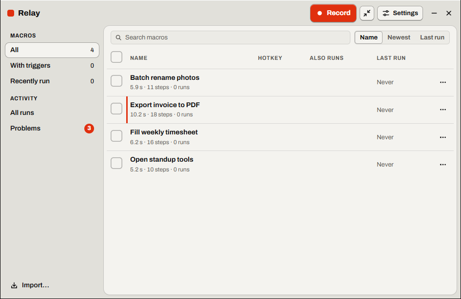
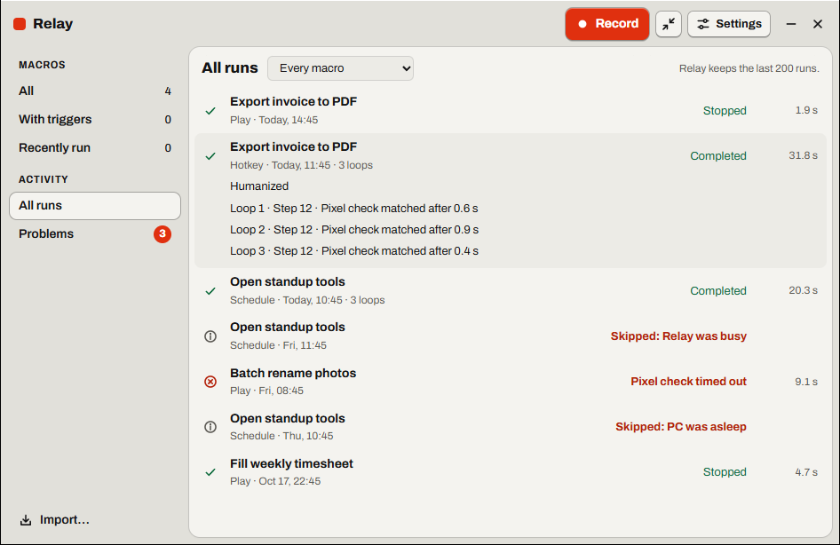
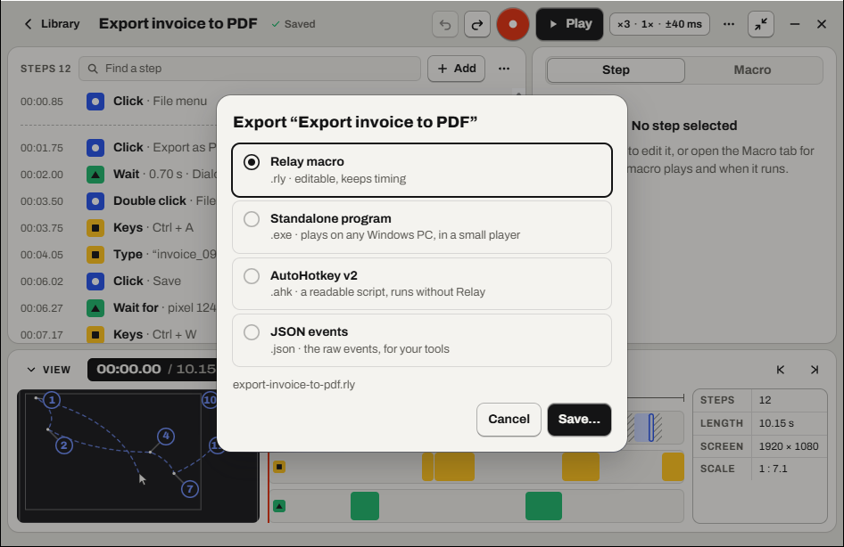
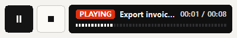

# Library, export and import

Every recording is saved automatically to your **Library**, Relay's home. From there you can open, play, duplicate, delete, export and import macros, and see what ran in **Activity**.

- [The Library](#the-library)
- [Several macros at once](#several-macros-at-once)
- [Activity](#activity)
- [Duplicate](#duplicate)
- [Delete and undo](#delete-and-undo)
- [Export](#export)
- [Exported programs](#exported-programs)
- [AutoHotkey scripts](#autohotkey-scripts)
- [Import](#import)
- [Where your macros are stored](#where-your-macros-are-stored)
- [Backing up and moving to another PC](#backing-up-and-moving-to-another-pc)

## The Library

<p align="center"></p>

The Library is a page of Relay's window. A macro's **Library** button, Settings' **Library** button and <kbd>Alt</kbd>+<kbd>←</kbd> come back to it. Its top bar has **Record**, **Switch to the player** and **Settings**.

The side bar chooses what it lists:

| | Lists |
| --- | --- |
| **All** | Every macro |
| **With triggers** | Macros with a hotkey, or another [trigger](07-triggers.md) that's on |
| **Recently run** | Macros that ran in the last 7 days |
| **All runs** | [Activity](#activity): every run |
| **Problems** | Activity: the runs that didn't end as planned. A red badge says how many. |
| **Import…** | [Imports](#import) macro files |

Each list shows how many macros it has. **Search macros** (<kbd>Ctrl</kbd>+<kbd>F</kbd>) filters by name, and **Sort by** orders them by **Name**, **Newest** (when they were made) or **Last run**.

Each row shows:

| | |
| --- | --- |
| **Name** | The macro's name, and its length, steps and runs: *10.9 s · 12 steps · 5 runs*. A run counts when the macro plays to the end. The macro open in the editor has a red bar. |
| **Hotkey** | Its [hotkey](07-triggers.md#hotkey), if one is on |
| **Also runs** | Its other triggers that are on, in words: *Mon–Fri at 09:00*, *When EXCEL.EXE starts*, *When a pixel changes*, *When an image appears*. Click them to open the macro on its triggers. |
| **Last run** | *Today, 09:12*, *Fri, 17:40*, *Sep 12* or *Never*, with a check mark, or a red mark when that run didn't end as planned. Hover it for how it ended. |

**Click a name** (or press <kbd>Enter</kbd> on it) to open the macro in the editor. In the list, <kbd>↑</kbd> and <kbd>↓</kbd> go to the next or previous macro, <kbd>Del</kbd> deletes it and <kbd>Ctrl</kbd>+<kbd>D</kbd> duplicates it.

The **⋯** button at the end of a row (*More for* its name) opens its menu:

| Item | Does |
| --- | --- |
| **Open** | Opens it in the editor |
| **Play** | Plays it from the start, without leaving the Library |
| **Duplicate** | See [Duplicate](#duplicate) |
| **Export…** | See [Export](#export) |
| **Runs** | Its runs in [Activity](#activity) |
| **Delete** | See [Delete and undo](#delete-and-undo) |

Duplicate, Export and Delete are off while Relay records or plays. The editor's **⋯** menu has Export…, Duplicate, Runs and Delete for the open macro.

A new Library is empty. It says *Record what you do once. Relay plays it back.*, with **Record**.

When the [kill switch](04-playback.md#the-kill-switch) has paused the triggers, the Library says *Triggers are paused (the kill switch).*, with **Resume**.

## Several macros at once

Check the box at the start of a row to select it, or the box in the header to select every macro listed. A bar at the bottom then says how many are selected:

- **Export…** asks for a folder and saves each one there as a `.rly` file named after it: *Exported 3 macros to Backup*. A file of the same name in that folder is replaced.
- **Delete** moves them all to the trash, with one **Undo**: *Moved 3 macros to the trash*.
- **Clear** unselects them.

<kbd>Del</kbd> on a selected row deletes every selected macro.

## Activity

**All runs** and **Problems**, in the Library's side bar, show what ran and when. **Show the runs of** chooses **Every macro** or one of them; a macro's **Runs** menu item opens Activity on its runs.

<p align="center"></p>

Each run shows the macro's name (as it was then), and:

| | |
| --- | --- |
| **What started it** | *Play* (the Play button or your Play / pause key), *Hotkey*, *Schedule*, *App launch*, *Pixel trigger* or *Image trigger* |
| **When** | *Today, 09:12*, *Fri, 17:40*, *Sep 12, 14:05* |
| **Rows or loops** | *12 rows* for a run from a [data file](04-playback.md#a-data-file-one-run-per-row), or *3 loops* when it played more than one |
| **How it ended** | *Completed*, *Stopped*, *Stopped by a key*, *Kill switch*, *Pixel check timed out*, *Image not found* or *Failed* |
| **Duration** | From start to end, pauses included |

Click a run to see what its [pixel checks](05-pixel-checks.md) and [Find image](06-find-image.md) steps did (*Step 4 · Pixel check matched after 1.2 s*, *Row 2 of 12 · Step 6 · Image found at 812, 344 (93 %) after 0.4 s*), and its play options if they weren't the usual ones (*From 00:03.20 · 2× speed · Humanized*). A run keeps its last 50 checks. A run that stopped on a pixel check or a Find image step has **Open at step N**, which opens the macro on that step, marked *Timed out*.

Activity also lists [triggers](07-triggers.md) that fired but didn't run their macro: *Skipped: Relay was busy*, *Skipped: screen locked*, *Skipped: PC was asleep* for a scheduled run the PC slept through, and *Skipped: data file* when the macro's [data file](04-playback.md#a-data-file-one-run-per-row) couldn't be played, with what was wrong.

**Problems** lists only the runs that didn't end as planned: every run that ended other than *Completed* or *Stopped*, and every skip. They're marked in red.

Relay keeps the last 200 runs, in `runs.json`. A run still going when you quit Relay isn't recorded.

## Duplicate

**Duplicate** makes a copy named *"… (copy)"* (then *"… (copy) 2"*, and so on). From the editor's ⋯ menu, the copy opens in the editor. Use it before big edits, or to make a variation of a macro.

The copy starts with **no triggers**, so the two macros don't compete for the same hotkey or schedule, and its run count starts at zero. It keeps the original's data file.

## Delete and undo

**Delete** moves the macro to the trash. A message at the bottom of the window says *Moved “…” to the trash* with an **Undo** button, for 8 seconds. Undo brings the macro back, with its run count and triggers. If another macro took its hotkey in the meantime, it comes back with that hotkey off, and a message says so: *“Export invoice to PDF” is back; its hotkey Ctrl + Alt + 1 is now used by “Fill weekly timesheet”, so it's off*.

If you deleted the macro open in the editor, Relay goes back to the Library, with the next macro in the list as the current one.

> [!NOTE]
> After the Undo message is gone, the macro's file is still in the `macros\.trash` folder (see [below](#where-your-macros-are-stored)). To get it back, [import](#import) the file from there. Relay never empties the trash by itself: delete files from that folder to free the space.

## Export

<p align="center"></p>

1. Open the macro's **⋯** menu, in the editor's top bar or on its Library row, and choose **Export…**.
2. The dialog, *Export “<name>”*, offers four formats. Click one, or move between them with the arrow keys:

   | Format | File | Use it to |
   | --- | --- | --- |
   | **Relay macro** | `.rly` | Share or back up a macro. It can be imported back into Relay with all its steps, timing and play options. |
   | **Standalone program** | `.exe` | Play the macro on any Windows PC, even without Relay. See [Exported programs](#exported-programs). |
   | **AutoHotkey v2** | `.ahk` | Read, change or run the macro as a script, with [AutoHotkey](https://www.autohotkey.com/) v2. See [AutoHotkey scripts](#autohotkey-scripts). |
   | **JSON events** | `.json` | Read or process the macro in your own tools. It's the same data, pretty-printed, plus the list of steps. Relay can import it too. |

3. Press **Save…** and choose where. The name defaults to the macro's name, like `export-invoice-to-pdf.rly`, and the dialog shows it. (A program is never named `relay.exe`: a macro named *Relay* is exported as `relay-macro.exe`.) **Cancel**, <kbd>Esc</kbd> or a click outside the dialog closes it.

An export contains the macro's events, its play options and a little about the PC it was recorded on (monitor layout, the window it was anchored to). It includes the pictures its [Find image](06-find-image.md) steps look for. It doesn't contain its triggers, run count or last run: those stay on your PC.

> [!WARNING]
> A macro contains everything you typed while recording it, and so does a program exported from it. Check the *Type* and *Text* steps before sharing a macro file or a program.

## Exported programs

A macro exported as a **Standalone program** is an `.exe` that plays it on any Windows 10 or 11 PC, without Relay. Nothing to install: copy it, double-click it.

<p align="center"></p>

It looks like Relay's player, without the record key: **Pause** and **Stop**, then a dark screen with the state, the macro's name, the time, and a progress bar of lights, with the clicks in red.

1. The window opens in a corner of the main screen (the bottom right, or another corner the macro doesn't click in) and counts down: *GET READY*, **3, 2, 1**. Use those seconds to click into the app the macro works in: the window never takes the focus.
2. The macro plays (*PLAYING*, or *WAITING* during a pixel check or Find image step) with the play options saved with it: speed, repeats, *Vary timing*, *Stop on key* and *Clicks land*. The time shows the loop too when it repeats (*2/3 · 00:12 / 00:45*). [Text steps](03-editing.md#text-that-changes-each-run) fill in the date, the time and the clipboard of the PC it plays on. A macro with a [data file](04-playback.md#a-data-file-one-run-per-row) plays once per row of the file as it was when you exported it, and shows the row (*Row 3 / 12*): export again after changing the file. Relay won't export one whose file it can't play (missing, or without a column a Text step types), and says why.
3. When it's done, the window says *DONE ✓* and closes by itself.

**Pause** pauses it (*PAUSED*), and plays on when pressed again. Stop it with **Stop**, <kbd>Esc</kbd>, or the <kbd>Ctrl</kbd>+<kbd>Alt</kbd>+<kbd>End</kbd> kill switch (or any key, if the macro stops on a key press). The window says *STOPPED* and closes. Anything it was holding is released. Drag the window anywhere but its keys to move it.

> [!NOTE]
> An exported program's kill switch is always <kbd>Ctrl</kbd>+<kbd>Alt</kbd>+<kbd>End</kbd>, whatever Relay's own **Stop everything** key is on your PC: the program has no settings.

If something goes wrong, the window stays open and says what on its second line: *TIMED OUT* with the step a pixel check or Find image step stopped at, *NOT PLAYED* when the screen was locked (*The screen is locked, so nothing can be played.*), or *FAILED*. An app running as administrator gets a note too: Windows won't let the program send input to it (run the program as administrator to automate it). **Stop** turns into **×**: press it when you've read the message, to close the window.

> [!NOTE]
> If the macro clicks in every corner of the screen, the window lets clicks go through it to the app below, so its keys can't be clicked: use <kbd>Esc</kbd> instead.

### Options

Run it from a command line, a shortcut or a scheduled task to change how it plays:

| Option | Does |
| --- | --- |
| `--repeat N` or `--repeat forever` | Plays it *N* times, or until stopped, instead of the saved repeat. A macro with a data file plays once per row whatever this says. |
| `--speed X` | Plays *X* times faster (`0.5` is half speed), from 0.01 to 100 |
| `--no-countdown` | Starts right away |
| `--quiet` | Shows no window at all. Stop it with <kbd>Esc</kbd> or the kill switch. |
| `--help` | Lists the options |

For example: `export-invoice.exe --repeat 3 --no-countdown`.

### Exit codes

The program's exit code says how it ended, for scripts and Task Scheduler (*Last Run Result*):

| Code | Meaning |
| --- | --- |
| 0 | Completed |
| 1 | Error: the macro couldn't be read, or playback failed |
| 2 | Bad options (the message says which) |
| 3 | Stopped: the **Stop** button, <kbd>Esc</kbd>, or a key press |
| 4 | Stopped by the kill switch |
| 5 | A pixel check or Find image step timed out |
| 6 | The screen was locked, so nothing was played |

In a script, wait for it to end: `start /wait export-invoice.exe --quiet` in `cmd` (then `%ERRORLEVEL%`), or `(Start-Process .\export-invoice.exe -ArgumentList '--quiet' -Wait -PassThru).ExitCode` in PowerShell.

> [!IMPORTANT]
> Exported programs aren't code-signed. On a PC that downloaded or received one, Windows SmartScreen may say *Windows protected your PC*: choose **More info → Run anyway**. An antivirus may be wary of it too, since it presses keys and clicks like a person would. See [Troubleshooting](10-troubleshooting.md#installing).

## AutoHotkey scripts

A macro exported as **AutoHotkey v2** is a script you can read, change and run with [AutoHotkey](https://www.autohotkey.com/) v2, without Relay. Each step is a short block, numbered like the steps list (a move goes by the step it leads to):

```autohotkey
Play(N) {
    ; Move before step 1
    Pause(0, false)
    MouseMove 840, 412
    ; 1. Click · Save
    Pause(100)
    Click "840 412"
    ; 2. Keys · Ctrl + S
    Pause(300)
    Send "^s"
    ; 3. Text
    Pause(300)
    SendText "Invoice " . FormatTime(, "yyyy-MM-dd") . " #" . N
}
```

- **Running it.** Double-click the `.ahk` (with AutoHotkey v2 installed). A tooltip counts down 3 seconds: click into the app the macro works in. It then plays and exits.
- **Stopping it.** <kbd>Ctrl</kbd>+<kbd>Alt</kbd>+<kbd>End</kbd>, and <kbd>Esc</kbd> if the macro stops on a key press. Keys it was holding are released.
- **Options** are variables at the top: `Speed`, `Repeat` (0 loops until stopped), `Jitter` (*Vary timing*, in ms; 0 plays exactly) and `Countdown`. A macro with a [data file](04-playback.md#a-data-file-one-run-per-row) has its rows in `Rows` and plays once per row; Relay won't export it if the file can't be played, as for a program.
- **Timing.** Each step starts when it did, relative to the step before; waits are those pauses. Pixel checks and Find image steps wait for what they look for, up to their timeout, then stop the script with a message.
- **Mouse.** Clicks, drags and scrolls are at the screen coordinates they were recorded at, with any key held over them (a Shift-click). A mouse path is a jump to where it ends. The script ignores *Clicks land: Window*.
- **Text.** Typed text and Text steps are sent as characters. `{date}`, `{time}`, `{clipboard}`, `{n}` and `{col:…}` are filled in when the script plays.
- **Find image** steps carry their picture inside the script. AutoHotkey's `ImageSearch` compares pixels rather than shapes: it finds the picture only at the size it was taken, and less forgivingly than Relay. The match becomes its color variation (85 % allows 30 levels).

> [!NOTE]
> Relay's tests check that AutoHotkey accepts the scripts it writes, but don't run them: try one on your own macro before you rely on it.

## Import

1. In the Library, press **Import…** at the bottom of the side bar (it's off while recording or playing).
2. Pick one or more `.rly` or `.json` files, or programs exported by Relay (`.exe`: Relay reads the macro back out of them). Relay can read files from any version of Relay up to its own. (A macro with Find image steps needs Relay 1.4 or later, and one with Text steps Relay 1.5 or later; older versions say it was saved by a newer Relay.)

Relay then tells you *Imported 3 macros*, and the first one becomes the current macro (with the red bar). If a file didn't work, the message names it and says what went wrong, for example *Imported 2 macros. old.exe: not a program exported by Relay*:

| Message | Meaning |
| --- | --- |
| *not a Relay macro* | The file isn't a Relay export |
| *not a program exported by Relay* | The `.exe` is another program |
| *this macro was saved by a newer Relay (format version 2)* | Update Relay to open it |
| *invalid macro file: …* | The file is damaged or was edited by hand incorrectly |

If a macro with the same name exists, the imported one gets a number (*Daily report 2*), or the next one if its name already ends in a number (*Daily report 2* becomes *Daily report 3*). Importing a macro that's already in your Library adds a copy rather than replacing it. Imported macros have no triggers.

> [!IMPORTANT]
> A macro replays **screen positions and physical keys**. On a PC with a different monitor layout, display scaling or keyboard layout, clicks can land in the wrong place and keys can type different characters. Try [**Clicks land: Window**](04-playback.md#screen-or-window-coordinates), or record the macro again on that PC.

## Where your macros are stored

Everything is in `%APPDATA%\Relay` (usually `C:\Users\<you>\AppData\Roaming\Relay`). **Open macros folder** in the tray menu opens its `macros` folder.

```text
%APPDATA%\Relay\
├── macros\
│   ├── <id>.rly        one file per macro
│   └── .trash\         deleted macros
├── screens\            the screenshots taken as recordings start, for the preview
├── library.json        run counts, triggers and data files
├── runs.json           Activity's runs
├── settings.json       your settings
├── window.json         where the window and the player sit, and player mode
└── logs\               diagnostics from the last 7 days
```

The `.rly` files are plain JSON, so they're easy to back up, keep in version control or look at. Their format is described in the [engineering guide](../engineering/file-formats.md).

## Backing up and moving to another PC

- **Back up everything:** quit Relay (tray → **Quit Relay**) and copy the whole `%APPDATA%\Relay` folder. Copy it back to restore, triggers and all.
- **Move some macros:** select them in the Library, press **Export…**, and import the files on the other PC. Set up their triggers again there.

---

<p align="center"><a href="07-triggers.md">← Triggers</a> · <a href="README.md">Contents</a> · <a href="09-settings.md">Settings, tray and window →</a></p>
