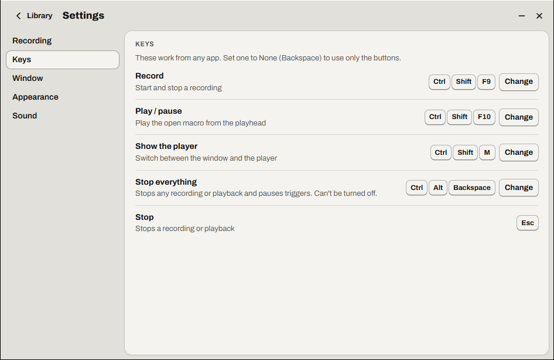

# Settings, tray and window

- [Settings](#settings)
- [The window](#the-window)
- [The player](#the-player)
- [Player mode](#player-mode)
- [The tray icon](#the-tray-icon)
- [Start with Windows](#start-with-windows)
- [Logs](#logs)
- [Uninstall](#uninstall)

## Settings

Press **Settings** in the Library's top bar. The side bar has five sections: **Recording**, **Keys**, **Window**, **Appearance** and **Sound**. **Library** (or <kbd>Alt</kbd>+<kbd>←</kbd>) goes back.

Settings are Relay's own, for every macro, and save as soon as you change them. How a macro plays (repeat, speed, data file, *Vary timing*, *Stop on key*, *Clicks land*) belongs to the macro: it's in the editor's **Macro** tab, under **Play options**. See [Playing back](04-playback.md).

### Recording

These apply to every new recording. See [Recording](02-recording.md#recording-options).

| Setting | Default | What it does |
| --- | --- | --- |
| **Capture the mouse path** | On | Records cursor movement between clicks. Off records only where you clicked. |
| **Capture keystrokes** | On | Records the keyboard |
| **Screenshot** | On | Saves a picture of your screen as recording starts, for the preview. Kept on this PC only. |
| **Count down 3, 2, 1** | On | Counts down before recording starts |
| **Esc stops recording** | On | Off, <kbd>Esc</kbd> is recorded like any key: stop with the player's ■ or your Record key |
| **Ignore simulated input** | On | Leaves out input generated by other programs. Turn it off for Remote Desktop and KVM tools: they send your typing as simulated input. |

### Keys

Relay's own keys work from any app. Each is yours to set:

| Key | Does | New install | After an upgrade |
| --- | --- | --- | --- |
| **Record** | Starts and stops a recording | <kbd>Ctrl</kbd>+<kbd>Shift</kbd>+<kbd>F9</kbd> | <kbd>F9</kbd> |
| **Play / pause** | Plays the open macro from the playhead, or pauses it | <kbd>Ctrl</kbd>+<kbd>Shift</kbd>+<kbd>F10</kbd> | <kbd>F10</kbd> |
| **Show the player** | Switches between the window and the player ([player mode](#player-mode)) | <kbd>Ctrl</kbd>+<kbd>Shift</kbd>+<kbd>M</kbd> | <kbd>Ctrl</kbd>+<kbd>Shift</kbd>+<kbd>M</kbd> |
| **Stop everything** | The kill switch: stops any recording or playback and pauses triggers. Can't be turned off. | <kbd>Ctrl</kbd>+<kbd>Alt</kbd>+<kbd>Backspace</kbd> | <kbd>Ctrl</kbd>+<kbd>Alt</kbd>+<kbd>End</kbd> |
| **Stop** | Stops a recording or playback | <kbd>Esc</kbd>, fixed | <kbd>Esc</kbd>, fixed |

Someone who used an older Relay keeps the keys they knew, and sees the first run's keys screen once, with a button to switch the kill switch to <kbd>Ctrl</kbd>+<kbd>Alt</kbd>+<kbd>Backspace</kbd> (Remote Desktop takes <kbd>Ctrl</kbd>+<kbd>Alt</kbd>+<kbd>End</kbd> for itself).

To set one:

1. Press **Change** next to it. It says *Press keys…*, and **Change** becomes **Cancel**.
2. Press the combination. <kbd>Backspace</kbd> sets it to **None**, so only the buttons do that job and the key goes to your apps (all but Stop everything). <kbd>Esc</kbd> cancels.

While Relay listens, its keys and the macros' hotkeys let go of the keyboard, so a combination they use reaches it. The line under the key then says what happened: *Set to Ctrl + Shift + F9.*, *Set to None: use the buttons instead.*, or why it wasn't set. The same rules as a [macro's hotkey](07-triggers.md#hotkey) apply, and:

| Message | Meaning |
| --- | --- |
| *F10 is already Relay's “Record” key* | Two of Relay's keys can't be the same |
| *Ctrl + Alt + 1 already runs “Fill weekly timesheet”* | A macro's hotkey has it. Pick another, or change that macro's. |
| *Stop everything can't be turned off. Choose another combination.* | <kbd>Backspace</kbd> on the kill switch |

A key that's set can still come with a warning, when it costs you something:

| When | Says, for example |
| --- | --- |
| Apps use it | *F9 recalculates in Excel and updates fields in Word. While Relay runs, they won't get it.* |
| It types a character on your keyboard layout | *Ctrl + Alt + E types “€” on your keyboard (AltGr + E). You couldn't type it while this is set.* |
| Remote Desktop, VMware Horizon, Citrix or Hyper-V take it | *Remote Desktop sends this as Ctrl + Alt + Del. In a remote session, Relay won't get it.* |

Tooltips, the player and the tray name the keys as you set them. See [Keyboard shortcuts](keyboard-shortcuts.md).

### Window

| Setting | Default | What it does |
| --- | --- | --- |
| **Keep the player on top** | Always | When the [player](#the-player) floats above other windows: **Always**, **While working** (while recording or playing), or **Never**. The window itself is never on top. |
| **Hide the window while recording** | On | The window steps aside and the player shows instead, so Relay never covers what you record |
| **Hide the window while playing** | Off | On, the window steps aside during playback too, and the player shows. Off, the window stays where it is, behind your apps, so you can watch the steps. |
| **Close to the tray** | On | The window's close button and <kbd>Alt</kbd>+<kbd>F4</kbd> hide Relay to the tray. Hotkeys and triggers keep running. Off, they quit Relay. |
| **Start with Windows** | Off | Starts Relay in the tray when you sign in, so triggers run without you opening it |

### Appearance

| Setting | Default | What it does |
| --- | --- | --- |
| **Theme** | Like Windows | **Like Windows** (light or dark, as Windows' app mode), **Light** or **Dark** |
| **Frosted glass** | On for Windows 11, off for Windows 10 | The desktop shows through the window, blurred. Off by default on Windows 10, where it can slow down moving the window. With Windows' transparency effects off, Relay is solid and this switch is off. |
| **Spacing** | Comfortable | How much room the controls take: **Compact**, **Comfortable** or **Large** |
| **Text size** | 100% | **100%**, **125%**, **150%** or **200%**. Everything grows with it, the window too. |
| **Player size** | Compact | **Compact** (600 × 64) or **Large** (760 × 88) |
| **Reduce motion** | Like Windows | **Like Windows** follows Windows' *Animation effects*; **Always** turns Relay's animations off |
| **Show click labels** | On | Labels next to the numbered clicks in the preview |
| **Mouse path** | Whole path | **Whole path** draws the whole path in the preview. **Played part** draws only the part already played. |

### Sound

| Setting | Default | What it does |
| --- | --- | --- |
| **Sounds** | Off | Short clicks when recording starts and stops, a tick for each step recorded, and a sound when a macro finishes or fails |
| **Try them** | | **Record**, **Stop**, **Done** and **Error** play each sound (with Sounds on) |

The sounds are quiet; Windows' volume applies. They come with words on screen, never instead of them.

## The window

Relay's window is a normal window with three places: the **Library**, a **macro** in the editor, and **Settings**. It isn't on top of other windows.

- **Move it** by dragging its top bar. **Resize it** from any edge or corner. It's 944 × 612 at first (at most 80% of the screen), never smaller than 760 × 520, and grows with the [text size](#appearance). Relay remembers its size and place, even after a restart.
- **Where it sits:** it never goes off screen or under the taskbar, and keeps 16 pixels from the edges. If the monitor it was on is gone, it comes back on the nearest one, as close as it can to where it was. You can drag it between monitors with different resolutions or display scaling.
- **Small screens:** if it doesn't fit (a small laptop screen or high display scaling), Relay shrinks it to fit, down to 40%. In a narrow window, the editor's inspector slides over the steps list.
- **The editor's divider**, between the steps list and the inspector, sets their widths. Double-click it to put it back.
- **Its buttons:** **Minimize**, and close (**Hide to the tray**, or **Quit** with *Close to the tray* off).
- **While recording**, the window steps aside and the player shows (unless you turn off *Hide the window while recording*). It comes back when the recording stops, on the new macro, its name selected so you can type one. **While playing**, it stays, unless *Hide the window while playing* is on.
- **Focus:** during a recording or playback, clicking the window doesn't take the keyboard away from the app you're working in.
- **One Relay at a time:** starting Relay again while it's running brings it back to the front.

## The player

The player is Relay's small window of its own: 600 × 64, or 760 × 88 with **Player size: Large**, growing with the text size up to 150%. It shows whenever the window doesn't: while recording, while playing with the window hidden, in [player mode](#player-mode), and when a [trigger](07-triggers.md#when-a-trigger-fires) runs a macro. It **never takes the keyboard**, so clicking it leaves your app ready to type, and it floats on top as **Keep the player on top** says.

| Part | Does |
| --- | --- |
| **●** | Record, or stop recording |
| **▶** / **‖** | Play the macro on its screen, or pause it |
| **■** | Stop (<kbd>Esc</kbd>) |
| The screen | What's happening: *READY*, *GET READY* with the countdown, *REC* with the steps recorded and the last one, *PLAYING*, *PAUSED*, *DONE ✓*, or *STOPPED* with the error, until you dismiss it. Then the macro's name, the time (or the data file's row), and a row of lights for the progress, the clicks in red. |
| The macro's name | A menu to switch macros, while idle |
| **Open the window** | Opens the window, on the player's macro |

**Move it** by dragging the grip at its left end. Relay remembers where you put it. Until you do, it sits at the bottom center of the screen. When a trigger runs a macro while the window is open, the player comes up in a free corner instead, clear of the window and of the macro's clicks.

## Player mode

In player mode, only the player shows: it takes the window's place, for running macros without the window in the way.

- **Switch to it** with your **Show the player** key (<kbd>Ctrl</kbd>+<kbd>Shift</kbd>+<kbd>M</kbd> by default), or the **Switch to the player** button in the Library's or the editor's top bar.
- **Switch back** with the same key, or the player's **Open the window**.

Relay remembers player mode, even after a restart.

## The tray icon

Relay's icon sits in the notification area of the taskbar. Hover it to see what Relay is doing (*Relay — recording (Ctrl + Shift + F9 to stop)*, *Relay — playing (Esc to stop)*…).

**Left-click** puts Relay away in the tray, or brings it back: the window, or the player in player mode. **Right-click** opens the menu:

| Item | Does |
| --- | --- |
| **Show / hide Relay** | Same as left-click |
| **Record** | Starts or stops a recording. It shows your Record key. |
| **Stop** <kbd>Esc</kbd> | Stops the recording or playback |
| **Triggers active** | Checked while triggers can run. Uncheck it to pause them all, check it to resume. See [Pausing triggers](07-triggers.md#pausing-triggers). |
| **Open macros folder** | Opens `%APPDATA%\Relay\macros` in Explorer |
| **Quit Relay** | Quits for real. Hotkeys and triggers stop. |

While Relay is in the tray, a recording or a playback still shows the player, so **■** is always at hand.

> [!TIP]
> Windows may hide new tray icons under the **^** arrow. Drag Relay's icon onto the taskbar to keep it visible, or turn it on in **Settings → Personalization → Taskbar → Other system tray icons**.

## Start with Windows

With **Start with Windows** on, Relay starts **hidden in the tray** each time you sign in. Nothing pops up, but hotkeys and triggers are ready. Click the tray icon to open the window.

It's a per-user setting (in the *Run* list of your Windows account). You can also turn it off in Task Manager → **Startup apps**.

## Logs

Relay writes a diagnostic log to `%APPDATA%\Relay\logs`, one file per day, keeping the last 7 days. It records what Relay did: sessions starting and stopping, triggers firing or being skipped, errors, playback timing. It **never records what you type** or the contents of your macros.

If you report a problem, attaching the log of that day helps a lot.

## Uninstall

Uninstall Relay from **Settings → Apps → Installed apps**. For the portable .exe, just delete the file. Your macros and settings in `%APPDATA%\Relay` are left in place, in case you reinstall. Delete that folder to remove them too.

---

<a href="08-library.md">← Library, export and import</a> · <a href="README.md">Contents</a> · <a href="10-troubleshooting.md">Troubleshooting and FAQ →</a>

