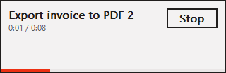

# User guide

Relay is a macro recorder for Windows. It watches what you do with the mouse and keyboard, turns it into a list of steps you can read and edit, and replays it on demand or on its own.

- [A tour of Relay](#a-tour-of-relay)
  - [The window](#the-window)
  - [The editor](#the-editor)
  - [The player](#the-player)
  - [Which one shows](#which-one-shows)
- [Contents](#contents)

## A tour of Relay

Relay has two windows: the **main window**, where you find, edit and set up your macros, and the **player**, a small bar that floats on top of your apps while Relay records or plays.

### The window

The main window is a normal window: move it by its top bar, resize it from its edges, minimize it. It has three places:

| Place | What it's for |
| --- | --- |
| **Library** | Relay's home: all your macros, with **Record**, **Settings**, **Import…** and **Activity**, the history of every run. See [Library, export and import](08-library.md). |
| **A macro** | The editor: open a macro from the Library to read it, change it and play it. |
| **Settings** | Relay itself: recording, its keys, the window, the look and the sounds. See [Settings, tray and window](09-settings.md). |

**Library** at the top left of a macro or of Settings (or <kbd>Alt</kbd>+<kbd>←</kbd>) goes back to the Library. The window's close button hides Relay to the tray, or quits if **Settings → Window → Close to the tray** is off.

### The editor

  

| Part | What it does |
| --- | --- |
| **Top bar** | **Library** goes back. Click the **name** to rename the macro; **Saved** shows for a moment after each change, and **Couldn't save** stays while a change isn't on disk. **Undo** and **Redo**, the red **record** button, **Play** (and **Stop** while it plays), and a summary of how the macro plays (*×3 · 1× · ±40 ms*) that opens its play options. **More** (⋯) has **Export…**, **Duplicate**, **Runs** and **Delete**. The last buttons switch to the player, minimize and close. |
| **Steps** | The macro as a list: clicks, keys, typed text, Text steps, waits, pixel checks and Find image steps, with the mouse moves folded into the step they lead to. Select a step to edit it, or several to edit them together. **Add** inserts a step at the dashed *insert here* line. See [Editing steps](03-editing.md). |
| **Inspector** | Two tabs. **Step** edits the selected steps. **Macro** has the macro's **Play options** (repeat, speed, data file, timing, stopping, where clicks land) and **Runs automatically**, its [triggers](07-triggers.md). |
| **View** | Under them: the **preview** of your screen with the mouse path and numbered clicks, the **timeline** with the playhead, and the macro's measurements. **View** folds it away. |

Drag the gap between the steps and the inspector to share the room differently. In a narrow window, the inspector slides over the list when you click a step, and <kbd>Esc</kbd> closes it.

Messages show at the bottom of the window: what just happened, with **Undo** when it can be undone, and errors, which stay until you dismiss them.

### The player

  

The player has **record**, **play/pause** and **stop** on the left, then a small screen with the state (*READY*, *GET READY*, *REC*, *PLAYING*, *PAUSED*, *DONE ✓*, *STOPPED*), the macro's name, the time (or the row of its [data file](04-playback.md#a-data-file-one-run-per-row)), and a progress bar with a red mark for each click. Click the name to switch to another macro. The button on the right opens the window on that macro. Drag the dots on its left edge to move it: Relay remembers where.

It never takes the keyboard from the app you're working in, and it stays on top of other windows (**Settings → Window → Keep the player on top** changes that). See [The player](04-playback.md#the-player).

### Which one shows

| When | The window | The player |
| --- | --- | --- |
| Nothing runs | Shows | Hidden |
| Recording | Steps aside (**Hide the window while recording**, on by default) | Shows when the window doesn't, with the countdown |
| Playing from the window | Stays, behind your apps (unless **Hide the window while playing** is on) | Shows when the window doesn't |
| A trigger starts a macro while the window is open | Stays, and says what runs, with **Stop** | Shows in a free corner of the screen |
| **Player mode** | Hidden | Shows |
| In the tray | Hidden | Shows only while something records or plays |

**Player mode** puts the player in the window's place, for when you only need to record and play. Turn it on with **Switch to the player** in the window's top bar or your **show the player** key (<kbd>Ctrl</kbd>+<kbd>Shift</kbd>+<kbd>M</kbd> by default), and off with the same key or the player's button on the right. Relay remembers it.

## Contents

1. **[Getting started](01-getting-started.md):** install Relay, the first run, and your first macro in two minutes.
2. **[Recording](02-recording.md):** what gets captured, what doesn't, and how to record well.
3. **[Editing steps](03-editing.md):** the steps list, the inspector, waits, Text steps, pauses, the preview and the timeline.
4. **[Playing back](04-playback.md):** the play options, the player, stopping, and where input goes.
5. **[Pixel checks](05-pixel-checks.md):** wait until something on screen changes before continuing.
6. **[Find image](06-find-image.md):** wait for a picture anywhere on screen, at any size, then click it.
7. **[Triggers](07-triggers.md):** hotkeys, schedules, app launches, pixel changes and images appearing.
8. **[Library, export and import](08-library.md):** organizing, sharing and backing up macros, programs that play a macro without Relay, and Activity.
9. **[Settings, tray and window](09-settings.md):** every option, explained.
10. **[Troubleshooting and FAQ](10-troubleshooting.md):** when something doesn't do what you expect.

⌨️ **[Keyboard shortcuts](keyboard-shortcuts.md):** everything on one page.

---

<a href="../README.md">Documentation home</a> · <a href="01-getting-started.md">Getting started →</a>

