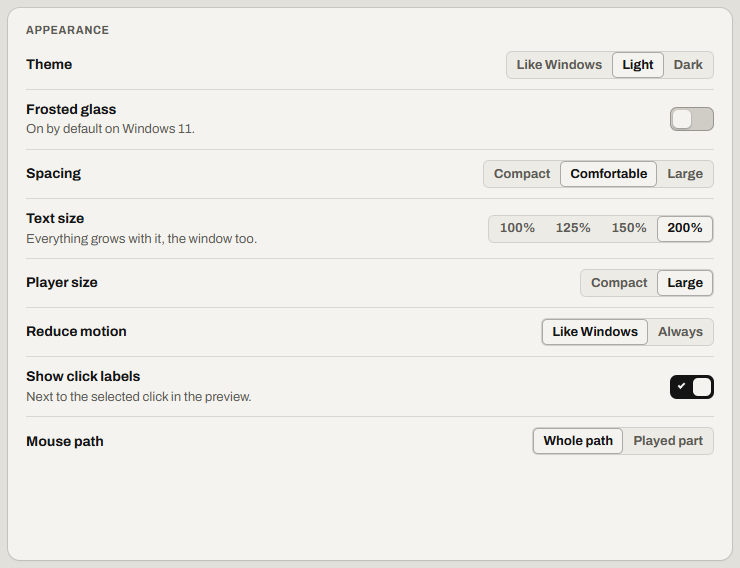

# Accessibility

Use Relay with a screen reader, with the keyboard only, or with bigger text.

- [Use Relay with a screen reader](#use-relay-with-a-screen-reader)
- [Use Relay from the keyboard only](#use-relay-from-the-keyboard-only)
- [Hear when recording starts and stops](#hear-when-recording-starts-and-stops)
- [Remove screen-reader keys from a recording](#remove-screen-reader-keys-from-a-recording)
- [Parts that need sight or a mouse](#parts-that-need-sight-or-a-mouse)
- [Make the text and the player bigger](#make-the-text-and-the-player-bigger)
- [Use a contrast theme or less motion](#use-a-contrast-theme-or-less-motion)
- [Not possible yet](#not-possible-yet)

## Use Relay with a screen reader

Every control in Relay has a name. Your screen reader reads Relay's messages when they show. Error messages stay until you select **Dismiss**.

The player (Relay's small bar) never takes the keyboard focus. It announces *Get ready, 3*, *Recording*, *Playing …*, *Paused*, *… finished* and *Stopped: …*.

More detail: [The window: messages](../spec/windows.md#messages)

## Use Relay from the keyboard only

- Press <kbd>Tab</kbd> to move to the steps list.
- If the arrow keys don't move between steps, turn on NVDA's focus mode (<kbd>NVDA</kbd>+<kbd>Space</kbd>).
- <kbd>Enter</kbd> moves to the step's first field. <kbd>Enter</kbd> in a field saves the change.
- In the steps list, <kbd>Esc</kbd> goes back to one selected step.
- Your screen reader reads *Saved* and the *Types now* line.
- After a recording, the keyboard focus is in the name field.

All the keys: [Shortcuts in the steps list](keys.md#shortcuts-in-the-steps-list)

## Hear when recording starts and stops

Relay can play a sound when recording starts and stops, for each recorded step, and when a macro finishes or fails.

1. Open **Settings**, then **Sound**.
2. Turn on **Sounds**. Sounds are off by default.
3. Under **Try them**, select **Record**, **Stop**, **Done** or **Error**.

If it worked, you hear each sound.

More detail: [Settings: sound](../spec/settings.md#sound)

## Remove screen-reader keys from a recording

Relay records screen-reader keys as steps. Delete these steps together.

1. In the steps list, select **Find a step** (<kbd>Ctrl</kbd>+<kbd>F</kbd>).
2. Type `Keys Ins`: `Ins` is the steps list's name for <kbd>Insert</kbd>. For another key, type `Keys` and its name as a step shows it.
3. Check that every step found is a *Keys* step. Select the first one, then press <kbd>Ctrl</kbd>+<kbd>A</kbd>. All the steps found are now selected.
4. Press <kbd>Delete</kbd>.

If it worked, **Find a step** finds nothing. One **Undo** (<kbd>Ctrl</kbd>+<kbd>Z</kbd>) restores all the steps.

> [!NOTE]
> In the steps list, <kbd>Insert</kbd> opens **Add**. NVDA uses it too, so press <kbd>+</kbd> instead.

## Parts that need sight or a mouse

Only two actions need sight or a mouse: moving the player, and choosing a pixel or a picture on the screen.

- The preview: the steps list shows the same steps in words.
- The timeline: the arrow keys move the playhead (the point where play starts) one step.
- The player: drag it by its grip, the dots at its left end. Only a mouse can move it.
- **Pick from screen**: works from the keyboard, with no countdown. The arrow keys move 1 pixel, or 10 with <kbd>Shift</kbd>. <kbd>Enter</kbd> chooses the pixel. Only choosing the pixel needs sight. Read [Wait until a window or page is ready](wait.md#wait-until-a-window-or-page-is-ready).
- **Find image**: <kbd>Esc</kbd> closes Windows' snipping overlay. Then select **Paste** or **File…** in the message above the steps list (*Snip the image to find, or*). For a step that already exists, use **Paste** or **File…** on its **Step** tab.

More detail: [The view: timeline keys](../spec/view.md#timeline-keys)

## Make the text and the player bigger

1. Open **Settings**, then **Appearance**.
2. Select a bigger **Text size**. The largest is **200%**.
3. For a bigger player, set **Player size** to **Large**.
4. For more space between items, set **Spacing** to **Large**.

If it worked, the text, the window and the player are bigger.

More detail: [Settings: appearance](../spec/settings.md#appearance)

## Use a contrast theme or less motion

When a Windows contrast theme is on, Relay's panels turn solid. Switches, tabs, choices such as **Speed**, menus, keys, the timeline and messages use the theme's colors.

Also turn off **Frosted glass** in **Settings**, then **Appearance**. If it stays on, the window's own background can stay frosted.

For less motion, use **Reduce motion** in **Appearance**:

- **Like Windows** follows the Windows setting **Animation effects**.
- **Always** turns off Relay's animations.

## Not possible yet

- Relay can't keep screen-reader keys out of a recording. Read [Remove screen-reader keys from a recording](#remove-screen-reader-keys-from-a-recording).
- The player doesn't say *Waiting for pixel* or *Looking for the image*. Standalone programs say *WAITING*.

---

Previous: [Settings](settings.md) · Next: [Use Relay over Remote Desktop](remote-desktop.md) · [Guide home](README.md)
