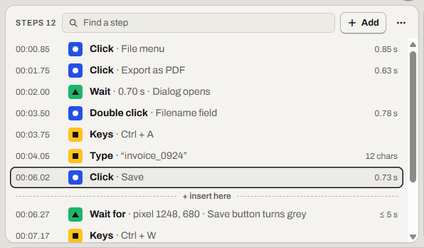
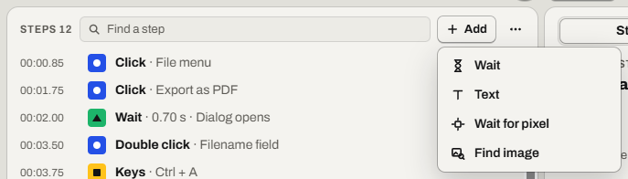
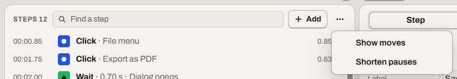

# Edit the steps

Change what a recording does, without recording it again.

Find it: open a macro from the **Library**.

- [Read the steps list](#read-the-steps-list)
- [Select one or several steps](#select-one-or-several-steps)
- [Find a step](#find-a-step)
- [Add a step](#add-a-step)
- [Change a step](#change-a-step)
- [Change the pause before a step](#change-the-pause-before-a-step)
- [Delete a step](#delete-a-step)
- [Undo a change](#undo-a-change)
- [Shorten long pauses](#shorten-long-pauses)
- [Show or hide the moves](#show-or-hide-the-moves)
- [Edit several steps at once](#edit-several-steps-at-once)
- [Good to know](#good-to-know)

## Read the steps list

Each row in the steps list is one step. Its first word is the step type.

| Step | What it does |
| --- | --- |
| **Click**, **Double click**, **Drag**, **Scroll** | Uses the mouse. |
| **Keys**, **Type**, **Text** | Presses keys or types text. |
| **Wait**, **Wait for** | Waits a set time, or waits for a pixel's color. |
| **Find** | Finds an image, then clicks it. |

A [move](glossary.md#move) is a mouse move. A move shows in the row of the step after it, without a number.

More detail: [Steps: step types](../spec/steps.md#step-types)

## Select one or several steps

Select a row to select its step.

1. Select the first row.
2. To select a range, hold <kbd>Shift</kbd>. Then click the last row, or press the arrow keys <kbd>↑</kbd> or <kbd>↓</kbd>.
3. To add or remove one row, hold <kbd>Ctrl</kbd> and click it. This needs a mouse.

If it worked, the [inspector](glossary.md#inspector) says *3 steps selected*. The number is how many you selected.

## Find a step

**Find a step** shows only steps that match what you type.

1. Select **Find a step** (<kbd>Ctrl</kbd>+<kbd>F</kbd>).
2. Type a word or a step type, for example `save` or `click`.
3. To select them all, select the first one. Then press <kbd>Ctrl</kbd>+<kbd>A</kbd>.

If it worked, the inspector says *2 steps selected*. The number is how many match.

## Add a step

**Add** inserts a new step.

1. Select the step the new one should come after. Clicking the timeline also moves this point.
2. Select **Add**, or press <kbd>Insert</kbd> or <kbd>+</kbd> in the steps list. The new step goes at the **+ insert here** line.
3. Select **Wait**, **Text**, **Wait for pixel** or **Find image**.

If it worked, the number after *Steps* goes up by 1.

With NVDA, open **Add** with <kbd>+</kbd>: NVDA uses <kbd>Insert</kbd>.

More detail: [Editing: adding steps](../spec/editing.md#adding-steps)

## Change a step

The inspector's **Step** tab shows the selected step's fields.

1. Select the step.
2. Press <kbd>Enter</kbd>. The focus moves to the first field.
3. Change the field.
4. Press <kbd>Enter</kbd> to save. In a Text step's **Text**, <kbd>Enter</kbd> starts a new line: press <kbd>Tab</kbd> instead.

If it worked, the top bar says *Saved*.

## Change the pause before a step

A [pause](glossary.md#pause) is recorded idle time.

1. Select the step.
2. Type the seconds in **Pause before**.
3. Press <kbd>Enter</kbd>.

If it worked, the top bar says *Saved*.

## Delete a step

Select the step. Then press <kbd>Delete</kbd>, or select **Delete step**.

If it worked, Relay says *Deleted the step*.

## Undo a change

**Undo** reverses changes to the steps and the macro name.

1. Select **Undo** (<kbd>Ctrl</kbd>+<kbd>Z</kbd>).
2. To redo it, select **Redo** (<kbd>Ctrl</kbd>+<kbd>Y</kbd>).

If it worked, the steps list shows the macro as it was.

More detail: [Editing: undo and redo](../spec/editing.md#undo-and-redo)

## Shorten long pauses

**Shorten pauses** makes every pause over 1 s last 1 s. You can't change this limit.

1. Select **Steps options**.
2. Select **Shorten pauses**.

If it worked, Relay says *Shortened 4 pauses to 1 s*. The number is how many changed.

## Show or hide the moves

**Show moves** gives each move its own row.

1. Select **Steps options**, then turn on **Show moves**.
2. Select a *Move* row.
3. Change **Takes**. Or select **Smooth the path** or **Straighten**.

If it worked, the steps list shows *Move* rows. To hide them, turn off **Show moves**.

To delete every move, turn on **Show moves** and type `move` in **Find a step**. If only *Move* rows show, select the first row. Then press <kbd>Ctrl</kbd>+<kbd>A</kbd> and <kbd>Delete</kbd>.

One **Undo** restores every move.

## Edit several steps at once

1. Select the steps.
2. Change **Pause before** or **Label**.
3. To turn **Type** steps into [Text steps](text.md), select **Make editable**.

If it worked, one **Undo** reverses the change on every step.

## Good to know

- You can't edit the steps while a macro records or plays.
- If the moves are hidden, deleting a step also deletes its move.
- To rename a macro, select its name in the top bar and type.
- **Undo** keeps 100 changes for each macro, until Relay quits.
- Two clicks on the same spot become one **Double click** if you set the second one's **Pause before** below the double-click time (usually half a second).

Something not working? Read [Problems while playing](troubleshooting.md#problems-while-playing).

---

Previous: [Stop a macro](stop-a-macro.md) · Next: [Make a macro wait](wait.md) · [Guide home](README.md)
