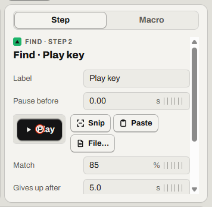

# Click a picture wherever it is

Click a button or an icon that isn't always in the same place.

Find it: in a macro, **Add**, then **Find image**.

- [Add a Find image step](#add-a-find-image-step)
- [Check it finds the picture](#check-it-finds-the-picture)
- [When the picture looks a bit different](#when-the-picture-looks-a-bit-different)
- [When the picture isn't found](#when-the-picture-isnt-found)
- [Good to know](#good-to-know)
- [Not possible yet](#not-possible-yet)

## Add a Find image step

1. Select the step the new one should come after. Clicking the timeline also moves this point.
2. Select **Add** (<kbd>Insert</kbd>), then **Find image**. Windows' snipping overlay opens.
3. Drag around the button (with a mouse only). Or press <kbd>Esc</kbd>, then select **Paste** or **File…** (PNG or JPEG).
4. In the **Step** tab, click the picture where Relay should click (with a mouse only). By default, Relay clicks the middle.

If it worked, the steps list shows a new *Find* row.

## Check it finds the picture

1. Show the picture, with no Relay window over it.
2. Select the Find image step, then **Test**.
3. Optional: select **Show**. Relay marks the match for 3 s, with a dot at the click point.

If it worked, Relay says *Found at …, … (…%)*.

## When the picture looks a bit different

A new size is fine. Relay looks at half to twice the picture's size. Two monitors with different display scaling work.

Select **Test** on each monitor. Lower **Match** only if the picture looks a little different:

1. Select **Test**. Note the number in *Not found: the best match is …%*.
2. Set **Match** a little below that number.
3. Select **Test** again.

If it worked, Relay says *Found at …, … (…%)*.

## When the picture isn't found

If the **Gives up after** time ends, playback stops. Relay says *Image not found at step …; playback stopped.* The [playhead](glossary.md#playhead) stays on that step, marked *Timed out*.

- If the app is slow, raise **Gives up after**.
- If the picture changed, select **Snip** and snip it again.
- If a window covers the picture, move that window.

## Good to know

- **Match**: 85% by default, from 50% to 100%.
- **Gives up after**: 5 s by default, 0.5 s or more.
- **Clicks**: **Left** by default, or **Right** or **Middle**.
- **Looks on**: with several monitors, one screen is faster than **All screens**.
- With several matches, Relay clicks the best one.
- Macros with this step need Relay 1.4 or later.

More detail: [Find image: the search](../spec/find-image.md#the-search) · [fields](../spec/find-image.md#fields) · [when the image isn't found](../spec/find-image.md#when-the-image-isnt-found)

## Not possible yet

- Finding a rotated picture, one stretched one way, or one restyled by a new theme or dark mode. Snip it again.
- Picking the click point on the screen. Click it in the **Step** tab instead.

Something not working? Read [Problems with waits and pictures](troubleshooting.md#problems-with-waits-and-pictures).

---

Previous: [Make a macro wait](wait.md) · Next: [Type text that changes: date, clipboard, columns](text.md) · [Guide home](README.md)
