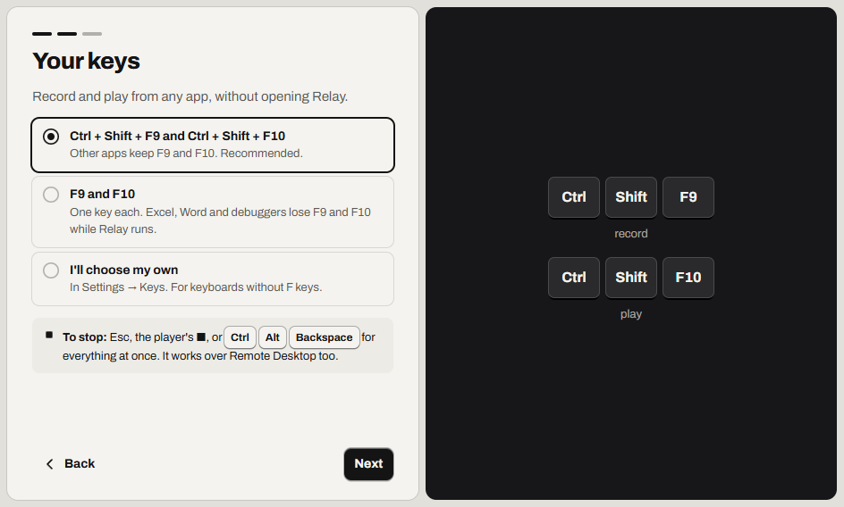
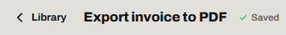
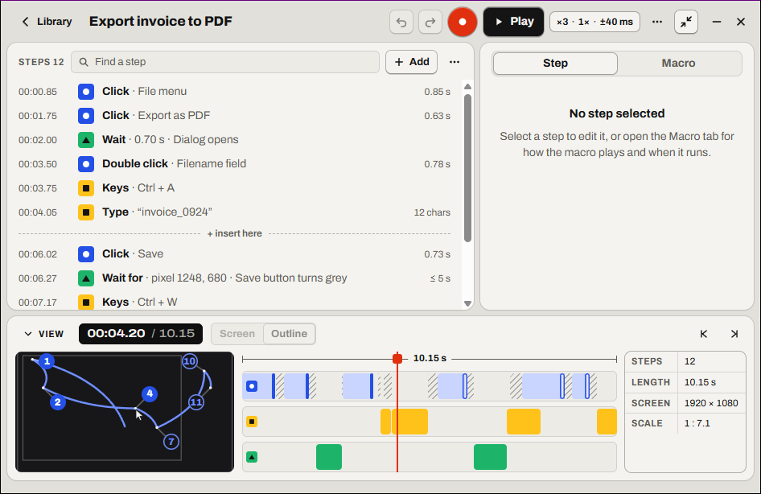

# Get started

Install Relay, then record and play your first macro.

- [Install Relay](#install-relay)
- [Choose your keys](#choose-your-keys)
- [Record and play your first macro](#record-and-play-your-first-macro)
- [Your macro saves by itself](#your-macro-saves-by-itself)
- [Find your way around](#find-your-way-around)
- [Where Relay goes when you close it](#where-relay-goes-when-you-close-it)
- [What to try next](#what-to-try-next)
- [Good to know](#good-to-know)
- [Not possible yet](#not-possible-yet)

## Install Relay

Download the installer, then open it.

1. Download `Relay_<version>_x64-setup.exe` from [Relay's releases on GitHub](https://github.com/HappyRave/Relay/releases).
2. Open the file.
3. If Windows says *Windows protected your PC*, select **More info**, then **Run anyway**.
4. Start **Relay** from the Start menu.

If it worked, Relay opens and says *Do it once. Relay does it again.*

To use Relay without installing it, read [Use the portable exe](files.md#use-the-portable-exe).

### Is "Windows protected your PC" safe?

**Yes.** Windows warns because Relay isn't code-signed. Relay installs for your account only. It needs no administrator rights. Read [SmartScreen, antivirus and signing](scripts.md#smartscreen-antivirus-and-signing).

More detail: [Installing: SmartScreen and antivirus](../spec/install.md#smartscreen-and-antivirus)

## Choose your keys

On its first run, Relay asks which keys record and play from any app.

1. Select **Next**.
2. Select **Ctrl + Shift + F9 and Ctrl + Shift + F10**.
3. Select **Next**.

If it worked, the next screen says *Your first macro*.

If your keyboard has no F keys, select **I'll choose my own**. Read [No F keys, or another app uses them](keys.md#no-f-keys-or-another-app-uses-them).

To stop a macro, press <kbd>Esc</kbd>. Read [Every way to stop a macro](stop-a-macro.md#every-way-to-stop-a-macro).

> [!TIP]
> Using a screen reader? Turn on **Sounds** in **Settings** before you record. Read [Hear when recording starts and stops](accessibility.md#hear-when-recording-starts-and-stops).

More detail: [Settings: the first run](../spec/settings.md#the-first-run)

## Record and play your first macro

Practice in Notepad, not in a program you use for work. Relay doesn't record clicks on the player, the small bar it shows while recording. Keep the player away from what you click.

1. Open Notepad.
2. On the *Your first macro* screen, select **Record now**. The player counts down.
3. When the countdown ends, click inside Notepad.
4. Type a line, then press <kbd>Enter</kbd>.
5. Press <kbd>Esc</kbd>. Relay says *Recording stopped, … steps. Name this macro.*
6. Type a name for the macro.
7. Select **Play**, or press <kbd>Ctrl</kbd>+<kbd>Shift</kbd>+<kbd>F10</kbd>.

If it worked, Notepad gets the line a second time.

## Your macro saves by itself

Relay saves every change, so there is no Save button. After a change, the top bar shows *Saved*. **Undo** (<kbd>Ctrl</kbd>+<kbd>Z</kbd>) reverses changes to the steps and the name. Play options and triggers aren't undone: change them back by hand.

## Find your way around

The window has three places: the **Library**, a macro's editor and **Settings**.

| Editor part | What it does |
| --- | --- |
| Steps list | Shows the steps, in order. |
| Inspector | The **Step** tab edits a step. The **Macro** tab (<kbd>Ctrl</kbd>+<kbd>M</kbd>) sets how the macro plays. |
| **View** | Shows where the macro clicks. It also holds the timeline. |

The playhead is the point on the timeline where play starts and new steps go. For other terms, read [Words used in Relay](glossary.md).

## Where Relay goes when you close it

When you close the window, Relay keeps running in the tray: the icons by the clock, maybe under the **^** arrow.

Relay's keys, macro hotkeys and [triggers](glossary.md#trigger) keep working. Nothing runs by itself unless you set a trigger.

- To show the window, select Relay's icon.
- To quit, right-click the icon (with a mouse only), then select **Quit Relay**.
- To quit Relay when you close the window, turn off **Close to the tray** in **Settings**, under **Window**.

  If it worked, the close button is named **Quit**.

More detail: [The window: closing to the tray](../spec/windows.md#closing-to-the-tray)

## What to try next

- [Make a macro wait](wait.md#which-wait-do-you-need)
- [Run a macro automatically](run-automatically.md#choose-what-starts-it)
- [Change a step](edit-steps.md#change-a-step)

## Good to know

- Relay needs Windows 10 or 11, 64-bit.
- Relay never connects to the internet. Your macros stay on this PC.

More detail: [Installing: requirements](../spec/install.md#requirements)

## Not possible yet

- Relay can't install for all users of a PC.
- Relay doesn't run on macOS or Linux.
- Relay is in English only.

Something not working? Read [Problems installing and starting](troubleshooting.md#problems-installing-and-starting).

---

Next: [Record a macro](record.md) · [Guide home](README.md)
