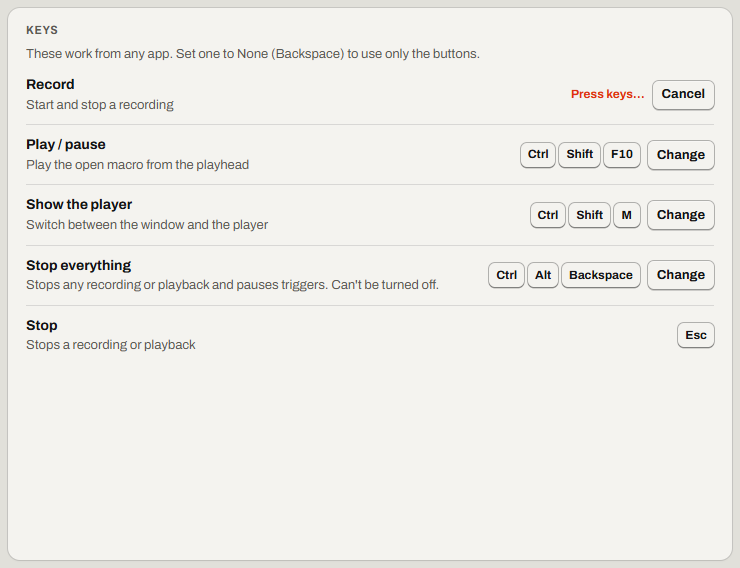

# Relay's keys and shortcuts

Change Relay's keys, and find every keyboard shortcut.

Find it: in the Library, select **Settings**, then **Keys**.

- [Relay's four keys](#relays-four-keys)
- [Change Relay's keys](#change-relays-keys)
- [No F keys, or another app uses them](#no-f-keys-or-another-app-uses-them)
- [Which key combinations work](#which-key-combinations-work)
- [AltGr on AZERTY, German, Swedish and other layouts](#altgr-on-azerty-german-swedish-and-other-layouts)
- [You upgraded from an older Relay](#you-upgraded-from-an-older-relay)
- [When a key does nothing](#when-a-key-does-nothing)
- [Shortcuts in Relay's window](#shortcuts-in-relays-window)
- [Shortcuts in the steps list](#shortcuts-in-the-steps-list)
- [Not possible yet](#not-possible-yet)

## Relay's four keys

These keys work in any app, even when Relay is hidden.

| Key | What it does, and its key on a new install |
| --- | --- |
| **Record** | Starts or stops recording. <kbd>Ctrl</kbd>+<kbd>Shift</kbd>+<kbd>F9</kbd>. |
| **Play / pause** | Plays or pauses the open macro. <kbd>Ctrl</kbd>+<kbd>Shift</kbd>+<kbd>F10</kbd>. |
| **Show the player** | Shows the [player](glossary.md#player), or the main window again. <kbd>Ctrl</kbd>+<kbd>Shift</kbd>+<kbd>M</kbd>. |
| **Stop everything** | Stops recording and playing, and pauses triggers. <kbd>Ctrl</kbd>+<kbd>Alt</kbd>+<kbd>Backspace</kbd>. |

<kbd>Esc</kbd> is the **Stop** key. You can't change it. It stops a macro. It also stops a recording while **Esc stops recording** is on.

More detail: [Shortcuts: Relay's keys](../spec/keys.md#relays-keys)

## Change Relay's keys

1. Select **Change** next to the key. *Press keys…* shows in place of the key, and **Change** becomes **Cancel**.
2. Press the new combination. To set the key to **None**, press <kbd>Backspace</kbd>.
3. To keep the old key, press <kbd>Esc</kbd> or select **Cancel**.

If it worked, the line under the key says *Set to …*, or *Set to None: use the buttons instead.*

If the line shows a warning, the combination is still set. If Relay refuses it, the line says why. **Stop everything** can't be **None**.

More detail: [Shortcuts: setting a key](../spec/keys.md#setting-a-key)

## No F keys, or another app uses them

[Change Relay's keys](#change-relays-keys) to combinations no other app or game uses, such as <kbd>Ctrl</kbd>+<kbd>Shift</kbd>+<kbd>R</kbd>.

Excel uses <kbd>F9</kbd>. Code editors (IDEs) and debuggers use <kbd>F9</kbd> and <kbd>F10</kbd>, alone and with <kbd>Ctrl</kbd>+<kbd>Shift</kbd>. If you [upgraded from an older Relay](#you-upgraded-from-an-older-relay), Relay may still use <kbd>F9</kbd> alone.

## Which key combinations work

Relay's keys and a macro's **Hotkey** follow the same rules. A <kbd>+</kbd> at the end of a combination means the plus key.

| Relay refuses | Relay says |
| --- | --- |
| A key other than <kbd>F1</kbd> to <kbd>F24</kbd>, with no <kbd>Ctrl</kbd>, <kbd>Alt</kbd>, <kbd>Shift</kbd> or <kbd>Win</kbd> | *Add Ctrl, Alt, Shift or Win, so the key still types normally* |
| <kbd>Shift</kbd> alone with a key that types | *Add Ctrl, Alt or Win: Shift + … is ordinary typing* |
| Ending with <kbd>Ctrl</kbd>, <kbd>Alt</kbd>, <kbd>Shift</kbd> or <kbd>Win</kbd> | *Add a key after …: a hotkey can't end with a modifier* |
| One of Relay's keys | *… is already Relay's “…” key*. A macro's **Hotkey** says *… is Relay's “…” key*. |
| Another macro's hotkey | *… already runs “…”* |

## AltGr on AZERTY, German, Swedish and other layouts

On these layouts, <kbd>Ctrl</kbd>+<kbd>Alt</kbd> works as <kbd>AltGr</kbd>. On Belgian AZERTY, <kbd>Ctrl</kbd>+<kbd>Alt</kbd>+<kbd>2</kbd> types `@` and <kbd>Ctrl</kbd>+<kbd>Alt</kbd>+<kbd>1</kbd> types `|`. On Swedish, <kbd>Ctrl</kbd>+<kbd>Alt</kbd>+<kbd>7</kbd> types `{`.

If Relay uses one of these combinations, you can't type that character. **Settings** warns about them. A macro's **Hotkey** doesn't. Use <kbd>Ctrl</kbd>+<kbd>Shift</kbd> combinations instead.

More detail: [Shortcuts: warnings](../spec/keys.md#warnings)

## You upgraded from an older Relay

Relay keeps your old keys: <kbd>F9</kbd>, <kbd>F10</kbd>, <kbd>Ctrl</kbd>+<kbd>Shift</kbd>+<kbd>M</kbd> and <kbd>Ctrl</kbd>+<kbd>Alt</kbd>+<kbd>End</kbd>.

Over Remote Desktop, <kbd>Ctrl</kbd>+<kbd>Alt</kbd>+<kbd>End</kbd> doesn't reach Relay. So the keys screen after the upgrade offers **Use Ctrl + Alt + Backspace**.

## When a key does nothing

Another app may use the key. Relay says so each time it starts: *Another program uses …, so Relay's “…” key doesn't work. Choose another in Settings → Keys.*

- A macro's **Hotkey** may say *… is taken by another app*. The hotkey is saved but doesn't work. Choose another key, or close that app.
- Over Remote Desktop, some keys don't reach Relay. Read [Stop a macro over Remote Desktop](remote-desktop.md#stop-a-macro-over-remote-desktop).
- On a laptop, you may need to hold <kbd>Fn</kbd>.

## Shortcuts in Relay's window

| Shortcut | What it does |
| --- | --- |
| <kbd>Ctrl</kbd>+<kbd>Z</kbd>, <kbd>Ctrl</kbd>+<kbd>Y</kbd> | In a macro: **Undo** and **Redo**. In a text field, they act on your typing. |
| <kbd>Alt</kbd>+<kbd>←</kbd> | Returns to the Library, except while Relay records or plays. |
| <kbd>Ctrl</kbd>+<kbd>F</kbd> | Goes to **Search macros** in the Library, or **Find a step** in the editor. |
| <kbd>Delete</kbd> | On a Library row: moves the macro, or every selected macro, to the trash. |
| <kbd>Ctrl</kbd>+<kbd>D</kbd> | On a Library row: duplicates the macro. |
| <kbd>Ctrl</kbd>+<kbd>M</kbd> | In the editor: opens the **Macro** tab. |
| <kbd>←</kbd>, <kbd>→</kbd> (the arrow keys) | On the timeline: moves the [playhead](glossary.md#playhead) one step. With <kbd>Shift</kbd>, it moves a tenth of a second. |
| <kbd>Space</kbd> | On the timeline: plays or pauses. |

## Shortcuts in the steps list

These keys work when the steps list has the focus.

| Key | What it does |
| --- | --- |
| <kbd>↓</kbd>, <kbd>↑</kbd> | Selects the next or previous step. |
| <kbd>Home</kbd>, <kbd>End</kbd> | Selects the first or last step. |
| <kbd>Ctrl</kbd>+<kbd>A</kbd> | Selects every step shown. |
| <kbd>Esc</kbd> | Keeps only one step selected. |
| <kbd>Enter</kbd> | Moves the focus to the step's first field on the **Step** tab. |
| <kbd>Delete</kbd> | Deletes the selected steps. |
| <kbd>Insert</kbd> or <kbd>+</kbd> | Opens **Add**. The NVDA screen reader uses <kbd>Insert</kbd>, so press <kbd>+</kbd> instead. |

For the keys while you pick a pixel, read [Wait until a window or page is ready](wait.md#wait-until-a-window-or-page-is-ready).

## Not possible yet

- You can't limit Relay's keys to Relay's window. If one of them takes a key you need, set it to **None**.
- A macro's **Hotkey** doesn't warn about [AltGr](#altgr-on-azerty-german-swedish-and-other-layouts).
- A macro can't play only while you hold its hotkey.

Something not working? Read [Problems with keys and triggers](troubleshooting.md#problems-with-keys-and-triggers).

---

Previous: [Run a macro without Relay](scripts.md) · Next: [Settings](settings.md) · [Guide home](README.md)
