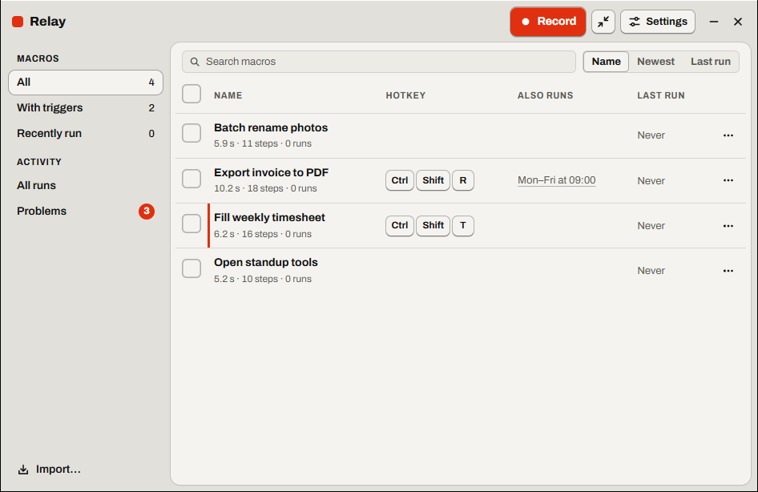
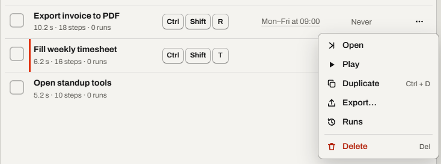
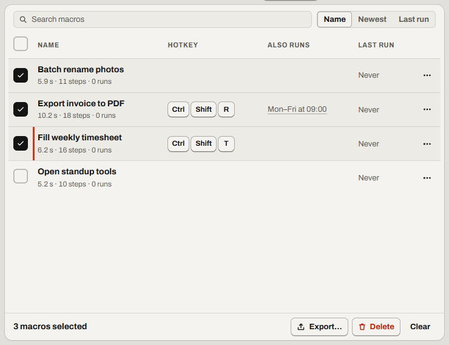

# Find, share and back up macros

Keep many macros in order, and move them between people and PCs.

Find it: **Library**, in the window's top bar.

- [Find a macro](#find-a-macro)
- [Duplicate a macro](#duplicate-a-macro)
- [Delete a macro and get it back](#delete-a-macro-and-get-it-back)
- [Share macros with a team](#share-macros-with-a-team)
- [Back up your macros, or move to a new PC](#back-up-your-macros-or-move-to-a-new-pc)
- [Good to know](#good-to-know)
- [Not possible yet](#not-possible-yet)

## Find a macro

Type part of the name in **Search macros** (<kbd>Ctrl</kbd>+<kbd>F</kbd>). **Sort by** orders the list by **Name**, **Newest** or **Last run**.

- **Hotkey** shows the macro's hotkey, if it has one.
- **Also runs** shows the macro's other [triggers](glossary.md#trigger) that are on, for example *Mon–Fri at 09:00* or *When EXCEL.EXE starts*. Select that text to change them.

More detail: [Library: search and sort](../spec/library.md#search-and-sort)

## Duplicate a macro

1. In the **Library**, find the macro.
2. On its row, select **More for …** (the three dots).
3. Select **Duplicate** (<kbd>Ctrl</kbd>+<kbd>D</kbd>).

If it worked, the Library shows a new macro named “… (copy)”. The copy has no triggers.

More detail: [Library: the row menu](../spec/library.md#the-row-menu)

## Delete a macro and get it back

1. On the macro's row, select **More for …**.
2. Select **Delete** (<kbd>Delete</kbd>). **Undo** shows in a message for 8 seconds.
3. Select **Undo** in the message.

If the message is gone, open the `macros\.trash` folder in the [data folder](files.md#where-your-macros-are). The files have IDs as names. Notepad shows each one's `"name"`. Then select **Import…** and that file.

If it worked, the Library shows the macro again. An imported macro has no triggers, run count or [data file](glossary.md#data-file).

More detail: [Library: delete and the trash](../spec/library.md#delete-and-the-trash)

## Share macros with a team

Export the macros as `.rly` files, and each person imports them. To export one macro, select **More for …**, then **Export…**, then **Relay macro**.

1. Start each name with the team's name, for example `Support – Refund`.
2. Search for `Support`, then select **Select all**.
3. Select **Export…** in the bar under the list, then a shared folder.
4. Each person selects **Import…**, then the files.
5. Each person sets the [hotkey and other triggers](run-automatically.md#run-a-macro-with-a-hotkey), and any data file again. Exported files don't hold them.

If it worked, the macros show in each person's Library. If clicks land in the wrong place, read [Clicks land in the wrong place](troubleshooting.md#clicks-land-in-the-wrong-place).

More detail: [Export and import: import](../spec/export-import.md#import)

## Back up your macros, or move to a new PC

1. Right-click Relay's icon in the [tray](glossary.md#tray) (with a mouse only). Then select **Quit Relay**.
2. Copy the data folder, `%APPDATA%\Relay`.
3. On the new PC, install Relay.
4. Copy the folder to the same path there.
5. Copy each data file to its old folder on the new PC, or select it again in Relay.
6. Start Relay.
7. If you used **Start with Windows**, turn it on again in **Settings**, then **Window**. The data folder doesn't hold it.

If it worked, the Library shows your macros and their triggers.

More detail: [Export and import: backing up and moving to another PC](../spec/export-import.md#backing-up-and-moving-to-another-pc)

## Good to know

- A `.rly` file holds the steps, play options and pictures, and any text it types, passwords included. It has no triggers, run count or data file.
- Export replaces a file with the same name. In a shared folder, that file can be a teammate's.

More detail: [Export and import: what an export contains](../spec/export-import.md#what-an-export-contains)

## Not possible yet

- Folders or tags. Start related names with the same word, then search for it.
- Hotkeys in exported files. Set each hotkey again after you import the macro.
- A printable list of hotkeys, or sorting by hotkey. To see every hotkey, read the **Hotkey** column, or open the [player](glossary.md#player)'s **Switch macros** menu.

Something not working? Read [Problems while playing](troubleshooting.md#problems-while-playing).

---

Previous: [Did it run? See what ran and what failed](what-ran.md) · Next: [Run a macro without Relay](scripts.md) · [Guide home](README.md)
