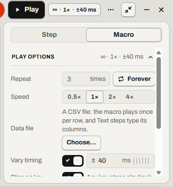

# Play, loop and change speed

Play a macro from the middle, many times, faster, or with exact timing.

Find it: open a macro, then the **Macro** tab (<kbd>Ctrl</kbd>+<kbd>M</kbd>), then **Play options**.

To stop a macro, press <kbd>Esc</kbd>. Read [Every way to stop a macro](stop-a-macro.md#every-way-to-stop-a-macro).

- [Play a macro](#play-a-macro)
- [Repeat a macro or loop it forever](#repeat-a-macro-or-loop-it-forever)
- [Play faster or slower](#play-faster-or-slower)
- [Vary the timing](#vary-the-timing)
- [Choose whether a key press stops it](#choose-whether-a-key-press-stops-it)
- [Make clicks follow a moved window](#make-clicks-follow-a-moved-window)
- [Good to know](#good-to-know)
- [Not possible yet](#not-possible-yet)

## Play a macro

**Play** starts at the playhead, the point that the timeline shows. If the playhead is at the end, **Play** starts from the beginning.

1. To start in the middle, select a step or a point on the timeline.
2. Select **Play**, or press the **Play / pause** key (<kbd>Ctrl</kbd>+<kbd>Shift</kbd>+<kbd>F10</kbd> on a new install).

If it worked, the **Play** button changes to **Pause**.

## Repeat a macro or loop it forever

In **Repeat**, type a number from 1 to 9999, or select **Forever**.

## Play faster or slower

Under **Speed**, select **0.5×**, **1×**, **2×** or **4×**. At a faster speed, a slow app can miss clicks, so [add waits](wait.md#which-wait-do-you-need).

## Vary the timing

**Vary timing** moves each step by a random amount, up to the **By up to** value (±0 to ±200 ms). For identical runs, turn **Vary timing** off.

**Vary timing** was called *Humanize* in older versions.

## Choose whether a key press stops it

If **Stop on key** is on, any key stops the macro. <kbd>Shift</kbd>, <kbd>Ctrl</kbd>, <kbd>Alt</kbd> or <kbd>Win</kbd> alone doesn't. If it is off, keys don't stop the macro. <kbd>Esc</kbd>, **Stop** and **Stop everything** still do.

The macro's keys go to the window in front, and its clicks go to whatever is under the cursor. If you select another window to type in, the macro types there too.

## Make clicks follow a moved window

Relay records clicks in screen pixels, across all monitors.

Position 0, 0 is your main monitor's top-left corner. Monitors left of it or above it have negative positions. A new monitor layout moves the clicks.

If only the window moved, set **Clicks land** to **Window**. **Window** doesn't help if the window size or display scaling changed. If Relay can't find the window, it shows a message and uses **Screen**.

More detail: [Screen or Window coordinates](../spec/playback.md#screen-or-window-coordinates)

## Good to know

| Option | Default |
| --- | --- |
| **Repeat** | 1 time |
| **Speed** | 1× |
| **Vary timing** | On, ±40 ms |
| **Stop on key** | On |
| **Clicks land** | Screen |

- Each macro has its own play options. Its standalone program uses them too.
- To reach an app run as administrator, run Relay as administrator too.

## Not possible yet

- No default play options for new macros. **Duplicate** a macro that has them.

Something not working? Read [Problems while playing](troubleshooting.md#problems-while-playing).

---

Previous: [Fill in a form from a spreadsheet](spreadsheet.md) · Next: [Use the player](player.md) · [Guide home](README.md)
