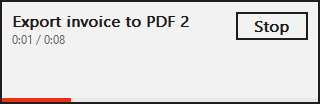
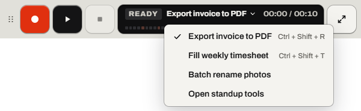

# Use the player

The player (Relay's small bar) records and plays macros on top of your apps.

Find it: **Switch to the player** in the top bar (<kbd>Ctrl</kbd>+<kbd>Shift</kbd>+<kbd>M</kbd>).

To stop a macro, press <kbd>Esc</kbd>. Read [Every way to stop a macro](stop-a-macro.md#every-way-to-stop-a-macro).

- [What the player shows](#what-the-player-shows)
- [Move the player](#move-the-player)
- [Switch macros from the player](#switch-macros-from-the-player)
- [Use only the player](#use-only-the-player)
- [Good to know](#good-to-know)

## What the player shows

The player shows, left to right:

- the grip, the dots at its left end
- **Record** (**Stop recording** while recording)
- **Play** (**Pause** while playing)
- **Stop** (a square)
- the state, the macro's name, and the time or the [data file](glossary.md#data-file) row
- **Open the window**

The state is *READY*, *GET READY*, *REC*, *PLAYING*, *PAUSED* or *DONE ✓*. After an error, it says *STOPPED* until you select **Dismiss**.

## Move the player

Keep the player away from your macro's clicks. Only a mouse can move it. Read [Parts that need sight or a mouse](accessibility.md#parts-that-need-sight-or-a-mouse).

1. Drag the grip to a new place.

If it worked, the player stays there, next time too.

## Switch macros from the player

Switch macros with the macro's name on the player.

1. Stop any recording or playback.
2. Select the macro's name. The **Switch macros** menu opens.
3. Select a macro.

If it worked, the player shows that macro's name.

## Use only the player

In player mode, only the player shows.

1. Select **Switch to the player** in the top bar (<kbd>Ctrl</kbd>+<kbd>Shift</kbd>+<kbd>M</kbd>).
2. Record and play from the player.
3. To get the window back, select **Open the window** or press <kbd>Ctrl</kbd>+<kbd>Shift</kbd>+<kbd>M</kbd> again.

If it worked, the window hides and the player says *READY*.

More detail: [Windows: player mode](../spec/windows.md#player-mode)

## Good to know

- The player shows by itself when Relay records or plays with its window hidden. That happens when Relay is in the [tray](glossary.md#tray) or in player mode. **Hide the window while recording** (on by default) and **Hide the window while playing** also hide it.
- When a [trigger](glossary.md#trigger) runs a macro while the window is open, the player shows in a corner away from the window and the clicks. Otherwise, it shows where you left it.
- The player follows **Theme**, but its display stays dark.
- The player never takes the keyboard from your app.
- [Make the text and the player bigger](accessibility.md#make-the-text-and-the-player-bigger) with **Player size**.

Something not working? Read [Problems while playing](troubleshooting.md#problems-while-playing).

---

Previous: [Play, loop and change speed](play.md) · Next: [Run a macro automatically](run-automatically.md) · [Guide home](README.md)
