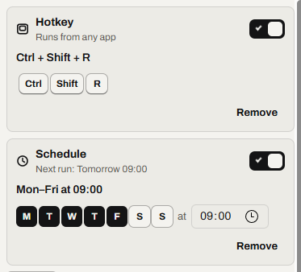

# Run a macro automatically

Make a macro start by itself, and see when it doesn't.

Find it: open a macro, then the **Macro** tab (<kbd>Ctrl</kbd>+<kbd>M</kbd>), then **Runs automatically**.

To stop a macro, press <kbd>Esc</kbd>. Read [Every way to stop a macro](stop-a-macro.md#every-way-to-stop-a-macro).

- [Choose what starts it](#choose-what-starts-it)
- [Run a macro with a hotkey](#run-a-macro-with-a-hotkey)
- [Run a macro on a schedule](#run-a-macro-on-a-schedule)
- [Run a macro when a program opens](#run-a-macro-when-a-program-opens)
- [Run a macro when a color changes](#run-a-macro-when-a-color-changes)
- [Run a macro when a picture appears](#run-a-macro-when-a-picture-appears)
- [If the PC is asleep or locked](#if-the-pc-is-asleep-or-locked)
- [When a trigger is skipped](#when-a-trigger-is-skipped)
- [Keep Relay running](#keep-relay-running)
- [Not possible yet](#not-possible-yet)

## Choose what starts it

A [trigger](glossary.md#trigger) starts a macro by itself. A macro can have one of each:

| Trigger | Starts the macro when |
| --- | --- |
| **Hotkey** | You press its keys. |
| **Schedule** | A day and time arrive. |
| **When an app starts** | A program starts. |
| **When a pixel changes** | A screen point changes color. |
| **When an image appears** | A picture appears. |

## Run a macro with a hotkey

A hotkey starts the macro from any app.

1. Select **Add**, then **Hotkey**.
2. Select **Set…**.
3. Press the keys, for example <kbd>Ctrl</kbd>+<kbd>Shift</kbd>+<kbd>R</kbd>. The switch turns on by itself.

If it worked, the line under **Hotkey** says *Runs from any app*. If Relay refuses the keys, read [Which key combinations work](keys.md#which-key-combinations-work).

On AZERTY and similar layouts, use <kbd>Ctrl</kbd>+<kbd>Shift</kbd>, not <kbd>Ctrl</kbd>+<kbd>Alt</kbd>. Read [AltGr on AZERTY, German, Swedish and other layouts](keys.md#altgr-on-azerty-german-swedish-and-other-layouts).

## Run a macro on a schedule

A schedule starts the macro on chosen days at one time.

1. Select **Add**, then **Schedule**. It starts as Monday to Friday at 09:00.
2. Select a day to turn it on or off.
3. Type the time after **at**.

If it worked, the line under **Schedule** says *Next run: Tomorrow 09:00*, with your day and time.

## Run a macro when a program opens

**When an app starts** runs the macro when a program starts.

1. Select **Add**, then **When an app starts**.
2. In **Program**, type the program's file name, for example `EXCEL.EXE`.
3. Set **Delay**, the wait after it starts (2 s by default).

If it worked, the card says *2 s after EXCEL.EXE starts*.

A program already open doesn't count. Neither does its second window.

## Run a macro when a color changes

**When a pixel changes** runs the macro when a point turns a color.

1. Select **Add**, then **When a pixel changes**.
2. Make the point show the color to wait for.
3. Select **Pick from screen**, then select the point. Or type **X**, **Y** and **Color**.
4. Turn on the card's switch.

If it worked, the line under **When a pixel changes** says *On*. A point that already has the color must change and come back first.

More detail: [Triggers: when a pixel changes](../spec/triggers.md#when-a-pixel-changes)

## Run a macro when a picture appears

**When an image appears** runs the macro when a picture shows on screen.

1. Select **Add**, then **When an image appears**.
2. Select **Snip**. Without a mouse, select **Paste** or **File…**.
3. After **Snip**, drag around the picture.

If it worked, the line under **When an image appears** says *On*. A picture already on the screen must hide and show again first.

## If the PC is asleep or locked

Triggers need the PC awake and unlocked.

- Relay skips a scheduled run the PC sleeps through. Activity lists *Skipped: PC was asleep*. A run up to 2 minutes after its time still starts.
- While the screen is locked, Relay skips runs without a message. Activity lists *Skipped: screen locked*. A Windows permission prompt counts as locked.

Read [See why a run was skipped](what-ran.md#see-why-a-run-was-skipped).

## When a trigger is skipped

Relay also skips a run when:

- Relay is recording or playing. A message says *Skipped “…”: Relay was busy*.
- Triggers are paused. Read [Stop everything, then turn triggers back on](stop-a-macro.md#stop-everything-then-turn-triggers-back-on).
- The macro's data file has a problem. Activity says why.

## Keep Relay running

Triggers work only while Relay runs. When you close the window, Relay stays in the [tray](glossary.md#tray), unless **Close to the tray** is off. **Start with Windows** starts Relay when you sign in.

## Not possible yet

- A monthly run. Instead, read [Run a standalone program from Task Scheduler](scripts.md#run-a-standalone-program-from-task-scheduler).
- One list of every schedule. Use the Library's **Also runs** column.
- A hotkey that plays only while you hold it.
- Triggers in an exported macro. Set them again after **Import…**.

Something not working? Read [Problems with keys and triggers](troubleshooting.md#problems-with-keys-and-triggers).

---

Previous: [Use the player](player.md) · Next: [Did it run? See what ran and what failed](what-ran.md) · [Guide home](README.md)
