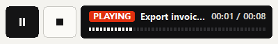

# Run a macro without Relay

Play a macro without Relay, from a script or from Task Scheduler.

Find it: open a macro, then **More**, then **Export…**.

- [Make a standalone program](#make-a-standalone-program)
- [Program options](#program-options)
- [Exit codes](#exit-codes)
- [Run a standalone program from Task Scheduler](#run-a-standalone-program-from-task-scheduler)
- [Run it on many PCs](#run-it-on-many-pcs)
- [SmartScreen, antivirus and signing](#smartscreen-antivirus-and-signing)
- [Export an AutoHotkey script](#export-an-autohotkey-script)
- [Good to know](#good-to-know)

## Make a standalone program

A standalone program is an `.exe` that plays one macro on any Windows 10 or 11 PC, with nothing to install.

1. Select **More**, then **Export…**.
2. Select **Standalone program**, then **Save…**.
3. Select a folder that holds only this program, then select **Save**.
4. Open the program.

If it worked, the program's window says *GET READY*, then *PLAYING*, then *DONE ✓*, and closes.



More detail: [Export and import: exported programs](../spec/export-import.md#exported-programs)

## Program options

Type options after the program's name, for example `export-invoice.exe --repeat 3`.

| Option | What it does | Default |
| --- | --- | --- |
| `--repeat N` or `--repeat forever` | Plays N times, or until stopped. With a data file, it plays once per row, whatever N is. | The macro's **Repeat** |
| `--speed X` | How fast it plays, from 0.01 to 100: 2 is twice as fast. | The macro's **Speed** |
| `--no-countdown` | Starts right away. | 3-second countdown |
| `--quiet` | Shows no window. | The window shows |
| `--help` | Lists the options. | |

More detail: [Export and import: program options](../spec/export-import.md#program-options)

## Exit codes

The exit code says how the program ended. It is the only record: no log, no runs in **Activity**.

Task Scheduler shows it as the **Last Run Result**. In a script, wait for the program to end:

- In cmd: `start "" /wait export-invoice.exe`, then read `%ERRORLEVEL%`.
- In PowerShell: `(Start-Process .\export-invoice.exe -Wait -PassThru).ExitCode`.

| Code | Meaning | What to do |
| --- | --- | --- |
| 0 | The macro played to the end. | Nothing. |
| 1 | The program could not read the macro, or playback failed. | Export again. |
| 2 | An option is wrong. | Fix the option it names. |
| 3 | **Stop**, <kbd>Esc</kbd> or another key stopped it. | If nobody stopped it, turn off **Stop on key** and export again. |
| 4 | <kbd>Ctrl</kbd>+<kbd>Alt</kbd>+<kbd>End</kbd> stopped it. | Nothing. |
| 5 | A pixel check or Find image step timed out. | Don't use `--quiet`. The window stays on *TIMED OUT* and names the step. |
| 6 | The screen was locked. Nothing played. | Keep the screen unlocked. |

More detail: [Export and import: exit codes](../spec/export-import.md#exit-codes)

## Run a standalone program from Task Scheduler

1. Open **Task Scheduler** from Start, then select **Create Task…**.
2. On **General**, type a name and select **Run only when user is logged on**.
3. On **Triggers**, select **New…** and set when the task runs.
4. On **Actions**, select **New…**, then **Browse…**, and select the program.
5. In **Add arguments (optional)**, type options such as `--no-countdown`. Select **OK**.
6. On **Settings**, select **Run task as soon as possible after a scheduled start is missed**. Select **OK**.

If it worked, the **Last Run Result** ends in `(0x0)`. Otherwise it shows the exit code: `(0x6)` is 6.

- A monthly task runs on a day number or a weekday, such as the first Monday, but not on the first working day.
- If the PC was off or asleep at the start time, step 6 runs the task later.
- Waking a PC doesn't unlock it, so the task ends with exit code 6.

## Run it on many PCs

Copy the program to each PC, then:

- Keep the program in a local folder of its own.
- Run the task while a user is signed in and the screen is unlocked.
- Clicks need the same resolution and display scaling as when you recorded. Find image steps work with other scaling. Read [Play on a PC with other display scaling](remote-desktop.md#play-on-a-pc-with-other-display-scaling).
- If the macro's app runs as administrator, run the program as administrator too.
- Use the same options in every task.

## SmartScreen, antivirus and signing

Standalone programs can't be code-signed, so Windows and antivirus programs may warn.

- SmartScreen may say *Windows protected your PC*. Select **More info**, then **Run anyway**.
- An antivirus may block a program started from `%TEMP%`. Keep it in its own folder, or ask your IT team to allow it.

More detail: [Export and import: signing and antivirus](../spec/export-import.md#signing-and-antivirus)

## Export an AutoHotkey script

An AutoHotkey v2 script plays the macro, and you can edit it.

1. In the **Export** dialog, select **AutoHotkey v2**.
2. Select **Save…**, select a folder, then select **Save**.
3. Open the `.ahk` file with AutoHotkey v2.

If it worked, a tooltip counts down *Playing in 3…*, then the macro plays.

Each step becomes a block, numbered as in the [steps list](glossary.md#steps-list):

```autohotkey
    ; 1. Click · Save
    Pause(100)
    Click "840 412"
```

- The play options are variables at the top: `Speed`, `Repeat` (0: until stopped), `Jitter` (**Vary timing**, in ms) and `Countdown`.
- The script uses screen coordinates (`CoordMode "Mouse", "Screen"`): clicks go to the same screen pixels as in Relay, even with **Clicks land** set to **Window**. Read [Make clicks follow a moved window](play.md#make-clicks-follow-a-moved-window).
- It types text as characters and fills in placeholders such as `{date}` when it runs.
- A [data file](glossary.md#data-file)'s rows are in the variable `Rows`. The script plays once per row.
- A [move](glossary.md#move) becomes one jump to where it ends.
- Find image only finds its image at its original size.
- <kbd>Ctrl</kbd>+<kbd>Alt</kbd>+<kbd>End</kbd> stops the script. So does <kbd>Esc</kbd> when **Stop on key** is on.
- Watch your script play once before you rely on it.

More detail: [Export and import: AutoHotkey scripts](../spec/export-import.md#autohotkey-scripts)

## Good to know

- A standalone program is a copy: after an edit, export again.
- The program uses the macro's saved play options, including **Vary timing**.
- Export copies a data file's rows. If the file changes, export again.
- With `--quiet`, the countdown runs but doesn't show. Add `--no-countdown` to skip it.

Something not working? Read [Problems with standalone programs](troubleshooting.md#problems-with-standalone-programs).

---

Previous: [Find, share and back up macros](library.md) · Next: [Relay's keys and shortcuts](keys.md) · [Guide home](README.md)
