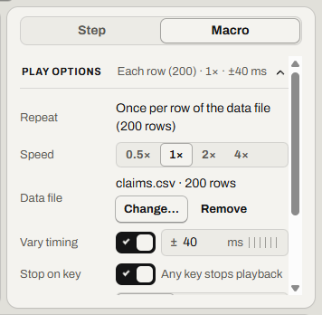
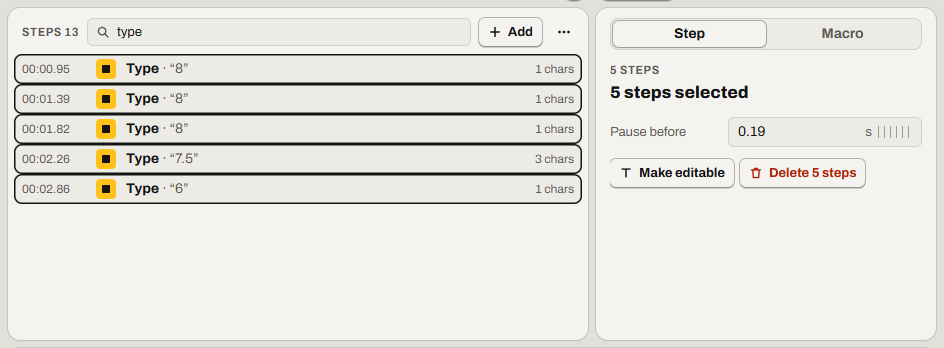

# Fill in a form from a spreadsheet

Play a macro once for each row of a CSV file. Relay calls this file a data file.

Find it: open a macro, then the **Macro** tab (<kbd>Ctrl</kbd>+<kbd>M</kbd>), then **Play options**, then **Data file**.

To stop a macro, press <kbd>Esc</kbd>. Read [Every way to stop a macro](stop-a-macro.md#every-way-to-stop-a-macro).

- [What you need](#what-you-need)
- [Choose the data file](#choose-the-data-file)
- [Turn the typed fields into columns](#turn-the-typed-fields-into-columns)
- [Try it on three rows first](#try-it-on-three-rows-first)
- [Continue from the row that failed](#continue-from-the-row-that-failed)
- [Good to know](#good-to-know)
- [Not possible yet](#not-possible-yet)

## What you need

- A CSV file whose first row has the column names. Commas, semicolons or tabs can separate the values. In Excel, use **Save As**, then CSV.
- A macro that fills in one entry and selects **Submit**. Read [Start and stop a recording](record.md#start-and-stop-a-recording).
- After **Submit**, a **Wait for pixel** step that waits for the website. Read [Wait until a window or page is ready](wait.md#wait-until-a-window-or-page-is-ready). If the website is slow, set a longer time in **Gives up after**.

More detail: [Data files: the CSV format](../spec/data-files.md#the-csv-format)

## Choose the data file

1. In **Play options**, under **Data file**, select **Choose…**.
2. Select your file.

If it worked, **Data file** shows the file name and the number of rows, for example *claims.csv · 200 rows*. The button is now **Change…**.

More detail: [Data files: one run per row](../spec/data-files.md#one-run-per-row)

## Turn the typed fields into columns

1. In **Find a step** (<kbd>Ctrl</kbd>+<kbd>F</kbd>), type `type`.
2. Select the first step, then press <kbd>Ctrl</kbd>+<kbd>A</kbd>. Relay selects only the steps it found.
3. In the **Step** tab, select **Make editable**. The steps become Text steps.
4. Clear **Find a step**.
5. In each Text step, clear the **Text** field. Then select the column's button under it, for example `{col:Amount}`.

If it worked, each Text step shows *Types now: “…”* with the first row's value.

More detail: [Data files: columns in Text steps](../spec/data-files.md#columns-in-text-steps)

## Try it on three rows first

1. In Excel, save a copy with only rows 1 to 4. That is the column names and 3 entries.
2. In Relay, select **Change…**, then select the copy.
3. Select **Play**.
4. If the website has 3 correct entries, select **Change…**, then select the full file.
5. Select **Play**.

If it worked, select the **Step** tab while the copy plays: **Row** shows *1 of 3*. In [player mode](player.md), the player says *Row 1 / 3*.

## Continue from the row that failed

If a wait times out, Relay stops with this message: *Pixel check timed out at step …; playback stopped.* Read [When the wait gives up](wait.md#when-the-wait-gives-up).

To find the row, open the run from **Problems** in the Library. The failed check names the row, for example *Row 112 of 200 · …*.

Row 112 in Relay is row 113 in Excel, because Excel's row 1 has the column names.

1. On the website, check whether entry 112 was saved.
2. In Excel, keep row 1, with the column names.
3. If entry 112 was saved, delete rows 2 to 113. If it wasn't saved, delete rows 2 to 112.
4. Save the file as CSV, with a new name.
5. In Relay, select **Change…**, then select the new file.
6. Select **Play**.

If it worked, select the **Step** tab while it plays: **Row** starts again at *1*.

More detail: [Data files: rows while playing and in Activity](../spec/data-files.md#rows-while-playing-and-in-activity)

## Good to know

- Relay reads the file each time the macro plays. If you move the file, select **Change…** and select the file again.
- Relay doesn't play if the file is gone or empty.
- Relay doesn't play if it can't read the file. For example, a row has more values than there are columns.
- Relay doesn't play if a Text step uses a column that the file doesn't have.
- In each case, **Data file** and **Play** say why.

More detail: [Data files: when a macro can't play with its file](../spec/data-files.md#when-a-macro-cant-play-with-its-file)

## Not possible yet

- You can't start at a chosen row. Make a shorter file instead.
- You can't set a **Repeat** count for a macro with a data file.

Something not working? Read [Problems while playing](troubleshooting.md#problems-while-playing).

---

Previous: [Type text that changes: date, clipboard, columns](text.md) · Next: [Play, loop and change speed](play.md) · [Guide home](README.md)
