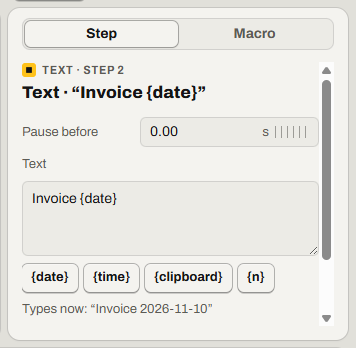

# Type text that changes: date, clipboard, columns

Make a macro type today's date, what you copied, or a column of a [data file](glossary.md#data-file).

Find it: select a **Type** step, then **Make editable**. Or select **Add**, then **Text**.

- [Turn typed text into a Text step](#turn-typed-text-into-a-text-step)
- [Add a new Text step](#add-a-new-text-step)
- [Insert the date, the time or the clipboard](#insert-the-date-the-time-or-the-clipboard)
- [Type a brace](#type-a-brace)
- [Check what it will type](#check-what-it-will-type)
- [Good to know](#good-to-know)
- [Not possible yet](#not-possible-yet)

## Turn typed text into a Text step

Record yourself as you type the text once. Then follow these steps:

1. Select the **Type** step.
2. Select **Make editable**.
3. Change the text in the **Text** field.

If it worked, the steps list shows the step as **Text**.

## Add a new Text step

1. Select the step the new one should come after. Clicking the timeline also moves this point.
2. Select **Add** (<kbd>Insert</kbd> or <kbd>+</kbd>), then **Text**.
3. Type the text in the **Text** field.

If it worked, the steps list shows a new **Text** step.

## Insert the date, the time or the clipboard

A placeholder is a word in braces, like `{date}`. Relay replaces it with a value as the macro plays. Type the placeholder, or insert it with the buttons under the **Text** field.

| Placeholder | What it types |
| --- | --- |
| `{date}` | Today's date: `2026-10-01` |
| `{time}` | The time: `14:05:09` |
| `{clipboard}` | The text on the clipboard |
| `{n}` | The repeat number: 1, 2, 3, and so on. With a data file, the row number. |
| `{col:Name}` | The value in the *Name* column of the data file, from this repeat's row |

More detail: [Text steps: placeholders](../spec/text-steps.md#placeholders)

## Type a brace

To type a brace, type it twice. `{{` types `{`. `}}` types `}`.

More detail: [Text steps: braces](../spec/text-steps.md#braces)

## Check what it will type

The line under the buttons starts with *Types now*. It shows what the first repeat types. Screen readers read the line each time it changes.

If it worked, *Types now* shows today's date in place of `{date}`.

More detail: [Text steps: the Types now line](../spec/text-steps.md#the-types-now-line)

## Good to know

- If the clipboard has no text, `{clipboard}` types nothing. The macro continues and shows no warning.
- A **Text** step types the same characters with any keyboard layout.
- If the text has a mistake, like `{name}`, a description of the mistake shows in place of *Types now*. Relay saves the text only after you fix it.
- A long text makes the step last longer.
- A macro with a **Text** step opens only in Relay 1.5 or later.

More detail: [Text steps: version compatibility](../spec/text-steps.md#version-compatibility)

## Not possible yet

- A date format other than `2026-10-01`. If someone watches the run, copy a date and use `{clipboard}`. For a run nobody watches, there is no workaround.

Something not working? Read [Problems while playing](troubleshooting.md#problems-while-playing).

---

Previous: [Click a picture wherever it is](find-image.md) · Next: [Fill in a form from a spreadsheet](spreadsheet.md) · [Guide home](README.md)
