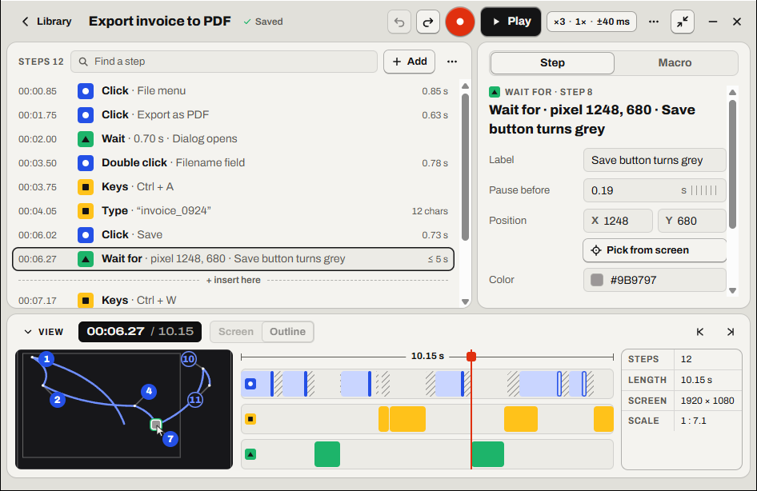

# Make a macro wait

Make a macro wait for a slow program or page, so it doesn't click too early.

Find it: open a macro, then **Add** (<kbd>Insert</kbd>), then **Wait** or **Wait for pixel**.

- [Which wait do you need?](#which-wait-do-you-need)
- [Wait a few seconds](#wait-a-few-seconds)
- [Wait until a window or page is ready](#wait-until-a-window-or-page-is-ready)
- [Choose a pixel that works](#choose-a-pixel-that-works)
- [When the wait gives up](#when-the-wait-gives-up)
- [Good to know](#good-to-know)

## Which wait do you need?

| What to wait for | What to add |
| --- | --- |
| A fixed time | **Wait** |
| Until a pixel shows a color | **Wait for pixel** |
| Until a picture shows, then click it | [**Find image**](find-image.md) |

## Wait a few seconds

1. Select the step the new one should come after. Clicking the timeline also moves this point.
2. Select **Add**, or press <kbd>Insert</kbd> while the steps list has the focus. Then select **Wait**. The new step goes after the selected step, at the line **+ insert here**.
3. Select the new **Wait** step.
4. In **Waits**, type the number of seconds, then press <kbd>Enter</kbd>.

If it worked, the steps list shows *Wait · 2.00 s · Inserted*, with your number.

## Wait until a window or page is ready

Add a **Wait for pixel** step when the app needs a different time on each run. If the time is always the same, a **Wait** step is enough.

1. Select the step the new one should come after. Clicking the timeline also moves this point.
2. Select **Add**, or press <kbd>Insert</kbd> while the steps list has the focus. Then select **Wait for pixel**.
3. Open the other app. Make it show the color to wait for.
4. Select the new **Wait for** step, then **Pick from screen**. A magnifier shows at once, with no countdown.
5. Move the magnifier to the pixel with the mouse or the arrow keys. Each arrow key press moves 1 pixel. With <kbd>Shift</kbd>, it moves 10 pixels.
6. If the color shows only while the mouse is over it, press <kbd>Space</kbd> to freeze the screen.
7. Press <kbd>Enter</kbd>, or click the pixel. To cancel, press <kbd>Esc</kbd>, or right-click.

If it worked, Relay says *Picked 1248, 680 · #EC3013*, with your numbers.

More detail: [Pixel checks: Pick from screen](../spec/pixel-checks.md#pick-from-screen)

## Choose a pixel that works

A good pixel changes color when the app is ready.

- Choose an area that has only one color, for example a title bar.
- Avoid the edges of text and icons.
- Avoid anything that blinks or moves.
- Avoid places that Relay's window or the [player](glossary.md#player) covers.

More detail: [Pixel checks: choosing a good pixel](../spec/pixel-checks.md#choosing-a-good-pixel)

## When the wait gives up

If the pixel doesn't show its color in time, the macro stops. Relay says *Pixel check timed out at step …*. The step's **Step** tab says *Timed out in the last run: …*. The [playhead](glossary.md#playhead) stays on that step.

For a slow website or app, increase **Gives up after**. If the app was ready, choose a better pixel or increase **Tolerance**.

More detail: [Pixel checks: when the timeout runs out](../spec/pixel-checks.md#when-the-timeout-runs-out)

## Good to know

- **Tolerance**: 8 by default. A value from 16 to 32 accepts small color changes.
- **Gives up after**: 5 s by default. The lowest value is 0.5 s.

Something not working? Read [Problems with waits and pictures](troubleshooting.md#problems-with-waits-and-pictures).

---

Previous: [Edit the steps](edit-steps.md) · Next: [Click a picture wherever it is](find-image.md) · [Guide home](README.md)
