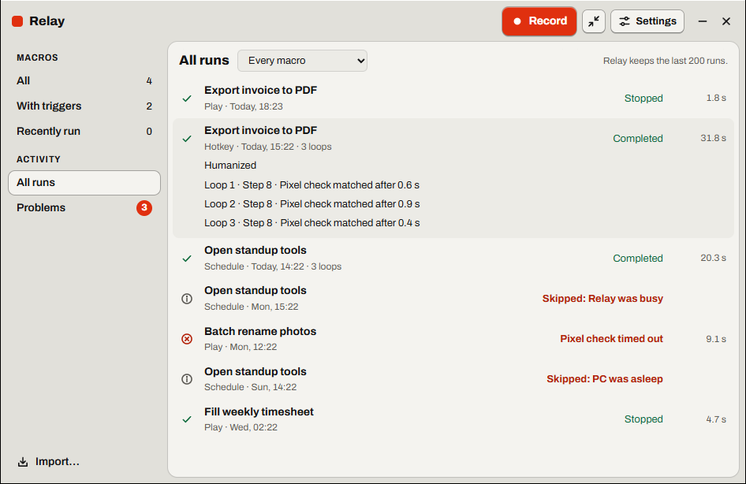
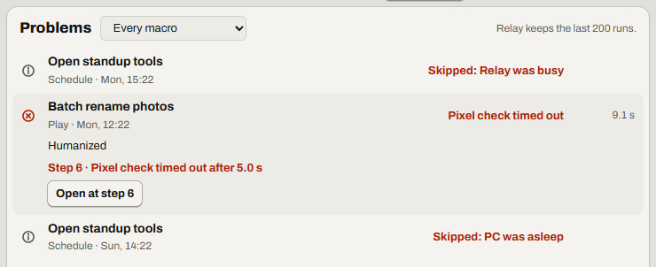

# Did it run? See what ran and what failed

Check that your macros ran, and find where a run failed.

Find it: the Library, then **All runs** or **Problems**. For one macro: **More for …**, then **Runs**.

- [See when a macro last ran](#see-when-a-macro-last-ran)
- [Open the run history](#open-the-run-history)
- [Find the step that failed](#find-the-step-that-failed)
- [Find the row that failed](#find-the-row-that-failed)
- [See why a run was skipped](#see-why-a-run-was-skipped)
- [Good to know](#good-to-know)
- [Not possible yet](#not-possible-yet)

## See when a macro last ran

The **Last run** column shows when the macro last played to the end, or *Never*. Its mark shows how the latest run or skip ended, which can be later. A green check mark means *Completed* or *Stopped*. A red circle with a cross means any other end.

## Open the run history

1. Select **All runs**.
2. For one macro, select it in **Show the runs of**.
3. Select a run.

If it worked, the run shows what started it and how it ended: *Hotkey*, *Completed*. *Humanized* means **Vary timing** was on.

## Find the step that failed

1. Select **Problems** for failed and skipped runs.
2. Select the run. Each check shows its duration, even one that passed: *Step 4 · Pixel check matched after 1.2 s*.
3. Select **Open at step …**.

If it worked, the macro opens on that step, marked *Timed out*. Read [When the wait gives up](wait.md#when-the-wait-gives-up) or [When the picture isn't found](find-image.md#when-the-picture-isnt-found).

More detail: [Library and Activity: Activity and Problems](../spec/library.md#activity-and-problems)

## Find the row that failed

With a [data file](glossary.md#data-file), each check names its row: *Row 2 of 12 · Step 6*. Read [Continue from the row that failed](spreadsheet.md#continue-from-the-row-that-failed).

## See why a run was skipped

When a [trigger](glossary.md#trigger) doesn't run its macro, Activity shows a skip (a circle with an *i*) and why:

- *Skipped: Relay was busy*: Relay was recording or playing.
- *Skipped: screen locked*: Relay shows no message.
- *Skipped: PC was asleep*: the PC slept through a scheduled run.
- *Skipped: data file*: select the skip to read the problem.

## Good to know

- Relay keeps the last 200 runs, and up to 50 checks for each run.
- If Relay quits during a run, that run is lost.

## Not possible yet

- Windows notifications for failed runs. Check **Problems** instead. [Sounds](accessibility.md#hear-when-recording-starts-and-stops) help only at the PC.
- Runs of standalone programs. They report only an [exit code](scripts.md#exit-codes).

Something not working? Read [Problems with keys and triggers](troubleshooting.md#problems-with-keys-and-triggers).

---

Previous: [Run a macro automatically](run-automatically.md) · Next: [Find, share and back up macros](library.md) · [Guide home](README.md)
